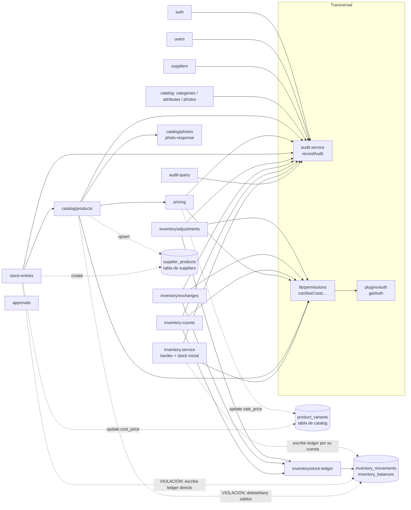

# 02 · Arquitectura, estructura y operación

> **Informe técnico de Joyería Sole — parte 02.**
> Fecha de la revisión: 2026-11-06 · Rama `feature/f1-productos-detalle` (ya integrada en `main`).
> Método: lectura estática del código y de la documentación del repositorio. **No se ejecutaron
> pruebas, Docker ni la aplicación**; todo lo que se afirma como «verificado» se comprobó leyendo el
> archivo citado (formato `ruta:línea`). Lo que no pudo comprobarse así se marca como _no verificado_.
> Las cuatro auditorías previas (BD, backend, seguridad, frontend; resumen de 2026-11-06) se tomaron
> como lista de hallazgos, pero **cada uno se volvió a contrastar con el código actual**: varios ya
> están corregidos y se indican como tales.

---

## Índice

1. [Visión y estilo arquitectónico](#1-visión-y-estilo-arquitectónico)
2. [Árbol del repositorio](#2-árbol-del-repositorio-comentado)
3. [Backend](#3-backend-appsapi)
4. [Paquete compartido](#4-paquete-compartido-packagesshared)
5. [Frontend (nivel arquitectura)](#5-frontend-appsweb-nivel-arquitectura)
6. [Seguridad como arquitectura](#6-seguridad-como-arquitectura)
7. [Operación](#7-operación)
8. [Rendimiento y escalabilidad](#8-rendimiento-y-escalabilidad)
9. [Dependencias](#9-dependencias)
10. [Evaluación crítica](#10-evaluación-crítica)
11. [Anexo: deriva de la documentación y huecos de verificación](#11-anexo-deriva-de-la-documentación-y-huecos-de-verificación)

---

## 1. Visión y estilo arquitectónico

### 1.1 Resumen en una frase

Un **monolito modular** en un **monorepo npm workspaces** que se despliega como **un único contenedor**:
la API (Fastify) sirve también la SPA (React) compilada, de modo que navegador y API comparten
**origen**; la persistencia es **una sola base PostgreSQL** (fuente de verdad, incluidas las fotos).

### 1.2 Diagrama de despliegue

```
 Navegador (PC / móvil) ── lector de códigos = teclado (texto + Enter, sin drivers)
        │  HTTPS (TLS terminado por el hosting / Cloudflare)
        ▼
┌──────────────────────────────────────────────────────────────────┐
│ UN contenedor Node 22 (alpine, usuario `node`, puerto 3000)       │
│                                                                    │
│  Fastify 5                                                         │
│   ├─ GET /                  → SPA compilada (fastify-static)       │
│   │   GET /<ruta SPA>       → index.html (fallback, solo GET)      │
│   └─ /api/v1/*  (101 endpoints, 19 grupos de rutas)                │
│        helmet → CORS → rate-limit → Origin/CSRF → Zod → auth/RBAC  │
│        → handler → service ($transaction + recordAudit) → Prisma   │
└──────────────────────────────────────────────────────────────────┘
        │ TLS (adaptador `pg`, pool por defecto)
        ▼
 PostgreSQL 18  (34 tablas, 15 enums, 17 migraciones, triggers append-only, CHECK, pg_trgm)
        │
        └─► backup externo (pg_dump cifrado → R2/S3) — DOCUMENTADO, NO IMPLEMENTADO (ver §7.7)
```

### 1.3 Por qué este estilo (y qué alternativas se descartaron)

| Decisión                                      | Razón (evidencia)                                                                                                                                                                                    | Alternativa descartada                | Consecuencia                                                                                                                                                                |
| --------------------------------------------- | ---------------------------------------------------------------------------------------------------------------------------------------------------------------------------------------------------- | ------------------------------------- | --------------------------------------------------------------------------------------------------------------------------------------------------------------------------- |
| Monolito modular                              | Pyme, pocos usuarios, un equipo pequeño (`docs/architecture/ARCHITECTURE.md`, ADR-011). Una unidad de despliegue, transacciones ACID entre módulos (ingreso + stock + auditoría en una transacción). | Microservicios / NestJS               | Los módulos comparten proceso y BD: el aislamiento es **por convención**, no por frontera técnica (ver §3.8, §10 R-01).                                                     |
| Monorepo con workspaces                       | Contratos (`@joyeria/shared`) compartidos sin publicar paquetes; un solo `npm ci`, un solo CI.                                                                                                       | Repos separados / paquete npm privado | `shared` se publica como **TypeScript sin compilar** (`packages/shared/package.json` `exports: ./src/index.ts`); cada consumidor lo compila (Vite, tsx, tsup `noExternal`). |
| Un contenedor, mismo origen                   | La cookie de sesión es `SameSite=Strict` y `__Host-`: exige mismo sitio y sin `Domain`. Sin CORS en la práctica. Menor costo y menos piezas (ADR-012, `app.ts:140-146`).                             | SPA en CDN/Vercel + API aparte        | Un solo punto de falla; la SPA no se cachea en CDN por sí misma (depende de Cloudflare/Render).                                                                             |
| Sesiones en servidor (no JWT)                 | Revocación inmediata, nada de tokens en JS (ADR-003).                                                                                                                                                | JWT en localStorage                   | Una consulta a BD por petición autenticada (ya optimizada a una sola, §3.3).                                                                                                |
| Libro de movimientos + saldos                 | Auditabilidad y reconciliación del stock (ADR-007).                                                                                                                                                  | Campo `stock` editable                | Todo cambio de stock es una escritura doble (movimiento + saldo) dentro de una transacción.                                                                                 |
| PostgreSQL como único almacén (incluye fotos) | Menos infraestructura; backup único (ADR-020; fotos en `product_photo_blobs`, detrás de la interfaz `PhotoStorage`).                                                                                 | S3/R2 desde el día 1                  | La BD y los backups crecen con las fotos (acotado: ≤ 5 fotos/producto, ≤ 1200 px, WebP).                                                                                    |
| Prisma 7 + adaptador `pg`                     | Migraciones versionadas, cliente tipado (ADR-002). SQL crudo (`$queryRaw` con plantilla etiquetada) donde hace falta `FOR UPDATE`/`array_agg`.                                                       | Drizzle, TypeORM                      | Prisma no expresa algunos índices/triggers: viven en SQL a mano dentro de las migraciones.                                                                                  |

### 1.4 Principios arquitectónicos vigentes (de `CLAUDE.md` y los ADR)

1. Stock **por variante**, nunca por producto (ADR-001).
2. Stock **nunca se edita**: todo cambio = movimiento append-only + saldo, **en la misma transacción** (ADR-007).
3. Auditoría en la misma transacción que la operación (ADR-010).
4. Autorización **siempre por permiso**, nunca por nombre de rol (ADR-004; `packages/shared/src/permissions.ts:4-6`).
5. Capas: `routes → service → prisma`; las rutas no contienen lógica (verificado: la única ruta que toca `prisma` es `health.routes.ts:20`, `SELECT 1`).
6. Nada de reglas de negocio pendientes (P-xx) convertidas en reglas sin aprobación.

---

## 2. Árbol del repositorio (comentado)

> Verificado con listados de directorio. `node_modules/`, `dist/` y `apps/api/src/generated/`
> (cliente Prisma regenerable) **no están versionados** (`.gitignore`).

```
joyeriaSole/
├── CLAUDE.md                     Reglas del proyecto para agentes/desarrolladores (reglas de negocio, NO hacer)
├── AGENTS.md                     Equivalente para agentes Codex
├── README.md · CONTRIBUTING.md · CHANGELOG.md (Keep a Changelog, sección «Sin publicar»)
├── package.json                  Raíz del monorepo: workspaces ["packages/*","apps/*"], scripts, lint-staged, devDeps comunes
├── package-lock.json             Lockfile (el Dockerfile y el CI usan `npm ci`)
├── tsconfig.base.json            TS estricto (noUncheckedIndexedAccess, verbatimModuleSyntax, allowImportingTsExtensions…)
├── eslint.config.js              ESLint 10 + typescript-eslint strictTypeChecked + react-hooks; sin reglas de límites entre módulos
├── .prettierrc.json · .prettierignore · .editorconfig · .gitattributes · .nvmrc (Node)
├── .dockerignore                 Excluye node_modules, docs, .claude, .env*, Dockerfile, compose…
├── Dockerfile                    Imagen de producción multi-etapa (deps → build → prod-deps → runtime)
├── docker-compose.yml            Dev: solo PostgreSQL 18; perfil `prod` opcional con la imagen de la app
├── .env.example                  Plantilla de variables (el `.env` real vive en la RAÍZ y no se versiona)
│
├── .github/
│   ├── workflows/ci.yml          CI: job `quality` (lint, format, tipos, migraciones, tests, build, E2E) + job `docker`
│   └── pull_request_template.md
├── .husky/                       pre-commit = lint-staged · pre-push = typecheck
├── .vscode/                      settings/extensions/launch/tasks compartidos
├── .claude/                      Agentes (8: architecture, backend, database, devops, documentation, frontend, security, testing) y skills
├── .agents/skills/               12 skills `sole-*` (api, bd, deploy, docs, frontend, git, dominio, arquitectura, evaluación, seguridad, entrega, testing)
├── .codex/agents/                10 definiciones de agentes Codex (`sole-*.toml`)
│
├── scripts/
│   ├── qa.mjs                    QA hermético: PostgreSQL efímero en Docker + `check` y/o E2E (no toca el `.env`)
│   ├── local-deploy.mjs          Despliegue LOCAL completo (up/down/status/logs/reset; modos docker|node; --demo)
│   └── db-init/01-create-test-db.sh   Crea la BD `joyeria_test` al inicializar el volumen de Postgres (dev)
│
├── apps/
│   ├── api/                      @joyeria/api — Fastify 5 + TypeScript + Prisma 7
│   │   ├── package.json · tsconfig.json · vitest.config.ts (proyectos `unit` e `integration`)
│   │   ├── tsup.config.ts        Bundle ESM único (`dist/server.js`), `noExternal: ['@joyeria/shared']`, sin sourcemaps
│   │   ├── prisma.config.ts      Esquema, migraciones y `seed: tsx prisma/seed.ts`; carga `../../.env` si existe
│   │   ├── prisma/
│   │   │   ├── schema.prisma     Modelo de datos (34 modelos, 15 enums)
│   │   │   ├── migrations/       17 migraciones SQL versionadas + migration_lock.toml
│   │   │   ├── seed.ts           Seed idempotente ESTRUCTURAL (permisos, roles, admin inicial, atributos base, motivos, tipos de costo)
│   │   │   └── seed-demo.ts      Datos DEMO (3 usuarios, productos y stock ficticios) — solo desarrollo/E2E
│   │   ├── src/
│   │   │   ├── server.ts         Arranque, apagado ordenado (SIGINT/SIGTERM → app.close())
│   │   │   ├── app.ts            `buildApp(env)`: Fastify + plugins + 19 grupos de rutas + estáticos (lo usan también los tests)
│   │   │   ├── config/env.ts     Variables de entorno validadas con Zod (falla al arrancar)
│   │   │   ├── lib/              errors · password (Argon2id) · tokens · prisma · permissions (costos/notas) · sku
│   │   │   ├── plugins/          error-handler · security · prisma · auth
│   │   │   ├── modules/          11 carpetas de módulo (§3.6): auth users suppliers catalog(+photos) pricing
│   │   │   │                     stock-entries inventory inventory-counts approvals audit health
│   │   │   └── generated/prisma/ Cliente Prisma generado (NO versionado)
│   │   └── test/
│   │       ├── helpers/          app (buildTestApp) · db (resetDatabase) · global-setup (migrate deploy) · test-env · images · cost-types
│   │       ├── unit/             16 archivos (costeo, conteos, env, permisos, sku, fechas, ledger puro, imágenes…)
│   │       └── integration/      21 archivos contra PostgreSQL REAL `joyeria_test` (en serie)
│   │
│   └── web/                      @joyeria/web — React 19 + Vite 8 + Tailwind 4 + TanStack Query + React Router 8
│       ├── index.html · vite.config.ts (proxy /api→:3000, sourcemap:false, Vitest jsdom) · playwright.config.ts · tsconfig.json
│       ├── public/favicon.svg
│       ├── src/
│       │   ├── main.tsx          QueryClientProvider + RouterProvider
│       │   ├── app/              router · app-shell (menú por permisos) · lazy-page · query-client · route-error
│       │   ├── components/ui/    button · input · pagination · skeleton · page-loading · full-page-message (sin lógica de negocio)
│       │   ├── lib/              api-client · format (Intl) · paging · use-document-title
│       │   ├── pages/            not-found-page
│       │   ├── features/         adjustments · approvals · audit · auth · catalog(+photos) · dashboard ·
│       │   │                     inventory · inventory-counts · pricing · stock-entries · suppliers · users
│       │   └── test/             setup · render (helpers de pruebas)
│       └── e2e/                  18 especificaciones Playwright (auth, catálogo, ingresos, conteos, ajustes, precios, fotos, auditoría, responsive…)
│
├── packages/
│   └── shared/                   @joyeria/shared — contratos API/web (TypeScript fuente, sin build)
│       └── src/                  index · api · permissions · costing · pricing · dates · reference-types · schemas/ (16 archivos)
│
└── docs/
    ├── README.md · DEVELOPMENT.md
    ├── architecture/ARCHITECTURE.md         Arquitectura (parcialmente desactualizada, ver §11)
    ├── api/API.md · database/DATABASE.md · security/SECURITY.md · testing/TESTING.md
    ├── decisions/                           ADR-001…021 + TEMPLATE + README (índice)
    ├── business/                            PENDIENTES, DOMINIO, RESOLUCIONES-*, DECISIONES-ABIERTAS, cuestionario
    ├── deployment/                          DEPLOYMENT.md · BACKUPS.md · LOCAL.md
    ├── engineering/                         ROADMAP, planes, HARNESS, verificación, análisis de fases
    └── informe-tecnico/                     ESTE informe (partes 01…)
```

**Escala (medida en los archivos):** `apps/api/src/modules` ≈ 8,4 mil líneas en 43 archivos TypeScript
(los tres servicios más grandes: `inventory-counts.service.ts` 1039, `products.service.ts` 969,
`stock-entries.service.ts` 888 líneas). Pruebas: ≈ **735 casos declarados** (`it(`/`test(`; recuento
aproximado por líneas): API ≈ 474 (124 unitarias + 350 de integración), web ≈ 209 de componentes/lógica
y ≈ 52 E2E.

---

## 3. Backend (`apps/api`)

### 3.1 Capas y flujo de una petición

```
Request
 └─ [onRequest] helmet (CSP/HSTS…) → CORS → rate-limit global (300/min/IP) → verificación de Origin (métodos que escriben)
 └─ parseo del cuerpo (JSON ≤ 1 MiB; multipart solo en fotos)
 └─ [preValidation] app.authenticate | requirePermission(...) | requireAnyPermission(...)   ← 401/403 ANTES de validar el cuerpo
 └─ validación Zod de params/query/body (fastify-type-provider-zod)
 └─ handler (routes.ts)   — solo traduce HTTP ↔ servicio
     └─ service (service.ts) — reglas de negocio, prisma.$transaction, bloqueos FOR UPDATE, recordAudit(tx, …)
         └─ Prisma (adaptador pg) → PostgreSQL (triggers/CHECK como última línea de defensa)
 └─ serialización de la respuesta con el esquema Zod `response` ({ data } | { data, meta })
 └─ [onSend] cabecera x-request-id + Cache-Control: no-store en /api/* (salvo imágenes, que fijan la suya)
 └─ error → errorHandler → { error: { code, message, details?, requestId } }
```

Observaciones verificadas:

- Los permisos se aplican en **`preValidation`** (no `preHandler` como dice `CLAUDE.md`), así una petición sin sesión
  recibe 401 sin filtrar detalles de validación (`auth.routes.ts:62`). Excepción justificada: el límite de
  tasa de imágenes se evalúa en `preHandler` para conocer al usuario (`photos.routes.ts:46-51`).
- Las rutas **no** contienen lógica: instancian `new XService(app.prisma)` en el plugin de la ruta
  (inyección manual, sin contenedor).
- **Acoplamiento servicio-HTTP**: los servicios reciben `FastifyRequest` (para `getAuth(request)` y la
  IP/UA de auditoría) e importan `plugins/auth.ts`. Es pragmático, pero impide reutilizarlos tal cual
  desde un job/CLI (ver §10, R-12).

### 3.2 Arranque (`server.ts`, `app.ts`)

| Aspecto            | Valor                                                                                                                                                                                                  | Evidencia                                   |
| ------------------ | ------------------------------------------------------------------------------------------------------------------------------------------------------------------------------------------------------ | ------------------------------------------- |
| Carga de entorno   | `loadEnv()` (Zod) antes de construir la app; si falta algo **no arranca**                                                                                                                              | `server.ts:4`, `env.ts:79-96`               |
| Apagado            | `SIGINT`/`SIGTERM` → `app.close()` (cierra Prisma por hook `onClose`) → `exit(0)`                                                                                                                      | `server.ts:8-19`, `plugins/prisma.ts:15-17` |
| IDs de petición    | `genReqId: randomUUID()`, `requestIdHeader:false` (el cliente no puede imponer el id)                                                                                                                  | `app.ts:78-79`                              |
| `trustProxy`       | función `hop < TRUST_PROXY_HOPS`, nunca `true`                                                                                                                                                         | `app.ts:46-49, 81`                          |
| Límites            | `bodyLimit` 1 MiB; `requestTimeout` y `connectionTimeout` 120 s; `keepAliveTimeout` 65 s                                                                                                               | `app.ts:37-39, 82-88`                       |
| Logger             | pino; `redact` de `authorization`, `cookie`, `set-cookie`, `*.password`, `*.passwordHash`, `*.token`; `pino-pretty` solo en `development`                                                              | `app.ts:51-73`                              |
| Avisos de arranque | `COOKIE_SECURE=false` en producción → `warn`                                                                                                                                                           | `env.ts:64-73`                              |
| Estáticos          | Si `WEB_DIST_DIR` apunta a una carpeta con `index.html`: `@fastify/static` (`wildcard:false`) + `setNotFoundHandler` que devuelve `index.html` solo para `GET` no-API; si no, 404 JSON con `requestId` | `app.ts:142-156`                            |

### 3.3 Plugins: orden de registro y responsabilidad

Registro en `app.ts:105-108` (todos con `fastify-plugin`, o sea **globales**, no encapsulados):

| #   | Plugin          | Archivo                    | Qué hace                                                                                                                                                                                                                                                                                                                                                                                                                                                                                                                                                     | Dependencias |
| --- | --------------- | -------------------------- | ------------------------------------------------------------------------------------------------------------------------------------------------------------------------------------------------------------------------------------------------------------------------------------------------------------------------------------------------------------------------------------------------------------------------------------------------------------------------------------------------------------------------------------------------------------ | ------------ |
| 1   | `error-handler` | `plugins/error-handler.ts` | Único `setErrorHandler`. Formato `{ error:{ code, message, details?, requestId } }`. Mapea: `AppError` → su código; errores de validación Zod → 400 con `details[{field,message}]`; **conflictos transitorios de BD** (`P2034`, `P2028`, SQLSTATE `40P01`/`40001`) → **503 + `Retry-After: 2`**; Prisma `P2002`→409, `P2003`→422, `P2025`→404; multipart demasiado grande → 413; 429 → `RATE_LIMITED`; otros 4xx de Fastify → 400 «Solicitud inválida»; todo lo demás → 500 genérico (el detalle solo al log). Nunca expone stack/SQL.                       | —            |
| 2   | `security`      | `plugins/security.ts`      | **helmet** (CSP, HSTS solo en producción), **CORS** con lista blanca (`CORS_ORIGIN` + origen de `FRONTEND_URL`), **cookie** firmada con `AUTH_SECRET`, **rate-limit** global 300/min/IP, hook **`onRequest` anti-CSRF**: en `POST/PUT/PATCH/DELETE`, si llega `Origin` y no está en la lista → 403 «Origen no permitido».                                                                                                                                                                                                                                    | —            |
| 3   | `prisma`        | `plugins/prisma.ts`        | Crea el cliente (`createPrismaClient`: adaptador `PrismaPg`, `transactionOptions {timeout 30 s, maxWait 10 s}`), `$connect()` al arrancar (fallar rápido si no hay BD), decora `app.prisma`, `$disconnect()` en `onClose`.                                                                                                                                                                                                                                                                                                                                   | —            |
| 4   | `auth`          | `plugins/auth.ts`          | Decora `sessionCookie`, `request.auth`, `authenticate`, `requirePermission(...todos)`, `requireAnyPermission(...alguno)`. Resuelve la sesión: cookie firmada → `unsignCookie` → **una sola consulta SQL** (`loadSessionUser`) que une `sessions→users→user_roles→roles→role_permissions→permissions` y devuelve solo columnas necesarias (nunca `passwordHash`). Descarta si revocada, vencida o usuario inactivo. Refresca `last_seen_at` como máximo cada 5 min. Con `mustChangePassword` responde 403 `PASSWORD_CHANGE_REQUIRED` en todo salvo `/auth/*`. | `prisma`     |

Notas de diseño:

- **Sin caché de sesión**: una consulta por petición autenticada. Esto da revocación y cambios de
  permisos **inmediatos** (decisión de seguridad, `auth.ts:78-80`), a costa de un viaje a BD por request.
- `GET /health` y `POST /auth/login` son las únicas rutas sin guarda de sesión (verificado por el listado
  de `preValidation` en todos los `*.routes.ts`).
- Cookie: `sid` (dev) o **`__Host-sid`** (si `COOKIE_SECURE`), `httpOnly`, `SameSite=Strict`, `Path=/`, firmada,
  `expires` = expiración de sesión; el borrado usa los mismos atributos (`auth.ts:117-143`).
- El hook `onSend` global añade `x-request-id` y `Cache-Control: no-store` a todo `/api/*` que no fije el suyo
  (`app.ts:94-101`).

### 3.4 Configuración: `config/env.ts` — **todas** las variables

Validadas con Zod al arrancar. Las que consume la API (`envSchema`):

| Variable               | Tipo                                 | Default                                        | Obligatoria | Propósito                                                                                                                                        |
| ---------------------- | ------------------------------------ | ---------------------------------------------- | ----------- | ------------------------------------------------------------------------------------------------------------------------------------------------ |
| `NODE_ENV`             | enum `development\|test\|production` | `development`                                  | no          | Modo. Activa `COOKIE_SECURE` por defecto, HSTS y desactiva `pino-pretty` fuera de `development`.                                                 |
| `LOG_LEVEL`            | enum `fatal…trace\|silent`           | `info`                                         | no          | Nivel de pino.                                                                                                                                   |
| `DATABASE_URL`         | URL `postgres(ql)://`                | —                                              | **sí**      | Conexión a PostgreSQL.                                                                                                                           |
| `API_HOST`             | string                               | `0.0.0.0`                                      | no          | Interfaz de escucha (la imagen la fija en `0.0.0.0`; el despliegue local en `127.0.0.1`).                                                        |
| `API_PORT`             | entero > 0                           | `3000`                                         | no          | Puerto. Si no está, se usa `PORT` (Render/Railway); `API_PORT` explícito gana (`env.ts:88`).                                                     |
| `CORS_ORIGIN`          | lista separada por comas             | `http://localhost:5173`                        | no          | Orígenes permitidos por CORS y por la verificación anti-CSRF.                                                                                    |
| `FRONTEND_URL`         | URL                                  | `http://localhost:5173`                        | no          | URL pública del frontend; su `origin` se suma a la lista permitida.                                                                              |
| `AUTH_SECRET`          | string ≥ 32                          | —                                              | **sí**      | Firma de la cookie de sesión.                                                                                                                    |
| `SESSION_TTL_HOURS`    | entero, **debe ser 8**               | `8`                                            | no          | Sesión fija de 8 h sin extensión por actividad (P-19, ADR-003). Cualquier otro valor invalida el arranque.                                       |
| `LOGIN_RATE_LIMIT_MAX` | entero 1–10 000                      | `10`                                           | no          | Intentos por IP cada 15 min en `/auth/login` y `/auth/change-password`. Solo el E2E lo sube (1000).                                              |
| `COOKIE_SECURE`        | `'true'\|'false'`                    | `true` si `NODE_ENV=production`, si no `false` | no          | Atributo `Secure` y prefijo `__Host-`; también activa `upgrade-insecure-requests` en la CSP.                                                     |
| `TRUST_PROXY_HOPS`     | entero 0–5                           | `0`                                            | no          | Nº de proxies propios cuyo `X-Forwarded-For` se acepta, contado desde el último salto. **`TRUST_PROXY=true` (antiguo) hace fallar el arranque.** |
| `WEB_DIST_DIR`         | string                               | —                                              | no          | Carpeta del frontend compilado; si contiene `index.html` la API lo sirve (la imagen usa `/app/web`).                                             |

Variables **fuera del esquema** de la API (las leen scripts, compose, seed o pruebas; no las valida `env.ts`):

| Variable                                                                                        | Quién la usa                              | Propósito                                                                                                          |
| ----------------------------------------------------------------------------------------------- | ----------------------------------------- | ------------------------------------------------------------------------------------------------------------------ |
| `PORT`                                                                                          | `env.ts:88`                               | Alias inyectado por el hosting para `API_PORT`.                                                                    |
| `TRUST_PROXY`                                                                                   | `env.ts:81`                               | Solo para **rechazar** el valor `true` (ruptura de compatibilidad).                                                |
| `POSTGRES_USER` / `POSTGRES_PASSWORD` (**obligatoria**, `:?`) / `POSTGRES_DB` / `POSTGRES_PORT` | `docker-compose.yml`                      | Credenciales y puerto (por defecto `joyeria`, `joyeria_dev`, `5434`) del Postgres de desarrollo.                   |
| `APP_PORT`                                                                                      | compose perfil `prod`, `local-deploy.mjs` | Puerto del host para la imagen de producción local (8080).                                                         |
| `TEST_DATABASE_URL`                                                                             | tests, E2E, `qa.mjs`                      | BD de pruebas. Salvaguarda: solo `localhost`/`127.0.0.1`, BD `joyeria_test`, `schema=public` (`test-env.ts:3-26`). |
| `SEED_ADMIN_EMAIL` / `SEED_ADMIN_NAME` / `SEED_ADMIN_PASSWORD`                                  | `seed.ts`                                 | Administrador inicial (omitido si faltan; clave ≥ `PASSWORD_MIN_LENGTH`).                                          |
| `DEMO_USER_PASSWORD`                                                                            | `seed-demo.ts`                            | Clave de los 3 usuarios demo (≥ 10 caracteres).                                                                    |
| `E2E_API_PORT` / `E2E_WEB_PORT`                                                                 | `playwright.config.ts`                    | Puertos del E2E (3001 / 5174) para correr varios worktrees a la vez.                                               |
| `API_PROXY_TARGET`                                                                              | `vite.config.ts`                          | Destino del proxy `/api` en desarrollo (por defecto `http://localhost:3000`).                                      |
| `CI`                                                                                            | Playwright                                | Activa reintentos y reporter `github`.                                                                             |

### 3.5 `lib/*`

| Archivo          | Responsabilidad                                                                                                                                                                                                                                                                                                                                                                       |
| ---------------- | ------------------------------------------------------------------------------------------------------------------------------------------------------------------------------------------------------------------------------------------------------------------------------------------------------------------------------------------------------------------------------------- |
| `errors.ts`      | Jerarquía `AppError(statusCode, code, message, details)`: `ValidationError`(400), `UnauthenticatedError`(401), `ForbiddenError`(403), `NotFoundError`(404), `ConflictError`(409), `BusinessRuleError`(422, admite código propio p. ej. `STOCK_BLOCKS_DEACTIVATION`), `PayloadTooLargeError`(413), `PasswordChangeRequiredError`(403). Los `ErrorCode` provienen de `@joyeria/shared`. |
| `password.ts`    | **Argon2id** (`@node-rs/argon2`), 19 MiB / timeCost 2 / paralelismo 1 (recomendación OWASP). Un hash corrupto verifica como `false`.                                                                                                                                                                                                                                                  |
| `tokens.ts`      | Token de sesión opaco de 256 bits (`randomBytes(32).base64url`); en BD solo `sha256(token)`.                                                                                                                                                                                                                                                                                          |
| `prisma.ts`      | `createPrismaClient(url)` con `PrismaPg` y `TRANSACTION_OPTIONS = {timeout:30 000, maxWait:10 000}` (Prisma usa 5 s/2 s por defecto). **No configura el pool** (`max`, timeouts de conexión): usa los valores por defecto de `pg`.                                                                                                                                                    |
| `permissions.ts` | Fuente única de «¿puede ver costos?» (`costs:read`) y «¿puede ver notas de movimientos?» (`inventory:adjust`, `stock-entries:read` o `audit:read`). Depende de `plugins/auth.ts` (inversión de capa menor).                                                                                                                                                                           |
| `sku.ts`         | `skuCandidates(code)`: búsqueda de SKU por igualdad exacta (aprovecha el índice único) en vez de `ILIKE`.                                                                                                                                                                                                                                                                             |

### 3.6 Patrón de módulo y catálogo completo de módulos

Patrón: `modules/<área>/<área>.routes.ts` (esquemas Zod de `params/query/body/response`,
`preValidation` con permiso, delegación) + `<área>.service.ts` (clase con `PrismaClient`, transacciones,
`recordAudit(tx,…)`) + auxiliares puros (`count-logic.ts`, `stock-ledger.ts`, `audit-redaction.ts`,
`image-processing.ts`…). Los esquemas que comparte la UI viven en `@joyeria/shared`, no en el módulo.

**Todos los módulos (101 endpoints), con prefijo `/api/v1`:**

| Módulo (carpeta)     | Prefijo(s)                                                                | Endpoints | Responsabilidad                                                                                                                                                                                               | Tablas que ESCRIBE                                                                                                                                                                                                                      | Permisos (lectura / escritura)                                                             |
| -------------------- | ------------------------------------------------------------------------- | --------- | ------------------------------------------------------------------------------------------------------------------------------------------------------------------------------------------------------------- | --------------------------------------------------------------------------------------------------------------------------------------------------------------------------------------------------------------------------------------- | ------------------------------------------------------------------------------------------ |
| `health`             | `/health`                                                                 | 1         | Estado de la API y de la BD (`SELECT 1`; 503 si cae). Límite 60/min.                                                                                                                                          | —                                                                                                                                                                                                                                       | público                                                                                    |
| `auth`               | `/auth`                                                                   | 4         | login, logout, `me`, cambio de contraseña. Revoca todas las sesiones al cambiar clave. Anti-enumeración (hash ficticio).                                                                                      | `sessions`, `users` (último login, clave, `must_change_password`), `audit_logs`                                                                                                                                                         | sesión (sin permiso específico)                                                            |
| `users`              | `/users`                                                                  | 7         | CRUD de usuarios, activar/desactivar, restablecer clave temporal, asignar roles, listar roles. Protege al último ADMIN; solo un ADMIN toca/crea ADMIN.                                                        | `users`, `user_roles`, `sessions` (revocación), `audit_logs`                                                                                                                                                                            | `users:read` / `users:manage` (+`roles:manage` para alta y roles)                          |
| `suppliers`          | `/suppliers`                                                              | 4         | Proveedores (perfil v2, moneda, tipo).                                                                                                                                                                        | `suppliers`, `audit_logs`                                                                                                                                                                                                               | `suppliers:read` / `suppliers:manage`                                                      |
| `catalog/categories` | `/categories`                                                             | 5         | Árbol de categorías y atributos por categoría (ADR-005).                                                                                                                                                      | `categories`, `category_attributes`, `audit_logs`                                                                                                                                                                                       | `catalog:read` / `catalog:manage`                                                          |
| `catalog/attributes` | `/attributes`                                                             | 5         | Definiciones de atributos y opciones (ADR-006); al renombrar opciones recalcula etiquetas de variantes.                                                                                                       | `attributes`, `attribute_options`, `product_variants` (etiqueta), `audit_logs`                                                                                                                                                          | `catalog:read` / `catalog:manage`                                                          |
| `catalog/products`   | `/products`, `/catalog/variants`                                          | 13 + 1    | Productos y variantes (ADR-001): alta con variantes/ejes, edición, estado (bloquea desactivar con stock, P-22), eliminación física solo sin historial, búsqueda unificada SKU/código/proveedor.               | `products`, `product_variants`, `product_variant_axes`, `product_attribute_values`, `variant_attribute_values`, `supplier_products` (upsert), `inventory_balances` (**borrado**, ver §3.8), `price_changes` (vía pricing), `audit_logs` | `catalog:read` / `catalog:manage` / `catalog:delete`                                       |
| `catalog/photos`     | `/products/:id/photos…`, `/products/variants/:variantId/cover`            | 7         | Fotos (ADR-020): validación por firma, re-codificado a WebP ≤ 1200 px, ≤ 5 por producto, portada, orden; almacenamiento tras `PhotoStorage` (hoy `product_photo_blobs` bytea). Servidas con ETag y `nosniff`. | `product_photos`, `product_photo_blobs`, `audit_logs`                                                                                                                                                                                   | ver foto: cualquiera de 8 permisos de pantallas con piezas; escribir: `catalog:manage`     |
| `pricing`            | `/pricing`                                                                | 9         | Precios de venta (ADR-018): solicitar / aprobar / rechazar / cambio directo / precio inicial; historial inmutable. **Único camino** que modifica `sale_price` tras el alta.                                   | `price_changes`, `product_variants.sale_price`, `audit_logs`                                                                                                                                                                            | `prices:propose` o `prices:approve` / `prices:propose` / `prices:approve`                  |
| `stock-entries`      | `/stock-entries`, `/stock-entry-cost-types`, `/products/:id/cost-history` | 9 + 3 + 1 | Ingresos de mercadería (ADR-008/013/016): borrador, ítems, costos adicionales, moneda USD, **confirmación única** (prorrateo, último costo, movimientos). Tipos de costo configurables. Historial de costos.  | `stock_entries`, `stock_entry_items`, `stock_entry_costs`, `stock_entry_cost_types`, `supplier_products` (create), `product_variants.cost_price`, **`inventory_movements` + `inventory_balances` (directo, ver §3.8)**, `audit_logs`    | `stock-entries:read/manage/confirm`, `settings:manage`, `costs:read`                       |
| `inventory`          | `/inventory`, `/inventory/adjustments`, `/inventory/exchanges`            | 4 + 8 + 2 | Saldos y kardex; stock inicial; **ajustes con solicitud y aprobación** (ADR-017); **cambios de pieza** como doble movimiento atómico (ADR-019). Aloja el **escritor del libro** `stock-ledger.ts`.            | `inventory_balances`, `inventory_movements`, `inventory_adjustments`, `inventory_adjustment_items`, `audit_logs`                                                                                                                        | `inventory:read` / `inventory:adjust`, `…:adjust-approve`, `…:initial-stock`, `…:exchange` |
| `inventory-counts`   | `/inventory/counts`                                                       | 14        | Inventario físico a ciegas con segundo recuento, lecturas (escaneos), hallazgos, regularización y aprobación (ADR-009/014/021). Al aprobar genera los ajustes **vía `applyStockChanges`**.                    | `inventory_counts`, `inventory_count_items`, `inventory_count_scans`, `inventory_count_findings`, (movimientos vía ledger), `audit_logs`                                                                                                | `inventory-counts:read/manage/approve`                                                     |
| `approvals`          | `/approvals/pending`                                                      | 1         | Contadores de pendientes (ajustes, precios, conteos en revisión) según permisos. Solo lectura.                                                                                                                | —                                                                                                                                                                                                                                       | `requireAnyPermission` (los 3 de aprobar)                                                  |
| `audit`              | `/audit`                                                                  | 3         | Escritura: `recordAudit(db,…)` (la usan todos). Lectura: listado filtrable, acciones/entidades/usuarios, detalle; **redacta** claves sensibles al leer.                                                       | `audit_logs` (insert)                                                                                                                                                                                                                   | `audit:read`                                                                               |

### 3.7 Grafo de dependencias entre módulos (verificado en los `import`)



Lectura del grafo:

- **Sin ciclos entre módulos de negocio.** La única cadena larga es `stock-entries → catalog/products → pricing`.
- `audit` es el sumidero universal (todos los servicios que escriben lo importan): es el módulo más acoplado y,
  correctamente, el más estable (una función de 14 líneas).
- `inventory/stock-ledger.ts` es el **escritor canónico** del libro y lo usan `adjustments`, `exchanges` e
  `inventory-counts` (`count-views.ts` solo importa la constante `MAX_BALANCE`).
- Existen dependencias de **datos** (no de código) entre módulos: `pricing` escribe `product_variants.sale_price`
  (tabla del catálogo), `stock-entries` escribe `product_variants.cost_price` y `supplier_products`
  (tabla de proveedores/catálogo). Están documentadas como «único camino» (pricing) y son aceptables en un
  monolito, pero no hay una API interna que las represente.

### 3.8 Violaciones de límites encontradas (verificadas)

La regla de `CLAUDE.md` / ADR-007 es: _ningún módulo distinto de `modules/inventory` escribe en
`inventory_movements` / `inventory_balances`_.

| Id      | Dónde                                                           | Qué ocurre                                                                                                                                                                                                                                                                                                                                               | Severidad                               | Estado                                                        |
| ------- | --------------------------------------------------------------- | -------------------------------------------------------------------------------------------------------------------------------------------------------------------------------------------------------------------------------------------------------------------------------------------------------------------------------------------------------- | --------------------------------------- | ------------------------------------------------------------- |
| **V-1** | `stock-entries/stock-entries.service.ts:751-783` (`confirm`)    | Reimplementa el ledger: `INSERT … ON CONFLICT` de saldo, `SELECT … FOR UPDATE`, `inventoryMovement.create`, `inventoryBalance.update`; además redefine `MAX_BALANCE` (`:33`, duplicado de `stock-ledger.ts:14`). Funcionalmente equivalente hoy (misma secuencia de bloqueo, comprobado), pero es una **segunda fuente de verdad** de la regla de stock. | **Media** (Alta antes de añadir Ventas) | Abierto. La auditoría backend lo marcó C-01.                  |
| **V-2** | `catalog/products.service.ts:665` (`remove`)                    | `tx.inventoryBalance.deleteMany(...)` desde el módulo catálogo. Solo ocurre con saldos en cero y sin movimientos (se verifica antes, `:638-663`), pero rompe la regla. Además `remove` bloquea saldos **antes** que variantes (orden inverso al del ledger: variante → saldo), lo que abre una ventana de interbloqueo contra un ingreso concurrente.    | Media                                   | Abierto (R-01 / C-03 de la auditoría).                        |
| **V-3** | `inventory/inventory.service.ts:164-214` (`initialStock`)       | Dentro del propio módulo `inventory`, pero **no usa `applyStockChanges`**: duplica el ledger (INSERT saldo, FOR UPDATE, update, create). No viola el límite entre módulos, sí la regla «un único escritor».                                                                                                                                              | Baja–Media                              | Abierto.                                                      |
| **V-4** | `stock-ledger.ts`                                               | No comprueba que variante/producto estén `ACTIVE` bajo el bloqueo: una desactivación concurrente con la confirmación de un ingreso podría dejar stock en una pieza inactiva (rompe P-22).                                                                                                                                                                | Media                                   | Abierto (C-02).                                               |
| **V-5** | Servicios → `plugins/auth` y `lib/permissions` → `plugins/auth` | Dirección de dependencia invertida (capa «inferior» importa capa «superior» HTTP).                                                                                                                                                                                                                                                                       | Baja                                    | Aceptado de facto.                                            |
| **V-6** | `catalog/products` ↔ `pricing` ↔ `stock-entries`                | Escriben columnas de `product_variants` y tablas de otros módulos (ver §3.7).                                                                                                                                                                                                                                                                            | Baja                                    | Aceptado; conviene documentarlo como «propiedad de columnas». |
| **V-7** | Ninguna herramienta lo impide                                   | `eslint.config.js` no tiene `no-restricted-imports` ni `eslint-plugin-boundaries`; la regla «solo vía inventory» depende de la revisión humana (de hecho ya se violó).                                                                                                                                                                                   | Media                                   | Abierto.                                                      |

Lo que **sí** se cumple: todas las rutas JSON declaran esquema de `response`; ninguna ruta accede a Prisma
(salvo `health`); `recordAudit(tx,…)` se usa dentro de las transacciones; el orden de bloqueo
(documento → variantes por id → saldo) es coherente en ledger, ingresos y precios.

---

## 4. Paquete compartido (`packages/shared`)

`@joyeria/shared` (privado, sin build): `exports: { ".": "./src/index.ts" }`. Dependencia única: `zod`.
`index.ts` ejecuta `z.config(z.locales.es())` (mensajes de validación en español para **API y web**) y reexporta
todo.

| Archivo                                    | Exporta                                                                                                                                                                                                                                                                                                                                                                                                                                                                                 | Quién lo consume                                                                                           |
| ------------------------------------------ | --------------------------------------------------------------------------------------------------------------------------------------------------------------------------------------------------------------------------------------------------------------------------------------------------------------------------------------------------------------------------------------------------------------------------------------------------------------------------------------- | ---------------------------------------------------------------------------------------------------------- |
| `permissions.ts`                           | `PERMISSIONS` (**24** permisos `recurso:acción`), `Permission`, `ALL_PERMISSIONS`, `PERMISSION_DESCRIPTIONS`, `ROLES` (`ADMIN`, `INVENTORY_MANAGER`, `SELLER`), `RoleCode`, `DEFAULT_ROLE_PERMISSIONS`                                                                                                                                                                                                                                                                                  | API (guardas, seed), web (menú, `RequireAuth`, `useHasPermission`)                                         |
| `api.ts`                                   | `ERROR_CODES` (12), `ErrorCode`, `ApiErrorBody`, `ApiSuccess`, `PaginationMeta`, `API_PREFIX='/api/v1'`                                                                                                                                                                                                                                                                                                                                                                                 | API (errores), web (`ApiError`, `api-client`)                                                              |
| `costing.ts`                               | Aritmética de costos **entera/BigInt** (42 usos de `BigInt`/literales `n`): `parseUnitCost`, `parseMoney`, `formatUnitCost`, `formatMoney`, `unitsToCents`, `valueOfDelta`, `allocateExtraCosts` (reparto de centavos, ADR-015), `computeEntryCosts` (ADR-013/016), `parseExchangeRate`, `convertToBob`, `MAX_UNIT_COST_UNITS`                                                                                                                                                          | API (ingresos, ajustes, precios), web (previsualización de costos)                                         |
| `pricing.ts`                               | `computeProfit`, `hasSalePrice`, `ProfitResult`                                                                                                                                                                                                                                                                                                                                                                                                                                         | web (utilidad), API                                                                                        |
| `dates.ts`                                 | `BUSINESS_TIME_ZONE='America/La_Paz'`, `todayInLaPaz`, `dayRangeLaPaz` (rango inclusivo con UTC-4 fijo), `documentDateBounds`, `checkDocumentDate`, `DOCUMENT_DATE_MAX_AGE_DAYS=30`                                                                                                                                                                                                                                                                                                     | API (filtros por fecha, validación de fecha de documento), web                                             |
| `reference-types.ts`                       | `REFERENCE_TYPES` (`STOCK_ENTRY`, `INVENTORY_ADJUSTMENT`, `INVENTORY_COUNT`, `EXCHANGE`)                                                                                                                                                                                                                                                                                                                                                                                                | API (`reference_type` del movimiento), web (enlace al documento)                                           |
| `schemas/*.ts` (16 archivos, ≈154 exports) | Esquemas Zod + tipos inferidos por área: `auth`, `users`, `suppliers`, `categories`, `attributes`, `products`, `photos`, `inventory`, `stock-entries`, `stock-entry-cost-types`, `adjustments`, `exchanges`, `inventory-counts`, `pricing`, `approvals`, `audit`. Incluyen constantes de negocio (`MAX_PHOTOS_PER_PRODUCT=5`, `MAX_PHOTO_UPLOAD_BYTES=5 MiB`, `PHOTO_MAX_SIDE_PX=1200`, `PASSWORD_MIN_LENGTH`, `PRICING_BATCH_MAX`, `DEFAULT_ADJUSTMENT_REASONS`, `SYSTEM_COST_TYPES`…) | API (`body/query/params/response` con `fastify-type-provider-zod`), web (formularios y tipos de respuesta) |

**Cómo se comparte realmente:**

```
packages/shared/src (TS fuente)
   ├── API en desarrollo: tsx lo transpila al vuelo
   ├── API en producción: tsup lo EMPAQUETA dentro de dist/server.js (noExternal)  → la imagen final NO necesita el paquete
   ├── Web: Vite lo compila junto con la SPA
   └── Pruebas: Vitest (api y web) lo importa directamente
```

- **Una sola fuente de verdad** para validación: el mismo `loginSchema` valida el formulario y el endpoint.
  El esquema de `response` de cada ruta evita fugas accidentales de campos (`passwordHash`, etc.).
- **Riesgo menor (Bajo):** `shared` declara `zod ^4.0.0` y las apps `^4.6.5`. Mientras npm resuelva **una única
  copia** de Zod, `z.config(locales.es())` aplica a todos; si algún día se instalaran dos copias distintas, los
  mensajes en español podrían dejar de aplicarse a una de ellas sin error visible.
- **Efecto lateral en import:** `z.config(...)` se ejecuta al importar `@joyeria/shared`; cualquier test o
  script que valide con Zod debe importar antes el paquete.

---

## 5. Frontend (`apps/web`, nivel arquitectura)

> El detalle pantalla por pantalla lo cubre otra parte del informe. Aquí solo la estructura.

| Pieza                   | Archivo                                         | Qué hace                                                                                                                                                                                                                                                                                                                                                                                    |
| ----------------------- | ----------------------------------------------- | ------------------------------------------------------------------------------------------------------------------------------------------------------------------------------------------------------------------------------------------------------------------------------------------------------------------------------------------------------------------------------------------- |
| Punto de entrada        | `src/main.tsx`                                  | `StrictMode` → `QueryClientProvider` → `RouterProvider`.                                                                                                                                                                                                                                                                                                                                    |
| Router                  | `app/router.tsx`                                | `createBrowserRouter`. Ruta `/login`; ruta `/` protegida con `RequireAuth` + `AppShell`; ~22 secciones hijas. **Carga inicial** solo con Login, AppShell, Inicio, Mi cuenta y 404; **el resto es `lazy`**. `errorElement` en dos niveles (un error en una sección no tumba el panel).                                                                                                       |
| Carga perezosa + guarda | `app/lazy-page.tsx`                             | `lazyPage(loader, {permissions \| anyPermissions})` envuelve cada sección en `RequireAuth` + `Suspense`: la sección **no se descarga** hasta tener sesión y permisos.                                                                                                                                                                                                                       |
| Layout                  | `app/app-shell.tsx`                             | Menú lateral agrupado y filtrado por permiso (`permission`/`anyOf`); entradas futuras sin `to` se muestran como «Próximamente» deshabilitadas; cajón móvil.                                                                                                                                                                                                                                 |
| Estado del servidor     | `app/query-client.ts`                           | TanStack Query: `retry` solo para errores 5xx (máx. 2); `staleTime` 30 s, `gcTime` 10 min, sin refetch al enfocar la ventana; datos de referencia (categorías, atributos, proveedores activos, tipos de costo, motivos de ajuste) con `staleTime` 5 min. **Manejo global de 401**: un `QueryCache/MutationCache.onError` pone `me=null` y limpia la caché → `RequireAuth` redirige a login. |
| Cliente HTTP            | `lib/api-client.ts`                             | `fetch` mínimo sobre `API_PREFIX`; `credentials:'same-origin'`; JSON o `FormData` (fotos); 204 → `undefined`; errores → `ApiError{status, code, details, requestId}` con el formato estándar. **La web nunca ve el token** (cookie httpOnly).                                                                                                                                               |
| Autenticación           | `features/auth/use-auth.ts`, `require-auth.tsx` | `useCurrentUser` = `GET /auth/me` (401 → `null`), fuente única del estado de sesión; `useHasPermission`; `RequireAuth` gestiona carga/error/redirección a `/login`, **fuerza el cambio de clave temporal** (`ForcedPasswordChange`) y bloquea por permiso. Es **solo UX**; la API valida todo.                                                                                              |
| Organización            | `features/<área>/`                              | Páginas, hooks `use-*.ts` (TanStack Query), componentes y lógica pura testeable (`price-math`, `lines`, `code128`, `audit-diff`…). `components/ui/` contiene solo primitivas sin lógica de negocio.                                                                                                                                                                                         |
| Estilos                 | Tailwind 4 vía `@tailwindcss/vite`              | Utilitarios; iconos `lucide-react`.                                                                                                                                                                                                                                                                                                                                                         |
| Pruebas                 | Vitest + Testing Library (jsdom), Playwright    | Vitest en un único fork (`pool:'forks', maxWorkers:1, isolate:false`) por un problema de arranque en Windows (`vite.config.ts:24-33`).                                                                                                                                                                                                                                                      |

Lo que ya se corrigió respecto a la auditoría de frontend (verificado): rutas lazy, `staleTime/gcTime`, manejo
global de 401, `errorElement`, `sourcemap:false`, componente `Pagination` y `lib/format.ts` introducidos.
Pendiente (según auditoría, no re-verificado pantalla a pantalla): miniaturas con tamaño, `keepPreviousData`
en listas, componentes > 400 líneas, contraste de color, conteo con re-render por tecla.

---

## 6. Seguridad como arquitectura

### 6.1 Mapa de defensas en profundidad

```
Red/TLS (hosting)  →  helmet+CSP+HSTS  →  CORS lista blanca  →  rate-limit  →  verificación de Origin
  →  cookie __Host- httpOnly Secure SameSite=Strict firmada  →  sesión en BD (hash SHA-256 del token)
  →  RBAC por permisos releídos en cada petición  →  Zod entrada/salida  →  transacción + auditoría
  →  BD: CHECK, FK, índices únicos, triggers append-only / inmutabilidad
```

### 6.2 Autenticación (ADR-003)

| Aspecto             | Implementación                                                                                                                | Evidencia                                                    |
| ------------------- | ----------------------------------------------------------------------------------------------------------------------------- | ------------------------------------------------------------ |
| Credenciales        | Correo + contraseña; Argon2id (19 MiB, t=2, p=1)                                                                              | `lib/password.ts`                                            |
| Anti-enumeración    | Si el correo no existe se verifica contra un hash ficticio (mismo costo); mensaje único «Correo o contraseña incorrectos»     | `auth.service.ts:11-27, 43`                                  |
| Token de sesión     | 256 bits aleatorios; en BD solo `sha256`; el cliente recibe el valor en cookie firmada                                        | `tokens.ts`, `auth.service.ts:46-58`                         |
| Duración            | **8 h fijas** desde el login, sin renovar por actividad (la env var solo admite 8)                                            | `env.ts:32-36`                                               |
| Revocación          | Logout, cambio de clave (todas las sesiones), desactivar usuario y reset de clave revocan; `last_seen_at` ≤ 1 escritura/5 min | `auth.service.ts:66-102`, `users.service.ts:155-160,202-205` |
| Clave temporal      | `must_change_password`: toda ruta protegida responde 403 `PASSWORD_CHANGE_REQUIRED` salvo `/auth/*`                           | `plugins/auth.ts:166, 183`                                   |
| Auditoría de fallos | `auth.login_failed` con motivo (usuario inexistente / clave / inactivo)                                                       | `auth.service.ts:30-41`                                      |
| Cookie              | `__Host-sid` (Secure, `Path=/`, sin Domain) en producción; `sid` en dev                                                       | `plugins/auth.ts:117-143`                                    |

### 6.3 Autorización: RBAC por permisos (ADR-004)

- Guarda por **permiso**, nunca por rol: `requirePermission(...)` exige **todos**, `requireAnyPermission(...)` **al
  menos uno**. Los permisos del usuario se **releen de la BD en cada petición** (no se cachean en la sesión), así que
  un cambio de rol surte efecto de inmediato.
- Roles = agrupaciones guardadas en BD (`roles`, `role_permissions`); `DEFAULT_ROLE_PERMISSIONS` **solo siembra**
  (`seed.ts` agrega permisos faltantes con `skipDuplicates`, no quita).
- Reglas anti-escalada (`users.service.ts`): solo un ADMIN modifica/restablece a un ADMIN (`assertCanTouch`); solo un
  ADMIN concede el rol ADMIN al crear o reasignar (`assertCanGrantAdmin`); no se puede dejar el sistema sin
  administrador activo (`protectLastAdmin`, con bloqueo del rol ADMIN); un admin no se resetea su propia clave.
- Visibilidad por dato: **costos** solo con `costs:read` (`lib/permissions.ts`); **notas de movimientos** solo con
  `inventory:adjust`/`stock-entries:read`/`audit:read`; la auditoría se **redacta** al leer
  (`password|token|secret|cookie|authorization`).
- **No existe API para crear/editar roles ni sus permisos** (`GET /users/roles` es solo lectura). El permiso
  `roles:manage` solo se exige junto a `users:manage` en alta de usuarios y asignación de roles. Los roles se
  mantienen por seed/BD (límite funcional conocido).

### 6.4 Matriz roles × permisos por defecto (`permissions.ts:102-145`, sembrada por `seed.ts`)

| Permiso                                          | Administrador (`ADMIN`) | Responsable de inventario (`INVENTORY_MANAGER`) | Vendedor (`SELLER`) |
| ------------------------------------------------ | :---------------------: | :---------------------------------------------: | :-----------------: |
| `users:read` · `users:manage` · `roles:manage`   |          ✔ ✔ ✔          |                        —                        |          —          |
| `catalog:read`                                   |            ✔            |                        ✔                        |          ✔          |
| `catalog:manage`                                 |            ✔            |                        ✔                        |          —          |
| `catalog:delete` (borrado físico)                |            ✔            |                        —                        |          —          |
| `costs:read`                                     |            ✔            |                        ✔                        |          —          |
| `prices:propose`                                 |            ✔            |                        ✔                        |          —          |
| `prices:approve`                                 |            ✔            |                        ✔                        |          —          |
| `suppliers:read` · `suppliers:manage`            |           ✔ ✔           |                       ✔ ✔                       |          —          |
| `stock-entries:read` · `:manage` · `:confirm`    |          ✔ ✔ ✔          |                      ✔ ✔ ✔                      |          —          |
| `inventory:read`                                 |            ✔            |                        ✔                        |          ✔          |
| `inventory:adjust` (solicitar)                   |            ✔            |                        ✔                        |          —          |
| `inventory:adjust-approve`                       |            ✔            |                        ✔                        |          —          |
| `inventory:initial-stock`                        |            ✔            |                        ✔                        |          —          |
| `inventory:exchange` (cambio de pieza)           |            ✔            |                        ✔                        |          —          |
| `inventory-counts:read` · `:manage` · `:approve` |          ✔ ✔ ✔          |                      ✔ ✔ ✔                      |          —          |
| `audit:read`                                     |            ✔            |                        —                        |          —          |
| `settings:manage`                                |            ✔            |                        —                        |          —          |
| **Total**                                        |       **24 / 24**       |                   **18 / 24**                   |     **2 / 24**      |

Lo exclusivo del Administrador: usuarios/roles, auditoría, configuración (tipos de costo) y borrado físico
(regla del 2026-11-05: el Responsable también autoriza ajustes, precios, stock inicial y conteos). Hay pruebas
unitarias que fijan la matriz (`test/unit/permissions-matrix.test.ts`, `role-permissions.test.ts`).
_Observación:_ aprobar sus propios ajustes/precios/conteos **no está impedido** por separación de funciones
(decisión de negocio registrada, no un defecto técnico).

### 6.5 CSRF y verificación de origen

- Cookie `SameSite=Strict` + hook `onRequest` que, en `POST/PUT/PATCH/DELETE`, **rechaza (403)** si llega `Origin`
  fuera de la lista (`security.ts:55-62`). Peticiones **sin** cabecera `Origin` (curl, mismo origen en algunos
  navegadores) pasan: la defensa se apoya en `SameSite=Strict`.
- No se usa `Sec-Fetch-Site` como refuerzo (recomendación abierta de la auditoría, **S-05, Baja**).
- CORS: `credentials:true`, métodos `GET/POST/PUT/PATCH/DELETE`, origen validado contra la lista; en el modo
  normal de despliegue (mismo origen) CORS casi no interviene.

### 6.6 Límites de tasa (en memoria, por proceso)

| Ámbito                                               | Límite                               | Clave                                  | Evidencia                |
| ---------------------------------------------------- | ------------------------------------ | -------------------------------------- | ------------------------ |
| Global                                               | 300 / min                            | IP (`request.ip`)                      | `security.ts:47-51`      |
| `POST /auth/login` y `POST /auth/change-password`    | `LOGIN_RATE_LIMIT_MAX` (10) / 15 min | IP                                     | `auth.routes.ts:26, 64`  |
| `GET /health`                                        | 60 / min                             | IP                                     | `health.routes.ts:10`    |
| `POST /products/:id/photos` (subida)                 | 40 / min                             | IP                                     | `photos.routes.ts:180`   |
| Imágenes (`/photos/:photoId`, `/variants/:id/cover`) | 3000 / min                           | **usuario** (evaluado en `preHandler`) | `photos.routes.ts:46-51` |

La IP depende de **`TRUST_PROXY_HOPS`**: demasiado bajo, todos los usuarios detrás del balanceador comparten IP
(se bloquean entre sí); demasiado alto, un atacante falsea `X-Forwarded-For` y evade el límite de login. El
límite es **por IP, no por cuenta** (sin bloqueo por correo; S-12 abierto). El almacén es la memoria del proceso:
se reinicia con cada despliegue y no se comparte entre instancias.

### 6.7 Cabeceras y CSP (`security.ts:19-34`)

`default-src 'self'` · `script-src 'self'` · `style-src 'self' 'unsafe-inline'` · `img-src 'self' data: blob:` ·
`connect-src 'self'` · `font-src 'self' data:` · `object-src 'none'` · `frame-ancestors 'none'` ·
`upgrade-insecure-requests` solo si `COOKIE_SECURE`. HSTS 1 año + `includeSubDomains` solo en producción. Resto de
valores por defecto de helmet. Imágenes: `X-Content-Type-Options: nosniff`, CSP propia
`default-src 'none'; sandbox`, `Content-Disposition: inline`. Debilidades: `style-src 'unsafe-inline'` (necesario
para estilos en línea de la UI) y **sin `Permissions-Policy`** configurada.

### 6.8 Subida de archivos (ADR-020)

Solo fotos de producto. Defensas en capas: `multipart` registrado **solo** en el contexto de fotos (el resto de la
API sigue siendo JSON ≤ 1 MiB); límites `fileSize` 5 MiB, 1 archivo, 3 partes; chequeo previo de `Content-Length`;
**tipo por firma de bytes** (JPEG/PNG/WebP), nunca por extensión; **re-codificación obligatoria a WebP** con `sharp`
(elimina EXIF/GPS/perfiles/contenido incrustado, aplica orientación, reduce a 1200 px, un fotograma);
`limitInputPixels` 30 M (anti «bombas de descompresión»); concurrencia de decodificación acotada a 2
(`withSlot`) para limitar memoria del contenedor único; lista blanca de tipos al servir; ETag = SHA-256 del
contenido; `Cache-Control: private` (inmutable 1 año por foto; la portada se revalida).

### 6.9 Auditoría y append-only (ADR-007, ADR-010)

- `recordAudit(db, entry, request)` escribe en `audit_logs` **con el cliente de transacción** → la operación y su
  rastro son atómicos (acción, usuario, entidad, antes/después, IP, user-agent, `requestId`).
- **Triggers** (`init` + `append_only_error_code`): `inventory_movements` y `audit_logs` rechazan `UPDATE/DELETE`
  (único hueco permitido en auditoría: poner `user_id` a `NULL` si no cambia nada más, p. ej. al borrar un usuario).
  Triggers de **inmutabilidad condicional** en `price_changes`, `inventory_adjustments(+items)` resueltos y
  `inventory_counts(+items, +scans)` cerrados.
- **CHECK** (≈ 45 restricciones en 7 migraciones): saldo ≥ 0 (`inventory_balances_quantity_check`), cantidad de
  movimiento ≠ 0 y coherencia `balance_before + quantity = balance_after`, precios/costos ≥ 0, coherencia de
  estados de ajustes/conteos/precios, etc.
- **Lagunas conocidas (verificadas):** los triggers **no cubren `TRUNCATE`** ni a un superusuario/dueño de la tabla;
  la app usa un único rol de BD para migrar y para operar (S-11, Media-Baja); la auditoría **conserva costos** en
  `before/after` y se lee con `audit:read` sin exigir `costs:read` (S-02 de la auditoría backend, Baja; el ADMIN
  tiene ambos, hoy sin impacto).

### 6.10 Otros controles

Logs con `redact` de credenciales (pero `auth.service.ts:42` registra el **correo** de un login fallido, S-13
Baja); `Cache-Control: no-store` en `/api`; contenedor no-root; sin sourcemaps publicados; búsquedas con parámetros
(sin SQL concatenado; `$queryRaw` solo con plantilla etiquetada, verificado en los módulos); sin
`dangerouslySetInnerHTML`/`eval` (auditoría de seguridad); `escapeLike` solo se usa en auditoría
(`audit-query.service.ts`), no en `users`/`suppliers`/`pricing` (S-20, Baja: un `%` en la búsqueda amplía resultados,
no es inyección).

---

## 7. Operación

### 7.1 Entornos y puertos

| Entorno                                      | Qué corre                                                                                                                      | Puertos                                                                                    | BD                                                                                       | Origen de la configuración                              |
| -------------------------------------------- | ------------------------------------------------------------------------------------------------------------------------------ | ------------------------------------------------------------------------------------------ | ---------------------------------------------------------------------------------------- | ------------------------------------------------------- |
| **Desarrollo** (`npm run dev`)               | Postgres en Docker; API (`node --watch … tsx`) y Vite en el host                                                               | API **3000**, Web **5173** (proxy `/api`→3000), Postgres **5434**→5432 solo en `127.0.0.1` | `joyeria_dev`                                                                            | `.env` raíz (`--env-file-if-exists`)                    |
| **Pruebas** (`npm test`)                     | Vitest unit + integración + componentes                                                                                        | —                                                                                          | `joyeria_test` en el Postgres de dev (migra con `migrate deploy` y se vacía al terminar) | `TEST_DATABASE_URL` (salvaguarda de nombre/host)        |
| **QA hermético** (`npm run qa`, `qa:e2e`)    | `qa.mjs`: contenedor Postgres efímero (puerto aleatorio en `127.0.0.1`, secretos aleatorios), `check` y/o seed+demo+Playwright | API E2E **3001**, Web E2E **5174**                                                         | efímera `joyeria_test`                                                                   | Variables generadas por el script (no lee el `.env`)    |
| **Local de producción** (`npm run local:up`) | `local-deploy.mjs`: Postgres + imagen `app` (modo `docker`, **8080**) o API compilada en el host (modo `node`, `API_PORT`)     | 8080 / 3000                                                                                | volumen `db-data` (proyecto Compose `joyeria-local`)                                     | `.env` autogenerado con secretos aleatorios (modo 0600) |
| **Producción** (previsto)                    | Un servicio Docker en Render + Render PostgreSQL                                                                               | `PORT` inyectado por el hosting                                                            | administrada                                                                             | Panel del hosting                                       |

### 7.2 Dockerfile (`Dockerfile`, 63 líneas, multi-etapa sobre `node:22-alpine`)

| Etapa       | Contenido                                                                                                                                                                                                        | Notas                                                                              |
| ----------- | ---------------------------------------------------------------------------------------------------------------------------------------------------------------------------------------------------------------- | ---------------------------------------------------------------------------------- |
| `deps`      | Copia manifiestos + `prisma/` y `prisma.config.ts`; `npm ci` (todas las dependencias)                                                                                                                            | El `postinstall` de la API ejecuta `prisma generate`, por eso necesita el esquema. |
| `build`     | Copia fuentes; `npm run build -w @joyeria/api` (`prisma generate && tsup`) y `-w @joyeria/web` (`tsc && vite build`); **borra `*.map`**                                                                          | Resultado: `apps/api/dist/server.js` (shared embebido) y `apps/web/dist`.          |
| `prod-deps` | `npm ci --omit=dev -w @joyeria/api` + `npm cache clean`                                                                                                                                                          | Solo dependencias de producción de la API.                                         |
| `runtime`   | `NODE_ENV=production`, `API_HOST=0.0.0.0`, `WEB_DIST_DIR=/app/web`; copia `node_modules`, `dist`, `prisma/`, `prisma.config.ts`, `package.json` y la SPA con `--chown=node:node`; **`USER node`**; `EXPOSE 3000` | Sin código fuente TS ni `shared`.                                                  |

- **HEALTHCHECK:** `wget -qO- http://127.0.0.1:3000/api/v1/health` cada 30 s, timeout 5 s, `start-period` 20 s, 3 reintentos.
- **CMD:** `sh -c "npx prisma migrate deploy && exec node dist/server.js"` → aplica migraciones pendientes (idempotente, no
  destructivo) y arranca; `exec` hace que `SIGTERM` llegue a Node (apagado ordenado).
- **Puntos a vigilar:**
  1. La CLI de **Prisma es dependencia de producción** (se ejecuta al arrancar): amplía la superficie de la imagen y
     arrastra las 4 vulnerabilidades _high_ transitivas ya documentadas en `SECURITY.md` (`mysql2`, `deepmerge-ts`,
     no explotables en este uso, pero sin resolver).
  2. **Un fallo de migración deja el contenedor en bucle de reinicios** (sin retroceso automático).
  3. **El seed de producción descrito en `DEPLOYMENT.md` (paso 6: `npx prisma db seed` en la shell del servicio) no
     parece ejecutable con esta imagen** _(no verificado ejecutándolo)_: el seed se invoca como `tsx prisma/seed.ts`,
     `tsx` es devDependency (omitida por `--omit=dev`), y la imagen final no contiene `src/`
     (`seed.ts` importa `../src/lib/*` y `@joyeria/shared`). `local-deploy.mjs` lo evita ejecutando el seed **desde el
     host**. Para Render hará falta un procedimiento alterno (p. ej. ejecutar el seed desde una máquina con el repo contra
     la BD gestionada) o un script de seed compilado. **Severidad Media** (bloquea el primer despliegue real si no se
     anticipa).
  4. La imagen se construye en CI pero **nunca se arranca** en CI (§7.4).

### 7.3 `docker-compose.yml` y scripts

- **Compose:** servicio `db` (`postgres:18-alpine`, `TZ=UTC`, publicado en `127.0.0.1:${POSTGRES_PORT:-5434}`, volumen
  `db-data`, `scripts/db-init` montado en `docker-entrypoint-initdb.d` para crear `joyeria_test`, healthcheck
  `pg_isready`); servicio `app` bajo el perfil `prod` (construye el `Dockerfile`, `COOKIE_SECURE=false`, publicado en
  `127.0.0.1:${APP_PORT:-8080}`). `POSTGRES_PASSWORD` es obligatoria (`:?`).
- **`scripts/qa.mjs`** — modos `all|check|api|e2e` (+ filtro de archivos validado por regex). Crea un contenedor
  `postgres:18-alpine` con `--rm`, contraseña aleatoria, puerto en `127.0.0.1:<aleatorio>`, espera `pg_isready` (60 s),
  genera `AUTH_SECRET`/claves aleatorias, ejecuta `db:generate`, `check`, y para E2E `db:deploy` + `db:seed` +
  `db:seed:demo` + Playwright; detiene **solo** el contenedor que creó. Nunca imprime credenciales.
- **`scripts/local-deploy.mjs`** — `up|down|status|logs|reset`. `up --mode=docker` (por defecto) construye la imagen,
  levanta `app`, siembra desde el host y espera `/health`; `--mode=node` compila y arranca la API en el host
  (PID/log en `.local-deploy/`). Crea el `.env` la primera vez con secretos aleatorios; `reset` exige `--yes` y borra
  el volumen. Advierte que **no es herramienta de producción** (cookies sin HTTPS).
- **`scripts/db-init/01-create-test-db.sh`** — crea `joyeria_test` **una sola vez** al inicializar el volumen.

### 7.4 CI (`.github/workflows/ci.yml`)

| Job       | Corre en                                       | Pasos                                                                                                                                                                                                                                                      | Tiempo (según comentarios del workflow)                                                    |
| --------- | ---------------------------------------------- | ---------------------------------------------------------------------------------------------------------------------------------------------------------------------------------------------------------------------------------------------------------- | ------------------------------------------------------------------------------------------ |
| `quality` | `ubuntu-latest`, servicio `postgres:18-alpine` | checkout → setup-node (`.nvmrc`, caché npm) → `npm ci` → **lint** → **format:check** → **typecheck** → **`db:deploy`** (migraciones desde cero) → **`npm test`** (unit + integración + componentes) → **build** → instalar Chromium → **`npm run qa:e2e`** | «Calidad ≈ 12 min + E2E ≈ 17 min en local, más lentos en el runner»; `timeout-minutes: 45` |
| `docker`  | `ubuntu-latest`, `needs: quality`              | buildx → `build-push-action` **sin publicar**, caché `gha`                                                                                                                                                                                                 | `timeout-minutes: 20`                                                                      |

Disparadores: `pull_request` y `push` a `main`/`develop`; `concurrency` cancela ejecuciones previas de la misma rama;
permisos mínimos (`contents: read`).
Carencias verificadas: **no hay job de despliegue** (comentado como pendiente: Render auto-deploy o deploy hook);
**la imagen no se ejecuta** (ni `migrate deploy` ni `/health` dentro del contenedor); **sin `npm audit`, escaneo de
secretos ni Dependabot**; las acciones se referencian por **tag** (`@v4`, `@v3`, `@v6`) y la imagen de Postgres por
etiqueta, no por SHA/digest (S-16). Local: `husky` ejecuta `lint-staged` en pre-commit y `typecheck` en pre-push.

### 7.5 Despliegue recomendado (Render) — estado: **sin contratar**

`docs/deployment/DEPLOYMENT.md` y ADR-012 recomiendan **Render**: Web Service Docker (≈ US$7/mes) + Render PostgreSQL con
backups/PITR (≈ US$20/mes), DNS en Cloudflare y R2 para backups externos; costos «a verificar» (P-18). Variables de
producción: `NODE_ENV=production`, `DATABASE_URL` (con `sslmode=require` si es externa), `AUTH_SECRET` ≥ 48 bytes distinto
al de desarrollo, `CORS_ORIGIN`/`FRONTEND_URL`, `TRUST_PROXY_HOPS` (1 con Render; 2 con Cloudflare delante; **calibrar
con un `X-Forwarded-For` de prueba**), `LOG_LEVEL=info`, `SESSION_TTL_HOURS=8`; no definir `API_PORT` (se usa `PORT`).
Flujo: `feature/* → develop → main` con CI verde; Render despliega `main`, el contenedor corre `migrate deploy` y el
health check decide el tráfico; **rollback** = redeploy del commit anterior (las migraciones son «hacia adelante»).
Requisito: poder crear la extensión **`pg_trgm`** (migración `20261106040000`); `DEPLOYMENT.md` describe cómo comprobarlo
(`pg_available_extensions`) y qué hacer si el rol no es dueño de la BD.
No existe `render.yaml`/blueprint en el repositorio _(no encontrado)_; la configuración sería manual en el panel.

### 7.6 Migraciones y datos iniciales

17 migraciones Prisma (2026-10-06 … 2026-11-06). Regla: **nunca editar una aplicada**. Contienen SQL a mano (CHECK,
triggers, índices GIN, extensión). Se aplican en el arranque del contenedor, en CI (`db:deploy` desde cero) y en cada
corrida de pruebas de integración (`global-setup`). El **seed** es idempotente y estructural (24 permisos, 3 roles,
admin inicial, 12 atributos sin valores, motivos de ajuste, tipos de costo); **no crea el administrador con
`must_change_password`** (S-10 abierto: la contraseña inicial de `SEED_ADMIN_PASSWORD` no se obliga a cambiar), y
`DEPLOYMENT.md` pide cambiarla manualmente tras el primer ingreso.

### 7.7 Backups y restauración (`docs/deployment/BACKUPS.md`)

| Capa                                                                                                 | Frecuencia / retención propuesta                  | Estado                                                                                  |
| ---------------------------------------------------------------------------------------------------- | ------------------------------------------------- | --------------------------------------------------------------------------------------- |
| 1. Backup administrado del hosting + PITR                                                            | continuo/diario, ~7 días (según plan)             | **Depende del plan de Render contratado** (no contratado)                               |
| 2. `pg_dump --format=custom` → `gpg` AES256 → R2/S3 de **otra cuenta** (credenciales solo escritura) | diario 03:00 (Bolivia), 30 diarios + 12 mensuales | **Solo documentada; no existe el workflow ni el script** (`ci.yml` no tiene `schedule`) |
| 3. Dump manual antes de migraciones grandes                                                          | a demanda, 90 días                                | Manual                                                                                  |

Objetivos propuestos: RPO ≤ 24 h (minutos con PITR), RTO ≤ 4 h. Restauración documentada (`gpg` → `createdb` →
`pg_restore` → verificar `count(*)` de movimientos y **suma de movimientos = saldos**) con prueba trimestral.
**Brechas:** (a) la capa 2 no está construida; (b) `BACKUPS.md` aún dice que «los archivos (fotos) no existen (P-14)»,
pero las fotos **ya viven en PostgreSQL** (`product_photo_blobs`): quedan cubiertas por el `pg_dump`, **lo que
incrementa el tamaño del dump y el tiempo de restauración**; (c) nunca se ha probado una restauración; (d) no hay
conciliación automática saldo-vs-movimientos programada (solo la query manual).

### 7.8 Observabilidad

Solo logs estructurados de pino a stdout (con `requestId` correlacionable con la respuesta y la auditoría).
**Sin** métricas (Prometheus/StatsD), trazas, alertas, ni reporte de errores (Sentry): una excepción 500 se registra pero
nadie es avisado. `/health` valida la BD pero no expone versión/commit. Monitoreo externo previsto (UptimeRobot/Render)
sin configurar.

---

## 8. Rendimiento y escalabilidad

### 8.1 Características del diseño

- **Un proceso Node, una instancia, un pool de conexiones** (`pg` por defecto, ~10 conexiones; no configurado en
  `lib/prisma.ts`). Para una pyme con pocos usuarios simultáneos es holgado.
- **La BD es el cuello de botella natural**: cada petición autenticada = 1 consulta de sesión (join de 6 tablas
  con `array_agg`) + las propias; toda operación de stock serializa por variante con `FOR UPDATE`.
- **El estado vive en la BD** (sesiones, saldos, fotos, bloqueos consultivos de conteo) excepto el **almacén de
  rate-limit (memoria)**. Por tanto el servicio sería **horizontalmente escalable** casi sin cambios si se
  sustituyera ese almacén (p. ej. Redis) — hoy no hace falta.
- Argon2id (19 MiB, ~decenas de ms) y `sharp` son los únicos trabajos intensivos en CPU/memoria; `sharp` está acotado
  a 2 trabajos concurrentes.
- Escala de datos esperada: catálogo y movimientos de una tienda; sin particionado ni archivado (no se necesita a
  este volumen). Las tablas de crecimiento ilimitado: `audit_logs`, `inventory_movements`, `inventory_count_scans`,
  `sessions` (sin purga), `product_photo_blobs`.

### 8.2 Cuellos de botella conocidos — estado **verificado hoy** de lo que reportaron las auditorías

| Tema                                          | Hallazgo de auditoría                                                               | Estado en el código actual                                                             | Pendiente / riesgo                                                                                                                                           |
| --------------------------------------------- | ----------------------------------------------------------------------------------- | -------------------------------------------------------------------------------------- | ------------------------------------------------------------------------------------------------------------------------------------------------------------ |
| Sesión por request                            | Carga completa con `include` (incluía `passwordHash`) en cada petición (F-01, Alto) | **Resuelto**: una consulta `$queryRaw` con columnas mínimas (`plugins/auth.ts:74-113`) | Sigue siendo 1 viaje a BD por request (sin caché, por diseño de revocación inmediata).                                                                       |
| Búsqueda `ILIKE '%q%'`                        | Sin índices (F-05, Alto)                                                            | **Resuelto**: `pg_trgm` + 6 índices GIN (`20261106040000`)                             | Solo ayudan con ≥ 3 caracteres; requiere poder crear la extensión en el hosting.                                                                             |
| Kardex global / auditoría ordenados por fecha | Sin índice (F-04, Alto)                                                             | **Parcial**: índices `(created_at DESC, id DESC)` creados                              | El `count()` total sigue siendo exacto y sin filtro (`inventory.service.ts:142`); `audit filters()` sigue con `distinct` (F-07).                             |
| Transacciones largas                          | Timeout 5 s / 2 s por defecto (C-05, Alta)                                          | **Mitigado**: 30 s / 10 s por defecto (`lib/prisma.ts:11`); conteos 60 s / 15 s        | La causa persiste: **confirmar/aprobar opera línea por línea** (≈ 7 consultas/línea, p. ej. 200 líneas ≈ 1400 viajes) — ver F-03.                            |
| Escritura por línea del ledger                | Secuencial (F-03, Alto)                                                             | **Abierto** (`stock-ledger.ts:77-133`, `stock-entries.service.ts:747-803`)             | Reescribir en lote (`unnest`) si aparecen ingresos de cientos de líneas.                                                                                     |
| Errores transitorios                          | 500 genérico en deadlock/timeout (C-04)                                             | **Resuelto**: 503 + `Retry-After` (`error-handler.ts:76-84`)                           | El cliente web no reintenta automáticamente mutaciones.                                                                                                      |
| Pool de conexiones                            | Sin `max`, `lock_timeout`, `statement_timeout`; `/health` comparte pool (C-06)      | **Abierto** (`lib/prisma.ts`)                                                          | Bajo carga o con un `FOR UPDATE` largo el health check puede devolver 503 y provocar reinicio.                                                               |
| Idempotencia de creaciones                    | Doble clic duplica documentos (C-07)                                                | **Abierto** (sin `Idempotency-Key`; verificado: ninguna coincidencia en `src`)         | Duplicados de ajustes/ingresos/conteos/cambios en reintentos de red o doble envío. Confirmaciones y aprobaciones **sí** están protegidas por estado/bloqueo. |
| Fotos: portada                                | `private, no-cache` → N revalidaciones por pantalla (F-02/P-02, Alto)               | **Abierto** (`photos.routes.ts:160`)                                                   | Una lista con 25 piezas genera 25 peticiones condicionales (sesión + consulta) aun con 304.                                                                  |
| Fotos: tamaño                                 | ~1200 px mostrado a 40–235 px (P-03)                                                | **Abierto** (no hay `?w=`)                                                             | Ancho de banda y memoria móvil.                                                                                                                              |
| Fotos en BD                                   | bytes en `bytea`                                                                    | Decisión consciente (ADR-020); bytes se leen solo tras comprobar ETag                  | Dump y restauración más grandes; migrar a R2 detrás de `PhotoStorage` cuando crezca.                                                                         |
| Frontend: bundle                              | 1 chunk de 850 kB (224 kB gzip)                                                     | **Resuelto**: rutas `lazy` (≈ −38 % de bytes iniciales según medición de la auditoría) | `jsbarcode` (63 kB) solo en Etiquetas. Sin compresión HTTP propia ni caché largo de `/assets` en la API (depende de Render/Cloudflare).                      |
| Frontend: listas                              | Paginación sin `keepPreviousData`, recarga total (Q-01)                             | **Abierto** (según auditoría)                                                          | Parpadeo/pérdida de foco al paginar.                                                                                                                         |
| Inicio (dashboard)                            | 5 peticiones, tabla de 200 filas (P-10)                                             | **Abierto** (no existe `/inventory/summary`)                                           | Costo creciente con el catálogo.                                                                                                                             |
| Búsqueda de SKU                               | `equals insensitive` no usa índice (F-12)                                           | **Resuelto**: `skuCandidates` (igualdad exacta)                                        | —                                                                                                                                                            |
| Sesiones                                      | Sin purga (F-24)                                                                    | **Abierto** (no hay `deleteMany` de sesiones)                                          | Crecimiento lento e ilimitado de `sessions`.                                                                                                                 |
| Zona horaria                                  | Offset fijo mal aplicado (M-03)                                                     | **Resuelto**: `dayRangeLaPaz` en shared                                                | —                                                                                                                                                            |

### 8.3 Límites del diseño (cuándo dejaría de bastar)

| Dimensión                             | Límite actual                                                                                                                       | Qué haría falta                                                                                                                                                                       |
| ------------------------------------- | ----------------------------------------------------------------------------------------------------------------------------------- | ------------------------------------------------------------------------------------------------------------------------------------------------------------------------------------- |
| Usuarios concurrentes                 | Decenas: 1 proceso, pool ~10, Argon2id síncrono en hilos de `@node-rs`                                                              | Subir pool y réplicas; rate-limit en Redis.                                                                                                                                           |
| Ingreso/ajuste muy grande             | ≈ cientos de líneas por transacción (30 s)                                                                                          | Ledger en lote; timeouts por operación.                                                                                                                                               |
| Concurrencia sobre una misma variante | Se serializa (correcto); alto contención = esperas                                                                                  | `FOR NO KEY UPDATE`, reservas de stock (para Ventas).                                                                                                                                 |
| **Punto de venta (futuro)**           | Sin idempotencia, sin reservas, sin `CHECK` de signo por tipo de movimiento, sin garantía diferida «saldo = último `balance_after`» | Requisitos V-01…V-10 de la auditoría (idempotencia en el ledger, un único `StockLedger` con `requireActive`, reservas, trigger/conciliación). **No iniciar Ventas sin cerrar estos.** |
| Multi-sucursal                        | PK de `inventory_balances` = `variant_id`                                                                                           | Migración planificada (`location_id`) descrita en `ARCHITECTURE.md`.                                                                                                                  |
| Almacén de fotos                      | `bytea` en la BD                                                                                                                    | Implementar `PhotoStorage` para R2/S3 (interfaz ya existe).                                                                                                                           |

---

## 9. Dependencias

Versiones = **rangos declarados** en los `package.json` (el lockfile fija las resueltas; no se inspeccionó).
Runtime: Node ≥ 22.12 (`engines`; Dockerfile `node:22-alpine`), npm ≥ 10.

### 9.1 API — producción (`apps/api/package.json`)

| Paquete                                 | Rango   | Justificación                                                                                  |
| --------------------------------------- | ------- | ---------------------------------------------------------------------------------------------- |
| `fastify`                               | ^5.12.5 | Servidor HTTP con validación por esquema, hooks y logger pino integrados (ADR-011).            |
| `fastify-plugin`                        | ^6.0.0  | Hace globales los plugins transversales (security, auth, prisma, error-handler).               |
| `fastify-type-provider-zod`             | ^7.0.0  | Une Zod con las rutas de Fastify: validación de entrada **y serialización de salida** tipadas. |
| `zod`                                   | ^4.6.5  | Validación (mismo esquema que la web; ADR-011).                                                |
| `@fastify/helmet`                       | ^13.1.1 | Cabeceras de seguridad y CSP.                                                                  |
| `@fastify/cors`                         | ^11.3.0 | CORS con lista blanca.                                                                         |
| `@fastify/cookie`                       | ^11.1.2 | Cookies firmadas de sesión.                                                                    |
| `@fastify/rate-limit`                   | ^11.2.0 | Límite de tasa global y por ruta (en memoria).                                                 |
| `@fastify/static`                       | ^10.1.5 | Sirve la SPA desde el mismo contenedor.                                                        |
| `@fastify/multipart`                    | ^10.1.7 | Subida de fotos (solo en ese contexto).                                                        |
| `@prisma/client` + `@prisma/adapter-pg` | ^7.10.0 | ORM + adaptador de `pg`.                                                                       |
| `prisma` (CLI)                          | ^7.10.0 | **En producción** porque el contenedor ejecuta `migrate deploy` al arrancar (ver riesgo §7.2). |
| `@node-rs/argon2`                       | ^2.2.2  | Hash de contraseñas Argon2id con binarios nativos precompilados (sin compilar en la imagen).   |
| `sharp`                                 | ^0.35.5 | Re-codificación segura de fotos (libvips; nativo).                                             |
| `dotenv`                                | ^18.0.6 | Lo necesita `prisma.config.ts` (en producción no hay `.env`; no falla).                        |
| `@joyeria/shared`                       | *       | Contratos compartidos (empaquetado en el bundle).                                              |

### 9.2 Web — producción (`apps/web/package.json`)

| Paquete                 | Rango    | Justificación                                                       |
| ----------------------- | -------- | ------------------------------------------------------------------- |
| `react`, `react-dom`    | ^19.3.0  | UI.                                                                 |
| `react-router`          | ^8.4.0   | Enrutado de la SPA (rutas perezosas, `errorElement`).               |
| `@tanstack/react-query` | ^5.104.1 | Datos del servidor (caché, reintentos) sin estado global manual.    |
| `zod`                   | ^4.6.5   | Validación de formularios con los esquemas compartidos.             |
| `lucide-react`          | ^1.55.0  | Iconografía.                                                        |
| `jsbarcode`             | ^3.12.3  | Generación de códigos de barras (Etiquetas; ~63 kB, solo esa ruta). |
| `@joyeria/shared`       | *        | Contratos compartidos.                                              |

### 9.3 Desarrollo y calidad

| Ámbito | Paquetes (rango)                                                                                                                                                                                                                                                                                           | Para qué                                                                         |
| ------ | ---------------------------------------------------------------------------------------------------------------------------------------------------------------------------------------------------------------------------------------------------------------------------------------------------------- | -------------------------------------------------------------------------------- |
| Raíz   | `typescript ~6.0.3`, `eslint ^10.12.0`, `typescript-eslint ^8.71.1`, `@eslint/js`, `eslint-config-prettier`, `eslint-plugin-react-hooks ^7.1.1`, `eslint-plugin-react-refresh`, `globals`, `prettier ^3.9.9`, `prettier-plugin-tailwindcss`, `husky ^9.1.7`, `lint-staged ^17.6.0`, `concurrently ^10.0.5` | Calidad y ganchos de commit; `concurrently` levanta API y web con `npm run dev`. |
| API    | `tsup ^8.5.1` (bundle prod), `tsx ^4.23.15` (dev, seed), `vitest ^5.0.3`, `pino-pretty ^13.2.0` (logs legibles en dev), `@types/node ^22.20.5`                                                                                                                                                             | Build, ejecución TS y pruebas.                                                   |
| Web    | `vite ^8.3.3`, `@vitejs/plugin-react ^6.1.2`, `tailwindcss ^4.3.3` + `@tailwindcss/vite`, `vitest ^5.0.3`, `jsdom ^30.1.2`, `@testing-library/{react ^16.3.3, user-event ^14.6.7, jest-dom ^7.0.1}`, `@playwright/test ^1.63.0`, `@types/react*`, `dotenv`                                                 | Build, estilos, pruebas de componentes y E2E.                                    |

Comentarios: (1) el conjunto es **muy reciente** (TypeScript 6, ESLint 10, Vite 8, Vitest 5, React Router 8,
Prisma 7, Zod 4): ventaja de soporte largo, riesgo de incompatibilidades de ecosistema (el propio equipo fijó
TypeScript 6 porque `typescript-eslint` aún no soporta TS 7). (2) Tamaño del árbol: la API en producción incluye
`sharp` y `@node-rs/argon2` (binarios nativos por plataforma; la imagen Alpine usa las variantes musl). (3) No hay
compresión HTTP (`@fastify/compress`), observabilidad ni cola/caché externos: coherente con el alcance, pero son huecos
a conocer. (4) `npm audit`: 4 _high_ transitivas del CLI de Prisma documentadas; la auditoría de seguridad no pudo
re-ejecutar `npm audit` (sin red) → **estado actual no verificado**.

---

## 10. Evaluación crítica

### 10.1 Fortalezas

| #    | Fortaleza                                                                                                                                                                                                                | Evidencia                                |
| ---- | ------------------------------------------------------------------------------------------------------------------------------------------------------------------------------------------------------------------------ | ---------------------------------------- |
| F-1  | **Integridad del inventario defendida en la base**, no solo en el código: `CHECK` de saldo ≥ 0, coherencia `before+qty=after`, triggers append-only e inmutabilidad condicional, índices únicos (SKU, código de barras). | `migrations/*`, §6.9                     |
| F-2  | **Trazabilidad transaccional**: la auditoría se escribe en la misma transacción; el `requestId` une log, respuesta y auditoría.                                                                                          | `audit.service.ts`, `error-handler.ts`   |
| F-3  | **Contratos compartidos** (Zod) y esquemas de respuesta obligatorios en todas las rutas JSON: menos fugas y menos deriva API/UI.                                                                                         | `packages/shared`, rutas                 |
| F-4  | **Autorización consistente y verificable**: todas las rutas con guarda excepto 2; permisos releídos por petición; reglas anti-escalada; matriz de roles con pruebas.                                                     | §6.3–6.4                                 |
| F-5  | **Seguridad por capas** en cookies, cabeceras, límites, CSRF, subida de archivos, Argon2id, anti-enumeración, logs redactados, contenedor no-root.                                                                       | §6                                       |
| F-6  | **Configuración que falla rápido** (Zod; `TRUST_PROXY` heredado rechazado explícitamente; `SESSION_TTL_HOURS` solo 8).                                                                                                   | `env.ts`                                 |
| F-7  | **Disciplina de pruebas y QA hermético**: ≈ 735 casos; integración contra PostgreSQL real; E2E; `qa.mjs` con BD efímera y salvaguardas que impiden tocar bases reales.                                                   | `test/`, `scripts/qa.mjs`, `test-env.ts` |
| F-8  | **Costeo exacto** (aritmética entera/BigInt, reparto de centavos) en un módulo puro y probado, compartido con la UI.                                                                                                     | `shared/src/costing.ts`                  |
| F-9  | **Orden de bloqueo coherente** (documento → variantes por id → saldos) y manejo de conflictos transitorios (503 + Retry-After).                                                                                          | `stock-ledger.ts`, `error-handler.ts`    |
| F-10 | **Extensibilidad prevista sin sobreingeniería**: `PhotoStorage` (S3/R2), `REFERENCE_TYPES`, ruta clara a Ventas/multi-sucursal en `ARCHITECTURE.md`.                                                                     | `photo-storage.ts`                       |
| F-11 | **Documentación viva y trazable**: 21 ADR, planes, resoluciones de negocio, CHANGELOG detallado, decisiones PENDIENTES sin convertirse en reglas.                                                                        | `docs/`                                  |

### 10.2 Debilidades y riesgos (con severidad)

Escala: **Alta** = puede causar pérdida/corrupción de datos o bloquear la salida a producción; **Media** = degrada
seguridad/operación o acumula deuda con riesgo real; **Baja** = mejora recomendable; **Info** = observación.

| Id       | Riesgo                                                                                                                                                                                                              |                  Severidad                   | Evidencia                                                                                                         | Mitigación sugerida                                                                                                                                                                                                                                   |
| -------- | ------------------------------------------------------------------------------------------------------------------------------------------------------------------------------------------------------------------- | :------------------------------------------: | ----------------------------------------------------------------------------------------------------------------- | ----------------------------------------------------------------------------------------------------------------------------------------------------------------------------------------------------------------------------------------------------- |
| **R-01** | **Backups externos no implementados** y nunca probados; los únicos disponibles dependen de un plan de hosting aún no contratado. La BD contiene todo el negocio (incluidas las fotos).                              |        **Alta** (antes de producción)        | `BACKUPS.md`, `ci.yml` sin `schedule`                                                                             | Contratar plan con PITR y construir el workflow `pg_dump → gpg → R2`; ensayar una restauración; actualizar `BACKUPS.md` (fotos).                                                                                                                      |
| **R-02** | **Primer despliegue: seed no ejecutable con la imagen actual** (tsx y `src/` ausentes) y la CI no arranca la imagen, por lo que el defecto aparecería al desplegar.                                                 | **Media** (bloqueante para el primer deploy) | `Dockerfile:42-63`, `seed.ts`, `DEPLOYMENT.md` paso 6, `ci.yml` job `docker`                                      | Añadir al CI un smoke test (arrancar imagen + `migrate deploy` + `/health`); proveer un seed compilado o un procedimiento documentado desde el host.                                                                                                  |
| **R-03** | **Doble implementación del ledger** (`stock-entries.confirm`, `inventory.initialStock`) y borrado de saldos desde catálogo; sin regla de lint que lo impida. Hoy es correcto y está probado; mañana puede divergir. |       **Media** (Alta antes de Ventas)       | `stock-entries.service.ts:751-783`, `inventory.service.ts:164-214`, `products.service.ts:665`, `eslint.config.js` | Refactor a `applyStockChanges` con opciones (`unitCost`, `referenceType`, `afterApply`), `InventoryService.dropEmptyBalances`, y `no-restricted-imports`/`eslint-plugin-boundaries`. Requiere T-07/T-08 (invariante del ledger) **antes** de tocarlo. |
| **R-04** | **El ledger no valida que variante/producto estén activos bajo el bloqueo** (carrera con la desactivación) y `remove` bloquea en orden inverso (posible interbloqueo).                                              |                    Media                     | `stock-ledger.ts`, `products.service.ts:637-642`                                                                  | `requireActive` leyendo `status` con `FOR UPDATE`; helper común de bloqueos ordenados.                                                                                                                                                                |
| **R-05** | **Sin idempotencia** en creaciones (doble clic/reintento duplica ajustes, ingresos, conteos, cambios).                                                                                                              |                    Media                     | búsqueda sin resultados en `src`                                                                                  | `Idempotency-Key` + tabla + índice único parcial; prerrequisito de Ventas.                                                                                                                                                                            |
| **R-06** | **Pool y tiempos de BD sin configurar**; el health check comparte pool: una espera por bloqueo puede tumbarlo y causar reinicios.                                                                                   |                    Media                     | `lib/prisma.ts`, `health.routes.ts`                                                                               | `max` explícito, `lock_timeout`/`statement_timeout` (`SET LOCAL`), pool o consulta ligera aparte para health.                                                                                                                                         |
| **R-07** | **Operaciones masivas por línea** (≈ 7 consultas/línea) acotadas solo por un timeout de 30 s.                                                                                                                       |                    Media                     | `stock-ledger.ts:77-133`                                                                                          | Ledger en lote (`unnest`), tras tener la batería de pruebas de invariantes.                                                                                                                                                                           |
| **R-08** | **Rate-limit por IP y en memoria**: depende de calibrar `TRUST_PROXY_HOPS`; se reinicia con cada deploy; sin bloqueo por cuenta.                                                                                    |                    Media                     | `security.ts`, `env.ts:51`                                                                                        | Verificar en el primer despliegue con `X-Forwarded-For` falso; límite adicional por correo; almacén externo si hay más de una instancia.                                                                                                              |
| **R-09** | **Observabilidad nula** (sin alertas ni reporte de errores): una caída o una ráfaga de 500 pasaría desapercibida.                                                                                                   |                    Media                     | sin dependencias de métricas                                                                                      | Monitor externo de `/health` + Sentry u otro; métricas básicas.                                                                                                                                                                                       |
| **R-10** | **Cadena de suministro/CI**: acciones por tag y sin digest, sin `npm audit`/escaneo de secretos/Dependabot; CLI de Prisma (con 4 _high_ transitivas) vive en la imagen de producción.                               |                  Media–Baja                  | `ci.yml`, `SECURITY.md:84`                                                                                        | Fijar SHAs, añadir `npm audit --omit=dev`, gitleaks, Dependabot; ejecutar migraciones como paso previo del despliegue en vez de en el contenedor (a futuro).                                                                                          |
| **R-11** | **Rendimiento de fotos**: portada sin caché efectiva y sin miniaturas; fotos dentro de la BD.                                                                                                                       |                  Media–Baja                  | `photos.routes.ts:160`                                                                                            | `coverPhotoId` en listados + URL inmutable; `?w=160\|320`; migrar a R2 cuando proceda.                                                                                                                                                                |
| **R-12** | **Servicios acoplados a Fastify** (`FastifyRequest`) y de gran tamaño (≈ 1000 líneas): difícil de reutilizar fuera de HTTP y de mantener.                                                                           |                     Baja                     | `inventory-counts.service.ts`, `products.service.ts`                                                              | Pasar un contexto `{userId, ip, ua, requestId, permissions}`; dividir por casos de uso.                                                                                                                                                               |
| **R-13** | **Roles sin pantalla/API de administración** (permiso `roles:manage` sin endpoints propios): cambiar permisos de rol exige tocar la BD o el seed.                                                                   |           Baja (límite funcional)            | `users.routes.ts`                                                                                                 | Decidir con el cliente si hace falta.                                                                                                                                                                                                                 |
| **R-14** | **Los triggers no cubren `TRUNCATE` ni a un dueño de tabla**; un único rol de BD para migrar y operar.                                                                                                              |                  Baja–Media                  | migraciones                                                                                                       | Triggers `BEFORE TRUNCATE`; roles separados (migrador vs. runtime) en el hosting.                                                                                                                                                                     |
| **R-15** | **Seed del administrador sin cambio de clave obligatorio**; correo en logs de login fallido; auditoría con costos legible sin `costs:read`.                                                                         |                     Baja                     | `seed.ts:124-131`, `auth.service.ts:42`, `audit-redaction.ts`                                                     | `mustChangePassword` en el seed; hash del correo en logs; ampliar la redacción.                                                                                                                                                                       |
| **R-16** | **Dependencias de última generación** (TS 6, ESLint 10, Vite 8, Prisma 7, Zod 4…): riesgo de rupturas o de plugins sin soporte.                                                                                     |                     Baja                     | `package.json`                                                                                                    | Mantener el lockfile; actualizar de a poco con CI.                                                                                                                                                                                                    |
| **R-17** | **Punto único de falla** (1 contenedor, 1 BD) y migraciones «hacia adelante» (una migración destructiva rompería la versión previa durante el despliegue; sin patrón expand/contract documentado).                  |                     Baja                     | `DEPLOYMENT.md`                                                                                                   | Aceptable al tamaño actual; documentar la práctica expand/contract.                                                                                                                                                                                   |
| **R-18** | **`sessions` sin purga** y tablas de crecimiento ilimitado (`audit_logs`, movimientos, escaneos) sin política de retención.                                                                                         |                     Baja                     | ausencia de `deleteMany` de sesiones                                                                              | Job de limpieza de sesiones vencidas; definir retención de auditoría (ligado a P-xx).                                                                                                                                                                 |
| **R-19** | **Deriva de documentación** (ver §11): `ARCHITECTURE.md`, `BACKUPS.md`, `CLAUDE.md` describen un estado anterior.                                                                                                   |                     Info                     | §11                                                                                                               | Actualizar.                                                                                                                                                                                                                                           |
| **R-20** | **CSP con `style-src 'unsafe-inline'`**, sin `Permissions-Policy`, sin `Sec-Fetch-Site`.                                                                                                                            |                     Info                     | `security.ts`                                                                                                     | Endurecimiento opcional.                                                                                                                                                                                                                              |

### 10.3 Valoración global

La arquitectura es **adecuada, simple y coherente con el tamaño del negocio**. Las decisiones de mayor riesgo
(integridad del stock, trazabilidad, seguridad de sesión y permisos) están bien resueltas y defendidas en varias
capas. Lo pendiente se agrupa en dos bloques:

1. **Antes de salir a producción real:** R-01 (backups), R-02 (seed/arranque de la imagen y smoke test en CI), R-08
   (calibrar el proxy) y R-09 (monitoreo mínimo).
2. **Antes de añadir Ventas/POS (no antes):** R-03, R-04, R-05, R-06, R-07 y las garantías de integridad I-01…I-06
   (que, según las reglas del proyecto, requieren aprobación explícita del cliente).

Nada de lo observado compromete hoy la corrección del inventario en el uso previsto (pocos usuarios, operación
secuencial); los riesgos son de **robustez operativa** y de **preparación para crecer**.

---

## 11. Anexo: deriva de la documentación y huecos de verificación

### 11.1 Documentación que ya no coincide con el código

| Documento                                                    | Afirmación desactualizada                                                                                 | Realidad verificada                                                                                                |
| ------------------------------------------------------------ | --------------------------------------------------------------------------------------------------------- | ------------------------------------------------------------------------------------------------------------------ |
| `docs/architecture/ARCHITECTURE.md` («Estructura de la API») | «Módulos previstos para la Fase 1 (no implementados aún)…» y «servicio de inventario (a crear en Fase 1)» | Todos implementados (11 carpetas de módulo, 19 grupos de rutas, 101 endpoints); existe `stock-ledger.ts`.          |
| `ARCHITECTURE.md` («Evolución prevista»)                     | Fotos → «Almacenamiento S3 (P-14)»                                                                        | Las fotos ya están en PostgreSQL tras `PhotoStorage` (ADR-020).                                                    |
| `docs/deployment/BACKUPS.md`                                 | «Archivos (fotos): aún no existen»                                                                        | Existen (`product_photo_blobs`) y entran en el `pg_dump`.                                                          |
| `CLAUDE.md`                                                  | «preHandler: app.requirePermission»                                                                       | Las guardas se aplican en **`preValidation`**. «Fase actual F1-02 en desarrollo» y «futuro servicio de inventario» | Fase 1 funcionalmente implementada; el servicio de inventario ya existe. |
| `CLAUDE.md` / ADR-007                                        | «Ningún otro módulo escribe en `inventory_movements`/`inventory_balances`»                                | Lo incumplen `stock-entries.confirm` y `products.remove` (§3.8).                                                   |
| `ARCHITECTURE.md` («Flujo de una petición»)                  | `preHandler authenticate`                                                                                 | `preValidation`.                                                                                                   |

### 11.2 Qué no se pudo verificar

- Ejecución real de la imagen Docker, de las migraciones en Render ni de `pg_trgm` en el hosting elegido.
- Resultado actual de `npm audit` (la auditoría de seguridad no tuvo red).
- Versiones **resueltas** del lockfile (se citan rangos declarados).
- Rendimiento medido bajo carga: las cifras de rendimiento (p. ej. «1400 viajes por 200 líneas», «−38 % de bytes») provienen
  de las auditorías previas, no de mediciones propias.
- Estado de los hallazgos de frontend no citados explícitamente en §5/§8 (listas, accesibilidad, contraste).
- Existencia de un `render.yaml`/blueprint: no se encontró en el repositorio.
