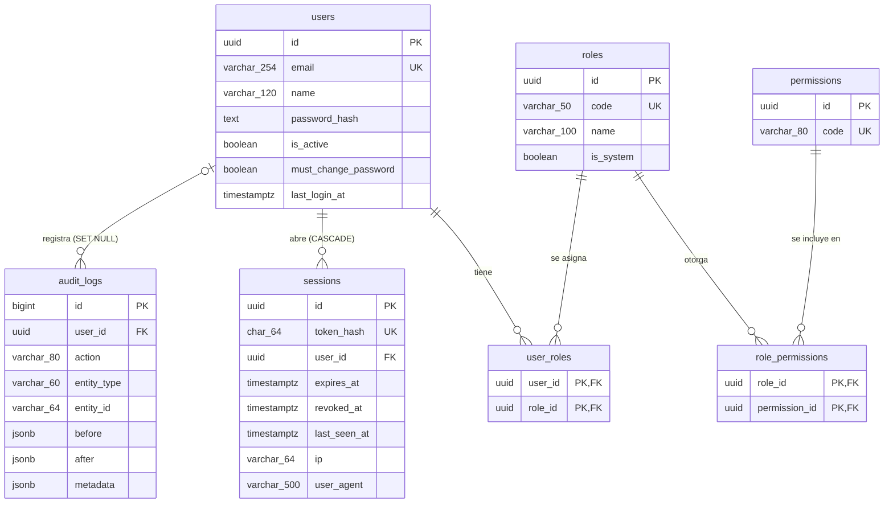
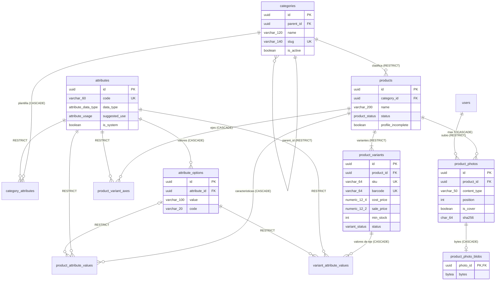
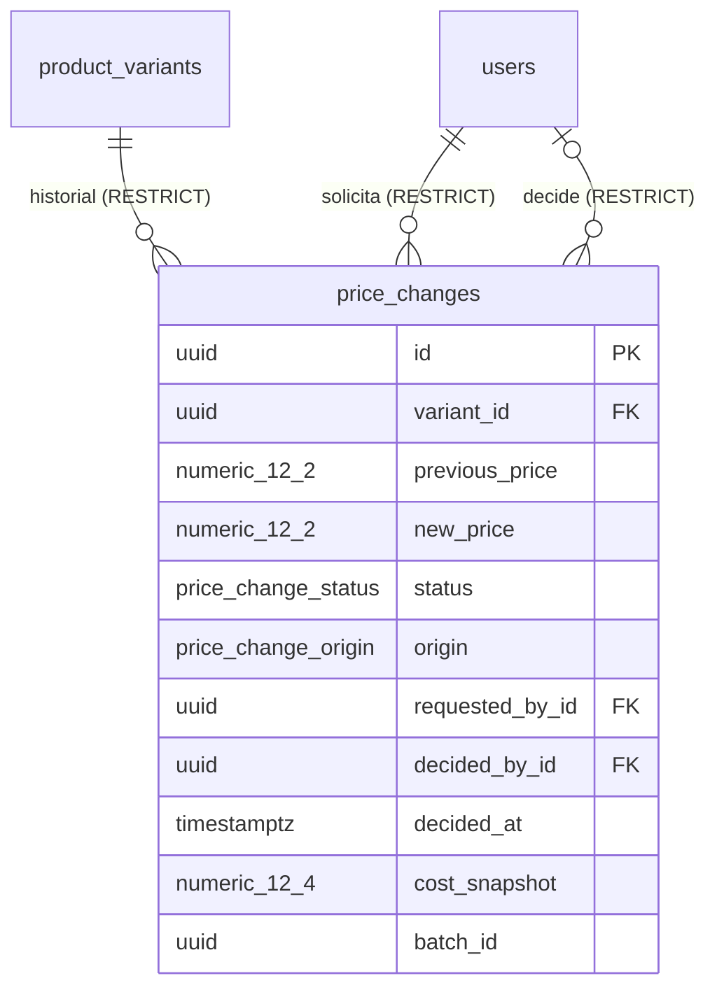
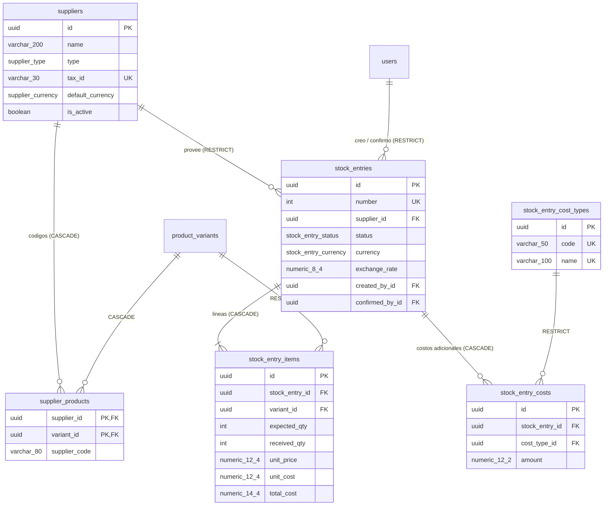
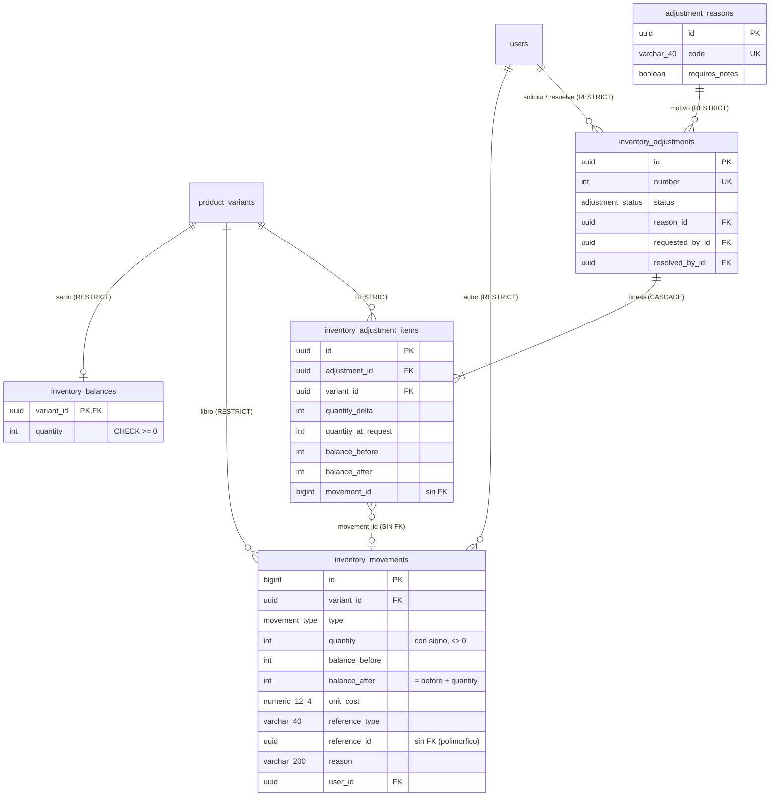
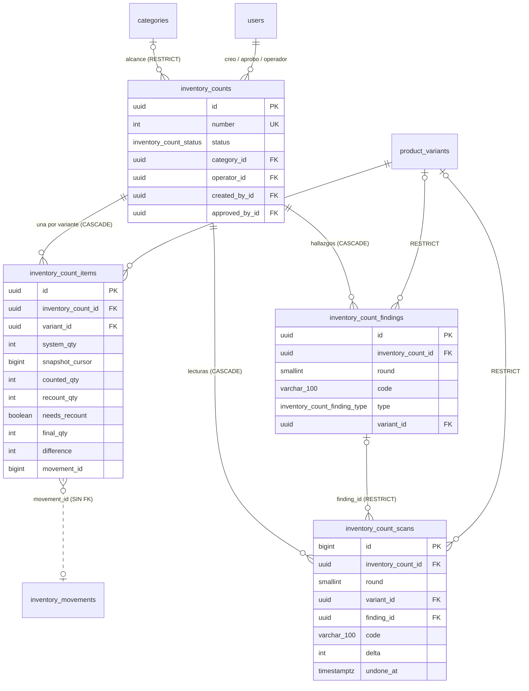
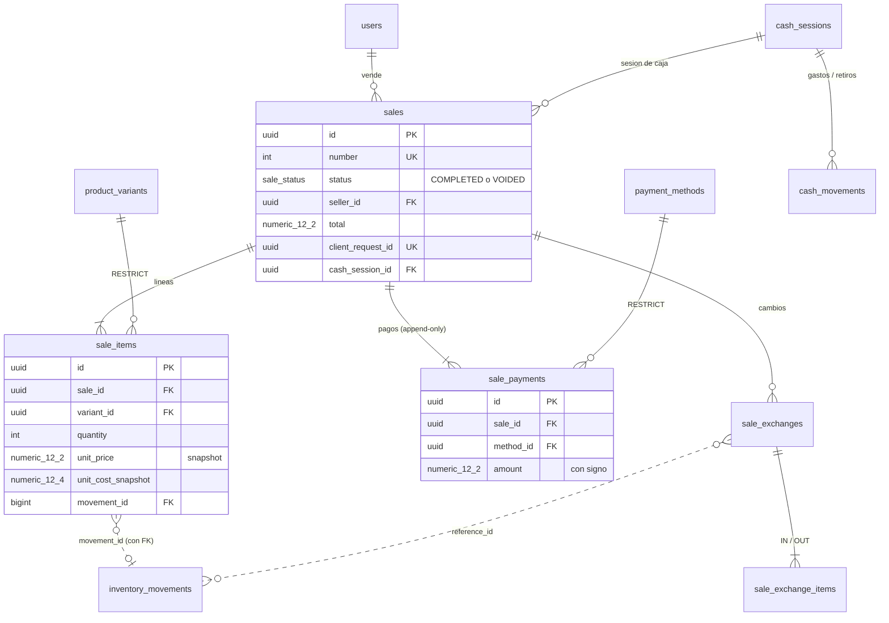

# 04 · Modelo de datos

> Informe técnico de «Joyería Sole» · parte 04 · fecha de verificación: 2026-11-06 · rama `feature/f1-productos-detalle` (integrada en `main`).
>
> **Cómo se elaboró.** Se leyeron `apps/api/prisma/schema.prisma`, el SQL de las **17 migraciones**, `seed.ts`, `seed-demo.ts`, `prisma.config.ts`, los servicios que escriben en la base (`stock-ledger`, `inventory`, `stock-entries`, `pricing`, `photos`, `auth`, `users`, `products`, etc.), el `Dockerfile`, los documentos `docs/database/DATABASE.md`, `docs/deployment/*`, y el resumen de la auditoría de BD (hallazgos F-xx e I-01…I-06). `docs/database/DATABASE.md` **no** se copió sin comprobar: cada diferencia está en la sección 9.
>
> **Qué NO se hizo.** No se ejecutó nada (ni Docker, ni tests, ni `EXPLAIN`, ni `prisma migrate diff`, ni consultas contra una base). Todo lo que depende de un plan de ejecución o de una medición está marcado como _razonamiento, no medido_. No se aplicó ninguna garantía propuesta.

## Índice

0. Resumen en cifras
1. Convenciones
2. Catálogo de entidades (34 tablas, 15 enums), con un diagrama ER por dominio
3. Historial de migraciones (17)
4. Invariantes e integridad (BD frente a código) y propuestas I-01…I-06
5. Seed (`seed.ts`, `seed-demo.ts`)
6. Consultas y rendimiento
7. Datos sensibles, retención y respaldos
8. Preparación del modelo para la Fase 2 (Ventas)
9. Incoherencias schema ↔ migraciones ↔ DATABASE.md ↔ código

---

## 0. Resumen en cifras

| Concepto                   | Valor (verificado en el repositorio)                                                                                                                                                                                     |
| -------------------------- | ------------------------------------------------------------------------------------------------------------------------------------------------------------------------------------------------------------------------ |
| Motor / ORM                | PostgreSQL 18 (la migración 10 usa `uuidv7()`, nativa de PG 18) · Prisma 7.10 con `@prisma/adapter-pg`                                                                                                                   |
| Tablas                     | **34** (24 en la migración inicial, 10 posteriores)                                                                                                                                                                      |
| Enums de BD                | **15**                                                                                                                                                                                                                   |
| Migraciones                | **17** (1 inicial + 16 incrementales), todas en `apps/api/prisma/migrations`                                                                                                                                             |
| CHECK activos              | **47** (13 en `init`, el resto en las migraciones 4, 8, 10, 12, 13, 15); `stock_entries_costs_check` desapareció con las columnas que revisaba                                                                           |
| Triggers / funciones       | **8 triggers** y **8 funciones** `plpgsql` (append-only, inmutabilidad de precios, ajustes, conteos)                                                                                                                     |
| Índices únicos parciales   | 2 (`product_photos_one_cover_per_product`, `price_changes_one_pending_per_variant_idx`)                                                                                                                                  |
| Índices GIN `gin_trgm_ops` | 6 (extensión `pg_trgm`)                                                                                                                                                                                                  |
| Secuencias                 | `product_variant_sku_seq` (SKU) + 3 `SERIAL` (`stock_entries.number`, `inventory_counts.number`, `inventory_adjustments.number`) + 3 `BIGSERIAL` (`inventory_movements.id`, `audit_logs.id`, `inventory_count_scans.id`) |
| Volumen esperado (A2)      | 150–250 productos (con variantes), 1.000–2.000 piezas, 3–5 usuarios                                                                                                                                                      |

Lo que más importa de este informe, en una frase por tema:

- **Integridad.** Lo crítico (saldo ≥ 0, libro y auditoría append-only, precios y ajustes resueltos inmutables, portada única, una solicitud de precio pendiente por variante) **sí** está en la BD. Lo que **no** está: que el saldo coincida con el libro, que un ingreso confirmado sea inmutable, que `movement_id` apunte a un movimiento real y el signo por tipo de movimiento (propuestas I-01…I-05, sin aplicar).
- **Escritura de stock.** La regla «solo el servicio de inventario escribe movimientos» **no se cumple del todo** en el código (ver 4.4 y 9): `stock-entries.confirm` e `inventory.initialStock` escriben el libro por su cuenta.
- **Rendimiento.** Con el volumen A2 no hay riesgo de latencia; los índices de la migración 17 son holgados. Hay índices que el código actual no usa (4.5/6.4) y consultas que no escalan (auditoría, `count(*)` del kardex), irrelevantes hoy.
- **Operación.** La imagen de producción probablemente **no puede ejecutar el seed** (sección 5.4) y la app corre con el mismo rol que migra (dueño de las tablas): los triggers protegen contra bugs, no contra una credencial de BD comprometida.

---

## 1. Convenciones

| Tema                  | Convención                                                                                                                                                                                                                                                  | Verificación / matices                                                                                                                                                                                                                                         |
| --------------------- | ----------------------------------------------------------------------------------------------------------------------------------------------------------------------------------------------------------------------------------------------------------- | -------------------------------------------------------------------------------------------------------------------------------------------------------------------------------------------------------------------------------------------------------------- |
| Nombres               | Tablas `snake_case` plural (`@@map`); columnas `snake_case` (`@map`); enums de BD `snake_case` singular (`@@map`)                                                                                                                                           | Cumplida en las 34 tablas y 15 enums.                                                                                                                                                                                                                          |
| Claves primarias      | **UUID v7** (`@default(uuid(7))`, `@db.Uuid`) en entidades y documentos; `BIGSERIAL` en `inventory_movements`, `audit_logs`, `inventory_count_scans`; PK compuesta en tablas puente y 1:1 (`inventory_balances.variant_id`, `product_photo_blobs.photo_id`) | **El UUID lo genera el cliente Prisma, la columna no tiene `DEFAULT` en la BD.** Cualquier `INSERT` manual debe aportar el `id` (la migración 10 usa `uuidv7()` de PG 18). Lo mismo con `updated_at`: `NOT NULL` sin default (lo fija `@updatedAt` en Prisma). |
| Correlativos legibles | `number INTEGER` autoincremental (`SERIAL`) en ingresos (ING-), conteos (CNT-), ajustes (AJ-)                                                                                                                                                               | Con huecos tras transacciones revertidas (las secuencias no se reponen); sin garantía de continuidad.                                                                                                                                                          |
| Fechas                | `timestamptz(3)` en UTC (`TZ: UTC` en `docker-compose.yml`); `DEFAULT CURRENT_TIMESTAMP`; presentación en `America/La_Paz` en la UI                                                                                                                         | `stock_entries.document_date` es `DATE` (fecha del comprobante, sin hora). Nota: `CURRENT_TIMESTAMP` es el instante de **inicio de la transacción**, no el de la inserción (por eso el kardex ordena por `id`, ver 6).                                         |
| Dinero                | `numeric` (nunca `float`): precios de venta `(12,2)`; costos unitarios `(12,4)`; `stock_entry_items.total_cost (14,4)`; costos adicionales `(12,2)`; tipo de cambio `(8,4)`; `value_number (12,3)`                                                          | El sistema opera en bolivianos; los ingresos pueden digitarse en USD con tipo de cambio por ingreso (ADR-016). No hay columna de moneda en precios ni costos de variante: **todo es Bs**.                                                                      |
| Cantidades            | `INTEGER` (piezas enteras, P-09 aprobada); saldo máximo `2.147.483.647` (la capa de servicio lo valida, `MAX_BALANCE`)                                                                                                                                      |                                                                                                                                                                                                                                                                |
| Claves foráneas       | `ON UPDATE CASCADE` (valor por defecto de Prisma, irrelevante con UUID). `ON DELETE`: **RESTRICT** en todo lo que tiene historial; **CASCADE** solo en tablas hijas sin vida propia (lista abajo); **SET NULL** únicamente en `audit_logs.user_id`          | Ver tabla de FK abajo.                                                                                                                                                                                                                                         |
| Borrado               | No se borran entidades con historial: se desactivan (`is_active` / `status`). Excepciones físicas: `catalog:delete` (B11) elimina una ficha de producto **sin** historial; los ítems/costos de un ingreso en borrador se reemplazan                         | Usuarios, proveedores, categorías, atributos, ajustes y conteos no tienen endpoint de borrado. Los dos últimos están además protegidos por trigger.                                                                                                            |
| Integridad extra      | CHECK, triggers e índices parciales escritos a mano en el SQL de las migraciones (Prisma no los expresa)                                                                                                                                                    | No aparecen en `schema.prisma`: ver 9 (INC-17).                                                                                                                                                                                                                |

**FK con `ON DELETE CASCADE`** (el resto es `RESTRICT`): `user_roles.user_id`, `role_permissions.role_id` y `.permission_id`, `sessions.user_id`, `attribute_options.attribute_id`, `category_attributes.category_id`, `product_variant_axes.product_id`, `product_attribute_values.product_id`, `product_photos.product_id`, `product_photo_blobs.photo_id`, `variant_attribute_values.variant_id`, `supplier_products.supplier_id` y `.variant_id`, `stock_entry_items.stock_entry_id`, `stock_entry_costs.stock_entry_id`, `inventory_count_items/scans/findings.inventory_count_id`, `inventory_adjustment_items.adjustment_id`. **`SET NULL`:** `audit_logs.user_id`.

Efecto práctico: dos cascadas de documento están neutralizadas por triggers (conteos y ajustes no se pueden borrar), pero **la cascada `stock_entries → items/costos` no tiene protección** (propuesta I-03); y `products → fotos/ejes/características` borra sin dejar rastro salvo la auditoría `product.deleted`.

---

## 2. Catálogo de entidades

Leyenda: **NN** = `NOT NULL`; **U** = único; **PK**/**FK**. Los `id` UUID y los `updated_at` no tienen default en BD (ver 1). «Escribe» indica el módulo del backend que inserta/actualiza la tabla (verificado por `grep` de `tx.<modelo>` / SQL crudo).

### 2.0 Enums (15)

| Enum de BD                     | Valores                                                                                                                                        | Estado de uso                                                                                                                                                                                                                                                                                                                                                                                                  |
| ------------------------------ | ---------------------------------------------------------------------------------------------------------------------------------------------- | -------------------------------------------------------------------------------------------------------------------------------------------------------------------------------------------------------------------------------------------------------------------------------------------------------------------------------------------------------------------------------------------------------------- |
| `attribute_data_type`          | `OPTION`, `TEXT`, `NUMBER`, `BOOLEAN`                                                                                                          | Los 4 en uso. Solo `OPTION` puede ser eje de variante.                                                                                                                                                                                                                                                                                                                                                         |
| `attribute_usage`              | `VARIANT_AXIS`, `DESCRIPTIVE`                                                                                                                  | En uso. Es solo una sugerencia de la UI; la API no lo impone.                                                                                                                                                                                                                                                                                                                                                  |
| `product_status`               | `DRAFT`, `ACTIVE`, `INACTIVE`                                                                                                                  | **`DRAFT` sin uso efectivo**: ninguna ruta lo asigna (`updateProductSchema` solo acepta `ACTIVE`/`INACTIVE`; el alta rápida desde ingreso crea `ACTIVE` + `profile_incomplete`). Solo se puede filtrar por él.                                                                                                                                                                                                 |
| `variant_status`               | `ACTIVE`, `INACTIVE`                                                                                                                           | En uso.                                                                                                                                                                                                                                                                                                                                                                                                        |
| `price_change_status`          | `PENDING`, `APPROVED`, `REJECTED`, `CANCELLED`                                                                                                 | En uso.                                                                                                                                                                                                                                                                                                                                                                                                        |
| `price_change_origin`          | `REQUEST`, `ADMIN_DIRECT`, `INITIAL`                                                                                                           | En uso. `ADMIN_DIRECT` lo registra también el Responsable con `prices:approve`.                                                                                                                                                                                                                                                                                                                                |
| `supplier_type`                | `NATIONAL`, `FOREIGN`                                                                                                                          | En uso.                                                                                                                                                                                                                                                                                                                                                                                                        |
| `supplier_currency`            | `BOB`, `USD`                                                                                                                                   | En uso (informativa).                                                                                                                                                                                                                                                                                                                                                                                          |
| `stock_entry_status`           | `DRAFT`, `CONFIRMED`, `CANCELLED`                                                                                                              | En uso.                                                                                                                                                                                                                                                                                                                                                                                                        |
| `stock_entry_currency`         | `BOB`, `USD`                                                                                                                                   | En uso.                                                                                                                                                                                                                                                                                                                                                                                                        |
| `movement_type`                | `INITIAL_STOCK`, `STOCK_ENTRY`, `ADJUSTMENT`, `COUNT_ADJUSTMENT`, `LOSS`, `SALE`, `CUSTOMER_RETURN`, `EXCHANGE`, `EXCHANGE_IN`, `EXCHANGE_OUT` | **En uso (escritos por el código):** `INITIAL_STOCK`, `STOCK_ENTRY`, `ADJUSTMENT`, `COUNT_ADJUSTMENT`, `EXCHANGE_IN`, `EXCHANGE_OUT`. **Reservados sin uso (Fase 2):** `SALE`, `CUSTOMER_RETURN`. **Reservado y obsoleto:** `EXCHANGE` (reemplazado por IN/OUT, ADR-019). **Sin uso y sin marca de reservado en el schema: `LOSS`** (las pérdidas son `ADJUSTMENT` con motivo `LOSS` de `adjustment_reasons`). |
| `inventory_count_status`       | `DRAFT`, `IN_PROGRESS`, `RECOUNT`, `IN_REVIEW`, `APPROVED`, `CANCELLED`                                                                        | En uso. En la BD `RECOUNT` quedó **al final** del orden del enum (se agregó con `ADD VALUE`), en el schema está tercero (ver INC-16).                                                                                                                                                                                                                                                                          |
| `inventory_count_scan_source`  | `SCAN`, `MANUAL`                                                                                                                               | En uso.                                                                                                                                                                                                                                                                                                                                                                                                        |
| `inventory_count_finding_type` | `NOT_FOUND`, `OUT_OF_SCOPE`                                                                                                                    | En uso.                                                                                                                                                                                                                                                                                                                                                                                                        |
| `adjustment_status`            | `PENDING`, `APPROVED`, `REJECTED`, `CANCELLED`                                                                                                 | En uso.                                                                                                                                                                                                                                                                                                                                                                                                        |

Los valores de un enum de PostgreSQL **no se pueden quitar** sin recrear el tipo; `ADD VALUE` no puede usarse en la misma transacción que lo crea (por eso las migraciones 14/15 y la 16 están separadas del uso).

### 2.1 Dominio: identidad, acceso y auditoría



#### `users`

Propósito: personas con acceso. Argon2id en `password_hash`; se desactivan (`is_active`), no se borran. `must_change_password` = clave temporal pendiente de cambio (F2).

| Columna                     | Tipo           | NULL | Default / nota                                                                                             |
| --------------------------- | -------------- | ---- | ---------------------------------------------------------------------------------------------------------- |
| `id`                        | uuid           | NN   | PK                                                                                                         |
| `email`                     | varchar(254)   | NN   | **U** `users_email_key`; sensible a mayúsculas en BD (la API normaliza a minúsculas con Zod `toLowerCase`) |
| `name`                      | varchar(120)   | NN   |                                                                                                            |
| `password_hash`             | text           | NN   | Argon2id                                                                                                   |
| `is_active`                 | boolean        | NN   | `true`                                                                                                     |
| `must_change_password`      | boolean        | NN   | `false` (migración 5)                                                                                      |
| `last_login_at`             | timestamptz(3) | sí   |                                                                                                            |
| `created_at` / `updated_at` | timestamptz(3) | NN   | `CURRENT_TIMESTAMP` / sin default                                                                          |

FK entrantes (RESTRICT salvo indicado): 17 relaciones desde movimientos, ingresos (creó/confirmó), conteos (creó/aprobó/operador/contó/lecturas/regularizó), ajustes (solicitó/resolvió), precios (solicitó/decidió), fotos (subió); `sessions` y `user_roles` en CASCADE; `audit_logs` en SET NULL. **Consecuencia:** un usuario con cualquier historial no puede borrarse (y no existe endpoint para ello); solo se desactiva.
Índices: `users_email_key`. Escribe: `users.service` (alta, edición, desactivación, restablecer clave), `auth.service` (`last_login_at`, cambio de clave), seeds.

#### `roles`, `permissions`, `user_roles`, `role_permissions`

| Tabla              | Columnas                                                                                                  | PK / únicos / índices / FK                                                                               |
| ------------------ | --------------------------------------------------------------------------------------------------------- | -------------------------------------------------------------------------------------------------------- |
| `roles`            | `id` uuid; `code` varchar(50) NN; `name` varchar(100) NN; `description` text; `is_system` bool NN `false` | PK `id`; **U** `roles_code_key`                                                                          |
| `permissions`      | `id`; `code` varchar(80) NN (`<recurso>:<acción>`); `description` text                                    | PK; **U** `permissions_code_key`                                                                         |
| `user_roles`       | `user_id`, `role_id` (uuid NN)                                                                            | PK compuesta; idx `user_roles_role_id_idx`; FK `user_id → users` CASCADE, `role_id → roles` **RESTRICT** |
| `role_permissions` | `role_id`, `permission_id` (uuid NN)                                                                      | PK compuesta; idx `role_permissions_permission_id_idx`; FK ambas CASCADE                                 |

Escribe: `roles`, `permissions` y `role_permissions` **solo el seed** (no hay API de edición de roles; `roles:manage` solo gobierna la asignación de roles a usuarios); `user_roles`: `users.service`. Modelo RBAC por permiso (ADR-004): la API autoriza siempre por permiso, nunca por nombre de rol.

#### `sessions`

Propósito: sesiones de servidor; la cookie lleva un token aleatorio y aquí solo se guarda su **hash SHA-256** (64 hex). TTL fijo de 8 h (`SESSION_TTL_HOURS` solo admite 8).

| Columna        | Tipo           | NULL | Default                                                  |
| -------------- | -------------- | ---- | -------------------------------------------------------- |
| `id`           | uuid           | NN   | PK                                                       |
| `token_hash`   | char(64)       | NN   | **U** `sessions_token_hash_key`                          |
| `user_id`      | uuid           | NN   | FK → `users` CASCADE                                     |
| `expires_at`   | timestamptz(3) | NN   |                                                          |
| `revoked_at`   | timestamptz(3) | sí   |                                                          |
| `last_seen_at` | timestamptz(3) | NN   | `CURRENT_TIMESTAMP` (se refresca como máximo cada 5 min) |
| `ip`           | varchar(64)    | sí   | dato personal                                            |
| `user_agent`   | varchar(500)   | sí   | dato personal                                            |
| `created_at`   | timestamptz(3) | NN   | `CURRENT_TIMESTAMP`                                      |

Índices: `sessions_user_id_idx`, `sessions_expires_at_idx` (este último existe pero **ningún proceso purga sesiones**: ver 7). Escribe: `auth.service` (login/logout/cambio de clave), `users.service` (revocación al desactivar/restablecer), `plugins/auth` (`last_seen_at`).

#### `audit_logs`

Propósito: auditoría de negocio y seguridad **append-only** (ADR-010), distinta de los logs técnicos. Se escribe con `recordAudit(tx, …)` en la **misma transacción** que la operación.

| Columna                       | Tipo               | NULL | Nota                                                                                           |
| ----------------------------- | ------------------ | ---- | ---------------------------------------------------------------------------------------------- |
| `id`                          | bigint (BIGSERIAL) | NN   | PK                                                                                             |
| `user_id`                     | uuid               | sí   | FK → `users` **SET NULL**; null en acciones del sistema o login fallido de usuario inexistente |
| `action`                      | varchar(80)        | NN   | `<entidad>.<acción>`                                                                           |
| `entity_type`                 | varchar(60)        | sí   |                                                                                                |
| `entity_id`                   | varchar(64)        | sí   | texto libre (UUID, bigint o id lógico como el `referenceId` de un cambio de pieza)             |
| `before`, `after`, `metadata` | jsonb              | sí   | snapshots; el `metadata` de `auth.login_failed` guarda el correo tal como se tecleó            |
| `ip`                          | varchar(64)        | sí   |                                                                                                |
| `user_agent`                  | varchar(500)       | sí   |                                                                                                |
| `request_id`                  | varchar(64)        | sí   |                                                                                                |
| `created_at`                  | timestamptz(3)     | NN   | `CURRENT_TIMESTAMP`                                                                            |

Índices: `(entity_type, entity_id)`, `(user_id, created_at)`, `(action, created_at)`, `audit_logs_created_at_id_idx (created_at DESC, id DESC)` (migración 17; **reemplazó** a `audit_logs_created_at_idx`, eliminado). **No hay índice de texto**: la búsqueda `q` de la pantalla de auditoría hace `ILIKE '%q%'` sin trigramas.
Trigger `audit_logs_append_only` (BEFORE UPDATE OR DELETE): bloquea todo salvo un `UPDATE` que solo ponga `user_id = NULL` (efecto del `SET NULL`). Escribe: todos los servicios vía `recordAudit`; seeds.

### 2.2 Dominio: catálogo (categorías, atributos, productos, variantes, fotos)



#### `categories`

Árbol de categorías (subcategoría = categoría con `parent_id`). La API limita a **dos niveles** (P-04, implementada); la BD no limita la profundidad y solo impide `parent_id = id`.

| Columna                   | Tipo           | NULL | Default                                                                                                        |
| ------------------------- | -------------- | ---- | -------------------------------------------------------------------------------------------------------------- |
| `id`                      | uuid           | NN   | PK                                                                                                             |
| `parent_id`               | uuid           | sí   | FK → `categories` RESTRICT                                                                                     |
| `name`                    | varchar(120)   | NN   |                                                                                                                |
| `slug`                    | varchar(140)   | NN   | **U** `categories_slug_key` (el servicio lo genera como `<nombre-normalizado>-<4 bytes hex>`: nunca colisiona) |
| `description`             | text           | sí   |                                                                                                                |
| `is_active`               | boolean        | NN   | `true`                                                                                                         |
| `sort_order`              | integer        | NN   | `0`                                                                                                            |
| `created_at`/`updated_at` | timestamptz(3) | NN   |                                                                                                                |

Únicos: `(parent_id, name)` — **no protege a las categorías raíz** (con `parent_id` NULL los duplicados son distintos para PostgreSQL) **ni distingue mayúsculas**; la unicidad real la comprueba el servicio con `equals insensitive` (carrera posible). Índices: `categories_parent_id_idx` (**redundante**: el prefijo de la unicidad ya lo cubre). CHECK: `categories_not_self_parent_check`. Escribe: `catalog/categories.service`.

#### `attributes`, `attribute_options`, `category_attributes`

| Tabla                 | Columnas                                                                                                                                                                                                                                                                    | PK / únicos / índices / FK / CHECK                                                                                                                                                                  |
| --------------------- | --------------------------------------------------------------------------------------------------------------------------------------------------------------------------------------------------------------------------------------------------------------------------- | --------------------------------------------------------------------------------------------------------------------------------------------------------------------------------------------------- |
| `attributes`          | `id`; `code` varchar(60) NN; `name` varchar(100) NN; `data_type` attribute_data_type NN; `unit` varchar(20); `suggested_use` attribute_usage NN `DESCRIPTIVE`; `is_system` bool NN `false`; `is_active` bool NN `true`; `sort_order` int NN `0`; `created_at`; `updated_at` | PK; **U** `attributes_code_key`. El nombre único (insensible a mayúsculas) lo valida el servicio, no la BD                                                                                          |
| `attribute_options`   | `id`; `attribute_id` NN; `value` varchar(100) NN; `code` varchar(20) (para componer SKU, P-05); `is_active` `true`; `sort_order` `0`; `created_at`                                                                                                                          | PK; **U** `(attribute_id, value)`; FK `attribute_id → attributes` CASCADE                                                                                                                           |
| `category_attributes` | `category_id`, `attribute_id` NN; `is_required` bool `false`; `is_variant_axis_default` bool `false`; `sort_order` int `0`                                                                                                                                                  | PK `(category_id, attribute_id)`; idx `category_attributes_attribute_id_idx`; FK `category_id` CASCADE, `attribute_id` RESTRICT. Es una **plantilla sugerida**; el producto define sus propios ejes |

Escribe: `catalog/attributes.service` (atributos y opciones), `catalog/categories.service` (plantilla `PUT /categories/:id/attributes`), seed (12 definiciones). Las 12 definiciones base tienen `is_system = true` (se editan, no se desactivan).

#### `products`

Ficha comercial (nombre, descripción, categoría, atributos comunes). **Todo producto tiene ≥ 1 variante** (regla de servicio, ADR-001).

| Columna                   | Tipo           | NULL | Default                                                                       |
| ------------------------- | -------------- | ---- | ----------------------------------------------------------------------------- |
| `id`                      | uuid           | NN   | PK                                                                            |
| `category_id`             | uuid           | NN   | FK → `categories` RESTRICT                                                    |
| `name`                    | varchar(200)   | NN   |                                                                               |
| `description`             | text           | sí   |                                                                               |
| `model`                   | varchar(100)   | sí   |                                                                               |
| `status`                  | product_status | NN   | `ACTIVE`                                                                      |
| `profile_incomplete`      | boolean        | NN   | `false` (migración 11; marca manual C1; la API calcula además `isIncomplete`) |
| `created_at`/`updated_at` | timestamptz(3) | NN   |                                                                               |

Índices: `products_category_id_idx`, `products_status_idx`, `products_name_idx` (btree, para el orden del listado), `products_name_trgm_idx` (GIN `gin_trgm_ops`, migración 17). Escribe: `catalog/products.service` (incluye el alta rápida desde un ingreso).

#### `product_variants`

**Unidad de inventario** (stock, costo, precio, código). Los productos simples tienen una sola variante.

| Columna                   | Tipo           | NULL | Default / nota                                                           |
| ------------------------- | -------------- | ---- | ------------------------------------------------------------------------ |
| `id`                      | uuid           | NN   | PK                                                                       |
| `product_id`              | uuid           | NN   | FK → `products` **RESTRICT**                                             |
| `sku`                     | varchar(64)    | NN   | **U**; `SKU-000001` con `nextval('product_variant_sku_seq')`             |
| `barcode`                 | varchar(64)    | sí   | **U**; código del proveedor o `SOLE-<uuid sin guiones>`                  |
| `label`                   | varchar(200)   | sí   | «Plata 925 / Talla 16»; `Única` en piezas simples                        |
| `cost_price`              | numeric(12,4)  | NN   | `0`; **último costo** (P-07), lo reemplaza cada ingreso confirmado       |
| `sale_price`              | numeric(12,2)  | NN   | `0`; solo cambia junto a una fila de `price_changes` (regla de servicio) |
| `min_stock`               | integer        | NN   | `0` (0 = alerta desactivada)                                             |
| `status`                  | variant_status | NN   | `ACTIVE`                                                                 |
| `created_at`/`updated_at` | timestamptz(3) | NN   |                                                                          |

CHECK: `cost_price >= 0`, `sale_price >= 0`, `min_stock >= 0`. Índices: `product_variants_product_id_idx`, `product_variants_status_idx`, GIN trigram de `sku`, `barcode`, `label` (migración 17). La unicidad cruzada «un barcode no puede igualar el SKU de otra variante» **solo la comprueba el servicio** (`checkProviderCode`). Escribe: `catalog/products.service` (alta, `min_stock`, barcode, estado); `stock-entries.service` (`cost_price` al confirmar); `pricing.service` (`sale_price`).
Bloqueo de concurrencia: casi toda operación de stock/precio/edición toma `SELECT … FROM product_variants WHERE id = … FOR UPDATE`; así se serializan por variante.

#### `product_variant_axes`, `product_attribute_values`, `variant_attribute_values`

| Tabla                      | Columnas                                                                                                                           | PK / FK / índices / CHECK                                                                                                                                                                                                                                                                |
| -------------------------- | ---------------------------------------------------------------------------------------------------------------------------------- | ---------------------------------------------------------------------------------------------------------------------------------------------------------------------------------------------------------------------------------------------------------------------------------------- |
| `product_variant_axes`     | `product_id`, `attribute_id`, `sort_order` int `0`                                                                                 | PK `(product_id, attribute_id)`; FK producto CASCADE, atributo RESTRICT; idx `attribute_id`. Qué atributos generan variantes **en este producto**                                                                                                                                        |
| `product_attribute_values` | `product_id`, `attribute_id`; `option_id` uuid NULL; `value_text` varchar(500); `value_number` numeric(12,3); `value_boolean` bool | PK `(product_id, attribute_id)`; FK producto CASCADE, atributo RESTRICT, opción RESTRICT; idx `(attribute_id, option_id)`; CHECK `num_nonnulls(option_id, value_text, value_number, value_boolean) = 1`. Que el valor sea del tipo que dicta `attributes.data_type` es regla de servicio |
| `variant_attribute_values` | `variant_id`, `attribute_id`, `option_id` (todos NN)                                                                               | PK `(variant_id, attribute_id)`; FK variante CASCADE, atributo y opción RESTRICT; idx `(attribute_id, option_id)`. **No hay restricción que impida dos variantes del mismo producto con la misma combinación de ejes**: la valida `products.addVariant` bajo `FOR UPDATE` del producto   |

Escribe: `catalog/products.service` (`attributes.service` solo las consulta/reetiqueta).

#### `product_photos` y `product_photo_blobs`

Metadatos y bytes separados (ADR-020): los listados jamás arrastran la imagen; la interfaz `PhotoStorage` permite migrar a un bucket sin tocar `product_photos`. Máximo 5 fotos por producto (Q-09); la imagen se re-codifica siempre (WebP, lado mayor ≤ 1200 px, sin EXIF).

| Tabla                 | Columnas                                                                                                                                                                                                                 | Restricciones                                                                                                                                                                                                                                                                                                     |
| --------------------- | ------------------------------------------------------------------------------------------------------------------------------------------------------------------------------------------------------------------------ | ----------------------------------------------------------------------------------------------------------------------------------------------------------------------------------------------------------------------------------------------------------------------------------------------------------------- |
| `product_photos`      | `id`; `product_id` NN; `content_type` varchar(50) NN; `width` int NN; `height` int NN; `size_bytes` int NN; `sha256` char(64) NN (ETag); `position` int NN; `is_cover` bool NN `false`; `created_by_id` NN; `created_at` | FK producto **CASCADE**, usuario RESTRICT. CHECK `content_type IN ('image/webp','image/jpeg','image/png')`; `width > 0 AND height > 0 AND size_bytes > 0`; `position >= 0`. **Único parcial** `product_photos_one_cover_per_product (product_id) WHERE is_cover`. Idx `(product_id, position)`, `(created_by_id)` |
| `product_photo_blobs` | `photo_id` uuid PK/FK; `bytes` bytea NN                                                                                                                                                                                  | FK foto CASCADE. CHECK `octet_length(bytes) > 0`                                                                                                                                                                                                                                                                  |

El tope de 5 y el orden (`position` no es único) los garantiza el servicio bajo `FOR UPDATE` del producto; la BD solo garantiza una portada. Escribe: `catalog/photos/photos.service` (+ `PostgresPhotoStorage`).

### 2.3 Dominio: precios de venta



#### `price_changes`

**Historial inmutable** de precios de venta por variante (ADR-018). Todo cambio pasa por esta tabla: se solicita (`PENDING`) y se aprueba/rechaza, o se registra directo, o es el precio `INITIAL` al crear la pieza.

| Columna                        | Tipo                | NULL | Nota                                                                        |
| ------------------------------ | ------------------- | ---- | --------------------------------------------------------------------------- |
| `id`                           | uuid                | NN   | PK                                                                          |
| `variant_id`                   | uuid                | NN   | FK RESTRICT                                                                 |
| `previous_price` / `new_price` | numeric(12,2)       | NN   |                                                                             |
| `status`                       | price_change_status | NN   | `PENDING`                                                                   |
| `origin`                       | price_change_origin | NN   |                                                                             |
| `requested_by_id`              | uuid                | NN   | FK usuarios RESTRICT                                                        |
| `decided_by_id`                | uuid                | sí   | FK usuarios RESTRICT (en cancelación = el solicitante)                      |
| `created_at`                   | timestamptz(3)      | NN   | `CURRENT_TIMESTAMP`                                                         |
| `decided_at`                   | timestamptz(3)      | sí   |                                                                             |
| `reason` / `decision_comment`  | varchar(500)        | sí   | el comentario es obligatorio al rechazar                                    |
| `cost_snapshot`                | numeric(12,4)       | NN   | costo total unitario al registrar el cambio (visible solo con `costs:read`) |
| `batch_id`                     | uuid                | sí   | agrupa decisiones en masa; **no es FK** (no hay tabla de lotes)             |

Índices: `(variant_id, created_at)`, `(status, created_at)`, `(requested_by_id)`, `(decided_by_id)`, `(batch_id)`, `price_changes_created_at_id_idx (created_at DESC, id DESC)` (migración 17), **único parcial** `price_changes_one_pending_per_variant_idx (variant_id) WHERE status = 'PENDING'`.
CHECK (6): precios `>= 0` y `previous_price <> new_price`; `cost_snapshot >= 0`; coherencia estado/decisión (PENDING sin decidir; el resto con quién y cuándo); `origin <> REQUEST` ⇒ `APPROVED` y `decided_by_id = requested_by_id`; `CANCELLED` ⇒ `decided_by_id = requested_by_id`; `REJECTED` ⇒ comentario de ≥ 3 caracteres.
Trigger `price_changes_immutable` (BEFORE UPDATE OR DELETE): prohíbe `DELETE`; prohíbe todo `UPDATE` si `OLD.status <> 'PENDING'`; de una pendiente solo permite cambiar `status`, `decided_by_id`, `decided_at`, `decision_comment`, `batch_id`.
Escribe: `pricing.service` (y `products.service` para el `INITIAL` vía `recordInitialPrice`). **No hay backfill:** las variantes anteriores a la migración 12 no tienen fila `INITIAL`.

### 2.4 Dominio: proveedores e ingresos de mercadería



#### `suppliers`

| Columna                   | Tipo              | NULL | Default / nota                                                        |
| ------------------------- | ----------------- | ---- | --------------------------------------------------------------------- |
| `id`                      | uuid              | NN   | PK                                                                    |
| `name`                    | varchar(200)      | NN   | **no único** (la existencia se decide por nombre solo en `seed-demo`) |
| `type`                    | supplier_type     | NN   | `NATIONAL` (migración 9)                                              |
| `country`                 | varchar(80)       | sí   |                                                                       |
| `tax_id`                  | varchar(30)       | sí   | **U** (NIT); varios NULL permitidos                                   |
| `contact_name`            | varchar(120)      | sí   | dato personal                                                         |
| `phone`, `whatsapp`       | varchar(40)       | sí   | dato personal                                                         |
| `email`                   | varchar(254)      | sí   |                                                                       |
| `address`                 | varchar(300)      | sí   |                                                                       |
| `default_currency`        | supplier_currency | NN   | `BOB` (sugerida al registrar un ingreso)                              |
| `payment_terms`           | varchar(300)      | sí   |                                                                       |
| `notes`                   | text              | sí   |                                                                       |
| `is_active`               | boolean           | NN   | `true`                                                                |
| `created_at`/`updated_at` | timestamptz(3)    | NN   |                                                                       |

Índices: `suppliers_tax_id_key` (U), `suppliers_name_idx`, `suppliers_type_idx`. Escribe: `suppliers.service`.

#### `supplier_products`

Relación proveedor ↔ variante con el **código del proveedor** (alimenta la búsqueda unificada por lector, Q-10).

| Columna                     | Tipo           | NULL | Nota                               |
| --------------------------- | -------------- | ---- | ---------------------------------- |
| `supplier_id`, `variant_id` | uuid           | NN   | PK compuesta; FK ambas **CASCADE** |
| `supplier_code`             | varchar(80)    | sí   |                                    |
| `created_at`                | timestamptz(3) | NN   |                                    |

Únicos: `(supplier_id, supplier_code)` (varios NULL permitidos). Índices: `supplier_products_variant_id_idx`, `supplier_products_supplier_code_idx` (btree, igualdad exacta del lector), `supplier_products_supplier_code_trgm_idx` (GIN). Escribe: `catalog/products.service` (`linkSupplierCode`), `stock-entries.service` (alta rápida de pieza).

#### `stock_entries`

Ingreso de mercadería: `DRAFT → CONFIRMED` (solo aquí hay movimientos) o `CANCELLED` (ADR-008).

| Columna                        | Tipo                 | NULL | Default / nota                                          |
| ------------------------------ | -------------------- | ---- | ------------------------------------------------------- |
| `id`                           | uuid                 | NN   | PK                                                      |
| `number`                       | integer              | NN   | `SERIAL`, **U** `stock_entries_number_key` (ING-000123) |
| `supplier_id`                  | uuid                 | NN   | FK RESTRICT                                             |
| `status`                       | stock_entry_status   | NN   | `DRAFT`                                                 |
| `document_type`                | varchar(40)          | sí   | texto libre (P-12)                                      |
| `document_number`              | varchar(60)          | sí   | **puede repetirse** (entregas parciales, C5)            |
| `document_date`                | date                 | sí   |                                                         |
| `received_at`                  | timestamptz(3)       | NN   | `CURRENT_TIMESTAMP`                                     |
| `currency`                     | stock_entry_currency | NN   | `BOB` (migración 10)                                    |
| `exchange_rate`                | numeric(8,4)         | sí   | Bs por USD, fijo al confirmar                           |
| `notes`                        | text                 | sí   |                                                         |
| `created_by_id`                | uuid                 | NN   | FK usuarios RESTRICT                                    |
| `confirmed_by_id`              | uuid                 | sí   | FK RESTRICT                                             |
| `confirmed_at`, `cancelled_at` | timestamptz(3)       | sí   |                                                         |
| `created_at`/`updated_at`      | timestamptz(3)       | NN   |                                                         |

CHECK: `stock_entries_currency_rate_check` (BOB ⇒ sin tipo de cambio; USD ⇒ tipo de cambio > 0). **No hay CHECK que relacione `status` con `confirmed_*`/`cancelled_at`** ni trigger de inmutabilidad (I-03). Índices: `(supplier_id, document_number)` (reemplazó al índice solo por proveedor), `(status)`, `(received_at)`, `stock_entries_document_number_trgm_idx` (GIN). Escribe: `stock-entries.service`.

#### `stock_entry_cost_types` y `stock_entry_costs`

| Tabla                    | Columnas                                                                                                                         | Restricciones                                                                                                                                                                                       |
| ------------------------ | -------------------------------------------------------------------------------------------------------------------------------- | --------------------------------------------------------------------------------------------------------------------------------------------------------------------------------------------------- |
| `stock_entry_cost_types` | `id`; `code` varchar(50) NN; `name` varchar(100) NN; `is_active` `true`; `is_system` `false`; `sort_order` int `0`; `created_at` | **U** `code`, **U** `name`. Los 5 del sistema (`TRANSPORT`, `PACKAGING`, `CUSTOMS`, `COMMISSIONS`, `OTHER`) los siembran la migración 10 **y** el seed. Escribe: `cost-types.service` (Admin), seed |
| `stock_entry_costs`      | `id`; `stock_entry_id` NN; `cost_type_id` NN; `amount` numeric(12,2) NN; `note` varchar(300); `created_at`                       | FK ingreso CASCADE, tipo RESTRICT; CHECK `amount > 0`; idx `stock_entry_id`, `cost_type_id`. Lista abierta de costos adicionales en **Bs**, prorrateados por valor de compra (ADR-015)              |

#### `stock_entry_items`

| Columna                | Tipo          | NULL | Nota                                                                 |
| ---------------------- | ------------- | ---- | -------------------------------------------------------------------- |
| `id`                   | uuid          | NN   | PK                                                                   |
| `stock_entry_id`       | uuid          | NN   | FK CASCADE                                                           |
| `variant_id`           | uuid          | NN   | FK RESTRICT                                                          |
| `expected_qty`         | integer       | sí   | según el documento del proveedor                                     |
| `received_qty`         | integer       | NN   | verificada físicamente; es la que ingresa al confirmar               |
| `difference_reason`    | varchar(500)  | sí   | obligatoria para confirmar si hay diferencia (C2, regla de servicio) |
| `unit_price`           | numeric(12,4) | NN   | en la moneda del ingreso (migración 10: backfill = `unit_cost`)      |
| `unit_cost`            | numeric(12,4) | NN   | en Bs (`unit_price × tipo de cambio`)                                |
| `unit_extra_cost`      | numeric(12,4) | sí   | se fija al confirmar                                                 |
| `extra_cost_allocated` | numeric(12,2) | sí   | se fija al confirmar                                                 |
| `total_cost`           | numeric(14,4) | sí   | se fija al confirmar                                                 |
| `notes`                | text          | sí   |                                                                      |

Únicos: `(stock_entry_id, variant_id)` (una línea por variante). Índice: `variant_id`. CHECK: `received_qty >= 0`, `expected_qty IS NULL OR >= 0`, `unit_cost >= 0`, `unit_extra_cost IS NULL OR >= 0`, `unit_price >= 0`. Escribe: `stock-entries.service`.

### 2.5 Dominio: inventario (saldos, libro de movimientos y ajustes)



#### `inventory_balances`

Saldo actual por variante (lectura rápida; **el libro es la fuente de verdad**). 1:0..1 con la variante: la fila se crea de forma perezosa (`INSERT … ON CONFLICT DO NOTHING` con 0) en la primera operación de stock; una variante sin fila equivale a saldo 0 (las consultas usan `LEFT JOIN` + `COALESCE`).

| Columna      | Tipo           | NULL | Nota                                                                                                              |
| ------------ | -------------- | ---- | ----------------------------------------------------------------------------------------------------------------- |
| `variant_id` | uuid           | NN   | PK, FK → `product_variants` RESTRICT                                                                              |
| `quantity`   | integer        | NN   | `0`; **CHECK `quantity >= 0`** (`inventory_balances_quantity_check`, migración 4; P-08: no existe stock negativo) |
| `updated_at` | timestamptz(3) | NN   | sin default                                                                                                       |

Índice: `inventory_balances_quantity_idx` (**sin uso conocido**: el dashboard filtra `COALESCE(quantity,0)`, que no puede usarlo). Escribe: ver 4.4 (**cuatro** puntos de escritura, no uno).

#### `inventory_movements`

**Libro mayor inmutable**: una fila por cambio de stock de una variante.

| Columna                           | Tipo               | NULL | Nota                                                                                                                                            |
| --------------------------------- | ------------------ | ---- | ----------------------------------------------------------------------------------------------------------------------------------------------- |
| `id`                              | bigint (BIGSERIAL) | NN   | PK; es el **cursor** de conciliación de los conteos                                                                                             |
| `variant_id`                      | uuid               | NN   | FK RESTRICT                                                                                                                                     |
| `type`                            | movement_type      | NN   |                                                                                                                                                 |
| `quantity`                        | integer            | NN   | con signo, **CHECK `<> 0`**                                                                                                                     |
| `balance_before`, `balance_after` | integer            | NN   | **CHECK `balance_after = balance_before + quantity`**                                                                                           |
| `unit_cost`                       | numeric(12,4)      | sí   | ingresos: costo total unitario; ajustes/conteos/cambios: `cost_price` vigente; `INITIAL_STOCK`: NULL                                            |
| `reference_type`                  | varchar(40)        | sí   | `STOCK_ENTRY`, `INVENTORY_ADJUSTMENT`, `INVENTORY_COUNT`, `EXCHANGE` (fuente: `REFERENCE_TYPES` en `@joyeria/shared`)                           |
| `reference_id`                    | uuid               | sí   | **sin FK** (polimórfico). Para `EXCHANGE` es un UUID aleatorio sin tabla propia: el cambio solo existe como 2 movimientos + 1 fila de auditoría |
| `reason`                          | varchar(200)       | sí   |                                                                                                                                                 |
| `notes`                           | text               | sí   | solo se muestra con permisos (`canSeeMovementNotes`)                                                                                            |
| `user_id`                         | uuid               | NN   | FK usuarios RESTRICT                                                                                                                            |
| `created_at`                      | timestamptz(3)     | NN   | `CURRENT_TIMESTAMP`                                                                                                                             |

Índices (7): PK; `(variant_id, created_at)`; `(reference_type, reference_id)`; `(type, created_at)`; `(user_id)`; `inventory_movements_created_at_id_idx (created_at DESC, id DESC)`; `inventory_movements_variant_id_id_idx (variant_id, id DESC)` (ambos de la migración 17). Trigger `inventory_movements_append_only` (BEFORE UPDATE OR DELETE) lanza excepción siempre. **`TRUNCATE` no dispara el trigger** (ver 4.3).
Escribe: `inventory/stock-ledger.applyStockChanges` (ajustes, conteos, cambios), `stock-entries.confirm` (por su cuenta), `inventory.initialStock` (por su cuenta), `seed-demo` (inserción directa).

#### `adjustment_reasons`

Catálogo de motivos (P-20): `id`; `code` varchar(40) NN **U**; `name` varchar(100) NN; `requires_notes` bool NN `false`; `is_active` bool NN `true`; `sort_order` int NN `0`; `created_at`. Seed: `THEFT`, `LOSS`, `SAMPLE`, `BREAKAGE`, `REGISTRATION_ERROR`, `OTHER` (este exige observación). **No hay API para editar motivos**: solo el seed.

#### `inventory_adjustments` e `inventory_adjustment_items`

Ajuste manual con solicitud y aprobación (ADR-017): `PENDING → APPROVED` (único estado que mueve stock) | `REJECTED` | `CANCELLED`.

| Tabla                        | Columnas                                                                                                                                                                                                                               | Restricciones                                                                                                                                                                                                                                                                                                                                                                                                                                                                                    |
| ---------------------------- | -------------------------------------------------------------------------------------------------------------------------------------------------------------------------------------------------------------------------------------- | ------------------------------------------------------------------------------------------------------------------------------------------------------------------------------------------------------------------------------------------------------------------------------------------------------------------------------------------------------------------------------------------------------------------------------------------------------------------------------------------------ |
| `inventory_adjustments`      | `id`; `number` int NN `SERIAL` **U** (AJ-000001); `status` NN `PENDING`; `reason_id` NN; `notes` text; `requested_by_id` NN; `resolved_by_id`, `resolved_at` NULL; `resolution_notes` text; `cancelled_at`; `created_at`; `updated_at` | FK motivo y usuarios RESTRICT. Idx `(status, created_at)`, `(requested_by_id)`, `(reason_id)`. CHECK: `(status IN (APPROVED,REJECTED)) = (resolved_by_id IS NOT NULL AND resolved_at IS NOT NULL)`; `(status = CANCELLED) = (cancelled_at IS NOT NULL)`; `REJECTED` ⇒ `resolution_notes` no vacío. Trigger `inventory_adjustments_immutable`: `DELETE` prohibido; `UPDATE` solo si `OLD.status = 'PENDING'`                                                                                      |
| `inventory_adjustment_items` | `id`; `adjustment_id` NN; `variant_id` NN; `quantity_delta` int NN; `quantity_at_request` int NN; `balance_before`, `balance_after` int NULL; `unit_cost` numeric(12,4) NULL; `movement_id` bigint NULL                                | FK ajuste CASCADE, variante RESTRICT. **U** `(adjustment_id, variant_id)` (una variante por ajuste). Idx `variant_id`. CHECK: `quantity_delta <> 0`; `quantity_at_request >= 0`; `balance_before/after/movement_id` o todos NULL o todos presentes con `balance_after = balance_before + quantity_delta >= 0`; `unit_cost IS NULL OR >= 0`. Trigger `inventory_adjustment_items_immutable`: `UPDATE`/`DELETE` solo mientras el ajuste padre está `PENDING`. **`movement_id` no tiene FK** (I-04) |

Escribe: `inventory/adjustments.service`.

### 2.6 Dominio: inventario físico (conteo a ciegas, ADR-009/014/021)



#### `inventory_counts`

Un conteo por **categoría** (incluye subcategorías; no hay conteo «total»). Estados: `DRAFT → IN_PROGRESS → [RECOUNT] → IN_REVIEW → APPROVED | CANCELLED`. Solo `APPROVED` genera movimientos `COUNT_ADJUSTMENT`, conciliando los movimientos ocurridos durante el conteo.

| Columna                                                                     | Tipo                   | NULL | Nota                                                       |
| --------------------------------------------------------------------------- | ---------------------- | ---- | ---------------------------------------------------------- |
| `id`                                                                        | uuid                   | NN   | PK                                                         |
| `number`                                                                    | integer                | NN   | `SERIAL`, **U** (CNT-000001)                               |
| `status`                                                                    | inventory_count_status | NN   | `DRAFT`                                                    |
| `scope`                                                                     | varchar(200)           | sí   | etiqueta histórica de la categoría                         |
| `category_id`                                                               | uuid                   | sí   | FK RESTRICT (null en conteos anteriores a la migración 14) |
| `notes`, `resolution_notes`                                                 | text                   | sí   |                                                            |
| `operator_id`                                                               | uuid                   | sí   | FK RESTRICT; único operador que captura                    |
| `created_by_id`                                                             | uuid                   | NN   | FK RESTRICT                                                |
| `approved_by_id`                                                            | uuid                   | sí   | FK RESTRICT                                                |
| `started_at`, `first_closed_at`, `review_at`, `approved_at`, `cancelled_at` | timestamptz(3)         | sí   |                                                            |
| `created_at`/`updated_at`                                                   | timestamptz(3)         | NN   |                                                            |

Índices: `(status)`, `(category_id)`, U `number`. CHECK (3): `status IN (IN_PROGRESS, RECOUNT)` ⇒ `operator_id` presente; `(status = APPROVED) = (approved_by_id y approved_at presentes)`; `(status = CANCELLED) = (cancelled_at presente)`. Trigger `inventory_counts_immutable`: `DELETE` prohibido; `UPDATE` prohibido si `OLD.status` es `APPROVED` o `CANCELLED`. **No existe restricción de «un solo conteo activo por categoría o categorías solapadas»**: lo valida el servicio en memoria (F-10). Escribe: `inventory-counts.service`.

#### `inventory_count_items`

| Grupo de columnas                      | Detalle                                                                                                                                                                                               |
| -------------------------------------- | ----------------------------------------------------------------------------------------------------------------------------------------------------------------------------------------------------- |
| Identidad                              | `id`; `inventory_count_id` NN (FK CASCADE); `variant_id` NN (FK RESTRICT); **U** `(inventory_count_id, variant_id)`                                                                                   |
| Foto del sistema                       | `system_qty` int NN; `snapshot_cursor` bigint NN `0` (último movimiento de la variante al tomar la foto; en conteos preexistentes quedó en 0)                                                         |
| Primer conteo                          | `counted_qty` int NULL; `counted_cursor` bigint NULL; `counted_by_id` uuid NULL (FK RESTRICT); `counted_at` NULL; `needs_recount` bool NN `false`                                                     |
| Segundo recuento                       | `recount_qty` int NULL; `recount_cursor` bigint NULL; `recounted_at` NULL                                                                                                                             |
| Resultado de la aprobación (congelado) | `expected_qty`, `final_qty`, `reconciled_movements`, `difference`, `balance_before`, `balance_after` (int NULL); `unit_cost` numeric(12,4) NULL; `movement_id` bigint NULL (**sin FK**); `notes` text |

Índices: `variant_id` (+ la unicidad). CHECK (5): `counted_qty IS NULL OR >= 0` (heredado de `init`, redundante con el siguiente); cantidades `>= 0`; `recount_qty` solo si `needs_recount`; resultado «todo o nada» coherente (`difference = final_qty − expected_qty`, `balance_after = balance_before + difference >= 0`, `movement_id` presente ⇔ `difference <> 0`); `unit_cost >= 0`. Trigger `inventory_count_items_immutable` (UPDATE/DELETE bloqueados si el conteo padre está `APPROVED`/`CANCELLED`).

#### `inventory_count_scans`

Registro de **cada lectura** o cantidad fijada (trazabilidad pieza por pieza, E5); se persiste al instante para poder reanudar.

| Columna                     | Tipo                        | NULL | Nota                                                        |
| --------------------------- | --------------------------- | ---- | ----------------------------------------------------------- |
| `id`                        | bigint (BIGSERIAL)          | NN   | PK                                                          |
| `inventory_count_id`        | uuid                        | NN   | FK CASCADE                                                  |
| `round`                     | smallint                    | NN   | CHECK `IN (1, 2)`                                           |
| `variant_id` / `finding_id` | uuid                        | sí   | FK RESTRICT; CHECK: **exactamente uno** de los dos presente |
| `code`                      | varchar(100)                | NN   | texto leído, normalizado                                    |
| `source`                    | inventory_count_scan_source | NN   |                                                             |
| `delta`                     | integer                     | NN   | CHECK `<> 0`; `quantity_after >= 0`                         |
| `quantity_after`            | integer                     | NN   |                                                             |
| `movement_cursor`           | bigint                      | sí   |                                                             |
| `user_id`                   | uuid                        | NN   | FK RESTRICT                                                 |
| `created_at`                | timestamptz(3)              | NN   |                                                             |
| `undone_at`                 | timestamptz(3)              | sí   | único campo que puede cambiar, una vez                      |

Índices: `(inventory_count_id, round, id)`, `inventory_count_scans_count_variant_round_id_idx (inventory_count_id, variant_id, round, id)` (migración 17: deshacer), `(variant_id)`, `(finding_id)`; **no hay índice en `user_id`**. Trigger `inventory_count_scans_immutable`: `DELETE` prohibido; `UPDATE` solo para poner `undone_at` (y únicamente si estaba NULL), ningún otro campo puede cambiar.

#### `inventory_count_findings`

Códigos leídos que no forman parte del conteo (`NOT_FOUND`, `OUT_OF_SCOPE`); **no afectan el stock**; el aprobador los marca como regularizados. Columnas: `id`; `inventory_count_id` NN (FK CASCADE); `round` smallint NN (CHECK `IN (1,2)`); `code` varchar(100) NN; `type` NN; `variant_id` NULL (FK RESTRICT); `quantity` int NN `0` (CHECK `>= 0`); `note` text; `regularized_at`, `regularized_by_id` (FK RESTRICT), `regularization_note` text; `created_at`; `updated_at`. **U** `(inventory_count_id, round, code)`; idx `variant_id`. CHECK: `type = OUT_OF_SCOPE` ⇔ `variant_id` presente; regularización: `regularized_at` y `regularized_by_id` van juntos y exigen nota no vacía. **Sin trigger de inmutabilidad, a propósito:** se regulariza después de aprobar el conteo.

### 2.7 Resumen: quién escribe cada tabla

| Tabla                                                                                                          | Escribe (módulo)                                                                                                                                                  |
| -------------------------------------------------------------------------------------------------------------- | ----------------------------------------------------------------------------------------------------------------------------------------------------------------- |
| `users`, `sessions`                                                                                            | `users`, `auth`, `plugins/auth`; seeds                                                                                                                            |
| `roles`, `permissions`, `role_permissions`                                                                     | **solo seed**                                                                                                                                                     |
| `user_roles`                                                                                                   | `users`; seeds                                                                                                                                                    |
| `categories`, `category_attributes`                                                                            | `catalog/categories`                                                                                                                                              |
| `attributes`, `attribute_options`                                                                              | `catalog/attributes`; seed (definiciones)                                                                                                                         |
| `products`, `product_variants`, `product_variant_axes`, `product_attribute_values`, `variant_attribute_values` | `catalog/products` (también desde el alta rápida de `stock-entries`); `product_variants.cost_price` además `stock-entries.confirm`; `sale_price` además `pricing` |
| `product_photos`, `product_photo_blobs`                                                                        | `catalog/photos`                                                                                                                                                  |
| `price_changes`                                                                                                | `pricing` (y `catalog/products` para `INITIAL`)                                                                                                                   |
| `suppliers`                                                                                                    | `suppliers`                                                                                                                                                       |
| `supplier_products`                                                                                            | `catalog/products`, `stock-entries`                                                                                                                               |
| `stock_entries`, `stock_entry_items`, `stock_entry_costs`                                                      | `stock-entries`                                                                                                                                                   |
| `stock_entry_cost_types`                                                                                       | `stock-entries/cost-types`; seed; migración 10                                                                                                                    |
| `inventory_balances`, `inventory_movements`                                                                    | `inventory/stock-ledger`, `stock-entries.confirm`, `inventory.initialStock` (y `catalog/products.remove` borra saldos vacíos)                                     |
| `inventory_adjustments`, `inventory_adjustment_items`                                                          | `inventory/adjustments`                                                                                                                                           |
| `adjustment_reasons`                                                                                           | **solo seed**                                                                                                                                                     |
| `inventory_counts`, `_items`, `_scans`, `_findings`                                                            | `inventory-counts`                                                                                                                                                |
| `audit_logs`                                                                                                   | todos los servicios por `recordAudit`; seeds                                                                                                                      |

### 2.8 Referencias lógicas sin FK (polimorfismo y valores sueltos)

| Origen                                                                        | Destino                                                                                    | Cómo se resuelve hoy                                                 |
| ----------------------------------------------------------------------------- | ------------------------------------------------------------------------------------------ | -------------------------------------------------------------------- |
| `inventory_movements.reference_type/reference_id`                             | `stock_entries`, `inventory_adjustments`, `inventory_counts`, o ninguna tabla (`EXCHANGE`) | Índice `(reference_type, reference_id)`; sin integridad referencial. |
| `inventory_adjustment_items.movement_id`, `inventory_count_items.movement_id` | `inventory_movements.id`                                                                   | Mismo tipo (`BIGINT`) pero **sin FK** (I-04).                        |
| `inventory_count_items.*_cursor`, `inventory_count_scans.movement_cursor`     | `inventory_movements.id` (cursor)                                                          | Valor numérico sin FK (correcto: es un cursor, no una referencia).   |
| `price_changes.batch_id`                                                      | — (identificador de lote)                                                                  | UUID suelto, sin tabla.                                              |
| `audit_logs.entity_type/entity_id`                                            | cualquier entidad                                                                          | Texto libre; `entity_id` es `varchar(64)`.                           |

### 2.9 Inventario de índices (resumen por tabla)

Total de índices secundarios/únicos declarados: se listan en cada tabla. Observaciones del conjunto:

- **GIN trigram (6):** `products(name)`, `product_variants(sku, barcode, label)`, `supplier_products(supplier_code)`, `stock_entries(document_number)`.
- **Descendentes (4):** `inventory_movements(created_at DESC, id DESC)`, `inventory_movements(variant_id, id DESC)`, `audit_logs(created_at DESC, id DESC)`, `price_changes(created_at DESC, id DESC)`.
- **Parciales únicos (2):** portada única y solicitud de precio pendiente única.
- **Redundantes o sin uso conocido** (candidatos a eliminar **solo tras medir** `idx_scan`): `categories_parent_id_idx` (prefijo de la unicidad), `inventory_balances_quantity_idx`, `inventory_movements_variant_id_created_at_idx` (el código ordena por `id`), `inventory_movements_type_created_at_idx` (ninguna consulta filtra por tipo), `inventory_movements_created_at_id_idx` (el kardex global ordena por `id`, ver 6.4), índices de baja cardinalidad `products_status_idx`, `product_variants_status_idx`, `stock_entries_status_idx`.
- **FK sin índice propio** (solo importan al borrar el usuario o la opción referenciada, hoy imposible): `stock_entries.created_by_id/confirmed_by_id`, `inventory_counts.operator_id/created_by_id/approved_by_id`, `inventory_count_items.counted_by_id`, `inventory_count_scans.user_id`, `inventory_count_findings.regularized_by_id`, `inventory_adjustments.resolved_by_id`, `product_attribute_values.option_id`, `variant_attribute_values.option_id` (F-23).

---

## 3. Historial de migraciones (17)

Orden de aplicación = orden lexicográfico del nombre de carpeta. Ninguna migración fue editada tras aplicarse (cuando hubo que corregir una, se creó otra: p. ej. la 2 corrige los triggers de la 1).

| #   | Migración                                       | Qué cambia                                                                                                                                                                                                                                                                                                                                                                                                           | Riesgo                                                                                                                                                                                                                                                 | ¿Migración de datos?                                                                                                                                                                                                                                                                                                          |
| --- | ----------------------------------------------- | -------------------------------------------------------------------------------------------------------------------------------------------------------------------------------------------------------------------------------------------------------------------------------------------------------------------------------------------------------------------------------------------------------------------- | ------------------------------------------------------------------------------------------------------------------------------------------------------------------------------------------------------------------------------------------------------ | ----------------------------------------------------------------------------------------------------------------------------------------------------------------------------------------------------------------------------------------------------------------------------------------------------------------------------- |
| 1   | `20261006224722_init`                           | 6 enums (`attribute_data_type`, `product_status`, `variant_status`, `stock_entry_status`, `movement_type` con 8 valores, `inventory_count_status` con 5); **24 tablas**; índices y únicos; FK (RESTRICT con historial); **13 CHECK**; funciones/triggers `prevent_append_only_change` y `prevent_audit_log_change` con `ERRCODE restrict_violation`. Deja sin restringir el stock negativo (P-08 pendiente entonces) | Bajo (BD vacía)                                                                                                                                                                                                                                        | No                                                                                                                                                                                                                                                                                                                            |
| 2   | `20261006225940_append_only_error_code`         | `CREATE OR REPLACE` de las 2 funciones: quita `ERRCODE restrict_violation` (23001), que Prisma traducía como «FK violada» ocultando el mensaje; usa el código por defecto (P0001)                                                                                                                                                                                                                                    | Bajo                                                                                                                                                                                                                                                   | No                                                                                                                                                                                                                                                                                                                            |
| 3   | `20261010000000_product_variant_sku_sequence`   | `CREATE SEQUENCE product_variant_sku_seq` + `setval` según el mayor `SKU-nnnnnn` existente                                                                                                                                                                                                                                                                                                                           | Bajo                                                                                                                                                                                                                                                   | Sí, ligera: `setval` (no modifica filas)                                                                                                                                                                                                                                                                                      |
| 4   | `20261106010000_inventory_balance_non_negative` | `CHECK (quantity >= 0)` en `inventory_balances` (P-08 confirmada 2026-11-05)                                                                                                                                                                                                                                                                                                                                         | Bajo–medio: valida todas las filas existentes (falla con saldos negativos)                                                                                                                                                                             | No                                                                                                                                                                                                                                                                                                                            |
| 5   | `20261106010100_user_must_change_password`      | `users.must_change_password BOOLEAN NOT NULL DEFAULT false`                                                                                                                                                                                                                                                                                                                                                          | Bajo (PG ≥ 11: sin reescritura de tabla)                                                                                                                                                                                                               | No                                                                                                                                                                                                                                                                                                                            |
| 6   | `20261106010200_catalog_attribute_usage`        | Enum `attribute_usage`; `attributes.suggested_use` y `is_system`; `UPDATE` que marca las 12 definiciones base                                                                                                                                                                                                                                                                                                        | Bajo                                                                                                                                                                                                                                                   | Sí: 2 `UPDATE` condicionados por `code` (no-op en BD nueva; el seed reproduce lo mismo)                                                                                                                                                                                                                                       |
| 7   | `20261106010300_supplier_product_code_index`    | Índice btree `supplier_products(supplier_code)`                                                                                                                                                                                                                                                                                                                                                                      | Bajo                                                                                                                                                                                                                                                   | No                                                                                                                                                                                                                                                                                                                            |
| 8   | `20261106010400_product_photos`                 | Tablas `product_photos` y `product_photo_blobs`; 3 CHECK + 1 CHECK de bytes; **índice único parcial** de portada                                                                                                                                                                                                                                                                                                     | Bajo (tablas nuevas)                                                                                                                                                                                                                                   | No                                                                                                                                                                                                                                                                                                                            |
| 9   | `20261106020000_supplier_profile_v2`            | Enums `supplier_type`, `supplier_currency`; columnas `type`, `country`, `whatsapp`, `default_currency`, `payment_terms`; idx `type`                                                                                                                                                                                                                                                                                  | Bajo (defaults compatibles)                                                                                                                                                                                                                            | No                                                                                                                                                                                                                                                                                                                            |
| 10  | `20261106020100_stock_entry_import_costs`       | Enum `stock_entry_currency`; tablas `stock_entry_cost_types` y `stock_entry_costs`; `stock_entries.currency/exchange_rate` + CHECK; `stock_entry_items.unit_price/difference_reason/extra_cost_allocated/total_cost`; **elimina** `freight_cost`, `packaging_cost`, `other_costs` (y su CHECK); reemplaza el índice `stock_entries_supplier_id_idx`                                                                  | **Alto**: DDL destructivo + conversión de datos en una sola migración; usa `uuidv7()` (**exige PG 18**)                                                                                                                                                | **Sí, importante:** inserta 5 tipos de costo; convierte los 3 montos fijos en filas de `stock_entry_costs` (solo > 0; «Valores extras (migrado)»); rellena `unit_price = unit_cost`; **reconstruye** `extra_cost_allocated` y `total_cost` de ingresos confirmados (aproximación: el reparto exacto en centavos no se guardó) |
| 11  | `20261106020200_product_profile_incomplete`     | `products.profile_incomplete BOOLEAN NOT NULL DEFAULT false`                                                                                                                                                                                                                                                                                                                                                         | Bajo                                                                                                                                                                                                                                                   | No                                                                                                                                                                                                                                                                                                                            |
| 12  | `20261106020300_price_changes`                  | Enums y tabla `price_changes`; 6 CHECK; **único parcial** de pendiente por variante; trigger de inmutabilidad                                                                                                                                                                                                                                                                                                        | Bajo (tabla nueva)                                                                                                                                                                                                                                     | No: **sin backfill `INITIAL`** de variantes ya existentes                                                                                                                                                                                                                                                                     |
| 13  | `20261106030000_adjustments_request_approval`   | Enum `adjustment_status`; tablas `adjustment_reasons`, `inventory_adjustments`, `inventory_adjustment_items`; 7 CHECK; 2 funciones + 2 triggers de inmutabilidad                                                                                                                                                                                                                                                     | Bajo (tablas nuevas)                                                                                                                                                                                                                                   | No (los motivos los pone el seed)                                                                                                                                                                                                                                                                                             |
| 14  | `20261106030100_counts_blind_recount`           | `ALTER TYPE inventory_count_status ADD VALUE 'RECOUNT'`; enums de lecturas/hallazgos; **`DROP COLUMN inventory_count_items.difference_reason`** (el propio SQL advierte pérdida de datos); 12 columnas nuevas en `inventory_count_items` y 5 en `inventory_counts`; tablas `inventory_count_scans` y `inventory_count_findings`                                                                                      | **Medio–alto**: pérdida de la columna; los ítems preexistentes quedan con `snapshot_cursor = 0` (la conciliación tomaría todo el historial como «posterior») y los conteos con `category_id`/`operator_id` NULL                                        | Sin migración de datos: asume que no había conteos reales (pre-producción)                                                                                                                                                                                                                                                    |
| 15  | `20261106030200_counts_integrity`               | 15 CHECK sobre conteos, ítems, lecturas y hallazgos; 3 funciones + 3 triggers de inmutabilidad (conteo, ítems, lecturas). Separada de la 14 porque un valor nuevo de enum no puede usarse en la misma transacción                                                                                                                                                                                                    | Medio: los CHECK se validan contra filas existentes (`inventory_counts_operator_check` fallaría con un conteo `IN_PROGRESS` sin operador)                                                                                                              | No                                                                                                                                                                                                                                                                                                                            |
| 16  | `20261106030300_exchange_movement_types`        | `ADD VALUE 'EXCHANGE_IN'` y `'EXCHANGE_OUT'` a `movement_type` (ADR-019)                                                                                                                                                                                                                                                                                                                                             | Bajo; irreversible sin recrear el enum                                                                                                                                                                                                                 | No                                                                                                                                                                                                                                                                                                                            |
| 17  | `20261106040000_performance_indexes`            | `CREATE EXTENSION IF NOT EXISTS pg_trgm`; 6 índices GIN; índices `(created_at DESC, id DESC)` en movimientos, auditoría y precios; `(variant_id, id DESC)` en movimientos; `(count, variant, round, id)` en lecturas; `DROP INDEX audit_logs_created_at_idx`. Todos con `IF NOT EXISTS`                                                                                                                              | Bajo–medio: exige privilegio para crear la extensión (dueño de la BD en PG ≥ 13, extensión «de confianza»); cada `CREATE INDEX` bloquea escrituras de su tabla mientras se construye (Prisma corre la migración en transacción: no hay `CONCURRENTLY`) | No                                                                                                                                                                                                                                                                                                                            |

Observaciones transversales:

- **Dependencia dura de PostgreSQL 18** por `uuidv7()` en la migración 10. Con PG ≤ 17 la migración falla. `docker-compose.yml` usa `postgres:18-alpine`; el hosting debe ofrecer 18.
- La migración 10 y la 14 incumplen la regla de `DATABASE.md` («cambios destructivos en dos pasos: agregar → migrar → eliminar en versión posterior»). Se mitiga por ser pre-producción, pero no es reutilizable como práctica.
- `prisma migrate deploy` se ejecuta en el arranque del contenedor (`CMD` del `Dockerfile`): una migración lenta o fallida impide arrancar la app (el health check del hosting reintentará). La migración 17 requiere `CREATE EXTENSION`; si falla, el despliegue entero se cae.
- Hay varias garantías que **solo existen en SQL de migración** y no en `schema.prisma` (ver 9, INC-17): recrear la BD con `prisma db push` las perdería; hay que usar siempre `migrate`.

---

## 4. Invariantes e integridad

### 4.1 Garantías que impone la base de datos (con mecanismo)

| #   | Invariante                                                                                                                                                                                                                                                              | Mecanismo en BD                                                    | Prueba automática localizada                                                   |
| --- | ----------------------------------------------------------------------------------------------------------------------------------------------------------------------------------------------------------------------------------------------------------------------- | ------------------------------------------------------------------ | ------------------------------------------------------------------------------ |
| 1   | **Saldo ≥ 0** (P-08)                                                                                                                                                                                                                                                    | `inventory_balances_quantity_check`                                | `database-integrity.test.ts`, `negative-stock-guard.test.ts`                   |
| 2   | Movimiento válido: cantidad ≠ 0 y `balance_after = balance_before + quantity`                                                                                                                                                                                           | 2 CHECK en `inventory_movements`                                   | `database-integrity.test.ts`                                                   |
| 3   | **Libro de movimientos append-only**                                                                                                                                                                                                                                    | Trigger BEFORE UPDATE OR DELETE (`prevent_append_only_change`)     | `database-integrity.test.ts`                                                   |
| 4   | **Auditoría append-only** (solo se permite `user_id → NULL`)                                                                                                                                                                                                            | Trigger `prevent_audit_log_change`                                 | `database-integrity.test.ts`                                                   |
| 5   | Precios de variante, costos y stock mínimo no negativos                                                                                                                                                                                                                 | CHECK en `product_variants`                                        | `database-integrity.test.ts`                                                   |
| 6   | SKU y código de barras únicos                                                                                                                                                                                                                                           | `UNIQUE` (`product_variants_sku_key`, `_barcode_key`)              | `database-integrity.test.ts`                                                   |
| 7   | **Historial de precios inmutable** una vez resuelto; sin `DELETE`; de una pendiente solo se pueden resolver estado/decisor/fecha/comentario/lote                                                                                                                        | Trigger `price_changes_immutable`                                  | `pricing.test.ts` (~l. 630-643)                                                |
| 8   | Reglas de decisión de precio (estado ⇔ decisor/fecha, origen aprobado por el mismo usuario, solo el solicitante cancela, rechazo con comentario, precio distinto)                                                                                                       | 6 CHECK en `price_changes`                                         | `pricing.test.ts`                                                              |
| 9   | **Una sola solicitud de precio pendiente por variante**                                                                                                                                                                                                                 | Índice único parcial `WHERE status = 'PENDING'`                    | `pricing.test.ts`                                                              |
| 10  | **Ajuste resuelto inmutable**, sin borrado; líneas inmutables si el ajuste no está `PENDING`                                                                                                                                                                            | 2 triggers                                                         | `adjustments.test.ts` (~l. 655)                                                |
| 11  | Coherencia del ajuste (resolución, cancelación, rechazo con comentario; líneas con `balance_after = balance_before + delta >= 0`, todo-o-nada con `movement_id`)                                                                                                        | 7 CHECK                                                            | `adjustments.test.ts`                                                          |
| 12  | **Conteo terminado inmutable**, sin borrado; líneas inmutables; lecturas solo pueden marcarse deshechas, una vez                                                                                                                                                        | 3 triggers                                                         | `inventory-counts.test.ts` (~l. 1151)                                          |
| 13  | Coherencia del conteo: operador obligatorio al capturar; aprobado ⇔ aprobador y fecha; resultado de línea cuadrado y «todo-o-nada»; lectura de variante **xor** hallazgo; ronda ∈ {1,2}; regularización completa                                                        | 15 CHECK                                                           | `inventory-counts.test.ts`                                                     |
| 14  | **Una sola portada por producto**; tipo MIME en lista blanca; medidas y bytes positivos                                                                                                                                                                                 | Índice único parcial + CHECK                                       | `product-photos.test.ts`                                                       |
| 15  | Ingreso: moneda/tipo de cambio coherentes (BOB sin tipo; USD con tipo > 0); costos adicionales > 0; cantidades, precios y costos ≥ 0                                                                                                                                    | CHECK en `stock_entries`, `stock_entry_costs`, `stock_entry_items` | parcial: `stock-entries.test.ts` (~l. 300 ejercita el CHECK de tipo de cambio) |
| 16  | Característica de producto con **exactamente un** valor                                                                                                                                                                                                                 | `product_attribute_values_has_value_check`                         | no localizada                                                                  |
| 17  | Una categoría no es su propio padre                                                                                                                                                                                                                                     | CHECK (solo autorreferencia directa)                               | no localizada                                                                  |
| 18  | Unicidad: email, códigos de rol/permiso/atributo/motivo/tipo de costo, `token_hash`, `slug`, `tax_id`, `(supplier, supplier_code)`, números correlativos, `(entry, variant)`, `(count, variant)`, `(adjustment, variant)`, `(count, round, code)`, `(attribute, value)` | `UNIQUE`                                                           | varias                                                                         |
| 19  | Integridad referencial: RESTRICT en todo lo que tiene historial; usuarios y variantes con historial no se pueden borrar                                                                                                                                                 | FK                                                                 | indirecta                                                                      |
| 20  | Auditoría sobrevive al usuario                                                                                                                                                                                                                                          | `audit_logs.user_id` `ON DELETE SET NULL` + excepción del trigger  | `database-integrity.test.ts`                                                   |

### 4.2 Garantías que dependen SOLO del código (no hay mecanismo en la BD)

| Invariante                                                                                                                    | Dónde se aplica                                                                     | Qué podría romperla                                                                                                                                |
| ----------------------------------------------------------------------------------------------------------------------------- | ----------------------------------------------------------------------------------- | -------------------------------------------------------------------------------------------------------------------------------------------------- |
| **El saldo coincide con el libro** (`inventory_balances.quantity` = último `balance_after`; cadena `balance_before` continua) | `stock-ledger.applyStockChanges`, `stock-entries.confirm`, `inventory.initialStock` | Un `UPDATE` directo de saldo, un bug de un nuevo módulo o un restore parcial. La BD solo exige `>= 0`. (I-01)                                      |
| Todo cambio de stock es un movimiento y ocurre con el variante bloqueada (`FOR UPDATE`) en el mismo orden (por id)            | Convención repetida en 5 servicios                                                  | Un nuevo flujo que olvide el bloqueo o use otro orden → carrera/interbloqueo.                                                                      |
| **Ingreso confirmado inmutable** (cabecera, ítems, costos)                                                                    | `lockDraft` rechaza si `status <> 'DRAFT'`                                          | SQL manual o un endpoint nuevo. (I-03)                                                                                                             |
| `status` del ingreso coherente con `confirmed_by_id/at`, `cancelled_at`                                                       | Servicio                                                                            | Nada en BD lo comprueba.                                                                                                                           |
| `sale_price` de la variante = último `new_price` aprobado de `price_changes`                                                  | `pricing.service` (transacción única)                                               | Un `UPDATE product_variants SET sale_price` manual.                                                                                                |
| `cost_price` = costo del último ingreso confirmado                                                                            | `stock-entries.confirm`                                                             | Idem.                                                                                                                                              |
| Un movimiento por (documento, variante)                                                                                       | Unicidades de las líneas + `assertDistinctVariants`                                 | Un flujo nuevo. (I-02)                                                                                                                             |
| `movement_id` apunta a un movimiento real                                                                                     | Servicios                                                                           | Ids huérfanos. (I-04)                                                                                                                              |
| Signo del movimiento según su tipo (p. ej. `EXCHANGE_OUT` negativo)                                                           | `stock-ledger` / servicios                                                          | Un bug de signo: la BD solo exige `<> 0`. (I-05)                                                                                                   |
| No se borra un producto con historial                                                                                         | `products.remove` cuenta movimientos, saldos, ítems de ingreso y de conteo          | **No cuenta** `price_changes` ni líneas de ajuste (I-06): hoy falla por FK y devuelve **422 genérico** (`P2003`). Funcionalmente seguro, UX pobre. |
| Todo producto tiene ≥ 1 variante; combinación de ejes única por producto                                                      | `products.service` bajo `FOR UPDATE` del producto                                   | Inserciones directas.                                                                                                                              |
| Profundidad de categorías ≤ 2 y unicidad de nombre por nivel (insensible a mayúsculas)                                        | `categories.service`                                                                | La unicidad de BD no protege raíces ni mayúsculas.                                                                                                 |
| Un solo conteo activo por categoría / sin solapamiento de alcances                                                            | `inventory-counts.service` (en memoria)                                             | Dos aperturas concurrentes.                                                                                                                        |
| Máximo 5 fotos por producto; `position` consecutiva                                                                           | `photos.service` con `FOR UPDATE` del producto                                      | La BD no limita el número ni la unicidad de `position`.                                                                                            |
| Un barcode no coincide con el SKU de otra variante                                                                            | `checkProviderCode`                                                                 | Carrera entre dos altas.                                                                                                                           |
| Al menos un Administrador activo; los permisos no se escalan                                                                  | `users.service` con `FOR UPDATE` sobre `roles`                                      | —                                                                                                                                                  |
| Regla de autorización compartida (quién aprueba), P-43 auto-aprobación, etc.                                                  | Capa de permisos                                                                    | —                                                                                                                                                  |
| Tipo de dato del atributo vs. valor guardado                                                                                  | `validateAttributes`                                                                | —                                                                                                                                                  |

### 4.3 Matices importantes de las protecciones existentes

1. **Los triggers de inmutabilidad solo cubren `UPDATE`/`DELETE`, no `INSERT`.** Se puede insertar una línea en un ajuste ya `APPROVED`, un ítem o una lectura en un conteo ya `APPROVED`, o un ítem en un ingreso `CONFIRMED`. Es seguro hoy porque los servicios no lo hacen; la BD no lo impide. (`seed-demo` aprovecha esto: inserta un ajuste ya `APPROVED` y luego sus líneas.)
2. **`TRUNCATE` no dispara triggers de fila.** `resetDatabase` lo usa a propósito (`TRUNCATE … RESTART IDENTITY CASCADE`), y cualquier rol con el privilegio puede vaciar `inventory_movements`/`audit_logs`. El dueño de la tabla también puede `DISABLE TRIGGER` o `DROP TRIGGER`.
3. **La aplicación se conecta con el mismo rol que ejecuta las migraciones** (el `CMD` del `Dockerfile` corre `prisma migrate deploy` y luego la API con el mismo `DATABASE_URL`), es decir, con el **dueño** de las tablas. Por tanto el append-only protege contra bugs e inyección SQL de la propia app, **no** contra una credencial de BD comprometida. Mitigación sugerida (no aplicada): un rol de migración y un rol de ejecución solo con DML (`REVOKE TRUNCATE, DELETE, UPDATE` sobre esas dos tablas; `GRANT USAGE` sobre `product_variant_sku_seq`).
4. **`audit_logs`**: el trigger permite cualquier `UPDATE` cuyo único cambio sea `user_id → NULL`; quien tenga acceso SQL puede anonimizar autores. Es el costo de soportar `SET NULL`; hoy ningún usuario con historial puede borrarse, así que el camino `SET NULL` es en la práctica inalcanzable.
5. **`CHECK` y `ADD CONSTRAINT` en migraciones** validan datos existentes y toman bloqueos de tabla; con el volumen de la pyme es instantáneo.
6. **`ON DELETE CASCADE` de `stock_entries` hacia ítems/costos** no está compensado por ningún trigger (a diferencia de ajustes y conteos).
7. **Mensajes de error:** los triggers lanzan `RAISE EXCEPTION` con el código por defecto P0001 (corregido en la migración 2); un CHECK violado llega como error de BD y se traduce a 500 genérico (el servicio valida antes para devolver un mensaje útil).

### 4.4 Quién escribe el stock hoy (incoherencia con la regla del proyecto)

`CLAUDE.md` y ADR-007 establecen que solo el servicio de inventario escribe `inventory_movements`/`inventory_balances`. En el código actual hay **cuatro puntos** de escritura:

| Punto                                | Archivo                                          | Observación                                                                                                                                                                               |
| ------------------------------------ | ------------------------------------------------ | ----------------------------------------------------------------------------------------------------------------------------------------------------------------------------------------- |
| `applyStockChanges` (libro genérico) | `inventory/stock-ledger.ts`                      | Lo usan ajustes aprobados, conteos aprobados y cambios de pieza. Bloquea variantes en orden de id, crea el saldo si falta, valida `>= 0` y overflow, inserta movimiento, actualiza saldo. |
| `confirm` de ingresos                | `stock-entries/stock-entries.service.ts:742-803` | Reimplementa el mismo patrón (bloqueo, saldo, movimiento) con su propio `MAX_BALANCE`.                                                                                                    |
| `initialStock`                       | `inventory/inventory.service.ts:164-214`         | Inserta el saldo y el movimiento por separado; garantiza «solo si no hay movimientos previos».                                                                                            |
| `products.remove`                    | `catalog/products.service.ts:665`                | Borra filas de `inventory_balances` (sin movimientos y con saldo 0).                                                                                                                      |
| `seed-demo.ts`                       | `prisma/seed-demo.ts`                            | Inserción directa (solo desarrollo).                                                                                                                                                      |

Esto importa para I-01 (un trigger de conciliación atrapa cualquier desvío entre ellos) y para la Fase 2 (ver 8: la «fachada» de inventario del informe de arquitectura exige unificar estos puntos).

### 4.5 Estado de los hallazgos de la auditoría de BD verificados en el código

| Hallazgo                                       | Estado verificado                                                                                                                                                                               |
| ---------------------------------------------- | ----------------------------------------------------------------------------------------------------------------------------------------------------------------------------------------------- |
| F-01 sesión completa por request               | **Resuelto**: `plugins/auth.ts` hace **una** consulta con `array_agg` y sin `passwordHash`.                                                                                                     |
| F-03 transacciones largas                      | **Mitigado**: `lib/prisma.ts` fija `timeout: 30_000, maxWait: 10_000` global (conteos: 60 s). La ejecución **por línea** (≈ 5–7 sentencias por línea de ingreso) sigue; no hay versión en lote. |
| F-04 / F-15 kardex                             | Orden por `id desc` hecho (`inventory.service.ts`); `count(*)` sin filtro sigue. El índice `(created_at DESC, id DESC)` **no lo usa** ninguna consulta actual (ver 6.4).                        |
| F-05 `ILIKE '%q%'`                             | Índices GIN creados (migración 17); eficacia en la consulta de inventario **no demostrada** (ver 6.3).                                                                                          |
| F-06 listado de productos                      | **Abierto**: `list` usa `include: withDetails` completo en cada ficha.                                                                                                                          |
| F-07 `filters()` de auditoría                  | **Abierto**: tres `DISTINCT` sobre toda la tabla; `q` sin trigramas.                                                                                                                            |
| F-09 / F-25 índices de conciliación y deshacer | Índices creados; los contadores incrementales no se evaluaron.                                                                                                                                  |
| F-14 dashboard                                 | **Abierto**: 5 peticiones a `/inventory` + los contadores de salud.                                                                                                                             |
| F-22 `inventory_balances_quantity_idx`         | **Abierto**, sin uso aparente.                                                                                                                                                                  |
| F-23 FK sin índice                             | **Abierto** (lista en 2.9).                                                                                                                                                                     |
| F-24 sesiones sin purga                        | **Abierto**: no existe ningún `deleteMany` de sesiones ni tarea programada.                                                                                                                     |

### 4.6 Propuestas de la auditoría I-01…I-06 (sin aplicar)

Contexto común: el catálogo de la auditoría (`review-db.md`) y `DATABASE.md` las describen como **no implementadas y sujetas a aprobación**; cada una cambia el comportamiento ante datos inválidos. Todas deberían ir en una migración separada (p. ej. `…_ledger_integrity`). Nota Prisma: triggers, CHECK e índices parciales no se declaran en `schema.prisma` (no producen deriva); una **FK sí** (I-04) y requiere declarar la relación en el schema o `migrate dev` intentará borrarla.

Verificación previa común (debe devolver 0 filas antes de cualquier constraint):

```sql
-- (a) saldo distinto del último balance_after del libro
SELECT b.variant_id, b.quantity AS saldo, COALESCE(l.balance_after, 0) AS ultimo
FROM inventory_balances b
LEFT JOIN LATERAL (SELECT m.balance_after FROM inventory_movements m
                   WHERE m.variant_id = b.variant_id ORDER BY m.id DESC LIMIT 1) l ON true
WHERE b.quantity <> COALESCE(l.balance_after, 0);

-- (b) variantes con movimientos y SIN fila de saldo
SELECT DISTINCT m.variant_id FROM inventory_movements m
LEFT JOIN inventory_balances b ON b.variant_id = m.variant_id WHERE b.variant_id IS NULL;

-- (c) cadena rota: balance_before distinto del balance_after del movimiento anterior de la variante
SELECT id, variant_id FROM (
  SELECT id, variant_id, balance_before,
         lag(balance_after) OVER (PARTITION BY variant_id ORDER BY id) AS previo
  FROM inventory_movements) t
WHERE balance_before <> COALESCE(previo, 0);
```

#### I-01 · Saldo == `balance_after` del último movimiento

**Valor: el más alto** (es la única garantía que cierra el «dos fuentes de verdad»; hoy la cubre solo la disciplina del código, que tiene 4 puntos de escritura).

```sql
CREATE FUNCTION check_balance_matches_ledger() RETURNS trigger LANGUAGE plpgsql AS $$
DECLARE bal integer; ultimo integer;
BEGIN
  SELECT quantity INTO bal FROM inventory_balances WHERE variant_id = NEW.variant_id;
  SELECT balance_after INTO ultimo FROM inventory_movements
   WHERE variant_id = NEW.variant_id ORDER BY id DESC LIMIT 1;
  IF COALESCE(bal, 0) <> COALESCE(ultimo, 0) THEN
    RAISE EXCEPTION 'El saldo de la variante % (%) no coincide con el libro (%)',
      NEW.variant_id, COALESCE(bal, 0), COALESCE(ultimo, 0);   -- P0001: el mensaje llega intacto
  END IF;
  RETURN NULL;
END $$;

CREATE CONSTRAINT TRIGGER inventory_balances_match_ledger
  AFTER INSERT OR UPDATE ON inventory_balances
  DEFERRABLE INITIALLY DEFERRED FOR EACH ROW EXECUTE FUNCTION check_balance_matches_ledger();
CREATE CONSTRAINT TRIGGER inventory_movements_match_balance
  AFTER INSERT ON inventory_movements
  DEFERRABLE INITIALLY DEFERRED FOR EACH ROW EXECUTE FUNCTION check_balance_matches_ledger();
```

La misma función sirve a ambas tablas (las dos tienen `variant_id`). El segundo trigger atrapa «movimiento sin tocar el saldo» (el propuesto en `DATABASE.md` solo cubría el primer caso).
**Riesgos:** (1) falla si ya hay desfase histórico → correr antes (a)(b)(c). (2) Los tests que insertan saldos o movimientos sueltos con Prisma (`database-integrity`, `negative-stock-guard`) dejarían de funcionar (el chequeo se evalúa al `COMMIT` de cada sentencia suelta) y deberían pasar por el servicio. (3) `products.remove` borra saldos con 0: no dispara (solo INSERT/UPDATE) y es coherente. (4) Costo: dos lecturas indexadas por fila tocada (usa `inventory_movements_variant_id_id_idx`; es el mejor argumento a favor de ese índice); un ingreso de 200 líneas añade ≈ 400 lecturas dentro del servidor, sin viajes de red. (5) Es correcto bajo concurrencia solo porque todos los escritores serializan por `FOR UPDATE` de la variante; un escritor que no lo haga podría producir falsos positivos. (6) Orden de `INITIAL_STOCK` y de ingresos: crean el saldo en 0, insertan el movimiento y actualizan el saldo en la misma transacción → al `COMMIT` coincide.

#### I-02 · Un movimiento por (documento, variante)

```sql
-- verificación previa (0 filas):
SELECT reference_type, reference_id, variant_id, count(*) FROM inventory_movements
WHERE reference_id IS NOT NULL GROUP BY 1, 2, 3 HAVING count(*) > 1;

CREATE UNIQUE INDEX inventory_movements_reference_variant_key
  ON inventory_movements (reference_type, reference_id, variant_id, type)
  WHERE reference_id IS NOT NULL;
```

**Corrección respecto a `DATABASE.md`:** conviene incluir `type` en la clave. Con el índice de 3 columnas, la anulación de una venta (`SALE_VOID` con `reference_type = 'SALE'` y el mismo id de venta, ver informe de arquitectura B.5) chocaría con el movimiento `SALE` original de la misma variante. **Verificado en el código que ningún flujo actual repite (documento, variante):** ingresos (`UNIQUE(entry, variant)`), ajustes (`UNIQUE(adjustment, variant)`), conteos (un movimiento por ítem), cambios de pieza (`assertDistinctVariants`), stock inicial (`reference_id` NULL, excluido por el `WHERE`).
**Riesgos:** un error de aplicación que antes duplicaba silenciosamente un movimiento pasa a ser un error de BD (violación de unicidad → 409 genérico `P2002`); tests que fabriquen dos movimientos con la misma referencia.

#### I-03 · Ingreso confirmado/cancelado inmutable

Cierra el hueco de 4.2. Esquema propuesto (no listo en `DATABASE.md`; depende de columnas exactas):

```sql
ALTER TABLE stock_entries ADD CONSTRAINT stock_entries_state_check CHECK (
  (status = 'CONFIRMED') = (confirmed_by_id IS NOT NULL AND confirmed_at IS NOT NULL)
  AND (status = 'CANCELLED') = (cancelled_at IS NOT NULL)) NOT VALID;   -- validar tras revisar datos

CREATE FUNCTION prevent_closed_entry_change() RETURNS trigger LANGUAGE plpgsql AS $$
BEGIN
  IF OLD.status <> 'DRAFT' THEN
    RAISE EXCEPTION 'El ingreso ya fue % y no se puede modificar ni eliminar', OLD.status;
  END IF;
  RETURN CASE WHEN TG_OP = 'DELETE' THEN OLD ELSE NEW END;
END $$;
CREATE TRIGGER stock_entries_immutable BEFORE UPDATE OR DELETE ON stock_entries
  FOR EACH ROW EXECUTE FUNCTION prevent_closed_entry_change();
-- y, por analogía con ajustes: triggers BEFORE UPDATE OR DELETE en stock_entry_items y
-- stock_entry_costs que consulten el estado del padre (permitido solo si es DRAFT).
```

**Riesgos:** (1) el flujo `confirm` actualiza los ítems mientras el padre sigue `DRAFT` y recién después pasa a `CONFIRMED`; con el trigger así, ese orden funciona (no hay que reordenarlo). (2) El `CHECK` de estado puede fallar con datos viejos si algún ingreso confirmado no tiene `confirmed_*` → validar con `NOT VALID` + `VALIDATE`. (3) Si además se quiere impedir `INSERT` de ítems en padres cerrados (hueco 4.3.1), `seed-demo` debería insertar ítems **antes** de confirmar el ingreso. (4) `stock-entries.test.ts` (~l. 300) hace un `UPDATE` directo de `exchange_rate` para probar el CHECK: revisar si el ingreso está `CONFIRMED`. (5) El `DELETE` de ingresos no existe en el código: el trigger lo prohíbe de forma definitiva.

#### I-04 · FK de `movement_id` hacia `inventory_movements`

```sql
-- verificación previa (0 filas):
SELECT i.id FROM inventory_adjustment_items i
LEFT JOIN inventory_movements m ON m.id = i.movement_id
WHERE i.movement_id IS NOT NULL AND m.id IS NULL;
SELECT i.id FROM inventory_count_items i
LEFT JOIN inventory_movements m ON m.id = i.movement_id
WHERE i.movement_id IS NOT NULL AND m.id IS NULL;

ALTER TABLE inventory_adjustment_items
  ADD CONSTRAINT inventory_adjustment_items_movement_id_fkey
  FOREIGN KEY (movement_id) REFERENCES inventory_movements(id) ON DELETE RESTRICT NOT VALID;
ALTER TABLE inventory_count_items
  ADD CONSTRAINT inventory_count_items_movement_id_fkey
  FOREIGN KEY (movement_id) REFERENCES inventory_movements(id) ON DELETE RESTRICT NOT VALID;
ALTER TABLE inventory_adjustment_items VALIDATE CONSTRAINT inventory_adjustment_items_movement_id_fkey;
ALTER TABLE inventory_count_items VALIDATE CONSTRAINT inventory_count_items_movement_id_fkey;
```

Compatible con el append-only (no se borran movimientos). **Riesgos:** (1) **debe declararse la relación en `schema.prisma`** (campos de relación en `InventoryAdjustmentItem`/`InventoryCountItem` e inversa en `InventoryMovement`) o el siguiente `migrate dev` generará un `DROP CONSTRAINT`. (2) Los movimientos deben existir antes de la línea: ya ocurre (los servicios crean el movimiento y luego fijan `movement_id`; `seed-demo` también). (3) `TRUNCATE … CASCADE` de las pruebas sigue funcionando porque lista todas las tablas. (4) Recomendable indexar `movement_id` si algún día se borraran movimientos (hoy imposible).

#### I-05 · CHECK de signo por tipo de movimiento

```sql
ALTER TABLE inventory_movements ADD CONSTRAINT inventory_movements_sign_check CHECK (
  (type IN ('INITIAL_STOCK', 'STOCK_ENTRY', 'CUSTOMER_RETURN', 'EXCHANGE_IN') AND quantity > 0)
  OR (type IN ('SALE', 'EXCHANGE_OUT') AND quantity < 0)
  OR type IN ('ADJUSTMENT', 'COUNT_ADJUSTMENT', 'LOSS', 'EXCHANGE')
) NOT VALID;
ALTER TABLE inventory_movements VALIDATE CONSTRAINT inventory_movements_sign_check;
```

Estado de las dudas de `DATABASE.md`: **`LOSS` no se escribe en ningún lugar** (4.1/2.0), así que su signo no condiciona nada hoy; `ADJUSTMENT` y `COUNT_ADJUSTMENT` admiten ambos signos. El signo de `EXCHANGE_IN`/`EXCHANGE_OUT` lo fija `exchanges.service` (cantidad positiva / `-delivered.quantity`).
**Riesgos:** (1) al agregar `SALE_VOID` en la Fase 2 habrá que recrear el CHECK en una migración **posterior** a la que añade el valor (un valor de enum nuevo no puede usarse en su misma transacción). (2) Un `INITIAL_STOCK` con `quantity` negativo hoy es imposible por validación Zod; el CHECK lo respalda. (3) Los tests de `database-integrity` insertan movimientos de prueba: revisar signos.

#### I-06 · `products.remove` debe contar `price_changes` y líneas de ajuste

Es un cambio de **servicio**, no de esquema. Verificado: el borrado físico solo cuenta movimientos, saldos ≠ 0, ítems de ingreso e ítems de conteo, pero las FK `RESTRICT` de `price_changes.variant_id` (toda pieza creada con precio tiene una fila `INITIAL`), `inventory_adjustment_items.variant_id`, `inventory_count_scans.variant_id` e `inventory_count_findings.variant_id` también impiden borrar. La transacción se revierte entera (sin corrupción) y el error `P2003` se traduce a **422 con mensaje genérico** («hay registros que dependen de este»). `DATABASE.md` dice «error de FK 500»: el código real devuelve 422. Efecto práctico: **una pieza con precio inicial nunca se puede borrar físicamente**, solo desactivar, aunque nunca haya tenido stock; la regla B11 («sin movimientos ni referencias») queda más estrecha de lo que la documentación sugiere.

#### Propuestas adicionales detectadas en esta revisión (no estaban en I-01…I-06)

| Id   | Propuesta                                                                                                                                                         | Por qué                                                            | Riesgo                                                                                               |
| ---- | ----------------------------------------------------------------------------------------------------------------------------------------------------------------- | ------------------------------------------------------------------ | ---------------------------------------------------------------------------------------------------- |
| X-01 | Triggers `BEFORE INSERT` que impidan agregar líneas a ajustes resueltos y a conteos terminados                                                                    | Cierra el hueco de 4.3.1                                           | `seed-demo` inserta un ajuste `APPROVED` antes de sus líneas: habría que reordenarlo                 |
| X-02 | Rol de BD de ejecución sin `TRUNCATE/DELETE/UPDATE` sobre movimientos y auditoría; rol de migración aparte                                                        | Hace efectivo el append-only frente a credenciales robadas (4.3.3) | Cambia el despliegue (`CMD` del `Dockerfile` usa un solo `DATABASE_URL`); `nextval` requiere `USAGE` |
| X-03 | Tarea de purga de sesiones vencidas/revocadas (> 30–90 días)                                                                                                      | F-24; minimiza IP/user-agent retenidos                             | Requiere decidir retención (7) y un planificador (no existe)                                         |
| X-04 | Unicidad de nombre de categoría insensible a mayúsculas y válida para raíces: `UNIQUE (COALESCE(parent_id, '00000000-0000-0000-0000-000000000000'), lower(name))` | El `UNIQUE(parent_id, name)` actual no la da                       | Prisma no expresa índices con expresiones: quedaría solo en SQL                                      |
| X-05 | `NOT VALID` CHECK `stock_entries_state_check` (parte de I-03) también por separado                                                                                | Barato y sin trigger                                               | Datos previos                                                                                        |
| X-06 | Eliminar índices sin uso tras medir `idx_scan` (2.9)                                                                                                              | Cada índice cuesta en cada `INSERT` del libro                      | Solo con datos reales                                                                                |

---

## 5. Seed

### 5.1 `prisma/seed.ts` (estructural; `npm run db:seed` → `prisma db seed` → `tsx prisma/seed.ts`)

| Paso              | Qué crea                                                                                                                                                                                                                                                                                                                                    | Fuente                               | Idempotencia                                                                                                                                                                           |
| ----------------- | ------------------------------------------------------------------------------------------------------------------------------------------------------------------------------------------------------------------------------------------------------------------------------------------------------------------------------------------- | ------------------------------------ | -------------------------------------------------------------------------------------------------------------------------------------------------------------------------------------- |
| Permisos          | **24** (`ALL_PERMISSIONS`): `users:read/manage`, `roles:manage`, `catalog:read/manage/delete`, `costs:read`, `prices:propose/approve`, `suppliers:read/manage`, `stock-entries:read/manage/confirm`, `inventory:read/adjust/initial-stock/adjust-approve/exchange`, `inventory-counts:read/manage/approve`, `audit:read`, `settings:manage` | `packages/shared/src/permissions.ts` | `upsert` por `code`; **pisa la descripción** en cada ejecución                                                                                                                         |
| Roles             | 3: `ADMIN` (todos los permisos), `INVENTORY_MANAGER` (Responsable de inventario: 18 permisos), `SELLER` (Vendedor: `catalog:read`, `inventory:read`); `is_system = true`                                                                                                                                                                    | `DEFAULT_ROLE_PERMISSIONS`           | `upsert` por `code`; **pisa `name` y `description`**; los permisos se **solo agregan** (`createMany … skipDuplicates`); nunca se quitan ni se eliminan permisos retirados del catálogo |
| Administrador     | 1 usuario desde `SEED_ADMIN_EMAIL`/`SEED_ADMIN_PASSWORD`/`SEED_ADMIN_NAME` (mín. de longitud validado) + `audit_logs` `user.created`                                                                                                                                                                                                        | variables de entorno                 | No toca a un usuario existente (ni su clave). Se omite si faltan las variables. **`must_change_password` queda en `false`**: la clave del entorno no caduca                            |
| Atributos         | **12** definiciones sin valores (P-15): `material`, `color`, `tono`, `talla`, `tamano`, `longitud` (unidad `cm`), `dimensiones` (TEXT), `acabado`, `piedra`, `tipo_cierre`, `genero`, `coleccion`; `suggested_use` = `VARIANT_AXIS` en material, color, talla, tamano, longitud; el resto `DESCRIPTIVE`; `is_system = true`                 | `ATTRIBUTES` (en el propio archivo)  | `upsert` por `code`; en `update` **solo** asegura `is_system` (respeta renombres y `suggested_use` cambiados desde la app)                                                             |
| Motivos de ajuste | 6: `THEFT` Robo, `LOSS` Pérdida, `SAMPLE` Muestra, `BREAKAGE` Rotura, `REGISTRATION_ERROR` Error de registro, `OTHER` Otro (`requires_notes = true`)                                                                                                                                                                                        | `DEFAULT_ADJUSTMENT_REASONS`         | `upsert` con `update: {}`: no pisa nada                                                                                                                                                |
| Tipos de costo    | 5: `TRANSPORT`, `PACKAGING`, `CUSTOMS`, `COMMISSIONS`, `OTHER` (`is_system = true`)                                                                                                                                                                                                                                                         | `SYSTEM_COST_TYPES`                  | `upsert`; restablece `name` e `is_system` (nunca `is_active`)                                                                                                                          |

**NO** carga productos, categorías, proveedores ni stock (los define el cliente). El orden de ejecución es secuencial sin transacción global: un fallo a mitad deja un estado parcial, pero re-ejecutar converge.

### 5.2 `prisma/seed-demo.ts` (solo desarrollo/E2E; `npm run db:seed:demo`, requiere `db:seed` antes)

Protegido: rechaza `NODE_ENV=production` y cualquier host distinto de `localhost/127.0.0.1/::1`; exige `DEMO_USER_PASSWORD`.

| Bloque      | Crea                                                                                                                                                                   | Notas                                                                                                   |
| ----------- | ---------------------------------------------------------------------------------------------------------------------------------------------------------------------- | ------------------------------------------------------------------------------------------------------- |
| Usuarios    | 3 (`demo-admin@`, `demo-inventario@`, `demo-vendedor@example.invalid`), uno por rol, misma clave                                                                       | Con auditoría `user.created`                                                                            |
| Catálogo    | 4 categorías `DEMO …` y 20 productos con 1 variante (SKU por `nextval`), precio `80 + n·17.5`; producto 4 sin precio, 6/12/18 sin descripción; 2 fotos sintéticas WebP | Cada producto en su propia transacción                                                                  |
| Stock       | `INITIAL_STOCK` con saldo directo (5 sin stock, 5 bajo mínimo, 10 disponibles)                                                                                         | Inserta `inventory_balances` e `inventory_movements` **a mano** (no usa el servicio)                    |
| Ajustes     | 3 (2 `PENDING`, 1 `APPROVED` con movimiento `ADJUSTMENT`)                                                                                                              | Inserta el ajuste ya `APPROVED` y después sus líneas (permitido porque los triggers no cubren `INSERT`) |
| Proveedores | 2 (nacional Bs; Guangzhou USD)                                                                                                                                         | Idempotente por nombre (no único en BD)                                                                 |
| Ingresos    | 1 `CONFIRMED` en USD (aduanización + comisiones, tc 6,96) y 1 borrador                                                                                                 | Escribe movimientos `STOCK_ENTRY` y actualiza `cost_price` directo                                      |
| Precios     | 2 aprobados (uno `REQUEST`, uno `ADMIN_DIRECT`), 1 rechazado, 2 pendientes                                                                                             | Actualiza `sale_price` junto a cada cambio                                                              |
| Conteos     | 1 `APPROVED` sin diferencias (Pulseras), 1 `IN_PROGRESS` con lecturas (Collares)                                                                                       | Inserción directa                                                                                       |

### 5.3 Problemas de idempotencia y calidad de los seeds

| Id  | Problema                                                                                                                                                                                                                                | Impacto                                                                                                                           |
| --- | --------------------------------------------------------------------------------------------------------------------------------------------------------------------------------------------------------------------------------------- | --------------------------------------------------------------------------------------------------------------------------------- |
| S-1 | `seed-demo` decide si el catálogo ya existe buscando solo la categoría `DEMO Anillos`. Si una ejecución previa falló a mitad (cada producto es su propia transacción, las categorías no), la siguiente corrida **no completa** el resto | Datos demo incompletos tras un fallo; solución: borrar y recrear la BD demo                                                       |
| S-2 | `slug` demo con `Date.now()`; nombres de producto generados con `slice(0, -1)` producen **«DEMO Collare …»** (singular mal formado) y otros bloques (`seedImportEntries`, `seedPriceChanges`) **dependen de esa grafía** exacta         | Cosmético, pero una «corrección» ortográfica rompe los bloques posteriores sin error visible (se saltan con «Faltan piezas DEMO») |
| S-3 | Los 20 productos demo con precio **no generan** la fila `price_changes` `INITIAL` que sí genera el alta real (`recordInitialPrice`)                                                                                                     | La demo no ejercita el historial inicial de precios; `products.remove` de un demo sí funcionaría (en la realidad no, ver I-06)    |
| S-4 | `seed.ts` pisa `roles.name/description` y `permissions.description` en cada ejecución                                                                                                                                                   | Contradice la frase de `DATABASE.md` «no pisa cambios hechos después» (solo es cierta para motivos y atributos)                   |
| S-5 | `seed.ts` nunca retira permisos obsoletos ni los quita de los roles                                                                                                                                                                     | Un permiso renombrado o eliminado de `permissions.ts` queda huérfano en BD                                                        |
| S-6 | El administrador sembrado conserva la clave del entorno indefinidamente (`must_change_password = false`)                                                                                                                                | Riesgo operativo; se mitiga si `SEED_ADMIN_*` se usan solo una vez (`DEPLOYMENT.md`)                                              |
| S-7 | Las 5 filas de `stock_entry_cost_types` las crean **la migración 10 y el seed**; ambas upserts por `code`                                                                                                                               | Coherente, pero el `sort_order` y el `name` salen de dos fuentes (si se divergen, el seed restablece el nombre)                   |
| S-8 | Cuando se agregan permisos hay que **volver a ejecutar el seed en cada entorno** (DT-06)                                                                                                                                                | Un olvido deja a los roles sin el permiso nuevo; no hay comprobación en el arranque                                               |

### 5.4 El seed probablemente no funciona dentro de la imagen de producción

`DEPLOYMENT.md` indica ejecutar `npx prisma db seed` «en el shell del servicio» tras el primer despliegue. Por lectura del `Dockerfile` (no ejecutado): la imagen final (`runtime`) copia `node_modules` de `npm ci --omit=dev -w @joyeria/api`, el `dist/` compilado y la carpeta `prisma/`. El seed corre con `tsx prisma/seed.ts`; **`tsx` es `devDependency`** (omitida), el seed importa `../src/generated/prisma/client.ts` y `../src/lib/…` (la carpeta `src` **no se copia**) y `@joyeria/shared` (enlace a `packages/shared`, que tampoco está en la imagen; el código de producción lo lleva empaquetado dentro de `dist/` por `tsup`). Conclusión: el paso 6 del «Primer despliegue» necesita un contenedor/imagen aparte (p. ej. un target `seed` con todas las dependencias) o ejecutar el seed desde una máquina con el repositorio contra la BD de producción. **Verificar en el ensayo de despliegue** antes de depender de este paso.

---

## 6. Consultas y rendimiento

### 6.1 Cómo se calculan los conceptos de negocio

| Concepto                        | Cálculo                                                                                                                                                                                                                                                                                                                                                                                                                                                                                               | Dónde                                                                       |
| ------------------------------- | ----------------------------------------------------------------------------------------------------------------------------------------------------------------------------------------------------------------------------------------------------------------------------------------------------------------------------------------------------------------------------------------------------------------------------------------------------------------------------------------------------- | --------------------------------------------------------------------------- |
| **Stock de una variante**       | `inventory_balances.quantity` (cache) con `COALESCE(…, 0)` si no hay fila; el libro permite reconstruirlo: `SUM(quantity)` de `inventory_movements` por variante                                                                                                                                                                                                                                                                                                                                      | `inventory.service.list`, `products.toResponse`                             |
| **Disponibilidad**              | Igual al saldo. **No hay reservas ni stock comprometido**; «disponible» = saldo > 0. Una pieza solo aparece en listados de stock si `variant.status = ACTIVE` **y** `product.status = ACTIVE`                                                                                                                                                                                                                                                                                                         | `inventory.service.list`                                                    |
| **Nivel de stock**              | `OUT`: saldo = 0 · `LOW`: `min_stock > 0` **y** saldo ≤ `min_stock` (el filtro `LOW` de la API incluye también agotadas con mínimo) · `OK`: saldo > 0 y no `LOW`                                                                                                                                                                                                                                                                                                                                      | SQL en `inventory.service.list`; réplica en `products.toResponse`           |
| **Valorización del inventario** | **No existe ninguna consulta ni endpoint** (búsqueda de `SUM`/agregados: no hay `cantidad × costo`). Los insumos están: `product_variants.cost_price` (último costo, P-07), `inventory_movements.unit_cost` (costo del movimiento), `stock_entry_items.total_cost`. Cálculo ingenuo posible: `SUM(b.quantity * v.cost_price)`. **Cuidado:** `INITIAL_STOCK` no registra costo y `cost_price` solo se actualiza al confirmar un ingreso → las piezas con stock inicial valen 0 hasta su primer ingreso | —                                                                           |
| **Costo actual**                | Último costo: cada confirmación **reemplaza** `cost_price` por el costo total unitario del ingreso (no promedio ponderado; P-07 sigue pendiente)                                                                                                                                                                                                                                                                                                                                                      | `stock-entries.confirm`                                                     |
| **Historial de costos**         | `stock_entry_items` con `received_qty > 0` de ingresos `CONFIRMED`, ordenado por `confirmed_at DESC`                                                                                                                                                                                                                                                                                                                                                                                                  | `stock-entries.costHistory`                                                 |
| **Dashboard (Inicio)**          | En el cliente: 3 llamadas `GET /inventory?pageSize=1` (all, OUT, OK) usando solo `meta.total`; `low = all − out − ok`; 2 llamadas con `pageSize=100` (OUT, LOW) para la lista de atención; `staleTime` 30 s. Más los contadores de salud del catálogo (3 `count`) y pendientes de aprobación                                                                                                                                                                                                          | `apps/web/features/dashboard/use-dashboard.ts`, `products.service.health()` |
| **Conciliación de conteo**      | Por ítem: saldo vigente + `SUM(quantity)` de movimientos con `id > cursor` (`recount_cursor ?? counted_cursor ?? snapshot_cursor`)                                                                                                                                                                                                                                                                                                                                                                    | `count-views.loadReconciliation`                                            |
| **Kardex**                      | Por variante: `ORDER BY id DESC` + `count`; global: igual sobre toda la tabla                                                                                                                                                                                                                                                                                                                                                                                                                         | `inventory.service.movements/allMovements`                                  |

### 6.2 Consulta central de stock (extracto literal del servicio)

```sql
SELECT v.id, p.name AS product_name, v.label, v.sku, v.barcode,
       COALESCE(b.quantity, 0)::int AS quantity, v.min_stock,
       (COALESCE(b.quantity,0) = 0 AND NOT EXISTS (SELECT 1 FROM inventory_movements m WHERE m.variant_id = v.id)) AS can_initialize
FROM product_variants v
JOIN products p ON p.id = v.product_id
LEFT JOIN inventory_balances b ON b.variant_id = v.id
WHERE v.status = 'ACTIVE' AND p.status = 'ACTIVE' [AND filtros de búsqueda/nivel]
ORDER BY p.name ASC, v.sku ASC
LIMIT $n OFFSET $m;
-- y aparte: SELECT COUNT(*) ... mismo FROM/WHERE
```

Es SQL con plantilla etiquetada (sin concatenación). Se ejecuta tantas veces como contadores tenga el dashboard (5 + las del usuario).

### 6.3 Índices frente a consultas previstas

| Consulta                                                      | Índice(s) que la sirven                                                                                | Evaluación                                                                                                                                                                                                                                                                                                                                                                                         |
| ------------------------------------------------------------- | ------------------------------------------------------------------------------------------------------ | -------------------------------------------------------------------------------------------------------------------------------------------------------------------------------------------------------------------------------------------------------------------------------------------------------------------------------------------------------------------------------------------------- |
| Login / carga de sesión                                       | `sessions_token_hash_key`, PK de `users`, `user_roles`, `role_permissions`                             | OK: una sola consulta con `array_agg` por petición.                                                                                                                                                                                                                                                                                                                                                |
| Lookup por lector (SKU / barcode / código proveedor)          | `product_variants_sku_key`, `_barcode_key`, `supplier_products_supplier_code_idx`                      | OK (igualdad exacta). El SKU se busca con `IN (skuCandidates)`; un `equals insensitive` sí ignoraría el índice (F-12).                                                                                                                                                                                                                                                                             |
| Búsqueda de texto `ILIKE '%q%'` en productos                  | GIN trigram de `name`, `sku`, `barcode`, `label`, `supplier_code`                                      | El listado de productos usa filtros relacionales de Prisma (`name OR variants.some(...)`), que PostgreSQL puede planificar como semiunión con índices. **Eficaz con q ≥ 3 caracteres** (con menos, recorre la tabla). _No medido._                                                                                                                                                                 |
| Búsqueda de texto en la lista de **stock** (`inventory.list`) | los mismos GIN                                                                                         | **Dudosa**: la condición `v.sku ILIKE … OR v.barcode ILIKE … OR p.name ILIKE …` mezcla columnas de **dos relaciones** en un `OR` de un `JOIN`; un `OR` entre tablas distintas suele impedir el uso de índices (queda como filtro del join). `DATABASE.md` espera «BitmapOr» para una consulta de ese estilo; **no está demostrado** (razonamiento, sin `EXPLAIN`). A 500 variantes es irrelevante. |
| Listado de movimientos por variante                           | `inventory_movements_variant_id_id_idx` (también sirve `variant_id` solo y la conciliación por cursor) | OK.                                                                                                                                                                                                                                                                                                                                                                                                |
| Kardex global                                                 | PK (`id`) recorrido inverso                                                                            | El índice `(created_at DESC, id DESC)` **no se usa**: el código ordena por `id`.                                                                                                                                                                                                                                                                                                                   |
| Historial de precios global / por variante                    | `price_changes_created_at_id_idx`, `(variant_id, created_at)`                                          | OK (el global sí ordena por `created_at DESC, id DESC`).                                                                                                                                                                                                                                                                                                                                           |
| Pendientes de precio / ajustes                                | `(status, created_at)`                                                                                 | OK.                                                                                                                                                                                                                                                                                                                                                                                                |
| Pendiente único por variante                                  | índice único parcial                                                                                   | OK.                                                                                                                                                                                                                                                                                                                                                                                                |
| Auditoría: listado ordenado                                   | `audit_logs_created_at_id_idx`                                                                         | OK.                                                                                                                                                                                                                                                                                                                                                                                                |
| Auditoría: filtros por entidad / usuario / acción             | `(entity_type, entity_id)`, `(user_id, created_at)`, `(action, created_at)`                            | OK; el prefijo `action LIKE 'price.%'` con collation ≠ `C` puede no usar el btree (no verificado).                                                                                                                                                                                                                                                                                                 |
| Auditoría: búsqueda `q` y `filters()`                         | ninguno                                                                                                | **No escala**: `ILIKE '%q%'` sobre 3 columnas + join de usuarios y 3 `DISTINCT` sobre toda la tabla. Aceptable hasta decenas de miles de filas.                                                                                                                                                                                                                                                    |
| Conteo: progreso y deshacer                                   | `(count, round, id)`, `(count, variant, round, id)`                                                    | OK.                                                                                                                                                                                                                                                                                                                                                                                                |
| Conteo: líneas de un conteo                                   | `UNIQUE (count, variant)`                                                                              | OK.                                                                                                                                                                                                                                                                                                                                                                                                |
| Fotos: portada de una variante/producto                       | `(product_id, position)` + partial único                                                               | OK.                                                                                                                                                                                                                                                                                                                                                                                                |
| FK a usuarios en documentos                                   | (varios sin índice)                                                                                    | Irrelevante hoy (2.9).                                                                                                                                                                                                                                                                                                                                                                             |

### 6.4 Cuellos de botella y observaciones

1. **Transacciones por línea.** Confirmar un ingreso ejecuta por línea ≈ 7 sentencias (bloqueo de variante, `INSERT … ON CONFLICT` del saldo, `SELECT … FOR UPDATE`, `INSERT` del movimiento, `UPDATE` del saldo, `UPDATE` del costo, `UPDATE` del ítem) más la auditoría; aprobar un ajuste/conteo usa 5 por línea. Con 200 líneas son ≈ 1.000–1.400 viajes en una transacción: con el timeout global de 30 s es viable a latencias bajas, y quedaría justo con una BD remota lenta. Solución real (no aplicada): una versión en lote con `unnest` (F-03).
2. **Bloqueo por variante.** El `FOR UPDATE` de `product_variants` serializa edición de ficha, cambios de precio, ajustes, ingresos y conteos de la misma variante. Con 3–5 usuarios es aceptable y es lo que evita interbloqueos (orden por id).
3. **Dashboard.** Cada carga de Inicio dispara 5 consultas de stock completas sobre todas las variantes activas (más 3 de salud de catálogo y los contadores de aprobaciones). Con ≤ 1.000 variantes tarda milisegundos; un `GET /inventory/summary` con una sola consulta `FILTER` sería más limpio (F-14).
4. **Listado de productos.** `include: withDetails` trae categoría, variantes + saldo, ejes con todas sus opciones, características con atributo/opción y metadatos de fotos de **cada** producto de la página (≈ 8 consultas por petición; Prisma las agrupa). Sin problema a 250 productos; el tipeo rápido paga lo mismo (F-06).
5. **Kardex y auditoría.** `count(*)` sin filtro recorre el índice entero; `OFFSET` grande degrada linealmente. Irrelevante hasta cientos de miles de filas.
6. **Fotos.** Los bytes viven en `product_photo_blobs` (TOAST/`bytea`); se leen solo en el endpoint de imagen tras comparar ETag con `sha256`. No aparecen en listados ni en la mayoría de los backups lógicos pequeños, pero sí en `pg_dump`.
7. **Argon2 dentro de la transacción** de cambio de clave, con `FOR UPDATE` sobre `users` (F-17): retiene una conexión algunas decenas de ms; sin efecto con 3–5 usuarios.
8. **Índices que cuestan escritura sin servir lectura** (2.9): el libro es la tabla más escrita y arrastra 7 índices, dos de ellos sin consumidor conocido.
9. **El planificador usará `Seq Scan` con tablas pequeñas** aunque el índice exista: es correcto. No interpretar la ausencia de `Index Scan` en desarrollo como falla.

### 6.5 Volumen esperado y dimensionamiento (A2: 150–250 productos, 1.000–2.000 piezas, 3–5 usuarios)

_Estimaciones propias a partir de A2 y supuestos explícitos; no son mediciones._

| Tabla                                    | Filas esperadas / año                                                | Comentario                                                                                                                                               |
| ---------------------------------------- | -------------------------------------------------------------------- | -------------------------------------------------------------------------------------------------------------------------------------------------------- |
| `products` / `product_variants`          | 250 / 250–1.000                                                      | Variantes: 1–4 por producto.                                                                                                                             |
| `inventory_balances`                     | = variantes con alguna operación (≤ 1.000)                           |                                                                                                                                                          |
| `inventory_movements`                    | 3.000–10.000                                                         | ≈ 1 por línea de ingreso/ajuste/conteo con diferencia; en Fase 2 sumaría 1 por línea de venta (p. ej. 15–40 ventas/día × 1–2 líneas ≈ 5.000–30.000/año). |
| `stock_entries` / `_items` / `_costs`    | 50–150 / 1.000–3.000 / 100–400                                       | «Según proveedores» (sin cifra de A2).                                                                                                                   |
| `price_changes`                          | 500–3.000                                                            | Cada precio nuevo es una fila.                                                                                                                           |
| `inventory_counts` / `_items` / `_scans` | 4–20 / hasta 1.000 por conteo / ≈ 1 por pieza contada (2.000–10.000) | Escaneo pieza por pieza más segundo recuento.                                                                                                            |
| `audit_logs`                             | 10.000–50.000                                                        | ≈ 3–8 por operación + logins; retención indefinida (P-23).                                                                                               |
| `sessions`                               | 2.000–4.000                                                          | 5 usuarios × ~2 logins/día; **nunca se purgan**.                                                                                                         |
| `product_photos` / `_blobs`              | ≤ 1.250                                                              | 250 × 5 × ≤ 150 KB ≈ ≤ 190 MB en el peor caso (ADR-020 estima 0,5–1 GB para 2.000 productos × 3 fotos).                                                  |

Conclusión de rendimiento: **sin riesgo de latencia** (coincide con la nota de A2: «no hay riesgo de rendimiento; sin optimización especial»). Lo que sí requiere atención por volumen no es CPU sino tamaño de la base por las fotos (respaldos, plan del hosting) y la retención indefinida de auditoría y sesiones.

---

## 7. Datos sensibles, retención y respaldos

### 7.1 Inventario de datos sensibles

| Dato                          | Dónde                                                                                                                     | Sensibilidad / tratamiento actual                                                                                                                                                                                                                                          |
| ----------------------------- | ------------------------------------------------------------------------------------------------------------------------- | -------------------------------------------------------------------------------------------------------------------------------------------------------------------------------------------------------------------------------------------------------------------------- |
| Credenciales                  | `users.password_hash`                                                                                                     | Argon2id; nunca en logs ni respuestas; la auditoría redacta (en lectura) cualquier clave que parezca `password/token/secret/cookie/authorization`.                                                                                                                         |
| Sesión                        | `sessions.token_hash`                                                                                                     | Solo SHA-256 del token; cookie firmada `httpOnly`, `sameSite=strict`, `__Host-` si `COOKIE_SECURE`; TTL fijo 8 h.                                                                                                                                                          |
| Datos personales de empleados | `users.email`, `users.name`, `last_login_at`; `sessions.ip/user_agent`; `audit_logs.ip/user_agent`                        | Retenidos de forma indefinida.                                                                                                                                                                                                                                             |
| Intentos de login             | `audit_logs.metadata.email` (`auth.login_failed`)                                                                         | Se guarda el correo **tal como se tecleó**, aun si el usuario no existe: puede contener errores de tipeo con la contraseña pegada en el campo de correo, o texto arbitrario de un atacante. La redacción solo ocurre **al leer**, y por nombre de clave, no por contenido. |
| Datos de proveedores          | `suppliers.contact_name/phone/whatsapp/email/address/tax_id`                                                              | Datos de terceros (NIT, teléfonos); legibles con `suppliers:read`.                                                                                                                                                                                                         |
| Información comercial         | `product_variants.cost_price`, `stock_entry_items.*cost*`, `price_changes.cost_snapshot`, `inventory_movements.unit_cost` | Los costos se ocultan sin `costs:read` (P-02; `cost-visibility.test.ts`). **La auditoría de `stock_entry.confirmed` y de cambios de precio guarda costos en `before/after`**, visibles para quien tenga `audit:read` (hoy solo el Administrador).                          |
| Notas de movimientos          | `inventory_movements.notes`                                                                                               | Ocultas sin permiso (`canSeeMovementNotes`).                                                                                                                                                                                                                               |
| Fotos                         | `product_photo_blobs.bytes`                                                                                               | Contenido de producto; re-codificadas sin EXIF/GPS; solo se sirven con sesión.                                                                                                                                                                                             |
| Snapshots completos de fichas | `audit_logs.before/after`                                                                                                 | Incluyen descripciones y precios; `product.deleted` conserva la ficha eliminada.                                                                                                                                                                                           |

### 7.2 Retención

| Dato                    | Política vigente                                                                      | Observación                                                                                                                                                                    |
| ----------------------- | ------------------------------------------------------------------------------------- | ------------------------------------------------------------------------------------------------------------------------------------------------------------------------------ |
| Auditoría y movimientos | **Indefinida** (P-23; además técnicamente inmutable por trigger)                      | Para purgar habría que deshabilitar el trigger; no hay procedimiento definido ni se debería hacer sin decisión explícita. Crecimiento estimado 10–50 mil filas/año: manejable. |
| Sesiones                | **Sin política**: no hay purga; expiradas y revocadas se acumulan con IP y user-agent | Proponer purga a 30–90 días (X-03) cuando se defina un planificador (no hay cron interno; los jobs de respaldo previstos son externos).                                        |
| Usuarios                | No se borran (FK RESTRICT); se desactivan                                             | Un derecho de supresión de datos personales no se podría cumplir sin anonimizar (no existe procedimiento).                                                                     |
| Logs técnicos           | La del hosting (días) — ADR-010                                                       | Distintos de la auditoría.                                                                                                                                                     |
| Fotos                   | Mientras exista el producto; se borran en cascada al eliminar la ficha                | —                                                                                                                                                                              |

### 7.3 Respaldos (resumen de `docs/deployment/BACKUPS.md` contrastado con el modelo)

- Estrategia propuesta (pendiente de aprobar en **P-26**): backup administrado + PITR (≈ 7 días) y `pg_dump --format=custom` cifrado (GPG) diario a almacenamiento externo (R2/S3, otra cuenta) con 30 diarios + 12 mensuales; RPO ≤ 24 h (≤ minutos con PITR), RTO ≤ 4 h; restauración probada trimestralmente.
- **Diferencia:** `BACKUPS.md` afirma que «Archivos (fotos, documentos): aún no existen (P-14)». Desde ADR-020 **las fotos están en la base** (`product_photo_blobs`) y entran en el `pg_dump`: el tamaño del respaldo y el tiempo de restauración crecen con ellas (≤ ~190 MB según A2).
- La verificación post-restauración que recomienda el documento («comparar la suma de movimientos por variante con `inventory_balances`») es exactamente la consulta (a) de I-01 de este informe; conviene ejecutarla también **antes** de cualquier migración de integridad.
- La restauración en una base nueva no ejecuta `uuidv7()` (solo la migración 10 lo usa), pero sí necesita poder crear `pg_trgm`; las migraciones no se vuelven a correr al restaurar, pero el dump incluye la extensión: el rol de restauración debe poder crearla.
- El rol propietario ejecuta migraciones y aplicación (4.3.3): un restore debe preservar `--no-owner` coherente con el rol del hosting.
- Las migraciones no son reversibles (sin `down`): el único «rollback» de un cambio destructivo es el dump previo (BACKUPS capa 3: dump manual antes de cada migración destructiva).

---

## 8. Preparación del modelo para la Fase 2 (Ventas)

Referencia: informe de arquitectura, sección B.4 (modelo propuesto) y B.5 (integración con el libro). Esta sección contrasta esa propuesta con lo que el modelo **ya** tiene.

### 8.1 Qué ya existe y se puede reutilizar

| Elemento existente                                                                                | Uso en Ventas                                                                                | Estado                                                                 |
| ------------------------------------------------------------------------------------------------- | -------------------------------------------------------------------------------------------- | ---------------------------------------------------------------------- |
| `movement_type = SALE`                                                                            | Movimiento negativo por línea de venta, con `unit_cost` = costo vigente                      | Reservado, sin uso, **ya en la BD**                                    |
| `movement_type = CUSTOMER_RETURN`, `EXCHANGE`                                                     | No se usarán (ADR-019: no hay devoluciones puras; los cambios usan IN/OUT)                   | Sin uso                                                                |
| `EXCHANGE_IN` / `EXCHANGE_OUT` + `reference_type = 'EXCHANGE'` + `reference_id`                   | Base del cambio ligado a una venta (E4): el `reference_id` pasaría a ser `sale_exchanges.id` | En uso (hoy el `reference_id` es un UUID suelto)                       |
| `inventory_movements.reference_type/reference_id` (genéricos)                                     | `reference_type = 'SALE'`, `reference_id = sales.id` sin tocar el módulo de inventario       | Listo; falta agregar `SALE` a `REFERENCE_TYPES` (shared)               |
| `inventory_balances` con `CHECK quantity >= 0` + bloqueo `FOR UPDATE` por variante en orden de id | Impide vender lo que no hay (P-08) incluso con dos ventas simultáneas de la última pieza     | Listo                                                                  |
| `product_variants.sale_price` + `price_changes` (historial inmutable, `cost_snapshot`)            | Precio vigente y reconstrucción de precios pasados; la venta guarda su propio snapshot       | Listo                                                                  |
| `product_variants.cost_price` (último costo, P-07)                                                | `sale_items.unit_cost_snapshot` y margen (solo `costs:read`)                                 | Listo (con la salvedad: el margen usa último costo, no costo por lote) |
| `audit_logs` (+ `recordAudit(tx, …)`)                                                             | `sale.created`, `sale.voided`, … en la misma transacción                                     | Listo; falta ampliar `audit-redaction` si se guardan datos de clientes |
| Patrón de catálogo + semilla (`stock_entry_cost_types`)                                           | `payment_methods`                                                                            | Plantilla lista                                                        |
| Patrón de numeración `SERIAL`                                                                     | `sales.number` (con huecos)                                                                  | Listo; ver Q-V12 si se exige continuidad                               |
| RBAC por permisos + seed                                                                          | Permisos `sales:*`, `cash:*`, `reports:sales`                                                | Listo; hay que re-ejecutar el seed en cada entorno (S-8)               |
| Convenciones (UUID v7, timestamptz, numeric, RESTRICT, triggers de inmutabilidad)                 | Se aplican igual a las tablas nuevas                                                         | Listo                                                                  |

### 8.2 Cambios necesarios en el modelo

| Cambio                          | Detalle                                                                                                                                                                                                              | Migración / notas                                                                                                             |
| ------------------------------- | -------------------------------------------------------------------------------------------------------------------------------------------------------------------------------------------------------------------- | ----------------------------------------------------------------------------------------------------------------------------- |
| **Tablas nuevas**               | `payment_methods`, `sales`, `sale_items`, `sale_payments` (append-only), `sale_exchanges`, `sale_exchange_items`, `cash_sessions`, `cash_movements` (append-only); opcionales `customers` (E6) y `document_counters` | Una migración por épica (E1 ventas+pagos; E3 caja; E4 cambios). Con CHECK y triggers de inmutabilidad como en B.4             |
| **Nuevo valor de enum**         | `ALTER TYPE movement_type ADD VALUE 'SALE_VOID'` (cantidad positiva)                                                                                                                                                 | Migración **solo** con el `ADD VALUE` (patrón ADR-019/migración 16); cualquier CHECK que lo use va en una migración posterior |
| **Referencia**                  | Agregar `SALE` (y, si procede, `SALE_EXCHANGE`) a `REFERENCE_TYPES` y etiquetas a `MOVEMENT_TYPE_LABELS`                                                                                                             | Código compartido, no BD                                                                                                      |
| **Unicidad (I-02)**             | Si se adopta, la clave debe incluir `type` para permitir `SALE` y `SALE_VOID` de la misma variante bajo el mismo documento                                                                                           | Ver 4.6                                                                                                                       |
| **Signo (I-05)**                | Incluir `SALE` (< 0) y `SALE_VOID` (> 0) en el CHECK                                                                                                                                                                 | Idem                                                                                                                          |
| **FK `movement_id`**            | `sale_items.movement_id` y las líneas de cambio deben nacer **con** FK (I-04)                                                                                                                                        | Mejor que repetir el hueco actual                                                                                             |
| **Fachada única de inventario** | `sales` solo debe llamar a `applyStockChanges`; hoy ingresos e `initialStock` lo reimplementan (4.4). Unificarlos antes de la Fase 2 evita tener 5–6 escritores                                                      | Refactor de servicio, riesgo medio, cubierto por tests de stock                                                               |
| **Idempotencia**                | `sales.client_request_id` único + `request_hash`                                                                                                                                                                     | Tabla `sales`                                                                                                                 |
| **Zona horaria**                | Reportes «del día» por `sold_at AT TIME ZONE 'America/La_Paz'`; **no** usar `inventory_movements.created_at` (es el inicio de la transacción)                                                                        | Convención de consultas                                                                                                       |
| **Impuestos / factura**         | No agregar columnas hasta que Q-V02/Q-V03 respondan (sería inventar contabilidad); solo `invoice_reference` opcional                                                                                                 | Pendiente de decisión                                                                                                         |
| **Monedas**                     | Todo en Bs (ADR-016); P-10 sigue abierto: no agregar columna de moneda a `sales` sin decisión                                                                                                                        | Pendiente                                                                                                                     |
| **Clientes / datos personales** | Si E6 se aprueba: ampliar redacción de auditoría y logs; definir retención                                                                                                                                           | Pendiente                                                                                                                     |
| **Volumen**                     | `inventory_movements` crece más rápido (1 fila por línea vendida); los índices actuales alcanzan. Revisar `inventory_movements_type_created_at_idx`: en ventas, el reporte por tipo sí podría usarlo                 | Revisar con volumen real (Q-V14)                                                                                              |

Diagrama propuesto (de la sección B.4 del informe de arquitectura, solo lo esencial; **no existe en la BD**):



### 8.3 Riesgos específicos del modelo actual frente a Ventas

1. **Integridad del libro con más escritores y más frecuencia:** sin I-01 el desvío saldo/libro pasa de «posible» a «probable» cuando haya decenas de escrituras diarias y concurrencia entre ventas, ajustes e ingresos.
2. **Precio:** `sale_price` no está atado por BD al último `price_changes`. Una venta lee el precio bajo `FOR UPDATE` de la variante (patrón correcto) pero nada garantiza el origen del valor.
3. **Anulaciones y cambios** dependen de poder correlacionar movimientos con su documento: sin FK de `movement_id` ni índice único por (documento, variante, tipo) la reconstrucción es de confianza.
4. **Numeración con huecos** (`SERIAL`): si el contador o el SIN exigen continuidad, hace falta `document_counters` desde el primer día (cambiar después implica renumerar).
5. **Pendientes de negocio que bloquean columnas:** P-10 (moneda), P-17 (lotes), impuestos y descuentos: no deben anticiparse en el esquema.

---

## 9. Incoherencias schema ↔ migraciones ↔ `DATABASE.md` ↔ código

Severidad: **A** = puede inducir a error operativo o de diseño; **M** = documentación desactualizada; **B** = cosmético.

| Id     | Sev. | Incoherencia (evidencia)                                                                                                                                                                                                                                                                                                                                                                                                                                                                                   | Dónde corregir                                   |
| ------ | ---- | ---------------------------------------------------------------------------------------------------------------------------------------------------------------------------------------------------------------------------------------------------------------------------------------------------------------------------------------------------------------------------------------------------------------------------------------------------------------------------------------------------------- | ------------------------------------------------ |
| INC-01 | M    | El encabezado de `schema.prisma` dice «Cantidades de stock en Int. Ver PENDIENTE P-09», pero P-09 está **APROBADA** (`PENDIENTES.md`)                                                                                                                                                                                                                                                                                                                                                                      | Comentario del schema                            |
| INC-02 | M    | El comentario de `Category` dice «Profundidad máxima: PENDIENTE (P-04)», pero P-04 está **IMPLEMENTADA** (2 niveles, validada por la API); lo de «la BD no la limita» sigue siendo cierto                                                                                                                                                                                                                                                                                                                  | Comentario del schema                            |
| INC-03 | M    | `ProductStatus.DRAFT` documentado como «En preparación (p. ej. creado durante un ingreso)»; el alta rápida desde ingreso crea `ACTIVE` + `profile_incomplete = true` y `updateProductSchema` solo admite `ACTIVE/INACTIVE`: **`DRAFT` es inalcanzable**                                                                                                                                                                                                                                                    | Schema/DATABASE.md (marcar «reservado» o usarlo) |
| INC-04 | A    | `DATABASE.md` lista `LOSS` entre los tipos de movimiento en uso; **ningún código lo escribe** (la pérdida es `ADJUSTMENT` con motivo `LOSS`), y el schema no lo marca como reservado                                                                                                                                                                                                                                                                                                                       | DATABASE.md y comentario del enum                |
| INC-05 | M    | `DATABASE.md` dice que `inventory_movements_created_at_id_idx` sirve al «Kardex global (`ORDER BY created_at DESC, id DESC`)»; el código ordena por **`id desc`** (`inventory.service.ts:138`, F-15). El índice no tiene consumidor conocido; igual `(variant_id, created_at)` y `(type, created_at)`                                                                                                                                                                                                      | DATABASE.md; decidir si eliminar (tras medir)    |
| INC-06 | M    | El diagrama de entidades de `DATABASE.md` omite `stock_entry_cost_types`, `stock_entry_costs`, `inventory_count_scans` e `inventory_count_findings`                                                                                                                                                                                                                                                                                                                                                        | DATABASE.md                                      |
| INC-07 | B    | `DATABASE.md`: «las tablas append-only de alto volumen usan BIGINT» menciona solo movimientos y auditoría; `inventory_count_scans` también usa `BIGSERIAL`. Los `number` son `SERIAL` (int)                                                                                                                                                                                                                                                                                                                | DATABASE.md                                      |
| INC-08 | M    | I-06 de `DATABASE.md`: «mensaje claro en vez de error de FK 500». Hoy un `P2003` se traduce a **422 `BUSINESS_RULE_VIOLATION`** con texto genérico (`error-handler.ts:93`), no a 500                                                                                                                                                                                                                                                                                                                       | DATABASE.md                                      |
| INC-09 | A    | `DATABASE.md` espera «Bitmap Index Scan … BitmapOr» para una consulta que combina `p.name`, `v.sku` y `v.barcode` en un `OR` de un `JOIN`; con columnas de dos relaciones eso normalmente no es posible. La lista de stock (`inventory.service.list`) tiene esa forma. **No verificado con `EXPLAIN`**                                                                                                                                                                                                     | DATABASE.md / prueba con `EXPLAIN`               |
| INC-10 | M    | `BACKUPS.md`: «Archivos (fotos, documentos): aún no existen (P-14)»; desde ADR-020 las fotos viven en `product_photo_blobs` y forman parte del `pg_dump`                                                                                                                                                                                                                                                                                                                                                   | BACKUPS.md                                       |
| INC-11 | A    | `DEPLOYMENT.md` («Primer despliegue», paso 6): `npx prisma db seed` en el shell del servicio. La imagen de producción no contiene `tsx` ni `src/` ni `packages/shared` (ver 5.4)                                                                                                                                                                                                                                                                                                                           | DEPLOYMENT.md / Dockerfile                       |
| INC-12 | M    | `DATABASE.md` (Seed): «solo agrega los que faltan y no pisa cambios hechos después». Es cierto para motivos y atributos; **no** para roles (`name/description` pisados) ni descripciones de permisos ni nombre de tipos de costo                                                                                                                                                                                                                                                                           | DATABASE.md o seed                               |
| INC-13 | M    | `DATABASE.md` documenta solo `seed.ts`; **`seed-demo.ts`** y su script `db:seed:demo` no aparecen en la sección Seed                                                                                                                                                                                                                                                                                                                                                                                       | DATABASE.md                                      |
| INC-14 | M    | `DATABASE.md`, regla 3 de migraciones: «cambios destructivos en dos pasos». Las migraciones 10 (borra `freight_cost/packaging_cost/other_costs`) y 14 (borra `difference_reason`) lo hacen en un solo paso                                                                                                                                                                                                                                                                                                 | Documentar la excepción (pre-producción)         |
| INC-15 | A    | `CLAUDE.md` y ADR-007: «ningún otro módulo escribe en `inventory_movements`/`inventory_balances`». En el código, `stock-entries.confirm` e `inventory.initialStock` escriben el libro por su cuenta (4.4) y `products.remove` borra saldos                                                                                                                                                                                                                                                                 | Código (unificar) o docs                         |
| INC-16 | B    | En la BD, `RECOUNT` quedó **último** en el orden del enum `inventory_count_status` (`ADD VALUE`); en el schema es el tercero. Prisma no compara el orden; solo afectaría a `ORDER BY status` o comparaciones de rango en SQL directo                                                                                                                                                                                                                                                                       | —                                                |
| INC-17 | A    | **Objetos solo-SQL que `schema.prisma` no declara** (no producen deriva en `migrate dev`, pero se pierden con `db push` o si alguien regenera migraciones desde el schema): secuencia `product_variant_sku_seq`; 47 CHECK; 8 triggers + 8 funciones; 2 índices únicos parciales; `CREATE EXTENSION pg_trgm`. `DATABASE.md` los describe pero no advierte de este riesgo                                                                                                                                    | DATABASE.md (advertencia)                        |
| INC-18 | B    | `inventory_count_items_counted_qty_check` (migración 1) es redundante con `inventory_count_items_quantities_check` (migración 15)                                                                                                                                                                                                                                                                                                                                                                          | —                                                |
| INC-19 | B    | `categories_parent_id_idx` es redundante con la unicidad `(parent_id, name)` (prefijo)                                                                                                                                                                                                                                                                                                                                                                                                                     | —                                                |
| INC-20 | M    | `DATABASE.md`, «Convenciones»: «IDs UUID v7 (ordenables por tiempo)» sin aclarar que **los genera el cliente Prisma**, no la BD; los `INSERT` manuales y las migraciones de datos deben generar el id (se usó `uuidv7()`, PG 18)                                                                                                                                                                                                                                                                           | DATABASE.md                                      |
| INC-21 | M    | `DATABASE.md` afirma que las garantías «están cubiertas por `database-integrity.test.ts`»; ese archivo cubre 6 casos (SKU/barcode únicos, CHECK de movimiento, append-only de movimientos, auditoría, no negatividad de precios y de saldo). Triggers y CHECK de precios, ajustes, conteos y fotos se prueban en sus archivos de módulo; el CHECK `stock_entries_currency_rate_check`, `product_attribute_values_has_value_check` y `categories_not_self_parent_check` no tienen prueba directa localizada | DATABASE.md / ampliar tests                      |
| INC-22 | A    | `DATABASE.md` presenta I-01…I-06 como «scripts listos»: el SQL de I-01 solo cubre el trigger sobre saldos (no «movimiento sin saldo»), I-02 debe incluir `type` para ser compatible con Ventas y I-04 exige declarar la relación en el schema (si no, `migrate dev` la borra). I-03 no tiene SQL                                                                                                                                                                                                           | Este informe, 4.6                                |
| INC-23 | B    | Productos demo se llaman «DEMO **Collare** …»/«DEMO **Arete** …»/«DEMO **Anillo** …» (singularización por `slice(0,-1)`) y otros bloques dependen de esa grafía                                                                                                                                                                                                                                                                                                                                            | `seed-demo.ts`                                   |
| INC-24 | M    | El schema documenta `InventoryMovement.unitCost` «para valorización futura»; la valorización no existe y `INITIAL_STOCK` no guarda costo, por lo que una valorización retroactiva sería parcial                                                                                                                                                                                                                                                                                                            | Documentar la limitación                         |

---

## Anexo A · Resumen de CHECK por tabla (47 activos)

| Tabla                        | CHECK                                                                        | N.º    |
| ---------------------------- | ---------------------------------------------------------------------------- | ------ |
| `product_variants`           | `cost_price >= 0`, `sale_price >= 0`, `min_stock >= 0`                       | 3      |
| `stock_entries`              | `currency_rate`                                                              | 1      |
| `stock_entry_items`          | `received_qty`, `expected_qty`, `unit_cost`, `unit_extra_cost`, `unit_price` | 5      |
| `stock_entry_costs`          | `amount > 0`                                                                 | 1      |
| `inventory_balances`         | `quantity >= 0`                                                              | 1      |
| `inventory_movements`        | `quantity <> 0`, `balance_after = balance_before + quantity`                 | 2      |
| `product_attribute_values`   | un solo valor                                                                | 1      |
| `categories`                 | no autopadre                                                                 | 1      |
| `product_photos`             | MIME, medidas, posición                                                      | 3      |
| `product_photo_blobs`        | bytes no vacíos                                                              | 1      |
| `price_changes`              | precios, `cost_snapshot`, decisión, origen, cancelación, rechazo             | 6      |
| `inventory_adjustment_items` | delta, saldo al solicitar, balance todo-o-nada, costo                        | 4      |
| `inventory_adjustments`      | resolución, cancelación, rechazo con comentario                              | 3      |
| `inventory_counts`           | operador, aprobación, cancelación                                            | 3      |
| `inventory_count_items`      | `counted_qty`, cantidades, recuento, resultado, costo                        | 5      |
| `inventory_count_scans`      | ronda, delta/cantidad, destino variante xor hallazgo                         | 3      |
| `inventory_count_findings`   | ronda, cantidad, tipo ⇔ variante, regularización                             | 4      |
| **Total**                    |                                                                              | **47** |

## Anexo B · Triggers y funciones (8)

| Trigger                                | Tabla                        | Evento                  | Función                                   | Regla                                                            |
| -------------------------------------- | ---------------------------- | ----------------------- | ----------------------------------------- | ---------------------------------------------------------------- |
| `inventory_movements_append_only`      | `inventory_movements`        | BEFORE UPDATE OR DELETE | `prevent_append_only_change`              | Siempre excepción                                                |
| `audit_logs_append_only`               | `audit_logs`                 | BEFORE UPDATE OR DELETE | `prevent_audit_log_change`                | Solo permite `user_id → NULL`                                    |
| `price_changes_immutable`              | `price_changes`              | BEFORE UPDATE OR DELETE | `prevent_price_change_mutation`           | Sin `DELETE`; resueltos inmutables; pendientes solo se resuelven |
| `inventory_adjustments_immutable`      | `inventory_adjustments`      | BEFORE UPDATE OR DELETE | `prevent_resolved_adjustment_change`      | Sin `DELETE`; solo `PENDING` admite cambios                      |
| `inventory_adjustment_items_immutable` | `inventory_adjustment_items` | BEFORE UPDATE OR DELETE | `prevent_resolved_adjustment_item_change` | Solo con el ajuste padre `PENDING`                               |
| `inventory_counts_immutable`           | `inventory_counts`           | BEFORE UPDATE OR DELETE | `prevent_closed_count_change`             | Sin `DELETE`; `APPROVED/CANCELLED` inmutables                    |
| `inventory_count_items_immutable`      | `inventory_count_items`      | BEFORE UPDATE OR DELETE | `prevent_closed_count_item_change`        | Bloqueado con el conteo padre `APPROVED/CANCELLED`               |
| `inventory_count_scans_immutable`      | `inventory_count_scans`      | BEFORE UPDATE OR DELETE | `prevent_count_scan_change`               | Sin `DELETE`; solo `undone_at` NULL → valor, una vez             |

Ninguno es `BEFORE INSERT` ni `BEFORE TRUNCATE`.
