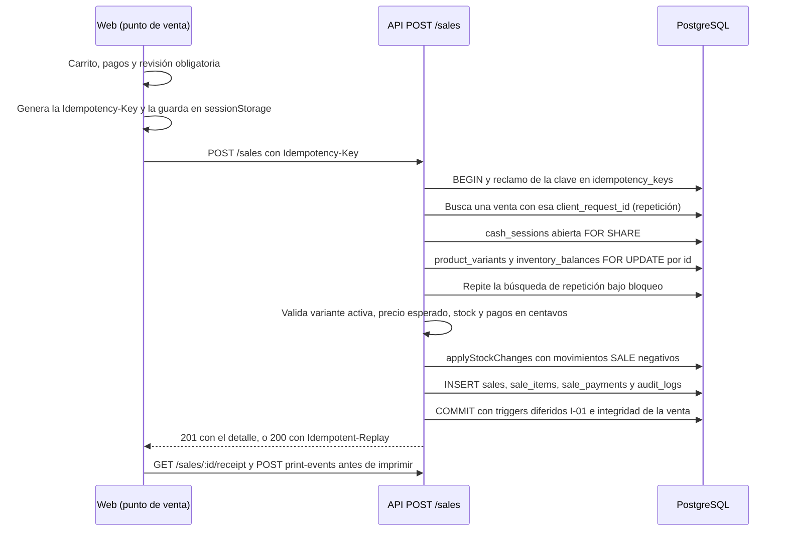

# 07 · Actualización del informe de software (2026-11-11)

Estado al **2026-11-11** de la rama `feature/f2-integracion` (`7e36948`), comparada con `origin/main`
(`54a4f3e`, la Fase 1 integrada y descrita en las secciones [00](00-resumen-ejecutivo-e-indice.md) a
[06](06-estado-deuda-y-fase-2.md)). Este documento es **autocontenido**: describe lo que se construyó
entre el 2026-11-09 y el 2026-11-11, el estado completo del sistema hoy y lo que falta decidir.

**Método.** Lo elaboró el agente de documentación leyendo el repositorio: código, migraciones, esquema,
documentos y el registro de referencias de Git (`.git/logs`, que guarda hash y mensaje de cada commit
de cada rama). Las cifras se contaron sobre los archivos; donde no se pudo verificar algo se dice. **No
se ejecutaron pruebas ni comandos** en esta revisión: los resultados de las suites los completa el
orquestador en la tabla de la sección 8.

Nota sobre la base de comparación: la referencia local `main` está desactualizada (`0af9ef1`, primer
push de la Fase 1), así que `git log main..HEAD` lista casi todo el historial. La base real de esta
etapa es `origin/main` = `54a4f3e`; el anexo (sección 14) enumera los 26 commits de `54a4f3e..7e36948`.

## 1. Resumen ejecutivo

- **Qué se pidió.** El 2026-11-10 el responsable autorizó, por escrito, idempotencia, garantías nuevas
  en la base de datos, pantalla de roles, miniaturas de fotos y «todo el módulo de Ventas», y pidió este
  informe ([RESOLUCIONES-2026-11-10](../business/RESOLUCIONES-2026-11-10.md)). El 2026-11-09 ya había
  autorizado unificar el libro de inventario y el seed de producción con prueba de arranque.
- **Qué se entregó.** Todo lo autorizado está implementado, probado y fusionado en
  `feature/f2-integracion`: libro de inventario unificado (E0 a), seed de producción ejecutable con prueba
  de arranque de la imagen, garantías de integridad en la base (I-01, I-02, sin `TRUNCATE` en
  producción), idempotencia con `Idempotency-Key`, gestión de roles por pantalla, miniaturas de fotos y
  **venta de mostrador con caja única y comprobante interno** (backend, endurecimiento de seguridad y
  web).
- **La regla que no se movió.** Una venta confirmada **no se anula, no se borra y no se modifica**
  (DEC-V07). No hay estado, ruta, permiso ni movimiento de anulación, y lo comprueban una guarda
  estática, triggers de la base y una prueba sobre la tabla de rutas.
- **Revisión de seguridad de Ventas.** 1 hallazgo medio y 6 bajos, **todos corregidos** en `57c8bdd`.
- **Qué falta.** Nada está publicado: no hubo push, PR ni despliegue (requieren indicación aparte) y el
  CI de GitHub Actions sigue bloqueado por facturación. Los 19 valores por defecto de Ventas (D-01 a
  D-19) y tres límites técnicos, la contradicción X-1 y la lista de permisos exclusivos esperan
  confirmación del responsable. Antes de
  operar con dinero real faltan el despliegue en la PC de la tienda, las copias de respaldo con una
  restauración ensayada y la consulta al contador y a un asesor legal.

### 1.1 Cifras (contadas sobre los archivos)

«Antes» son las cifras del [resumen del 2026-11-07](00-resumen-ejecutivo-e-indice.md#2-cifras-del-repositorio-medidas);
«Ahora», las de `7e36948`.

| Métrica                              | Antes       | Ahora        | Fuente del recuento                                |
| ------------------------------------ | ----------- | ------------ | -------------------------------------------------- |
| Endpoints HTTP                       | 101         | 127          | rutas declaradas en `apps/api/src/modules`         |
| Archivos de rutas                    | 19          | 26           | `apps/api/src/modules/**/*.routes.ts`              |
| Módulos de la API                    | 11          | 15           | carpetas de `apps/api/src/modules`                 |
| Tablas                               | 34          | 45           | `model` en `schema.prisma`                         |
| Enums                                | 15          | 19           | `enum` en `schema.prisma`                          |
| Migraciones                          | 17          | 22           | carpetas de `prisma/migrations`                    |
| Triggers                             | 8           | 23           | `CREATE TRIGGER` menos el recreado                 |
| Permisos                             | 24          | 34           | `PERMISSIONS` en `packages/shared`                 |
| Admin. / Responsable / Vendedor      | 24 / 18 / 2 | 34 / 25 / 5  | `DEFAULT_ROLE_PERMISSIONS`                         |
| ADR aceptados                        | 21          | 24           | `docs/decisions/ADR-*.md`                          |
| Pantallas de la web                  | no consta   | 33 + login   | `apps/web/src/app/router.tsx`                      |
| Archivos de prueba (API / web / E2E) | no consta   | 61 / 46 / 23 | `test/**/*.test.ts`, `*.test.tsx`, `e2e/*.spec.ts` |

Además: 41 restricciones `CHECK` nuevas netas (42 declaradas, una reemplazada por B-3) y 15 triggers
nuevos (2 del libro y 13 de ventas y caja; `sale_incidents_guard` se recreó en el endurecimiento y se
cuenta una vez). Los 26 commits de la etapa son 19 de trabajo y 7 de fusión.

### 1.2 Qué cambió desde el informe anterior

| Tema del informe anterior                                          | Estado hoy                                                       |
| ------------------------------------------------------------------ | ---------------------------------------------------------------- |
| Dos escritores del libro fuera de inventario y saldos borrados     | Resuelto: todo pasa por `applyStockChanges` (`d2584b5`)          |
| Variante activa sin validar bajo bloqueo; orden de bloqueo inverso | Resuelto: `requireActive` y `stock-locks.ts` (`d2584b5`)         |
| Sin verificación «saldo = suma de movimientos»                     | Resuelto: prueba de invariante y trigger diferido I-01           |
| Sin idempotencia                                                   | Parcial: confirmaciones y Ventas sí; creaciones de borrador no   |
| El seed de producción probablemente no corre en la imagen          | Confirmado y corregido: `node dist/seed.js` y prueba de arranque |
| Sin gestión de roles                                               | Resuelto: API `/roles` y pantalla «Roles» (P-46)                 |
| `/cover` revalida cada imagen; fotos de 1200 px como miniatura     | Resuelto: miniaturas 160/320/640 y portadas por lotes            |
| `TRUNCATE` no lo cubren los triggers append-only                   | Parcial: se revoca al arrancar la imagen; no con superusuario    |
| Ventas solo en análisis                                            | Implementado: venta, caja, comprobante, incidencias y datos      |
| Copias externas, hosting, observabilidad                           | Sin cambios: siguen abiertos (sección 11)                        |

## 2. Cronología de decisiones del responsable y su efecto

- **2026-11-07 · Resolución formal Q-V07, Q-V09 y Q-V12** (registrada el 2026-11-09,
  [RESOLUCIONES-2026-11-07](../business/RESOLUCIONES-2026-11-07.md)). Autorización: **solo análisis y
  planificación**.
  - DEC-V07: prohibida la anulación de ventas confirmadas (sin `POST /sales/:id/void`, `sales:void`,
    `SALE_VOID` ni estado `VOIDED`). Efecto: la venta se diseñó sin estado e inmutable (ADR-022).
  - DEC-V09: caja lógica única con apertura, cierre y arqueo. Efecto: ADR-023 y el módulo `cash`.
  - DEC-V12: comprobante interno imprimible por el navegador, tamaño configurable. Efecto: ADR-024.
- **2026-11-09 · Cuestionario de continuidad**
  ([RESOLUCIONES-2026-11-09](../business/RESOLUCIONES-2026-11-09.md)).
  - Autorizó: A1 a) unificar el libro de inventario; A2 registrar las decisiones; A3 a) seed de
    producción ejecutable y prueba de arranque en el CI. Efecto: commits `d2584b5` y `05f881d`.
  - Decidió el diseño de caja (B1 a B9): venta y caja juntas, sin venta sin sesión, abren y cierran
    Administrador y Responsable, fondo obligatorio de monto libre, diferencia con observación sin
    tolerancia, sin gastos ni retiros, sin reapertura, QR y transferencia aparte, arqueo por sesión.
  - Comprobante (B10, B11, C1 a C4): numeración por secuencia con saltos posibles, sin número de factura
    externa, datos comerciales en la base, A4 por defecto recordado por navegador, reimpresión con
    «Copia» y auditoría.
  - Venta errónea (C5, C6): incidencia resuelta fuera del sistema, sin ajuste de stock ni documento
    compensatorio; reportan Vendedor y Responsable, ve el Administrador.
  - Operación: reportes mínimos CSV con valor del inventario (D1, P-44), carga manual sin importador
    (D2, P-45), conjunto de garantías de base recomendado (D3, sin implementar aún), despliegue
    **local** en la PC de la tienda, dejado para después (D5), dos administradores (D6), sin 2FA (D7).
  - Documentación: ADR aceptados se enmiendan con notas (E1), `ROADMAP.md` pasa a histórico (E2),
    versión etiquetada al cerrar la Fase 1 (E3), el informe técnico se archiva como la revisión de
    seguridad y rendimiento (E4).
  - Aclaraciones posteriores del mismo día: fondo en campo libre (B4), **solo el Administrador corrige
    cierres** por la vía que se recomiende (B6/B7), flujo de incidencias delegado (C5), el reporte
    incluye el valor del inventario (D1).
- **2026-11-10 · Autorización de implementación** (texto literal en
  [RESOLUCIONES-2026-11-10](../business/RESOLUCIONES-2026-11-10.md)): idempotencia, garantías nuevas en
  la base, pantalla de roles, miniaturas y todo el módulo de Ventas (E1 venta de mostrador y E3 caja,
  según el [plan 11](../propuestas/fase-2-ventas/11-plan-de-implementacion.md)), más este informe y el
  proyecto levantado en local. Siguen fuera: anulaciones (E2), cambios de pieza ligados a ventas (E4),
  reportes de ventas (E5), descuentos, clientes, créditos, gastos y retiros de caja, reapertura y
  facturación. Push, PR y despliegue requieren indicación aparte. Efecto: commits `7fb458e`, `44b40d4`,
  `b93b2f0`, `4b3e069` y la serie de Ventas `a5cbf13` a `419714a`.

## 3. Trabajo entregado por pista

### 3.1 E0 (a) · Un solo libro de inventario

- **Qué hace.** Toda escritura en `inventory_movements` e `inventory_balances` ocurre en
  `modules/inventory/**` mediante `applyStockChanges`. La confirmación de ingresos y el stock inicial
  dejaron de escribir saldo y movimiento por su cuenta; la eliminación física de fichas usa
  `dropEmptyBalances`, que nunca borra un saldo distinto de cero.
- **Diseño.** `applyStockChanges` valida que la variante exista (404 de negocio en vez de una violación
  de clave foránea), acepta `requireActive` (variante y producto activos, comprobado **bajo el
  bloqueo**) y fija `referenceType` con `REFERENCE_TYPES` de `packages/shared`. El nuevo
  `stock-locks.ts` impone un orden único: variantes por id y luego saldos por id de variante. Corrige
  tres carreras: desactivar una pieza mientras se confirmaba un ingreso o se aprobaba un ajuste podía
  dejar stock en una pieza inactiva, y eliminar una ficha durante otra operación de stock podía
  interbloquear (503). Sin cambios de contratos HTTP.
- **Archivos principales.** `apps/api/src/modules/inventory/stock-ledger.ts`, `stock-locks.ts`,
  `inventory.service.ts`, `apps/api/src/modules/stock-entries/stock-entries.service.ts`,
  `apps/api/src/modules/catalog/products.service.ts`.
- **Migraciones.** Ninguna.
- **Pruebas.** `test/unit/ledger-write-guard.test.ts` (lee el código fuente y falla si aparece una
  escritura al libro fuera de `modules/inventory`), `test/integration/ledger-apply.test.ts` (contrato de
  `applyStockChanges`), `ledger-invariant.test.ts` (escenario mixto y `assertLedgerInvariant`),
  `ledger-concurrency.test.ts` (desactivar frente a confirmar o aprobar; eliminar sin interbloqueo) y
  los ayudantes `test/helpers/ledger.ts` y `locks.ts`.

### 3.2 Seed de producción y prueba de arranque de la imagen (A3 a)

- **Qué hace.** Se comprobó que `npx prisma db seed` dentro de la imagen fallaba (`spawn tsx ENOENT`):
  `tsx` es dependencia de desarrollo y la imagen no trae `src/` ni el código de `@joyeria/shared`, así
  que la base quedaba sin permisos, roles ni administrador. Ahora `tsup` compila también
  `prisma/seed.ts` a `dist/seed.js` y el primer despliegue usa `node dist/seed.js` (misma lógica,
  idempotente, sin datos DEMO).
- **Prueba de arranque.** `scripts/smoke-image.sh`, ejecutado por el job `docker` del CI tras construir
  la imagen: PostgreSQL 18 efímero, `CMD` real (migraciones desde cero, revocación de `TRUNCATE` y
  servidor), `GET /api/v1/health` = 200, la SPA en `/`, ninguna tabla con `TRUNCATE` para el rol de la
  aplicación, seed compilado dos veces y login del administrador sembrado (200; clave incorrecta 401).
  Las credenciales son efímeras y no se imprimen.
- **Archivos principales.** `apps/api/tsup.config.ts`, `scripts/smoke-image.sh`, `.github/workflows/ci.yml`,
  `Dockerfile`, [DEPLOYMENT.md](../deployment/DEPLOYMENT.md) (paso 6 y sección «Prueba de arranque»).
- **Migraciones.** Ninguna.

### 3.3 Garantías de integridad en la base de datos (D3)

- **I-01 · el saldo coincide con el libro.** Dos _constraint triggers_ diferidos
  (`inventory_balances_match_ledger` e `inventory_movements_match_balance`) se evalúan al confirmar la
  transacción: el saldo de cada variante debe ser el `balance_after` de su último movimiento y la cadena
  `balance_before`/`balance_after` debe ser continua. Un saldo cambiado sin movimiento, un movimiento
  sin saldo o una cadena rota revierten **toda** la transacción, incluida su auditoría.
- **I-02 · un movimiento por documento, variante y tipo.** Índice único parcial
  `inventory_movements_reference_variant_type_key` sobre `(reference_type, reference_id, variant_id, type)`.
- **Verificación previa.** La migración revisa los datos existentes y **aborta con un mensaje** si hay
  incoherencias; no corrige nada en silencio.
- **Sin `TRUNCATE` en producción.** El `CMD` de la imagen ejecuta
  `prisma/privileges/revoke-app-truncate.sql` (idempotente) después de migrar. No se usa un trigger
  `BEFORE TRUNCATE` porque rompería la limpieza de las pruebas. Límite en la sección 9.
- **Archivos principales.** Migración `20261110000000_ledger_integrity`,
  `apps/api/prisma/privileges/revoke-app-truncate.sql`, `Dockerfile`,
  [DATABASE.md](../database/DATABASE.md) («Garantías de integridad del libro»).
- **Pruebas.** `test/integration/database-integrity.test.ts` (saldo cambiado por SQL, saldo sin
  movimiento, movimiento sin saldo, cadena rota con saldo final correcto, reversión completa al
  confirmar, varios movimientos válidos en una transacción, I-02 y revocación de `TRUNCATE` en tablas
  actuales y futuras). Las pruebas que creaban saldos sueltos usan ahora `setStock`, que pasa por
  `applyStockChanges`.

### 3.4 Idempotencia con `Idempotency-Key` (E0)

- **Qué hace.** La misma clave con el mismo cuerpo, ruta y usuario devuelve la respuesta original con
  `Idempotent-Replay: true` y sin repetir movimientos ni auditoría; con otro cuerpo, ruta o usuario
  responde `409 IDEMPOTENCY_KEY_REUSED`; dos envíos simultáneos ejecutan una sola vez. Si la operación
  falla, la clave no se guarda y el reintento vuelve a ejecutar.
- **Diseño.** Tabla `idempotency_keys` (clave, usuario, alcance método + ruta, SHA-256 del JSON
  canónico de `{ params, body }`, respuesta, vencimiento). La clave se reclama como **primer paso** de
  la transacción con `INSERT … ON CONFLICT`. Vigencia de 24 h con limpieza horaria. Ayudantes
  `idempotencyOf`, `requiredIdempotencyOf` (`src/plugins/idempotency.ts`), `idempotentTransaction` y
  `runIdempotent` (`src/lib/idempotency.ts`). En la web, `useAttemptKeys` reutiliza la clave en los
  reintentos de un mismo intento (`apps/web/src/lib/idempotency.ts`), también por HTTP en la red local.
- **Dónde se usa.** Exigida (sin ella, `400 IDEMPOTENCY_KEY_REQUIRED`) en 5 rutas: `POST /sales`,
  `POST /sale-incidents`, `POST /cash/sessions`, `POST /cash/sessions/:id/close` y
  `POST /cash/sessions/:id/corrections`. Opcional en 7: confirmar ingreso, stock inicial, aprobar
  ajuste, cambio de pieza, cerrar ronda de conteo, aprobar conteo y registrar una impresión del
  comprobante (B-5). En Ventas y Caja la clave queda **además** en una columna única de la tabla de
  dominio, de modo que la repetición funciona aunque la clave genérica haya vencido.
- **Migraciones.** `20261110010000_idempotency_keys`.
- **Pruebas.** `test/unit/idempotency.test.ts`, `test/integration/idempotency.test.ts` (401 antes que
  400, 403 sin reclamar la clave, repetición, otro cuerpo, otra ruta, otro usuario, concurrencia, fallo
  y reintento, vencimiento y limpieza) y `apps/web/src/lib/idempotency.test.tsx`.

### 3.5 Gestión de roles por pantalla (P-46)

- **Qué hace.** Página «Roles» (menú Acceso, permiso nuevo `roles:read`) con la lista de roles, su tipo,
  número de permisos y de usuarios, y un formulario de alta y edición con permisos agrupados por área.
  API `GET/POST /roles`, `GET /roles/permissions` y `PATCH/DELETE /roles/:id` (`roles:manage`).
- **Salvaguardas.** El rol Administrador no pierde permisos, no se renombra ni se elimina; los otros
  roles de sistema no se renombran ni pierden sus permisos base; un rol con usuarios no se elimina;
  nadie concede permisos que no tiene (tampoco al asignar roles a usuarios); los permisos exclusivos
  del Administrador no se asignan a otro rol (`422`, ver sección 7); toda alta, edición o baja queda en
  `audit_logs` con antes y después. Los cambios rigen desde la siguiente petición.
- **Archivos principales.** `apps/api/src/modules/roles/`, `apps/web/src/features/roles/`,
  `packages/shared/src/permissions.ts`.
- **Migraciones.** Ninguna (el permiso nuevo llega con el seed).
- **Pruebas.** `test/integration/roles.test.ts`, `test/unit/role-management.test.ts`,
  `role-permissions.test.ts`, `roles-page.test.tsx` y el E2E `roles-management.spec.ts`.

### 3.6 Miniaturas de fotos y portadas sin revalidación (OD-04, DT-DAT-17/18)

- **Qué hace.** Cada foto se sirve también en 160, 320 y 640 px (`?w=`; otro ancho → 400), generadas
  con `sharp` al subir (sin dependencias nuevas) y guardadas en `product_photo_thumbnails`; las fotos
  anteriores las generan la primera vez que se piden. Caché `private, max-age=31536000, immutable` con
  `ETag` propio. `GET /products/variants/covers?ids=…` (hasta 100) entrega las portadas de una pantalla
  en una sola consulta y la imagen se pide luego por su URL inmutable.
- **Web.** `PieceImage`, `ProductThumb` y la galería usan `srcset`, `sizes`, `width`, `height` y
  `loading="lazy"`; una pieza sin foto muestra un marcador local sin petición.
- **Medición citada** ([nota de ADR-020](../decisions/ADR-020-fotos-de-producto.md)): en una foto real,
  la miniatura de 160 px pesa 2,5 KB frente a 44,7 KB de la versión de 1200 px; el espacio por foto
  crece cerca de un 55 %.
- **Migraciones.** `20261110000001_product_photo_thumbnails`.
- **Pruebas.** `test/integration/product-photo-thumbnails.test.ts`, `piece-image.test.tsx`,
  `photo-url.test.tsx` y `photos.test.tsx`.

### 3.7 Ventas de mostrador y caja única

Plan ejecutado: [11-plan-de-implementacion](../propuestas/fase-2-ventas/11-plan-de-implementacion.md),
rebanadas S1 a S8. Decisiones de diseño en
[ADR-022](../decisions/ADR-022-venta-de-mostrador-inmutable.md) (venta),
[ADR-023](../decisions/ADR-023-caja-unica-arqueo-y-correcciones.md) (caja) y
[ADR-024](../decisions/ADR-024-comprobante-interno.md) (comprobante). Guía para la tienda:
[ventas-y-caja.md](../guias/ventas-y-caja.md).

**Backend.**

- **S1 · Esquema, permisos y contratos** (`a5cbf13`). Migración `20261111000000_sales_and_cash` con
  nueve tablas, cuatro enums, CHECK, índice parcial de caja única y 13 triggers; nueve permisos nuevos;
  constantes y esquemas Zod compartidos (`packages/shared/src/sales.ts` y `schemas/`); `SALE` en
  `REFERENCE_TYPES` (el tipo de movimiento `SALE` ya existía reservado; no se agregó ningún valor al
  enum).
- **S2 · Caja** (`e206f0f`). `modules/cash/`: estado, apertura con fondo, sesión actual con cifras en
  vivo, historial, cierre con arqueo y observación obligatoria si hay diferencia, correcciones
  append-only solo del Administrador. `cash-locks.ts` (`lockOpenCashSession`, bloqueo por id) y
  `cash-math.ts` (aritmética en centavos).
- **S3 · Venta** (`d84e335`). `modules/sales/`: `POST /sales` atómica e idempotente (clave
  obligatoria) que bloquea caja → variantes → saldos, valida precio, stock y pagos en Bs (efectivo con
  vuelto, QR, transferencia y combinaciones) y descuenta stock **solo** con movimientos `SALE` del
  libro. Historial y detalle: sin `sales:read-all` solo las ventas propias; una ajena responde 404.
- **S4 · Comprobante, datos del negocio e incidencias** (`1e5282e`). `GET /sales/:id/receipt`
  (proyección de filas inmutables, sin costos ni referencias de pago), registro de impresiones con
  numeración de copias, `modules/settings/` (registro único `business_settings`) e incidencias de solo
  trazabilidad (`/sale-incidents`).
- **Endurecimiento tras la revisión de seguridad** (`57c8bdd`). Migración
  `20261111010000_sales_security_hardening`; detalle en la sección 7.3.

**Frontend.**

- **S5 · Caja** (`a01f6cb`). `/caja`, `/caja/cierre`, `/caja/historial` y `/caja/sesiones/:id`:
  apertura con fondo (el cero se escribe), cifras en vivo, cierre con la diferencia anunciada,
  observación obligatoria y confirmación «El cierre no se puede reabrir»; correcciones del
  Administrador con la marca «Corregida (N)».
- **S6 · Punto de venta y comprobante** (`b9f551e`). `/ventas/nueva`: lector de códigos (texto + Enter)
  o búsqueda, foto junto al nombre, cantidades con tope de stock, pagos con «Falta» y «Vuelto» en vivo,
  **revisión obligatoria** con el aviso de que la venta no se puede anular, y confirmación con la clave
  generada al revisar y guardada en `sessionStorage`: un corte de red, un 503 o una recarga reenvían la
  misma operación y la pantalla muestra «Resultado incierto: no cobre de nuevo». `/ventas/:id/comprobante`:
  58 mm, 80 mm, A5 y A4 (A4 por defecto, recordado en el navegador), impresión registrada antes de
  imprimir y «COPIA» desde la segunda.
- **S7 · Historial, detalle, incidencias y datos del negocio** (`fb8b2a0`). `/ventas` (el Vendedor solo
  ve las suyas), `/ventas/:id` de solo lectura con «Reportar incidencia», `/ventas/incidencias`
  (Administrador, cierre con resolución obligatoria) y `/configuracion/negocio`. El menú gana el grupo
  «Ventas» y pierde la entrada «Devoluciones».
- **S8 · E2E por rol, guía y correcciones** (`419714a`). `sales-admin.spec.ts`, `sales-cashier.spec.ts`,
  `sales-last-piece.spec.ts` y `sales-seller.spec.ts`; ampliación de `responsive.spec.ts` a 22
  pantallas; guía [ventas-y-caja.md](../guias/ventas-y-caja.md).

**Pruebas de Ventas y Caja (API).** Unitarias: `sale-math.test.ts`, `cash-math.test.ts`,
`no-sale-void-guard.test.ts`, `permissions-matrix.test.ts`, `role-permissions.test.ts`. Integración:
`sales.test.ts`, `sales-idempotency.test.ts`, `sales-concurrency.test.ts`, `sales-invariant.test.ts`,
`sales-immutability.test.ts` (triggers por SQL directo), `sales-receipt.test.ts`, `cash.test.ts`,
`cash-concurrency.test.ts`, `cash-corrections.test.ts`, `sale-incidents.test.ts`,
`business-settings.test.ts` y `admin-only-permissions.test.ts`; además la ampliación de
`ledger-invariant.test.ts` con ventas.

## 4. Arquitectura actualizada

Monolito modular en un monorepo (npm workspaces); en producción un solo contenedor en el que la API
(Fastify 5, Prisma 7, PostgreSQL 18) sirve también la SPA (React 19, Vite, Tailwind 4, TanStack Query).

### 4.1 Módulos y plugins

- **Módulos de la API (15)** en `apps/api/src/modules`, bajo `/api/v1`: `health`, `auth`, `users`,
  `roles` (nuevo), `suppliers`, `catalog` (con `photos`), `stock-entries`, `inventory` (con
  `stock-ledger.ts` y `stock-locks.ts`), `inventory-counts`, `pricing`, `approvals`, `audit`, `cash`
  (nuevo), `sales` (nuevo: venta, comprobante, incidencias y medios de pago) y `settings` (nuevo: datos
  del negocio).
- **Plugins (5)**: `security`, `error-handler`, `prisma`, `auth` e `idempotency` (nuevo).
- **Paquete compartido** `packages/shared`: permisos y `ADMIN_ONLY_PERMISSIONS`, códigos de error,
  `REFERENCE_TYPES`, constantes de Ventas (`sales.ts`: límites, formatos `VTA-`, `CAJ-`, `INC-`,
  `MONEY_INPUT_MAX`) y esquemas Zod estrictos de caja, ventas, incidencias y dinero.
- **Web**: `apps/web/src/features/` gana `roles`, `cash`, `sales` y `settings`; el router declara 33
  pantallas dentro del panel más el login y la página 404.
- **Regla del libro.** Solo `modules/inventory` escribe movimientos y saldos (guarda estática en las
  pruebas y trigger I-01 en la base). Ventas lo hace a través de `applyStockChanges`.

### 4.2 Orden global de bloqueos

Todas las operaciones que bloquean siguen el mismo orden, en `READ COMMITTED`:

1. Reclamo de la `Idempotency-Key` (primer paso de la transacción) y lectura de una posible repetición,
   sin bloqueos de dominio.
2. La fila de `cash_sessions`: la venta toma `FOR SHARE` sobre la sesión abierta; el cierre y la
   corrección toman `FOR UPDATE` por id (el cierre espera como máximo 5 s con `lock_timeout` y luego
   responde 503 con `Retry-After`).
3. `product_variants` por id ascendente (`lockVariants`).
4. `inventory_balances` por id de variante (`lockVariantsAndBalances`; `applyStockChanges` los vuelve a
   tomar sin esperar).
5. Inserciones (venta, líneas, pagos, auditoría) sin bloqueos explícitos.

Consecuencias: el cierre y la corrección solo bloquean la sesión, nunca variantes ni saldos; ingresos,
ajustes, conteos y cambios de pieza nunca bloquean la sesión; registrar una impresión bloquea solo la
fila de la venta. No hay ciclos posibles. Una venta en curso antes del cierre entra en el arqueo; una
que llega durante o después recibe `422 CASH_SESSION_REQUIRED` sin efectos.

### 4.3 Flujo de una venta de punta a punta

En texto: la web arma el carrito y obliga a revisar; al confirmar, la API reclama la clave, busca una
repetición, bloquea caja, variantes y saldos en ese orden, vuelve a buscar la repetición, valida con
los datos vigentes (`VARIANT_NOT_SELLABLE`, `PRICE_CHANGED`, `INSUFFICIENT_STOCK`, `PAYMENT_MISMATCH`),
descuenta stock con movimientos `SALE`, inserta venta, líneas, pagos y auditoría y confirma. Al
`COMMIT` la base exige saldo = libro, al menos una línea y un pago, Σ líneas = total = Σ pagos y que
cada línea apunte a su movimiento `SALE`. Ante cualquier error la API vuelve a buscar la venta de esa
clave: si ya existe (respuesta perdida en la red), responde la repetición en lugar del error.

### 4.4 Idempotencia en una línea

Una clave por **intento del usuario**, reutilizada en sus reintentos; protege contra el doble clic, el
reintento tras un corte de red y el 503, pero **no** contra dos ventas idénticas hechas a propósito con
dos intentos distintos (SD-A03 sigue abierta).

## 5. Modelo de datos actualizado

### 5.1 Tablas nuevas (11; total 45)

- `product_photo_thumbnails`: miniaturas WebP por `(photo_id, width)`.
- `idempotency_keys`: claves de idempotencia con respuesta guardada y vencimiento.
- `payment_methods`: catálogo sembrado de tres medios (Efectivo, QR, Transferencia).
- `cash_sessions`: sesiones de caja con apertura, cierre y arqueo congelado.
- `sales`, `sale_items`, `sale_payments`: venta inmutable con snapshots de precio, costo, SKU, nombres,
  vendedor y medio de pago.
- `sale_receipt_prints`: impresiones del comprobante (append-only, numeradas).
- `cash_session_corrections`: correcciones append-only de cierres.
- `sale_incidents`: incidencias de solo trazabilidad.
- `business_settings`: registro único con los datos comerciales.

Enums nuevos (4; total 19): `cash_session_status`, `cash_correction_kind`, `sale_incident_kind` y
`sale_incident_status`. Todas las claves foráneas nuevas de Ventas son `ON DELETE RESTRICT`.
Detalle de columnas en [DATABASE.md](../database/DATABASE.md) y en el plan 11 §3.

### 5.2 Garantías de integridad en la base (lista completa de lo nuevo)

Libro de inventario:

- I-01: triggers diferidos `inventory_balances_match_ledger` e `inventory_movements_match_balance`.
- I-02: índice único parcial `inventory_movements_reference_variant_type_key`.
- I-05 parcial: `inventory_movements_sale_sign_check` (un movimiento `SALE` siempre resta).

Caja:

- `cash_sessions_single_open_idx`: índice único parcial, **una sola sesión abierta**.
- CHECK: fondo, contado y cobros en efectivo ≥ 0; cierre posterior a la apertura; datos de cierre
  presentes si y solo si la sesión está cerrada; movimientos de caja = 0 (B6); esperado = fondo + cobros
  en efectivo + movimientos; diferencia = contado − esperado; observación de al menos 3 caracteres si la
  diferencia no es cero; hash de cierre hexadecimal.
- Trigger `cash_sessions_guard`: la sesión nace abierta y sin datos de cierre, no se borra, una cerrada
  no cambia ni se reabre, el cierre no altera los datos de apertura y **recalcula** los cobros en
  efectivo de sus ventas.
- `cash_session_corrections`: CHECK de tipo y valores, valor nuevo ≥ 0 y distinto del anterior,
  aritmética, motivo de al menos 10 caracteres; triggers `cash_session_corrections_append_only` y
  `cash_session_corrections_validate` (solo sesiones cerradas, valor anterior = vigente, cifras
  recalculadas con los cobros congelados, secuencia sin saltos).

Ventas:

- CHECK: total > 0, nombre del vendedor no vacío, hash de la petición hexadecimal; línea con cantidad
  y precio > 0, `line_total = quantity × unit_price`, costo ≥ 0; pago > 0, campos de efectivo
  (recibido y vuelto) presentes **solo** en efectivo (B-3), vuelto ≥ 0 y recibido = aplicado + vuelto,
  sin referencia en efectivo.
- Clave foránea compuesta `(method_id, method_is_cash)` hacia `payment_methods (id, is_cash)`: un pago
  no puede declararse en efectivo si el medio no lo es.
- Únicos: `sales.client_request_id`, `sales.number`, `sale_items (sale_id, variant_id)`,
  `sale_items.movement_id`, `sale_receipt_prints (sale_id, copy_number)`.
- Triggers `sales_immutable`, `sale_items_immutable` y `sale_payments_immutable`: todo `UPDATE` o
  `DELETE` falla.
- Trigger `sales_require_open_session`: toda venta pertenece a una sesión abierta y no es anterior a su
  apertura.
- Triggers diferidos `sales_integrity_check`, `sale_items_integrity_check` y
  `sale_payments_integrity_check`: al confirmar, al menos una línea y un pago y Σ líneas = total =
  Σ pagos (impide también agregar líneas o pagos después).
- Trigger diferido `sale_items_movement_check`: cada línea apunta a su movimiento `SALE` (misma
  variante, cantidad negada, documento de la misma venta y mismo costo).
- `sale_receipt_prints`: CHECK de copia ≥ 1 y formato en lista blanca; trigger append-only.

Incidencias, configuración y fotos:

- `sale_incidents`: descripción y resolución de al menos 10 caracteres, estado cerrado si y solo si hay
  resolución, quién y cuándo; trigger `sale_incidents_guard` (nace abierta y sin datos de cierre, B-7;
  no se borra; solo cambia de abierta a cerrada y solo en los campos de cierre).
- `business_settings`: `CHECK (id = 1)` (registro único) y nombre comercial no vacío.
- `product_photo_thumbnails`: ancho en 160, 320 o 640 y bytes no vacíos.
- Índices de idempotencia de dominio: `cash_sessions.open_request_id`, `close_request_id`,
  `cash_session_corrections.client_request_id` y `sale_incidents.client_request_id`.

Privilegios: revocación de `TRUNCATE` al rol de la aplicación en producción (sección 9).

Se mantienen las garantías anteriores (libro y auditoría append-only, `CHECK (quantity >= 0)` en saldos,
historiales inmutables de precios, ajustes y conteos). **Siguen sin aplicar** I-03 (ingreso confirmado
inmutable), I-04 (clave foránea `movement_id` de ajustes y conteos) e I-06; I-05 solo cubre `SALE`
([DATABASE.md](../database/DATABASE.md), «Garantías propuestas pendientes»).

## 6. API: los 127 endpoints

Prefijo `/api/v1`. «público»: sin sesión; «sesión»: cualquier usuario autenticado; `a` + `b`: exige
ambos permisos; «uno de»: basta uno. «Clave exigida u opcional» se refiere a `Idempotency-Key`.
Autorización en `preValidation` (401/403 antes que 400). Contratos en [API.md](../api/API.md).

### 6.1 Plataforma, acceso y auditoría (20)

| Método | Ruta                        | Permiso                         |
| ------ | --------------------------- | ------------------------------- |
| GET    | `/health`                   | público                         |
| POST   | `/auth/login`               | público                         |
| POST   | `/auth/logout`              | sesión                          |
| GET    | `/auth/me`                  | sesión                          |
| POST   | `/auth/change-password`     | sesión                          |
| GET    | `/users/roles`              | `users:read` + `roles:manage`   |
| GET    | `/users`                    | `users:read`                    |
| POST   | `/users`                    | `users:manage` + `roles:manage` |
| GET    | `/users/:id`                | `users:read`                    |
| PATCH  | `/users/:id`                | `users:manage`                  |
| POST   | `/users/:id/reset-password` | `users:manage`                  |
| PUT    | `/users/:id/roles`          | `users:manage` + `roles:manage` |
| GET    | `/roles`                    | `roles:read` (nuevo)            |
| GET    | `/roles/permissions`        | `roles:read` (nuevo)            |
| POST   | `/roles`                    | `roles:manage` (nuevo)          |
| PATCH  | `/roles/:id`                | `roles:manage` (nuevo)          |
| DELETE | `/roles/:id`                | `roles:manage` (nuevo)          |
| GET    | `/audit`                    | `audit:read`                    |
| GET    | `/audit/actions`            | `audit:read`                    |
| GET    | `/audit/:id`                | `audit:read`                    |

### 6.2 Catálogo, fotos y proveedores (36)

| Método | Ruta                                      | Permiso                          |
| ------ | ----------------------------------------- | -------------------------------- |
| GET    | `/suppliers`                              | `suppliers:read`                 |
| GET    | `/suppliers/:id`                          | `suppliers:read`                 |
| POST   | `/suppliers`                              | `suppliers:manage`               |
| PATCH  | `/suppliers/:id`                          | `suppliers:manage`               |
| GET    | `/categories`                             | `catalog:read`                   |
| GET    | `/categories/:id`                         | `catalog:read`                   |
| POST   | `/categories`                             | `catalog:manage`                 |
| PATCH  | `/categories/:id`                         | `catalog:manage`                 |
| PUT    | `/categories/:id/attributes`              | `catalog:manage`                 |
| GET    | `/attributes`                             | `catalog:read`                   |
| POST   | `/attributes`                             | `catalog:manage`                 |
| PATCH  | `/attributes/:id`                         | `catalog:manage`                 |
| POST   | `/attributes/:id/options`                 | `catalog:manage`                 |
| PATCH  | `/attributes/:id/options/:optionId`       | `catalog:manage`                 |
| GET    | `/products`                               | `catalog:read`                   |
| GET    | `/products/health`                        | `catalog:read`                   |
| GET    | `/products/lookup`                        | `catalog:read`                   |
| GET    | `/products/:id`                           | `catalog:read`                   |
| POST   | `/products`                               | `catalog:manage`                 |
| PATCH  | `/products/:id`                           | `catalog:manage`                 |
| DELETE | `/products/:id`                           | `catalog:delete`                 |
| PATCH  | `/products/variants/:id`                  | `catalog:manage`                 |
| PATCH  | `/products/variants/:id/status`           | `catalog:manage`                 |
| PATCH  | `/products/variants/:id/barcode`          | `catalog:manage`                 |
| POST   | `/products/variants/:id/barcode/generate` | `catalog:manage`                 |
| POST   | `/products/:id/axes`                      | `catalog:manage`                 |
| POST   | `/products/:id/variants`                  | `catalog:manage`                 |
| GET    | `/products/:id/photos`                    | `catalog:read`                   |
| GET    | `/products/:id/photos/:photoId`           | permisos de imagen (nota)        |
| GET    | `/products/variants/covers`               | permisos de imagen (nota, nuevo) |
| GET    | `/products/variants/:variantId/cover`     | permisos de imagen (nota)        |
| POST   | `/products/:id/photos`                    | `catalog:manage`                 |
| PUT    | `/products/:id/photos/order`              | `catalog:manage`                 |
| PUT    | `/products/:id/photos/:photoId/cover`     | `catalog:manage`                 |
| DELETE | `/products/:id/photos/:photoId`           | `catalog:manage`                 |
| GET    | `/catalog/variants/lookup`                | `catalog:read`                   |

Nota: «permisos de imagen» es uno cualquiera de `catalog:read`, `inventory:read`, `stock-entries:read`,
`inventory-counts:read`, `inventory:adjust`, `inventory:exchange`, `prices:propose` o `prices:approve`
(`IMAGE_VIEW_PERMISSIONS` en `photos.routes.ts`). La foto por id y la portada aceptan `?w=160|320|640`.

### 6.3 Ingresos, costos, precios y aprobaciones (23)

| Método | Ruta                                  | Permiso                                                  |
| ------ | ------------------------------------- | -------------------------------------------------------- |
| GET    | `/stock-entries`                      | `stock-entries:read`                                     |
| GET    | `/stock-entries/:id`                  | `stock-entries:read`                                     |
| POST   | `/stock-entries`                      | `stock-entries:manage`                                   |
| PATCH  | `/stock-entries/:id`                  | `stock-entries:manage`                                   |
| PUT    | `/stock-entries/:id/items`            | `stock-entries:manage` + `costs:read`                    |
| PUT    | `/stock-entries/:id/costs`            | `stock-entries:manage` + `costs:read`                    |
| POST   | `/stock-entries/:id/items/quick`      | `stock-entries:manage` + `catalog:manage` + `costs:read` |
| POST   | `/stock-entries/:id/confirm`          | `stock-entries:confirm` + `costs:read` (clave opcional)  |
| POST   | `/stock-entries/:id/cancel`           | `stock-entries:manage`                                   |
| GET    | `/stock-entry-cost-types`             | `stock-entries:read`                                     |
| POST   | `/stock-entry-cost-types`             | `settings:manage`                                        |
| PATCH  | `/stock-entry-cost-types/:id`         | `settings:manage`                                        |
| GET    | `/products/variants/:id/cost-history` | `costs:read`                                             |
| GET    | `/pricing/variants`                   | uno de `prices:propose`, `prices:approve`                |
| GET    | `/pricing/variants/:id/history`       | uno de `prices:propose`, `prices:approve`                |
| GET    | `/pricing/changes`                    | uno de `prices:propose`, `prices:approve`                |
| GET    | `/pricing/pending-count`              | `prices:approve`                                         |
| POST   | `/pricing/requests`                   | `prices:propose`                                         |
| POST   | `/pricing/apply`                      | `prices:approve`                                         |
| POST   | `/pricing/changes/approve`            | `prices:approve`                                         |
| POST   | `/pricing/changes/reject`             | `prices:approve`                                         |
| POST   | `/pricing/changes/:id/cancel`         | `prices:propose`                                         |
| GET    | `/approvals/pending`                  | uno de los 3 permisos de aprobación                      |

Los 3 permisos de aprobación son `inventory:adjust-approve`, `prices:approve` e
`inventory-counts:approve`.

### 6.4 Inventario, ajustes, cambios de pieza y conteos (28)

| Método | Ruta                                                   | Permiso                                     |
| ------ | ------------------------------------------------------ | ------------------------------------------- |
| GET    | `/inventory/movements`                                 | `inventory:read`                            |
| GET    | `/inventory`                                           | `inventory:read`                            |
| GET    | `/inventory/:variantId/movements`                      | `inventory:read`                            |
| POST   | `/inventory/:variantId/initial`                        | `inventory:initial-stock` (clave opcional)  |
| GET    | `/inventory/adjustments/reasons`                       | `inventory:adjust`                          |
| GET    | `/inventory/adjustments/pending-count`                 | `inventory:adjust-approve`                  |
| GET    | `/inventory/adjustments`                               | `inventory:adjust`                          |
| GET    | `/inventory/adjustments/:id`                           | `inventory:adjust`                          |
| POST   | `/inventory/adjustments`                               | `inventory:adjust`                          |
| POST   | `/inventory/adjustments/:id/cancel`                    | `inventory:adjust`                          |
| POST   | `/inventory/adjustments/:id/approve`                   | `inventory:adjust-approve` (clave opcional) |
| POST   | `/inventory/adjustments/:id/reject`                    | `inventory:adjust-approve`                  |
| POST   | `/inventory/exchanges`                                 | `inventory:exchange` (clave opcional)       |
| GET    | `/inventory/exchanges/:referenceId`                    | `inventory:read`                            |
| GET    | `/inventory/counts`                                    | `inventory-counts:read`                     |
| POST   | `/inventory/counts`                                    | `inventory-counts:manage`                   |
| GET    | `/inventory/counts/:id`                                | `inventory-counts:read`                     |
| GET    | `/inventory/counts/:id/scans`                          | `inventory-counts:read`                     |
| POST   | `/inventory/counts/:id/start`                          | `inventory-counts:manage`                   |
| POST   | `/inventory/counts/:id/take`                           | `inventory-counts:manage`                   |
| POST   | `/inventory/counts/:id/scan`                           | `inventory-counts:manage`                   |
| POST   | `/inventory/counts/:id/undo`                           | `inventory-counts:manage`                   |
| PUT    | `/inventory/counts/:id/items/:variantId`               | `inventory-counts:manage`                   |
| POST   | `/inventory/counts/:id/close`                          | `inventory-counts:manage` (clave opcional)  |
| POST   | `/inventory/counts/:id/approve`                        | `inventory-counts:approve` (clave opcional) |
| POST   | `/inventory/counts/:id/cancel`                         | `inventory-counts:manage`                   |
| PATCH  | `/inventory/counts/:id/findings/:findingId`            | `inventory-counts:manage`                   |
| POST   | `/inventory/counts/:id/findings/:findingId/regularize` | `inventory-counts:approve`                  |

### 6.5 Ventas y caja (20, todos nuevos)

| Método | Ruta                              | Permiso                                                |
| ------ | --------------------------------- | ------------------------------------------------------ |
| GET    | `/cash/status`                    | uno de `sales:create`, `cash:read`                     |
| POST   | `/cash/sessions`                  | `cash:open` (clave exigida)                            |
| GET    | `/cash/sessions/current`          | `cash:read`                                            |
| GET    | `/cash/sessions`                  | `cash:read`                                            |
| GET    | `/cash/sessions/:id`              | `cash:read`                                            |
| POST   | `/cash/sessions/:id/close`        | `cash:close` (clave exigida)                           |
| POST   | `/cash/sessions/:id/corrections`  | `cash:correct` (clave exigida)                         |
| GET    | `/cash/sessions/:id/corrections`  | `cash:read`                                            |
| POST   | `/sales`                          | `sales:create` (clave exigida)                         |
| GET    | `/sales`                          | uno de `sales:read`, `sales:read-all`                  |
| GET    | `/sales/:id`                      | uno de `sales:read`, `sales:read-all`                  |
| GET    | `/sales/:id/receipt`              | uno de `sales:read`, `sales:read-all`                  |
| POST   | `/sales/:id/receipt/print-events` | uno de `sales:read`, `sales:read-all` (clave opcional) |
| GET    | `/payment-methods`                | `sales:create`                                         |
| POST   | `/sale-incidents`                 | `sales-incidents:report` (clave exigida)               |
| GET    | `/sale-incidents`                 | `sales-incidents:manage`                               |
| GET    | `/sale-incidents/:id`             | `sales-incidents:manage`                               |
| POST   | `/sale-incidents/:id/close`       | `sales-incidents:manage`                               |
| GET    | `/settings/business`              | `settings:manage`                                      |
| PUT    | `/settings/business`              | `settings:manage`                                      |

Total: 20 + 36 + 23 + 28 + 20 = **127**. Los 26 nuevos de esta etapa son los 5 de roles, la portada
por lotes y los 20 de Ventas y caja. No existe ningún `PATCH`, `PUT` ni `DELETE` bajo `/sales`, `/cash`
ni `/sale-incidents`.

## 7. Seguridad

### 7.1 Permisos y matriz por rol

Los roles son agrupaciones de permisos en la base; la API autoriza siempre por permiso. Valores
iniciales de `DEFAULT_ROLE_PERMISSIONS` (el seed solo agrega, nunca quita). Columna «Nuevo»: creado en
esta etapa.

| Permiso                    | Administrador  | Responsable | Vendedor | Nuevo |
| -------------------------- | -------------- | ----------- | -------- | ----- |
| `users:read`               | sí             | no          | no       | —     |
| `users:manage`             | sí             | no          | no       | —     |
| `roles:read`               | sí             | no          | no       | sí    |
| `roles:manage`             | sí             | no          | no       | —     |
| `catalog:read`             | sí             | sí          | sí       | —     |
| `catalog:manage`           | sí             | sí          | no       | —     |
| `catalog:delete`           | sí             | no          | no       | —     |
| `costs:read`               | sí             | sí          | no       | —     |
| `prices:propose`           | sí             | sí          | no       | —     |
| `prices:approve`           | sí             | sí          | no       | —     |
| `suppliers:read`           | sí             | sí          | no       | —     |
| `suppliers:manage`         | sí             | sí          | no       | —     |
| `stock-entries:read`       | sí             | sí          | no       | —     |
| `stock-entries:manage`     | sí             | sí          | no       | —     |
| `stock-entries:confirm`    | sí             | sí          | no       | —     |
| `inventory:read`           | sí             | sí          | sí       | —     |
| `inventory:adjust`         | sí             | sí          | no       | —     |
| `inventory:initial-stock`  | sí             | sí          | no       | —     |
| `inventory:adjust-approve` | sí             | sí          | no       | —     |
| `inventory:exchange`       | sí             | sí          | no       | —     |
| `inventory-counts:read`    | sí             | sí          | no       | —     |
| `inventory-counts:manage`  | sí             | sí          | no       | —     |
| `inventory-counts:approve` | sí             | sí          | no       | —     |
| `audit:read`               | sí             | no          | no       | —     |
| `settings:manage`          | sí (exclusivo) | no          | no       | —     |
| `sales:create`             | sí             | sí          | sí       | sí    |
| `sales:read`               | sí             | sí          | sí       | sí    |
| `sales:read-all`           | sí             | sí          | no       | sí    |
| `cash:read`                | sí             | sí          | no       | sí    |
| `cash:open`                | sí             | sí          | no       | sí    |
| `cash:close`               | sí             | sí          | no       | sí    |
| `cash:correct`             | sí (exclusivo) | no          | no       | sí    |
| `sales-incidents:report`   | sí             | sí          | sí       | sí    |
| `sales-incidents:manage`   | sí (exclusivo) | no          | no       | sí    |

Totales: Administrador 34, Responsable 25, Vendedor 5. No existe ningún permiso de anulación,
devolución, edición de ventas, reapertura o movimientos de caja. Observación de diseño: el punto de
venta busca piezas con los endpoints del catálogo (`lookupVariant` y `searchCatalog` en
`pos-page.tsx`), así que un rol personalizado de cajero creado en «Roles» necesita también
`catalog:read`; los tres roles iniciales ya lo tienen.

### 7.2 Permisos exclusivos del Administrador

`ADMIN_ONLY_PERMISSIONS` = `cash:correct` (R-17), `sales-incidents:manage` (R-09) y `settings:manage`
(R-27). Dos defensas:

- **Pantalla y API de roles:** no se pueden conceder a ningún otro rol, ni de sistema ni personalizado,
  ni siquiera por un Administrador (`422` con la lista en `details.permissions`;
  `GET /roles/permissions` los marca `adminOnly: true`).
- **Defensa en profundidad (B-1):** al cargar la sesión (`plugins/auth.ts`) se descartan para todo
  usuario sin el rol `ADMIN`, aunque una fila de `role_permissions` los conceda (por SQL o por una
  asignación anterior). Rige para `requirePermission`, `requireAnyPermission`, `/auth/me` y toda
  comprobación interna. La fila no se borra.

Si la lista es la correcta (por ejemplo, si `audit:read` o `users:manage` también deberían quedar
bloqueados) está **pendiente de confirmación** (sección 10).

### 7.3 Revisión de seguridad de Ventas y Caja

Revisión hecha sobre el backend de Ventas antes de integrar la web: **1 hallazgo medio y 6 bajos, todos
corregidos** en `57c8bdd` (`fix(ventas): endurecimiento tras revisión de seguridad`) con la migración
`20261111010000_sales_security_hardening`. La revisión no tiene un documento propio en el repositorio:
sus hallazgos constan en `CHANGELOG.md` («Seguridad») y en [SECURITY.md](../security/SECURITY.md).

- **M-1 (medio) · Autor de ventas ajenas en el kardex.** `GET /inventory/movements` y
  `GET /inventory/:variantId/movements` (permiso `inventory:read`, que tiene el Vendedor) mostraban quién
  hizo cada movimiento `SALE`. Corrección: `userId: null` en los movimientos `SALE` de otro vendedor para
  quien no tiene `sales:read-all` (`movementAuthorFor`, `apps/api/src/lib/permissions.ts`). El
  movimiento sigue visible para que el saldo cuadre. Sigue a D-02.
- **B-1 · Permisos exclusivos efectivos solo con el rol `ADMIN`** (sección 7.2).
- **B-2 · Desbordamiento de importes.** Límite técnico `MONEY_INPUT_MAX` = Bs 99 999 999,99 en todo
  importe de entrada (`400` si se supera; no es regla de negocio, D-05 sigue «sin tope») y el
  desbordamiento numérico de la base (SQLSTATE `22003`, Prisma `P2020`) responde `422` en vez de `500`,
  para que una caja no quede imposible de cerrar.
- **B-3 · CHECK de pagos.** Fuera del efectivo, `tendered_amount` y `change_given` deben ser **ambos**
  nulos (antes se aceptaba un pago QR con recibido no nulo y vuelto nulo).
- **B-4 · Topes de enteros.** Números de venta e incidencia hasta 2 147 483 647 y `page` hasta 10 000;
  fuera de rango, `400` en vez de un error de la base.
- **B-5 · Impresiones idempotentes.** `POST /sales/:id/receipt/print-events` acepta `Idempotency-Key`:
  un doble clic ya no registra una «COPIA» falsa.
- **B-6 · Índice** `sale_incidents_reported_at_idx` para el listado de incidencias por fecha.
- **B-7 · Incidencias que nacen cerradas.** `sale_incidents_guard` cubre también `INSERT`: una incidencia
  se registra abierta y sin datos de cierre.

Pruebas que lo fijan (identificadas por el nombre de cada caso; no se ejecutaron en esta revisión):
`sales.test.ts` (M-1, B-2 y B-4), `admin-only-permissions.test.ts` (B-1), `error-handler.test.ts` y
`cash.test.ts` (B-2), `sales-immutability.test.ts` (B-3, B-6 y B-7) y `sales-receipt.test.ts` (B-5).

### 7.4 DEC-V07: cómo se garantiza que una venta no se anula

1. **Sin superficie.** No hay rutas `PATCH`, `PUT` ni `DELETE` bajo `/sales`, `/cash` ni
   `/sale-incidents`, ni rutas de anulación, devolución o reapertura; no hay permiso, movimiento
   (`SALE_VOID`) ni estado (`VOIDED`) de anulación; `sales` no tiene columna de estado.
2. **Guarda estática** `apps/api/test/unit/no-sale-void-guard.test.ts`: recorre el código de la API, el
   esquema, las migraciones, el paquete compartido y la web y falla si aparecen `SALE_VOID`, `VOIDED`,
   permisos `sales:void|cancel|refund|reverse|edit`, funciones `voidSale` y similares o textos como
   «Anular venta»; comprueba además que el catálogo de permisos no tenga permisos de reversión, que el
   enum de movimientos sea exactamente el revisado y que `sales` no tenga columna `status`.
3. **Prueba de rutas** (`sales.test.ts`, bloque «sin rutas de anulación ni edición»): la tabla de rutas
   de la aplicación no tiene métodos de edición ni rutas con `void`, `cancel`, `refund`, `reverse`,
   `reopen` o `return` en ventas, caja e incidencias.
4. **Base de datos.** Triggers que rechazan todo `UPDATE` o `DELETE` sobre `sales`, `sale_items`,
   `sale_payments` y `sale_receipt_prints`; integridad diferida que impide agregar líneas o pagos a una
   venta confirmada; sesión de caja cerrada inmutable; `TRUNCATE` revocado en producción.
5. **Sin reversión encubierta.** Las incidencias no tienen importes, cantidades, variante, movimiento ni
   pago y ningún módulo las lee; las correcciones de caja no tienen columnas hacia ventas o pagos; los
   ajustes y los cambios de pieza no se usan para corregir ventas (C5; nota en el índice de ADR).

## 8. Pruebas

| Nivel                         | Archivos                 | Resultado                                                                                         |
| ----------------------------- | ------------------------ | ------------------------------------------------------------------------------------------------- |
| Unitarias + integración (API) | 22 + 39                  | 731 de 731 en verde (`qa -- check`, 2026-11-11)                                                   |
| Componentes (web)             | 46                       | 312 de 312 en verde (`qa -- check`, 2026-11-11)                                                   |
| E2E (Playwright)              | 23                       | 65 de 65 en verde (`qa -- e2e`, 16,7 min, 2026-11-11)                                             |
| Arranque de imagen (smoke)    | `scripts/smoke-image.sh` | OK en 65 s (2026-11-11; el `docker build` falló 2 veces en `npm ci` por red y pasó al reintentar) |

Los archivos se contaron en `apps/api/test/unit`, `apps/api/test/integration`, `apps/web/src/**/*.test.*`
y `apps/web/e2e`. El número de casos y el resultado de cada suite los completa el orquestador; este
documento no afirma ningún porcentaje de cobertura (no hay cobertura instrumentada).

**Tipos de prueba.** Unitarias (lógica pura: aritmética de venta y arqueo, idempotencia, matriz de
permisos, guardas estáticas sobre el código fuente); integración con Fastify `inject` y PostgreSQL real
(cada endpoint con 401, 403, 400 y caso feliz, efectos en stock y auditoría); triggers y CHECK
probados con SQL directo; componentes web con Testing Library; E2E con Playwright por rol, con datos
propios y servidores exclusivos (`npm run qa`); prueba de arranque de la imagen de producción.

**Pruebas clave de concurrencia e invariantes.**

- `sales-concurrency.test.ts`: dos ventas simultáneas por la última pieza (una 201, la otra
  `422 INSUFFICIENT_STOCK`, saldo 0); ventas simultáneas de piezas distintas; venta y ajuste simultáneos
  de la misma variante sin interbloqueo; venta durante el cierre (el cierre espera y la incluye; la
  siguiente recibe 422).
- `cash-concurrency.test.ts`: doble apertura con claves distintas (201 y 409) y con la misma clave (una
  sola sesión); doble cierre con la misma clave (respuestas idénticas) y con claves distintas (uno
  cierra, el otro 409); el cierre espera como máximo 5 s a una venta en curso y responde 503 sin cerrar.
- `sales-idempotency.test.ts`: misma clave y cuerpo (una venta, un descuento, misma respuesta); otro
  cuerpo u otro usuario (409 sin efectos); envíos simultáneos; reintento **después** de cerrar la caja
  (200, no 422); clave genérica vencida (la columna de dominio sigue garantizando la repetición); fallo
  a mitad de la transacción y reintento.
- `ledger-concurrency.test.ts`: desactivar pieza frente a confirmar ingreso o aprobar ajuste; eliminar
  ficha frente a otra operación de stock sin interbloqueo. Usa `holdVariantLock` y `pg_stat_activity`
  para ordenar las carreras de forma determinista.
- Invariantes: `ledger-invariant.test.ts` (saldo = Σ movimientos = último `balance_after`, cadena
  continua, ninguna pieza inactiva con stock; también con ventas) y `sales-invariant.test.ts` (tras una
  secuencia mixta: Σ líneas = total = Σ pagos, un movimiento `SALE` por línea, esperado de cada cierre
  recalculado = congelado, como máximo una sesión abierta).
- `database-integrity.test.ts` y `sales-immutability.test.ts`: cada garantía de la sección 5.2 probada
  con SQL directo, por fuera de la API.

E2E de Ventas: `sales-cashier.spec.ts` (Responsable: abre caja, venta mixta QR + efectivo con vuelto,
comprobante 80 mm con impresión simulada, «COPIA» tras recargar, cierre con faltante y observación),
`sales-seller.spec.ts` (Vendedor: sin caja no vende ni abre; luego vende, solo ve sus ventas y reporta
una incidencia que no puede listar), `sales-admin.spec.ts` (datos del negocio en el comprobante,
corrección de un cierre, cierre de una incidencia sin cambios en venta ni stock) y
`sales-last-piece.spec.ts` (dos personas y una pieza única).

## 9. Despliegue

- **Imagen.** Un solo contenedor. El `CMD` ejecuta `prisma migrate deploy`, después
  `prisma db execute --file prisma/privileges/revoke-app-truncate.sql` y por último
  `exec node dist/server.js` (`Dockerfile`).
- **Seed compilado.** Primer despliegue: `node dist/seed.js` desde `/app/apps/api` con
  `SEED_ADMIN_EMAIL`, `SEED_ADMIN_NAME` y `SEED_ADMIN_PASSWORD` (paso 6 de
  [DEPLOYMENT.md](../deployment/DEPLOYMENT.md)); carga permisos, roles, administrador, atributos,
  motivos de ajuste y tipos de costo; idempotente; sin datos DEMO. Los medios de pago y los datos del
  negocio los siembra también la migración de Ventas. **No** usar `npx prisma db seed` en la imagen.
  En bases existentes hay que volver a ejecutar el seed para recibir `roles:read` y los nueve permisos
  de Ventas.
- **Prueba de arranque.** `bash scripts/smoke-image.sh <imagen>` (job `docker` del CI y en local con
  Git Bash). Mientras el CI remoto siga bloqueado, solo cuenta la ejecución local.
- **Revocación de `TRUNCATE` y su límite.** El script revoca `TRUNCATE` al rol conectado en las tablas
  de las que es dueño y en sus privilegios por defecto, en cada arranque. **No tiene efecto si el rol es
  superusuario** (un superusuario no pasa por la comprobación de privilegios): es el caso del
  PostgreSQL de `docker-compose.yml` y de `npm run local:up`, donde el script solo emite un `WARNING`.
  Para la PC de la tienda hará falta crear la base con un rol dueño **sin** superusuario
  (`NOSUPERUSER NOCREATEDB NOCREATEROLE`) y usarlo en `DATABASE_URL`; comprobarlo con
  `SELECT rolsuper FROM pg_roles WHERE rolname = current_user;` (debe ser `f`). Aun así el dueño de una
  tabla puede volver a concederse el permiso: la medida evita un `TRUNCATE` accidental o inyectado, no a
  quien controla la credencial. Separar un rol de migración y otro de ejecución (X-02) no está
  aprobado.
- **Despliegue local en la PC de la tienda (D5): pendiente.** El responsable decidió desplegar en la PC
  donde se usará el sistema y lo dejó para después. Antes de operar con datos reales hay que definir:
  rol de base no superusuario, HTTPS o `COOKIE_SECURE` en la red local (sin HTTPS el login desde otro
  equipo no funciona con la cookie segura), `TRUST_PROXY_HOPS` real, copias de respaldo en el sitio y
  una restauración ensayada, y quién accede y desde dónde (P-18, P-26). `DEPLOYMENT.md` sigue
  describiendo Render como recomendación; [LOCAL.md](../deployment/LOCAL.md) advierte no usar el
  despliegue local de prueba con datos reales.
- **Publicación.** Ninguna rama de esta etapa figura entre las referencias remotas conocidas en este
  equipo (`.git/refs/remotes` y `packed-refs`): no hubo push, PR ni despliegue, como exige la resolución
  del 2026-11-10.

## 10. Valores POR DEFECTO pendientes de confirmación

Implementados para poder construir y **fáciles de cambiar**; no son reglas de negocio. Origen: plan 11
§2.2 y [PENDIENTES.md](../business/PENDIENTES.md) («Valores POR DEFECTO»), donde consta también dónde se
cambia cada uno.

| ID    | Valor aplicado hoy                                                        | Qué decidir                                 |
| ----- | ------------------------------------------------------------------------- | ------------------------------------------- |
| D-01  | Venden Vendedor, Responsable y Administrador                              | ¿Quién cobra en la caja? (Q-V13)            |
| D-02  | Vendedor: solo sus ventas; el kardex oculta el autor de ventas ajenas     | ¿El Vendedor debe ver ventas ajenas?        |
| D-03  | Número de venta `VTA-000001`                                              | ¿Otro formato del número?                   |
| D-04  | Se guarda el vendedor; no se imprime                                      | ¿Imprimir el nombre del vendedor?           |
| D-05  | Fondo 0 válido si se escribe; sin tope de negocio                         | ¿Se admite fondo 0? ¿Hay un tope?           |
| D-06  | Reimprime quien puede ver la venta                                        | ¿Restringir la reimpresión a ciertos roles? |
| D-07  | «Joyería Sole», sin dirección, teléfono, NIT ni logo                      | Entregar los datos reales (C1)              |
| D-08  | El comprobante usa los datos del negocio vigentes                         | ¿Guardar los datos vigentes al vender?      |
| D-09  | Efectivo, QR y Transferencia; referencia opcional                         | ¿Referencia obligatoria? ¿Otros medios?     |
| D-10  | Incidencias dentro del sistema (ver X-1)                                  | Ver X-1                                     |
| D-11  | 4 tipos; reportan Vendedor y Responsable; lista y cierra el Administrador | ¿Tipos y visibilidad correctos?             |
| D-12  | Arqueo no ciego: el esperado se ve en vivo                                | ¿Arqueo ciego?                              |
| D-13  | El Responsable consulta la caja (`cash:read`)                             | Confirmar                                   |
| D-14  | Corrección sin plazo; el Administrador corrige su propio cierre           | ¿Plazo? ¿Corrige otra persona?              |
| D-15  | 1 a 50 líneas; 1 a 999 unidades por línea; un pago por medio              | ¿Límites adecuados?                         |
| D-16  | Sin descuentos, sin clientes, sin fecha retroactiva                       | Q-V06, Q-V10 y Q-V14 siguen abiertas        |
| D-17  | Número de sesión `CAJ-000001`                                             | ¿Otro formato?                              |
| D-18  | La sesión puede cruzar días; sin cierre automático                        | ¿Cierre diario obligatorio?                 |
| D-19  | «COPIA» desde la segunda impresión                                        | Confirmar                                   |
| X-1   | Dentro del sistema; la aclaración del 2026-11-09 pedía hoja externa       | Confirmar o retirar `/sale-incidents`       |
| Admin | Exclusivos: `cash:correct`, `sales-incidents:manage`, `settings:manage`   | ¿Añadir `audit:read` o `users:manage`?      |
| Otros | Cierre espera 5 s; observación ≥ 3 caracteres; motivo ≥ 10                | Confirmar                                   |

Sobre X-1: la aclaración delegada de C5 (2026-11-09) recomendaba una hoja de incidencias numerada
**fuera** del sistema; el encargo del 2026-11-10 las pidió **dentro**. Se implementaron como entidad de
solo trazabilidad y separable: si el responsable mantiene la hoja, se retiran las rutas
`/sale-incidents`, la pantalla y la tabla `sale_incidents` sin afectar nada más.

## 11. Deuda técnica y riesgos vigentes

### 11.1 Resuelto desde el informe anterior

Referencias al registro de deuda de la [sección 06 §3](06-estado-deuda-y-fase-2.md) y a las
incoherencias de la [sección 01 §4](01-historia-y-decisiones.md).

- DT-ARQ-01, DT-ARQ-02, DT-ARQ-04 y DT-ARQ-05 (escritores del libro, borrado de saldos, variante activa
  bajo bloqueo, orden de bloqueo) e INC-05 **en el código**: `d2584b5`.
- DT-ARQ-07 (roles): `7fb458e`. DT-DAT-17 y DT-DAT-18 (portadas y miniaturas): `b93b2f0`.
- DT-DAT-01, DT-DAT-02 y DT-DAT-03 (verificación saldo = libro, I-01, I-02 con `type`): `44b40d4` y
  `assertLedgerInvariant`.
- DT-TST-02 (prueba de integración de `applyStockChanges`): `ledger-apply.test.ts`.
- DT-DOC-03 (comentario de `permissions.ts` sobre quién aprueba ajustes): corregido.
- DT-DOC-09 (P-44 a P-47 sin registrar): registradas en `PENDIENTES.md`.
- DT-DOC-05 (informes citados que no existen): atendida con notas que remiten al informe (E4).
- Hallazgo «el seed de producción probablemente no corre en la imagen»: confirmado y corregido
  (`05f881d`).

Parciales: DT-ARQ-03 (existe la guarda automática; la fachada pública del módulo de inventario no se
verificó), DT-ARQ-06 (idempotencia en confirmaciones, no en creaciones), DT-DAT-06 (CHECK de signo solo
para `SALE`), DT-DAT-08 (`TRUNCATE` revocado, sin efecto con superusuario, un solo rol de base),
DT-OPS-04 (el seed corre en la imagen, pero sigue siendo un paso manual) y DT-TST-01 (hay pruebas de
concurrencia del libro, ventas y caja; la de un ingreso de 200 ítems no se verificó).

### 11.2 Sigue abierto

Operación y publicación:

- **CI remoto bloqueado** por la facturación de GitHub Actions (F2 de
  [RESOLUCIONES-2026-11-09](../business/RESOLUCIONES-2026-11-09.md); vigente según
  [RESOLUCIONES-2026-11-10](../business/RESOLUCIONES-2026-11-10.md)). El job `docker` con la prueba de
  arranque no consta ejecutado en remoto.
- **Push, PR y despliegue pendientes** de indicación del responsable (misma resolución).
- **Copias de respaldo y restauración ensayada** (DT-OPS-02, RK-10 del plan 11), RPO/RTO (P-26),
  hosting o PC de la tienda (DT-OPS-01, P-18, D5) y monitoreo (DT-OPS-05).
- **Rol de base no superusuario** para que la revocación de `TRUNCATE` tenga efecto en la PC de la
  tienda ([DEPLOYMENT.md](../deployment/DEPLOYMENT.md)).

Código:

- **Creaciones sin idempotencia** (DT-ARQ-06, DT-ARQ-14; comprobado en las rutas, que no declaran la
  cabecera): `POST /inventory/adjustments`, `POST /stock-entries`, `POST /inventory/counts`,
  `POST /inventory/counts/:id/scan` y las solicitudes y cambios de precio (`POST /pricing/requests`,
  `POST /pricing/apply`). Un doble envío puede duplicar un borrador o una lectura de conteo; las
  confirmaciones que mueven stock sí están protegidas.
- I-03, I-04 e I-06 sin aplicar; I-05 solo para `SALE` ([DATABASE.md](../database/DATABASE.md)).
- Pool de conexiones y tiempos de la base sin configurar (DT-DAT-09) y operaciones por línea en
  ingresos grandes (DT-DAT-10).
- **Tamaño del bundle web.** El orquestador señala que la compilación actual muestra un chunk de más de
  500 kB. No consta en ningún documento ni se midió en esta revisión (el informe anterior medía 370 kB
  como mayor chunk): **verificar** con `vite build` antes de decidir.

Negocio y cumplimiento:

- **SD-A04** (devoluciones obligatorias por ley) y **SD-R07** (requisitos del contador): no bloquean el
  código, **sí** operar con dinero real (plan 11 §0.4; piloto E7).
- **RK-01**: una venta errónea es permanente por diseño; la prevención depende de la revisión previa.
  RK-12 (no anulación frente a cambios de pieza, E4 diferida), RK-19 (stock poco confiable hasta la
  carga inicial y los conteos), RK-21 (cuenta comprometida, sin 2FA por D7) y RK-26 (ventas
  transcritas tarde, Q-V14) siguen abiertos (plan 11 §8).
- Concentración de funciones del Responsable (abre y cierra caja y aprueba ajustes, precios y conteos):
  conocida y aceptada por el responsable (2026-11-09); trazable por auditoría (DT-SEG-15).
- Reportes CSV de inventario y movimientos con valor (P-44): decididos, **no implementados** ni
  autorizados para implementar.
- Seguridad pendiente para producción ([SECURITY.md](../security/SECURITY.md)): el administrador
  sembrado no está obligado a cambiar la contraseña (DT-SEG-03), sesiones vencidas sin purga
  (DT-SEG-05), rotación de `AUTH_SECRET` sin procedimiento (DT-SEG-04) y `npm audit` sin re-verificar
  (DT-SEG-02).

Pruebas:

- E2E acoplados en serie con `workers: 1` y orden alfabético (DT-TST-03, [TESTING.md](../testing/TESTING.md)).
- `responsive.spec.ts` no cubre Precios, Conteos, Etiquetas, detalle de producto ni detalle de ajuste
  (TESTING.md).

## 12. Incoherencias entre documentos y código detectadas en esta revisión

Ninguna afecta al comportamiento del sistema; son documentos que no siguieron al código. Este agente
solo puede editar `docs/informe-tecnico/`, así que quedan señaladas.

1. **`docs/architecture/ARCHITECTURE.md`** («Estructura de la API», punto 3) sigue describiendo como
   «excepciones vigentes» los escritores del libro en ingresos y stock inicial y el borrado de saldos,
   resueltos por `d2584b5`; su lista de módulos omite `roles`, `cash`, `sales` y `settings`, la de
   plugins omite `idempotency`, y «Ventas / POS» figura en «Evolución prevista».
2. **`CLAUDE.md` de la rama** dice que los ADR 022 en adelante «son PROPUESTAS sin aprobar: no existen en
   `docs/decisions/`»; hoy ADR-022, 023 y 024 existen y están aceptados. También habla del «futuro»
   servicio de inventario y de «acceso desde Internet» (D5 eligió despliegue local). Cambiarlo requiere
   tu aprobación.
3. **`CLAUDE.md` del checkout principal** (`main` local en `0af9ef1`) sigue en «F1-02 Usuarios en
   desarrollo» y «P-03 PENDIENTE»: es INC-01 del informe anterior, todavía vigente.
4. **`PENDIENTES.md`**: la nota de P-46 dice «Queda abierto: marcar permisos exclusivos del
   Administrador… si el cliente lo pide», mientras la nota «Nueva (2026-11-11)» del mismo archivo y el
   código ya los implementan.
5. **`docs/api/API.md`**: la lista «Rutas que la aceptan como opcional» de la sección de idempotencia
   omite `POST /sales/:id/receipt/print-events` (sí la acepta, B-5, como dice la sección del
   comprobante). La tabla «Endpoints previstos» sigue listando «Salidas por ventas (Fase 2): fuera del
   alcance de la Fase 1» y el importador, descartado por P-45.
6. **`docs/README.md`** presenta `propuestas/fase-2-ventas/` como «no autoriza implementar nada» (el plan
   11 está autorizado), el informe técnico como «fotografía del 2026-11-07» y `ROADMAP.md` como «por
   decidir», aunque E2 decidió marcarlo histórico; `ROADMAP.md` aún no lleva ese aviso.
7. **`docs/testing/TESTING.md`** no describe las pruebas de backend de esta etapa (ventas, caja,
   idempotencia, roles, miniaturas, permisos exclusivos, guarda anti-anulación); solo documenta las de
   la web de Ventas. Su tabla de niveles resume las unitarias como «errores, contraseñas, tokens…».
8. **Plan 11 §6.5** cita los E2E `cash-manager.spec.ts` y `receipt-print.spec.ts`, que no existen: sus
   escenarios se cubrieron en `sales-cashier.spec.ts` y `sales-last-piece.spec.ts`.
9. **Revisión de seguridad de Ventas** sin documento propio: solo consta por sus identificadores (M-1,
   B-1 a B-7) en `CHANGELOG.md` y `SECURITY.md`.

## 13. Próximos pasos recomendados y qué necesita decidir el responsable

**Decisiones del responsable** (sin ellas el sistema funciona con los valores por defecto, pero no
deben convertirse en reglas):

1. Revisar el sistema levantado en local y la tabla de la sección 10: D-01 a D-19, **X-1**
   (incidencias dentro o fuera del sistema) y la lista de permisos exclusivos del Administrador.
2. Autorizar push y PR de `feature/f2-integracion` y resolver la facturación de GitHub Actions para ver
   el CI completo (incluida la prueba de arranque) en verde.
3. Definir el despliegue en la PC de la tienda (D5): equipo, red, HTTPS, rol de base no superusuario,
   copias y una restauración ensayada. Sin esto no se recomienda operar con dinero real.
4. Consultar al contador (SD-R07: datos obligatorios del comprobante, continuidad de la numeración) y a
   un asesor legal (SD-A04: devoluciones exigidas por ley) antes del piloto E7.
5. Entregar los datos reales del negocio (C1) y fijar la sesión de revisión de decisiones por defecto
   (D4, P-47).
6. Aprobar los cambios a `CLAUDE.md` (punto 2 de la sección 12).

**Trabajo técnico recomendado** (requiere autorización donde se indica):

1. Corregir las incoherencias documentales 1 y 4 a 9 de la sección 12 (documentación, sin código).
2. Idempotencia en las creaciones restantes (sección 11.2); requiere autorización expresa porque la del
   2026-11-10 cubre las operaciones que mueven stock o confirman documentos.
3. Verificar el tamaño de los chunks de la web y, si supera 500 kB, dividir la ruta responsable.
4. Implementar los reportes CSV de P-44 para el cierre de la Fase 1 (requiere autorización) y publicar
   la versión etiquetada al cerrarla (E3).
5. Piloto E7 con operaciones reales supervisadas: conciliación de caja, inventario y comprobantes.

## 14. Anexo: ramas y commits de esta etapa (`54a4f3e..7e36948`)

Fechas en hora de Bolivia (UTC−4), tomadas del registro de referencias de Git.

`docs/barrido-documental` (desde `origin/main`):

- `020f06d` (2026-11-09) docs: barrido documental (README, índice, arquitectura, dominio, API, pruebas,
  respaldos y despliegue)
- `884db55` (2026-11-09) docs: resoluciones del 2026-11-07 y 2026-11-09, pendientes de Ventas y
  revisión de decisiones por defecto
- `8fd7e6f` (2026-11-10) docs(fase-2): aclaraciones del 2026-11-09 y diseño de correcciones de caja

`feat/e0-unificar-libro` (desde `origin/main`; integrada por avance rápido):

- `d2584b5` (2026-11-09) refactor(inventario): toda escritura del libro pasa por applyStockChanges (E0 a)

`feat/seed-produccion-y-smoke` (desde `origin/main`):

- `05f881d` (2026-11-10) fix(despliegue): seed de producción ejecutable en la imagen y prueba de
  arranque en CI (A3a)

Directos en `feature/f2-integracion`:

- `d9a772c` (2026-11-10) fusión de `feat/seed-produccion-y-smoke`
- `f88fb7a` (2026-11-10) Merge branch 'docs/barrido-documental' into feature/f2-integracion
- `6fac631` (2026-11-10) docs(fase-2): autorización del 2026-11-10 y plan de implementación de Ventas

`feature/f2-gestion-roles`, `feature/f2-garantias-bd`, `feature/f2-miniaturas` y
`feature/f2-idempotencia` (las cuatro desde `f88fb7a`):

- `7fb458e` (2026-11-10) feat(roles): pantalla y API de gestión de roles (P-46)
- `a7a2fb6` (2026-11-10) fusión de `feature/f2-gestion-roles`
- `44b40d4` (2026-11-10) feat(bd): garantías de integridad del libro I-01, I-02 y sin TRUNCATE en
  producción (D3)
- `eef94f6` (2026-11-10) Merge branch 'feature/f2-garantias-bd' into feature/f2-integracion
- `b93b2f0` (2026-11-10) feat(fotos): miniaturas 160/320/640 y portadas por lotes sin revalidación
- `1f3f722` (2026-11-10) Merge branch 'feature/f2-miniaturas' into feature/f2-integracion
- `4b3e069` (2026-11-10) feat(api): idempotencia con Idempotency-Key en operaciones críticas (E0)
- `0d6316d` (2026-11-10) Merge branch 'feature/f2-idempotencia' into feature/f2-integracion

`feature/f2-ventas` (desde `0d6316d`; integrada por avance rápido):

- `a5cbf13` (2026-11-11) feat(ventas): esquema, migración, permisos y contratos de ventas y caja (S1)
- `e206f0f` (2026-11-11) feat(caja): API de caja única con arqueo y correcciones append-only (S2)
- `d84e335` (2026-11-11) feat(ventas): API de venta de mostrador atómica e idempotente (S3)
- `1e5282e` (2026-11-11) feat(ventas): comprobante, datos del negocio e incidencias de venta (S4)
- `57c8bdd` (2026-11-11) fix(ventas): endurecimiento tras revisión de seguridad

`feature/f2-ventas-web` (desde `1e5282e`):

- `a01f6cb` (2026-11-11) feat(caja): web de caja con apertura, arqueo, historial y correcciones (S5)
- `b9f551e` (2026-11-11) feat(ventas): punto de venta con revisión obligatoria y comprobante imprimible
  (S6)
- `fb8b2a0` (2026-11-11) feat(ventas): historial, detalle, incidencias y datos del negocio (S7)
- `419714a` (2026-11-11) test(ventas): E2E por rol, guía de la tienda y correcciones de caja y POS (S8)
- `7e36948` (2026-11-11) Merge branch 'feature/f2-ventas-web' into feature/f2-integracion

Las fusiones `d9a772c` y `a7a2fb6` se registraron con el mensaje automático de Git; el texto exacto de
su commit no consta en el registro de referencias.
