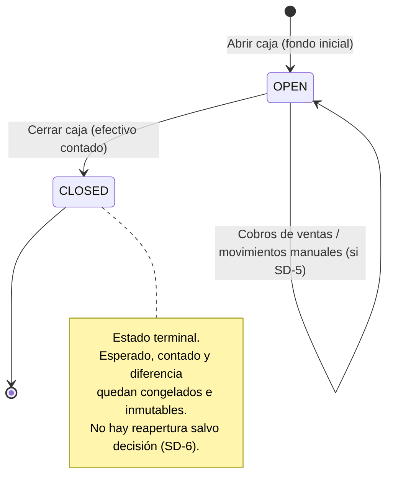
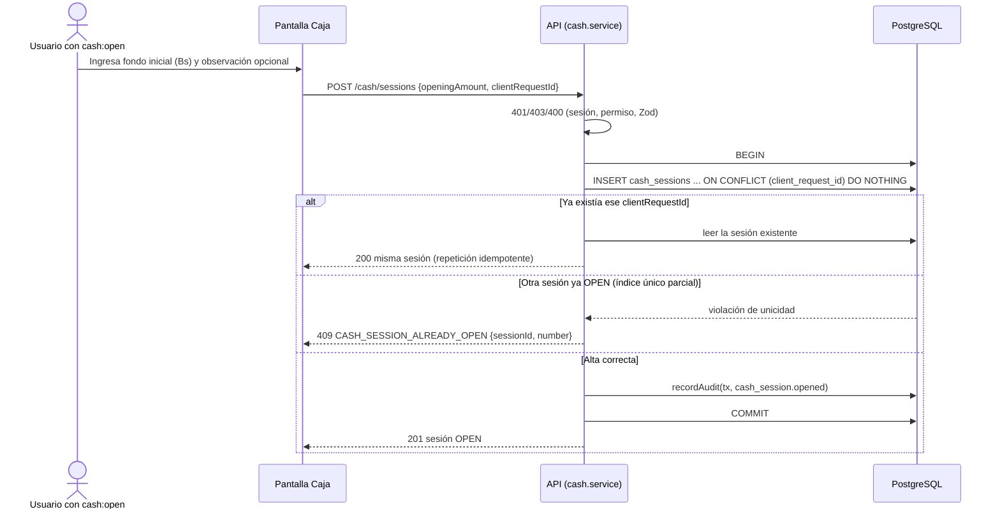
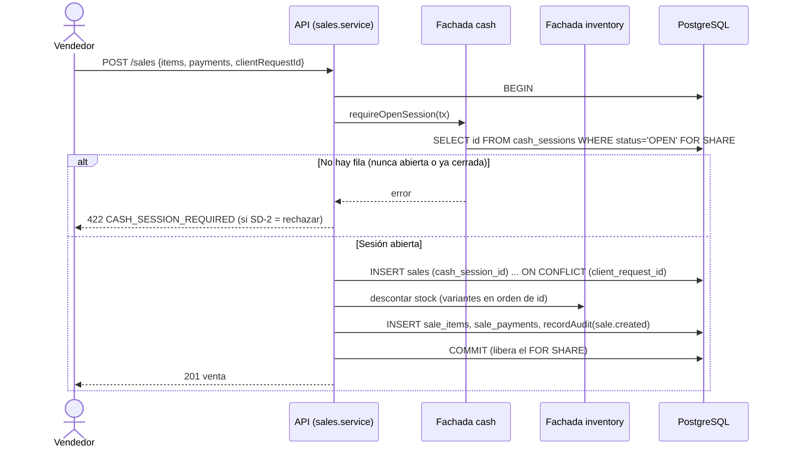
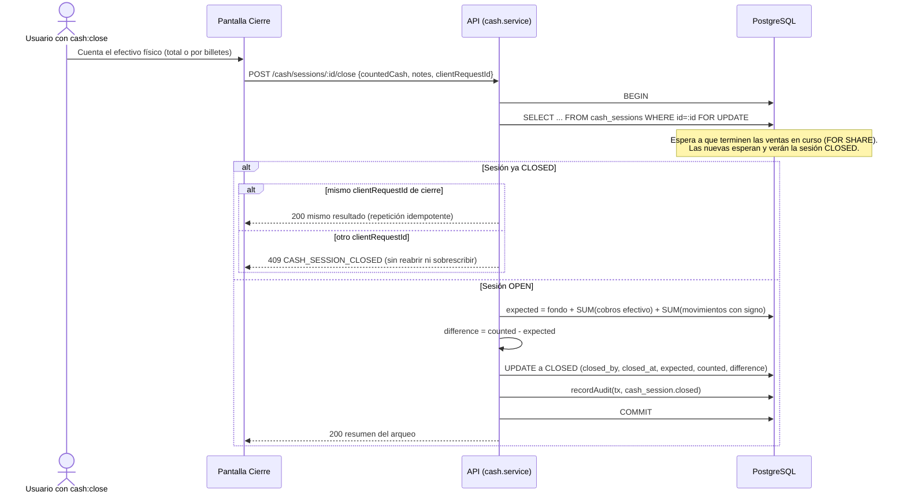
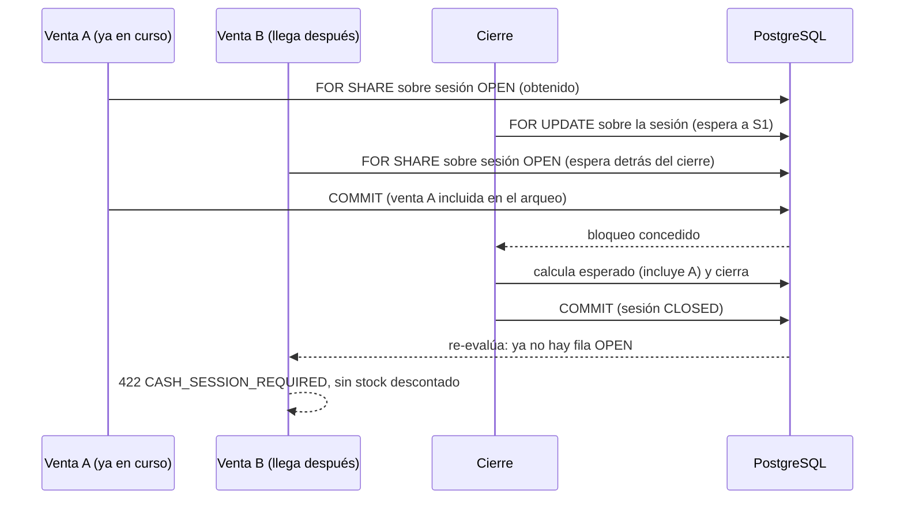
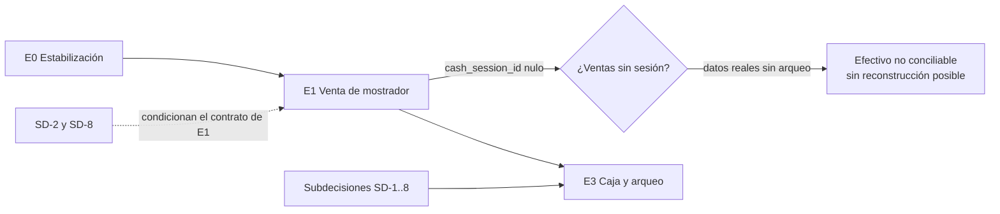

# 02 · Diseño funcional del módulo de caja única (E3, DEC-V09)

> **Estado:** documento de análisis para revisión del responsable del proyecto. **No autoriza** código, migraciones, endpoints, permisos ni pantallas. Todo lo descrito como ruta, permiso, columna o pantalla es una **PROPUESTA** escrita en este markdown.
> **Fecha:** 2026-11-09 · **Fuente de verdad:** resolución formal Q-V07, Q-V09 y Q-V12 (07/11/2026), §3 (DEC-V09) y §5 (roadmap).
> **Verificado contra el repositorio** (lectura, sin ejecutar nada): `apps/api/src/modules/inventory/stock-ledger.ts`, `apps/api/src/plugins/auth.ts`, `apps/api/src/lib/permissions.ts`, `apps/api/src/lib/prisma.ts`, `apps/api/src/modules/audit/audit.service.ts`, `apps/api/src/modules/inventory/exchanges.routes.ts`, `packages/shared/src/{permissions,api,dates,costing}.ts`, `apps/web/src/app/app-shell.tsx`, e informes `docs/informe-tecnico/03`, `05`, `06 §5`.

## Cómo leer las etiquetas

| Etiqueta                    | Significado                                                                                                       |
| --------------------------- | ----------------------------------------------------------------------------------------------------------------- |
| **[CONFIRMADA]**            | Decisión escrita por el responsable en la resolución (o hecho verificado en el código, indicado como «[CÓDIGO]»). |
| **[RECOMENDACIÓN TÉCNICA]** | Propuesta de quien analiza. **No es regla** hasta que el responsable la apruebe.                                  |
| **[PENDIENTE]**             | Subdecisión sin resolver; el diseño muestra opciones y no elige por el responsable.                               |

## Índice

1. [Alcance y límites](#1-alcance-y-límites)
2. [Qué está confirmado y qué no](#2-qué-está-confirmado-y-qué-no)
3. [Actores y permisos propuestos](#3-actores-y-permisos-propuestos)
4. [Ciclo de vida de la sesión de caja](#4-ciclo-de-vida-de-la-sesión-de-caja)
5. [Flujos funcionales](#5-flujos-funcionales)
6. [Cálculo del efectivo esperado y del arqueo](#6-cálculo-del-efectivo-esperado-y-del-arqueo)
7. [Concurrencia, idempotencia y venta durante el cierre](#7-concurrencia-idempotencia-y-venta-durante-el-cierre)
8. [Contrato propuesto de API](#8-contrato-propuesto-de-api)
9. [Contrato propuesto de pantallas](#9-contrato-propuesto-de-pantallas)
10. [Auditoría](#10-auditoría)
11. [Pruebas necesarias](#11-pruebas-necesarias)
12. [Las 8 subdecisiones pendientes](#12-las-8-subdecisiones-pendientes)
13. [Conflicto de orden: E1 antes de E3](#13-conflicto-de-orden-e1-antes-de-e3)
14. [Riesgos específicos de caja y controles](#14-riesgos-específicos-de-caja-y-controles)
15. [Decisiones nuevas detectadas (candidatas a PENDIENTES)](#15-decisiones-nuevas-detectadas-candidatas-a-pendientes)
16. [Impacto resumido y qué NO se hace](#16-impacto-resumido-y-qué-no-se-hace)

---

## 1. Alcance y límites

| Aspecto                     | Contenido                                                                                                                                                                           |
| --------------------------- | ----------------------------------------------------------------------------------------------------------------------------------------------------------------------------------- |
| Qué cubre                   | Una **única caja lógica** compartida por usuarios autorizados: apertura con fondo inicial, asociación de cobros, movimientos manuales (si se aprueban), cierre y arqueo, historial. |
| Qué no cubre                | Anulaciones (DEC-V07), cambios de pieza (E4), reportes de ventas (E5), conciliación bancaria, multi-caja, multi-moneda (solo Bs, Q-V04), facturación fiscal (Q-V02).                |
| Relación con otras etapas   | Consume `sales` y `sale_payments` de E1; no modifica ventas.                                                                                                                        |
| Prohibido en este documento | Cambiar código, crear migraciones, endpoints, permisos reales; editar ADR, PENDIENTES, CLAUDE.md o API.md.                                                                          |

---

## 2. Qué está confirmado y qué no

| #   | Afirmación                                                                                                                                                                                                             | Etiqueta                                                                                                                    | Fuente        |
| --- | ---------------------------------------------------------------------------------------------------------------------------------------------------------------------------------------------------------------------- | --------------------------------------------------------------------------------------------------------------------------- | ------------- |
| 1   | Existe una única caja lógica, compartida por usuarios autorizados, con apertura, registro de cobros, cierre y arqueo.                                                                                                  | **[CONFIRMADA]**                                                                                                            | DEC-V09       |
| 2   | Entidad `cash_sessions` con: id, número de sesión, estado `OPEN`/`CLOSED`, usuario y fecha de apertura, fondo inicial, usuario y fecha de cierre, efectivo esperado, efectivo contado, diferencia, observaciones.      | **[CONFIRMADA]** como campos mínimos («modelo técnico propuesto» dentro de una decisión confirmada en su alcance principal) | DEC-V09       |
| 3   | Entidad `cash_movements` para movimientos manuales distintos de ventas «cuando se autoricen», con sesión, tipo, importe, motivo, usuario y fecha, con historial y auditoría.                                           | **[CONFIRMADA]** la estructura; **[PENDIENTE]** si se autorizan (SD-5)                                                      | DEC-V09       |
| 4   | Las ventas se asocian a la sesión de caja correspondiente; se separan cobros en efectivo, QR, transferencia y ventas con pagos mixtos.                                                                                 | **[CONFIRMADA]**                                                                                                            | DEC-V09       |
| 5   | Efectivo esperado = fondo inicial + cobros aplicados en efectivo + movimientos de caja autorizados. QR y transferencias se reportan aparte y no forman parte del efectivo a contar.                                    | **[CONFIRMADA]**                                                                                                            | DEC-V09       |
| 6   | Una sola sesión abierta garantizada en base de datos; cierres duplicados impedidos con operaciones idempotentes; datos de cierre históricos; diferencias registradas; el importe esperado no se modifica directamente. | **[CONFIRMADA]** como «restricciones propuestas» de una decisión confirmada                                                 | DEC-V09       |
| 7   | Las 8 subdecisiones (roles, venta sin sesión, fondo, tolerancia, gastos/retiros, reapertura, QR/transferencia pendientes, responsabilidad por vendedor) **no** están confirmadas por haber elegido caja única.         | **[PENDIENTE]**                                                                                                             | DEC-V09       |
| 8   | No hay anulación de ventas; no existe `sales:void`, `SALE_VOID` ni estado `VOIDED` en el alcance.                                                                                                                      | **[CONFIRMADA]**                                                                                                            | DEC-V07       |
| 9   | E3 se desarrolla después de E1 y después de cerrar las subdecisiones.                                                                                                                                                  | **[CONFIRMADA]**                                                                                                            | §5            |
| 10  | Todo lo demás de este documento (rutas, cuerpos, códigos de error, permisos granulares, columnas extra, bloqueos, pantallas, textos)                                                                                   | **[RECOMENDACIÓN TÉCNICA]**                                                                                                 | Este análisis |

**Verificado en el código actual [CÓDIGO]** (relevante para el diseño):

| Hecho                                                                                                                                                                           | Evidencia                                      |
| ------------------------------------------------------------------------------------------------------------------------------------------------------------------------------- | ---------------------------------------------- |
| No existe módulo `cash`, `sales` ni permisos `cash:*`/`sales:*` en el catálogo de 24 permisos.                                                                                  | `packages/shared/src/permissions.ts`           |
| El rol `ADMIN` recibe `ALL_PERMISSIONS`: todo permiso nuevo llega al Administrador al ejecutar el seed; los demás roles solo si se asignan explícitamente.                      | `DEFAULT_ROLE_PERMISSIONS` en `permissions.ts` |
| La API autoriza por permiso con `app.requirePermission(...)` (todos) y `app.requireAnyPermission(...)` (al menos uno), como `preValidation`.                                    | `plugins/auth.ts:162,179`                      |
| La auditoría se escribe con `recordAudit(tx, …)` en la misma transacción.                                                                                                       | `audit.service.ts:18`                          |
| El libro de stock bloquea con `SELECT … FOR UPDATE` crudo (plantilla etiquetada) y orden de id ascendente.                                                                      | `stock-ledger.ts:76-81`                        |
| No hay mecanismo de idempotencia en la API (0 coincidencias de «idempot» en `apps/api/src`).                                                                                    | búsqueda en el código; informe 03 §1.9         |
| Transacciones: `timeout 30 s`, `maxWait 10 s`; los conflictos transitorios responden `503` con `Retry-After`.                                                                   | `lib/prisma.ts:11`, informe 03 §1.3            |
| `ERROR_CODES` tiene 12 valores; ninguno es de caja.                                                                                                                             | `packages/shared/src/api.ts:8-25`              |
| El menú tiene un grupo «Ventas» con «Punto de venta», «Historial de ventas» y «Devoluciones» como «Próximamente», sin permiso.                                                  | `app-shell.tsx:158-160`                        |
| Fechas de negocio en `America/La_Paz`; helpers `todayInLaPaz` y `dayRangeLaPaz`. Dinero como `string` decimal con aritmética `BigInt` de centavos (`parseMoney`/`formatMoney`). | `shared/src/dates.ts`, `costing.ts`            |

---

## 3. Actores y permisos propuestos

### 3.1 Actores

| Actor                                   | Qué hace con la caja                             | Estado                                                             |
| --------------------------------------- | ------------------------------------------------ | ------------------------------------------------------------------ |
| Quien abre la caja                      | Registra el fondo inicial                        | Quién puede serlo: **[PENDIENTE] SD-1**                            |
| Quien vende                             | Cobra; sus cobros se asocian a la sesión abierta | Si puede vender con la caja abierta por otro: **[PENDIENTE] SD-8** |
| Quien cierra y cuenta                   | Cuenta el efectivo, registra el arqueo           | **[PENDIENTE] SD-1**                                               |
| Quien registra gastos/retiros           | Movimientos manuales                             | **[PENDIENTE] SD-5**                                               |
| Supervisión (Administrador/Responsable) | Consulta historial y diferencias                 | **[PENDIENTE] SD-1**                                               |
| Auditor                                 | Ve eventos en `/auditoria` con `audit:read`      | Ya existe [CÓDIGO]                                                 |

### 3.2 Permisos propuestos **[RECOMENDACIÓN TÉCNICA]**

Se propone granularidad fina porque los roles son filas de base de datos (ADR-004) y cualquier respuesta a SD-1 podrá lograrse **solo asignando permisos**, sin cambiar código. Esto difiere de la propuesta previa de un único `cash:operate` (informe 06 §5.7), que obligaría a decidir antes.

| Permiso propuesto                                 | Acción                                                                                       |           Admin            | Resto de roles                                |
| ------------------------------------------------- | -------------------------------------------------------------------------------------------- | :------------------------: | --------------------------------------------- |
| `cash:read`                                       | Ver historial de sesiones y su detalle financiero (esperado, diferencias, totales por medio) | sí (por `ALL_PERMISSIONS`) | **[PENDIENTE] SD-1**                          |
| `cash:open`                                       | Abrir sesión con fondo inicial                                                               |             sí             | **[PENDIENTE] SD-1**                          |
| `cash:close`                                      | Cerrar sesión y registrar arqueo                                                             |             sí             | **[PENDIENTE] SD-1**                          |
| `cash:movement`                                   | Registrar gasto/retiro/reposición (solo si SD-5 los aprueba)                                 |             sí             | **[PENDIENTE] SD-5**                          |
| Consultar solo el **estado** (¿hay caja abierta?) | `sales:create` **o** `cash:read` (`requireAnyPermission`), devolviendo datos mínimos         |            n/a             | El POS lo necesita para saber si puede cobrar |

Reglas propuestas **[RECOMENDACIÓN TÉCNICA]**:

- Ningún rol salvo Administrador recibe permisos de caja por defecto hasta que SD-1 se cierre (el seed solo asigna lo aprobado).
- No crear `cash:resolve-difference` ni «ajustar diferencia»: sería un mecanismo alternativo de corrección no autorizado (DEC-V07, §2 de la resolución). Si se desea anotar una explicación a una diferencia, ver §12 (SD-4).
- El efectivo esperado y las diferencias son datos de dinero: solo con `cash:read`. Quien solo vende ve «caja abierta desde …, por …» sin cifras.
- Los permisos nuevos solo llegan a los roles al ejecutar el seed (DT-OPS-04 del informe 06).

---

## 4. Ciclo de vida de la sesión de caja

| Regla                                                                                                                               | Etiqueta                                                                                                                                                |
| ----------------------------------------------------------------------------------------------------------------------------------- | ------------------------------------------------------------------------------------------------------------------------------------------------------- |
| Estados `OPEN` y `CLOSED` únicamente.                                                                                               | **[CONFIRMADA]**                                                                                                                                        |
| Solo puede existir una sesión `OPEN` a la vez (garantía en base de datos).                                                          | **[CONFIRMADA]**                                                                                                                                        |
| `CLOSED` es terminal; no hay `CLOSED → OPEN`.                                                                                       | **[RECOMENDACIÓN TÉCNICA]** (la resolución no define reapertura; SD-6 **[PENDIENTE]**)                                                                  |
| Una sesión puede abarcar más de un día calendario (no se cierra sola a medianoche).                                                 | **[PENDIENTE]** (ver §15, N-4)                                                                                                                          |
| Al cerrar se congelan `expected_cash`, `counted_cash` y `difference`.                                                               | **[CONFIRMADA]** (datos históricos; esperado no modificable directamente)                                                                               |
| Mecanismo de garantía: índice único parcial «una fila con `status = 'OPEN'`», más trigger que impide modificar una sesión `CLOSED`. | **[RECOMENDACIÓN TÉCNICA]** para el database-agent; Prisma no expresa índices parciales, se usa SQL extra con `--create-only`, como ya hace el proyecto |

---

## 5. Flujos funcionales

### 5.1 Apertura

Reglas de apertura **[RECOMENDACIÓN TÉCNICA]**: el fondo es un importe `string` decimal ≥ 0 (acepta `"0"`); la fecha y hora de apertura las fija el servidor; se registra quién abre. Restricciones del fondo (obligatorio, tope, arrastre de la sesión anterior): **[PENDIENTE] SD-3**.

### 5.2 Cobro (venta asociada a la sesión)

La venta se define en E1; aquí solo se describe su relación con la caja.

Clasificación de los cobros **[CONFIRMADA]** (separar efectivo, QR, transferencia y mixtos):

| Concepto                | Cómo se obtiene                                    |    Aparece en el efectivo a contar    |
| ----------------------- | -------------------------------------------------- | :-----------------------------------: |
| Cobro en efectivo       | Suma de `sale_payments.amount` con medio `is_cash` |                **Sí**                 |
| Cobro QR                | Suma de `amount` del medio QR                      |        No (se reporta aparte)         |
| Cobro por transferencia | Suma de `amount` del medio transferencia           |        No (se reporta aparte)         |
| Venta con pago mixto    | Venta con más de un medio distinto en sus pagos    | La parte en efectivo sí; las demás no |

**Nota de cálculo [RECOMENDACIÓN TÉCNICA]:** «ventas mixtas» es una **clasificación transversal**, no un sumando adicional. Cada pago de una venta mixta suma en el total de su propio medio; la suma de los totales por medio es igual al total vendido. Mostrar aparte la **cantidad** y el **importe** de ventas mixtas es informativo.

Combinaciones de pago: efectivo, QR, transferencia y combinaciones, solo en Bs, ventas pagadas íntegramente en el acto, sin crédito ni apartados **[CONFIRMADA]** (Q-V04, Q-V05).

### 5.3 Movimientos manuales (solo si se aprueban, SD-5)

| Aspecto                             | Propuesta                                                                                                                                                                                                                  |
| ----------------------------------- | -------------------------------------------------------------------------------------------------------------------------------------------------------------------------------------------------------------------------- |
| Tipos                               | `EXPENSE` (gasto), `WITHDRAWAL` (retiro), `DEPOSIT` (reposición/ingreso de efectivo no proveniente de venta) **[RECOMENDACIÓN TÉCNICA]**; los nombres y la lista final son **[PENDIENTE]**                                 |
| Solo con sesión `OPEN`              | Mismo bloqueo `FOR SHARE` que una venta; si la sesión se cerró, `422 CASH_SESSION_CLOSED`                                                                                                                                  |
| Importe                             | Almacenado **positivo**, con `CHECK (amount > 0)`; el signo lo da el tipo (gasto y retiro restan; reposición suma). Evita errores de signo **[RECOMENDACIÓN TÉCNICA]** (difiere del importe con signo del informe 06 §5.8) |
| Motivo                              | Obligatorio, texto 1..200                                                                                                                                                                                                  |
| Inmutabilidad                       | Append-only: sin edición ni borrado                                                                                                                                                                                        |
| Corrección de un movimiento erróneo | **[PENDIENTE]**: cualquier mecanismo compensatorio requiere autorización expresa del responsable; no se diseña aquí                                                                                                        |
| Autorización previa o tope          | **[PENDIENTE]** (la resolución habla de «movimientos autorizados» sin definir quién autoriza)                                                                                                                              |

### 5.4 Cierre y arqueo

| Elemento                                      | Propuesta                                                                                                                                                                                    |
| --------------------------------------------- | -------------------------------------------------------------------------------------------------------------------------------------------------------------------------------------------- |
| Datos que ingresa quien cierra                | Efectivo contado (obligatorio), observaciones, y —solo si se aprueba— conteo por denominaciones                                                                                              |
| Datos que calcula el servidor                 | Esperado, diferencia, totales por medio, cantidad de ventas, ventas mixtas                                                                                                                   |
| Diferencia                                    | `difference = counted_cash − expected_cash`. Positiva = sobrante; negativa = faltante **[RECOMENDACIÓN TÉCNICA]** (convención a fijar)                                                       |
| El cierre nunca se bloquea por una diferencia | **[RECOMENDACIÓN TÉCNICA]** (bloquearlo incentiva falsear el conteo y deja sesiones abiertas); la tolerancia es **[PENDIENTE] SD-4**                                                         |
| Observación obligatoria si la diferencia ≠ 0  | **[RECOMENDACIÓN TÉCNICA]**; **[PENDIENTE] SD-4**                                                                                                                                            |
| El cliente no envía el esperado               | **[RECOMENDACIÓN TÉCNICA]**: el cuerpo no tiene `expectedCash`; las claves desconocidas se rechazan con Zod estricto («evitar modificar directamente el importe esperado», **[CONFIRMADA]**) |
| Esperado «en vivo» antes del cierre           | Se calcula por consulta, no se guarda un acumulado editable (mismo principio que el stock) **[CONFIRMADA]** como restricción general del esperado                                            |

### 5.5 Cierre con QR o transferencia sin conciliar

| Qué hace el sistema                                                                                     | Etiqueta                                                               |
| ------------------------------------------------------------------------------------------------------- | ---------------------------------------------------------------------- |
| El efectivo a contar excluye QR y transferencias.                                                       | **[CONFIRMADA]**                                                       |
| El resumen de cierre muestra por separado total y cantidad de pagos QR y transferencias de la sesión.   | **[CONFIRMADA]** (reportar separadamente)                              |
| No existe estado «conciliado/no conciliado» por pago, ni se bloquea el cierre por pagos no conciliados. | **[RECOMENDACIÓN TÉCNICA]**; decisión real: **[PENDIENTE] SD-7**       |
| No hay integración bancaria.                                                                            | **[CONFIRMADA]** (CLAUDE.md: integraciones bancarias fuera de alcance) |

---

## 6. Cálculo del efectivo esperado y del arqueo

**Fórmula [CONFIRMADA]:** `efectivo esperado = fondo inicial + cobros aplicados en efectivo + movimientos de caja autorizados`.

**Definición de «cobros aplicados en efectivo, netos de vuelto» [RECOMENDACIÓN TÉCNICA]:** el modelo propuesto en E1 guarda en `sale_payments` el importe **aplicado** a la venta (`amount`), y de forma informativa lo recibido (`tendered`) y el vuelto (`change_given`). Con `change_given = tendered − amount`, lo que queda físicamente en el cajón por ese cobro es `tendered − change_given = amount`. Por eso el esperado suma `amount`, **no** `tendered`. Sumar `tendered` inflaría el esperado con dinero que se devolvió al cliente.

### Ejemplo trabajado

| Hecho                  | Detalle                                         |   Efecto en efectivo |
| ---------------------- | ----------------------------------------------- | -------------------: |
| Apertura               | Fondo inicial Bs 200,00                         |              +200,00 |
| Venta 1 (total 100,00) | Efectivo 100,00 (recibido 150,00; vuelto 50,00) |              +100,00 |
| Venta 2 (total 80,00)  | QR 50,00 + efectivo 30,00 (recibido 30,00)      |               +30,00 |
| Venta 3 (total 120,00) | Transferencia 120,00                            |                 0,00 |
| Gasto                  | Bs 15,00 (si SD-5)                              |               −15,00 |
| Retiro                 | Bs 100,00 (si SD-5)                             |              −100,00 |
| **Efectivo esperado**  | 200 + 100 + 30 − 15 − 100                       |           **215,00** |
| Efectivo contado       | 214,50                                          |                      |
| **Diferencia**         | 214,50 − 215,00                                 | **−0,50 (faltante)** |

| Reporte aparte (no es efectivo)       |                       Importe | Cantidad de pagos |
| ------------------------------------- | ----------------------------: | ----------------: |
| Efectivo (informativo)                |                        130,00 |                 2 |
| QR                                    |                         50,00 |                 1 |
| Transferencia                         |                        120,00 |                 1 |
| **Total vendido**                     | **300,00** (= 100 + 80 + 120) |          3 ventas |
| Ventas con pago mixto (clasificación) |      1 venta (Venta 2), 80,00 |                   |

### Controles del cálculo **[RECOMENDACIÓN TÉCNICA]**

- Aritmética entera en centavos con los helpers compartidos (`parseMoney`/`formatMoney`), nunca `number` con coma flotante.
- La cifra congelada al cerrar debe coincidir con la recalculada después (prueba y script de verificación).
- Verificación de integridad: para cada venta de la sesión, `Σ sale_payments.amount = sales.total`; si no, es un defecto que debe detectarse por prueba/script (como el `db:verify-ledger` previsto en E0), no resolverse en el cierre.
- Solo se suman pagos de ventas cuya `cash_session_id` es esta sesión; ventas sin sesión (si SD-2 las permitiera) quedan fuera del arqueo y se reportan aparte.

---

## 7. Concurrencia, idempotencia y venta durante el cierre

### 7.1 Bloqueos propuestos **[RECOMENDACIÓN TÉCNICA]**

| Operación                 | Bloqueo sobre la fila de la sesión                                                         | Efecto                                                                                                     |
| ------------------------- | ------------------------------------------------------------------------------------------ | ---------------------------------------------------------------------------------------------------------- |
| Venta / movimiento manual | `SELECT id FROM cash_sessions WHERE status = 'OPEN' FOR SHARE` al inicio de la transacción | Varias ventas simultáneas entran sin esperarse entre sí; impiden que el cierre empiece hasta que terminen. |
| Cierre                    | `SELECT … WHERE id = :id FOR UPDATE`                                                       | Espera a las ventas en curso; mientras tiene el bloqueo, las ventas nuevas esperan.                        |
| Apertura                  | Índice único parcial `status = 'OPEN'`                                                     | La segunda apertura simultánea falla.                                                                      |

Por qué funciona: en `READ COMMITTED` (valor por defecto de PostgreSQL; el cliente Prisma no lo cambia en `lib/prisma.ts`, a confirmar con la prueba), una consulta de bloqueo que esperó a otra transacción **vuelve a evaluar la condición `WHERE` contra la versión actualizada de la fila**. La venta que esperó durante el cierre ya no encuentra una fila `OPEN` y falla **antes** de tocar stock, pagos o auditoría. El `FOR UPDATE` del cierre es explícito porque un `UPDATE` ordinario toma un bloqueo más débil que no choca con `FOR KEY SHARE`.

**Orden de bloqueo propuesto:** `sesión de caja → venta (insert) → variantes por id ascendente → saldos`. El cierre solo toma la sesión (nunca variantes), de modo que no se forma un ciclo de espera con las ventas. Este orden **amplía** el orden «documento → variantes → saldo» del informe 06 §5.6 y debería quedar en el ADR de ventas (ADR-024 propuesto) y en ADR-028.

### 7.2 Qué ocurre con una venta que llega durante el cierre

| Caso                                                       | Resultado                                                                                                                                                                                                        |
| ---------------------------------------------------------- | ---------------------------------------------------------------------------------------------------------------------------------------------------------------------------------------------------------------- |
| Venta confirmada antes de que el cierre obtenga el bloqueo | Se incluye en el esperado.                                                                                                                                                                                       |
| Venta que empieza mientras el cierre espera o ejecuta      | Falla con `422` (según SD-2), **sin efectos** (ni stock, ni pagos, ni auditoría de venta).                                                                                                                       |
| Qué ve el vendedor                                         | Mensaje accionable: «La caja se cerró mientras cobraba. Abra una nueva caja y vuelva a cobrar». El carrito sigue en `sessionStorage` y el mismo `clientRequestId` puede reutilizarse porque la venta no se creó. |
| `request_hash` de la venta                                 | No debe incluir la sesión de caja, para permitir el reintento con otra sesión.                                                                                                                                   |
| Si SD-2 permitiera vender sin caja                         | La venta pasaría con sesión nula y quedaría **fuera de cualquier arqueo**; ver §12.                                                                                                                              |
| Si el cierre excede el tiempo                              | Un bloqueo no concedido en 30 s produce el `503` + `Retry-After` ya existente [CÓDIGO]; el cierre se reintenta con el mismo `clientRequestId`.                                                                   |

### 7.3 Idempotencia **[RECOMENDACIÓN TÉCNICA]**

El resultado de DEC-V09 exige «impedir cierres duplicados mediante operaciones idempotentes» **[CONFIRMADA]**. Hoy no existe mecanismo [CÓDIGO]; se alinea con la solución de E0 (DT-ARQ-06) usando un campo de cuerpo `clientRequestId` (uuid).

| Operación  | Clave                                                | Repetición con la misma clave   | Con otra clave                                         |
| ---------- | ---------------------------------------------------- | ------------------------------- | ------------------------------------------------------ |
| Abrir      | `cash_sessions.client_request_id` único              | `200` misma sesión              | Si ya hay una `OPEN`: `409 CASH_SESSION_ALREADY_OPEN`  |
| Cerrar     | `cash_sessions.close_request_id` (columna adicional) | `200` mismo resultado congelado | `409 CASH_SESSION_CLOSED`; no se sobrescribe nada      |
| Movimiento | `cash_movements.client_request_id` único             | `200` mismo movimiento          | Crea otro movimiento (dos gastos iguales son posibles) |

Las columnas `client_request_id` y `close_request_id` **no están en los campos mínimos de la resolución**: son una adición propuesta que debe aprobar el database-agent y el responsable. Detalle importante: la repetición con la misma clave pero **cuerpo distinto** (otro contado) debe responder `409` y no devolver el cierre original, para que el usuario no crea que su cifra quedó guardada (se guarda un `request_hash` del cuerpo o se compara el cuerpo con lo congelado).

---

## 8. Contrato propuesto de API

> Todo lo siguiente es una **PROPUESTA** de contrato; no existe en el código. Prefijo `/api/v1`. Formato `{ data }`/`{ data, meta }`, errores `{ error: { code, message, details?, requestId } }`, dinero como `string` decimal con 2 decimales, fechas ISO 8601 con `Z`. Cada ruta declararía esquema Zod de `body`, `querystring`, `params` y `response`, y autorización como `preValidation` (así 401/403 se evalúan antes que el 400), igual que `exchanges.routes.ts` [CÓDIGO].

### 8.1 Rutas

| #   | Ruta                                | Permiso                                         | Cuerpo / consulta                                                                                                                  | Respuesta                                                                               | Errores                                                                                             | Idempotencia                |
| --- | ----------------------------------- | ----------------------------------------------- | ---------------------------------------------------------------------------------------------------------------------------------- | --------------------------------------------------------------------------------------- | --------------------------------------------------------------------------------------------------- | --------------------------- |
| C1  | `GET /cash/status`                  | `requireAnyPermission(sales:create, cash:read)` | —                                                                                                                                  | `200 {data:{open:boolean, session:{id,number,openedAt,openedByName}\|null}}` sin cifras | 401, 403                                                                                            | n/a                         |
| C2  | `POST /cash/sessions`               | `cash:open`                                     | `{openingAmount, notes?≤500, clientRequestId}`                                                                                     | `201 {data:sessionDetail}` (`200` si es repetición)                                     | 400; `409 CASH_SESSION_ALREADY_OPEN` con `details:{sessionId,number}`                               | `clientRequestId`           |
| C3  | `GET /cash/sessions/current`        | `cash:read`                                     | —                                                                                                                                  | `200 {data:sessionDetail}` con totales en vivo                                          | `404` si no hay sesión abierta                                                                      | n/a                         |
| C4  | `GET /cash/sessions`                | `cash:read`                                     | `page`, `pageSize≤100`, `status=all\|OPEN\|CLOSED`, `from`, `to` (días `AAAA-MM-DD` de La Paz, con `dayRangeLaPaz`), `openedById?` | `200 {data:[sessionSummary], meta}` orden `number desc`                                 | 400                                                                                                 | n/a                         |
| C5  | `GET /cash/sessions/:id`            | `cash:read`                                     | param `id` uuid                                                                                                                    | `200 {data:sessionDetail}`                                                              | 404                                                                                                 | n/a                         |
| C6  | `POST /cash/sessions/:id/movements` | `cash:movement` (solo si SD-5)                  | `{kind, amount, reason 1..200, clientRequestId}`                                                                                   | `201 {data:movement}`                                                                   | 400; `404`; `422 CASH_SESSION_CLOSED`                                                               | `clientRequestId`           |
| C7  | `GET /cash/sessions/:id/movements`  | `cash:read`                                     | `page`, `pageSize`                                                                                                                 | `200 {data:[movement], meta}`                                                           | 404                                                                                                 | n/a                         |
| C8  | `POST /cash/sessions/:id/close`     | `cash:close`                                    | `{countedCash, notes?≤1000, denominations?, clientRequestId}`                                                                      | `200 {data:sessionDetail}`                                                              | 400; `404`; `409 CASH_SESSION_CLOSED`; `422` si falta observación con diferencia (si SD-4 la exige) | `clientRequestId` de cierre |

Todas pueden responder además `401`, `403` (`FORBIDDEN` o `PASSWORD_CHANGE_REQUIRED`), `429` y `500` genérico [CÓDIGO]. **No hay** `PATCH`/`PUT`/`DELETE` sobre sesiones ni movimientos, **ni** ruta de reapertura **[RECOMENDACIÓN TÉCNICA]**.

### 8.2 Esquemas de respuesta propuestos

`sessionDetail`:

| Campo                                                               | Tipo                                                                            | Notas                                                                                                                                |
| ------------------------------------------------------------------- | ------------------------------------------------------------------------------- | ------------------------------------------------------------------------------------------------------------------------------------ |
| `id`, `number`                                                      | uuid, int                                                                       | `number` autoincremental (posibles saltos, como `ING-`/`AJ-`/`CNT-` [CÓDIGO]); formato visible `CAJ-000001` es **[PENDIENTE]** menor |
| `status`                                                            | `OPEN`\|`CLOSED`                                                                |                                                                                                                                      |
| `openedAt`, `openedBy{id,name}`, `openingAmount`                    |                                                                                 |                                                                                                                                      |
| `closedAt`, `closedBy`, `expectedCash`, `countedCash`, `difference` | `null` mientras `OPEN` (excepto `expectedCash` en vivo como `liveExpectedCash`) |                                                                                                                                      |
| `liveExpectedCash`                                                  | string                                                                          | Solo `OPEN`; calculado en la consulta                                                                                                |
| `totalsByMethod`                                                    | `[{methodCode, methodName, isCash, amount, paymentsCount}]`                     | Suma = total vendido                                                                                                                 |
| `salesCount`, `salesTotal`, `mixedSales{count,amount}`              |                                                                                 |                                                                                                                                      |
| `bySeller`                                                          | `[{sellerId, name, salesCount, cashAmount, otherAmount}]`                       | Informativo; ver SD-8                                                                                                                |
| `movements`                                                         | resumen por tipo                                                                | Si SD-5                                                                                                                              |
| `notes`                                                             | string\|null                                                                    |                                                                                                                                      |

Reglas de respuesta **[RECOMENDACIÓN TÉCNICA]**: ningún costo ni dato de producto aparece aquí; los cuerpos con claves desconocidas se rechazan; quien no tiene `cash:read` nunca recibe cifras (solo C1).

### 8.3 Códigos de error nuevos propuestos **[RECOMENDACIÓN TÉCNICA]**

| Código                      | HTTP      | Cuándo                                                                      |
| --------------------------- | --------- | --------------------------------------------------------------------------- |
| `CASH_SESSION_ALREADY_OPEN` | 409       | Apertura con otra sesión `OPEN`                                             |
| `CASH_SESSION_REQUIRED`     | 422       | Venta/movimiento sin sesión abierta (si SD-2 = rechazar)                    |
| `CASH_SESSION_CLOSED`       | 409 / 422 | Cierre repetido con otra clave (409); movimiento en sesión ya cerrada (422) |

Hoy `ERROR_CODES` no los incluye; agregarlos exige tocar `packages/shared/src/api.ts` (fuera de este análisis). Un `P2002` genérico se mapearía a un 409 de mensaje genérico [CÓDIGO], por lo que el servicio debe capturar la violación del índice parcial y lanzar un `ConflictError` con el código específico.

---

## 9. Contrato propuesto de pantallas

> **PROPUESTA.** El menú «Ventas» tiene hoy entradas «Próximamente» sin permiso [CÓDIGO]; se propone añadir «Caja» al grupo. Rutas perezosas con `lazyPage` y guarda de permisos como UX (la seguridad está en la API). Textos en español, labels asociados, foco visible, `aria-live` para cambios de estado, objetivos táctiles `min-h-10`, tarjetas bajo 56 rem (`table-cards`), formularios validados con esquemas compartidos, sin `window.confirm` para el cierre (se usa un diálogo accesible: el informe 05 §4.4 lista `window.confirm` como deuda).

| Pantalla        | Ruta propuesta     | Permiso (UX)                 | Contenido                                                                                                                                                                                                                                                                                                |
| --------------- | ------------------ | ---------------------------- | -------------------------------------------------------------------------------------------------------------------------------------------------------------------------------------------------------------------------------------------------------------------------------------------------------- |
| Estado de caja  | `/caja`            | `cash:read` o `sales:create` | Si cerrada: aviso y botón «Abrir caja» (con `cash:open`). Si abierta: quién y cuándo abrió, fondo, cantidad de ventas, totales por medio (efectivo/QR/transferencia), ventas mixtas, efectivo esperado en vivo (solo `cash:read`; depende de N-1 «arqueo ciego»).                                        |
| Apertura        | diálogo en `/caja` | `cash:open`                  | Campo «Fondo inicial (Bs)» (coma o punto), observación opcional, botón único «Abrir caja» deshabilitado mientras la petición está en vuelo. Muestra el contado de la sesión anterior como referencia (si SD-3 lo adopta).                                                                                |
| Movimientos     | sección en `/caja` | `cash:movement`              | Solo si SD-5: formulario tipo/importe/motivo y lista de la sesión.                                                                                                                                                                                                                                       |
| Cierre y arqueo | `/caja/cierre`     | `cash:close`                 | Paso 1: «Efectivo contado» (total, o tabla de billetes y monedas si se aprueba). Paso 2: resumen (contado, esperado —según N-1—, diferencia, totales QR/transferencia «por conciliar por su cuenta») y observación. Paso 3: diálogo de confirmación; resultado con diferencia anunciada por `aria-live`. |
| Historial       | `/caja/historial`  | `cash:read`                  | Tabla paginada: número, apertura/cierre y responsables, fondo, esperado, contado, diferencia (con texto «sobrante»/«faltante», nunca solo color). Detalle de solo lectura.                                                                                                                               |
| POS             | (E1)               | `sales:create`               | Si no hay caja abierta (y SD-2 = rechazar): mensaje con a quién acudir y enlace a `/caja`.                                                                                                                                                                                                               |

Conteo por denominaciones **[PENDIENTE]** (N-2): si el responsable lo aprueba, el servidor recibe `denominations:[{value,count}]` y valida que la suma coincida con `countedCash`; la lista de billetes y monedas válidos de Bolivia la confirma el cliente y no se escribe fija en el código.

Rendimiento del cierre en pantalla: el conteo se calcula en el navegador solo para mostrar; el valor oficial es el que valida el servidor.

---

## 10. Auditoría

Acciones propuestas **[RECOMENDACIÓN TÉCNICA]**, todas con `recordAudit(tx, …)` en la misma transacción [CÓDIGO: patrón vigente]:

| Acción                  | Entidad        | Contenido                                                                   |
| ----------------------- | -------------- | --------------------------------------------------------------------------- |
| `cash_session.opened`   | `CashSession`  | número, fondo, quién                                                        |
| `cash_session.closed`   | `CashSession`  | `before` (OPEN), `after` (esperado, contado, diferencia, totales por medio) |
| `cash_movement.created` | `CashMovement` | tipo, importe, motivo                                                       |

- Los intentos rechazados (cierre repetido, apertura duplicada) no generan fila de auditoría de negocio; quedan en el log con `requestId` (decisión a confirmar).
- Sin contraseñas, tokens ni datos personales. La pantalla de auditoría cae al código crudo si faltan etiquetas; conviene añadir las tres al diccionario `audit-labels.ts` (cambio de frontend futuro).
- Los datos de cierre se conservan como información histórica **[CONFIRMADA]**: sin borrado ni modificación (trigger).

---

## 11. Pruebas necesarias

Solo se listan; **no se ejecutó ni se escribió ninguna**. Siguen los patrones del proyecto: BD real, helpers `buildTestApp`, `login`, `createTestUser`, `resetDatabase`.

| Nivel                                     | Casos                                                                                                                                                                                                                                                                               |
| ----------------------------------------- | ----------------------------------------------------------------------------------------------------------------------------------------------------------------------------------------------------------------------------------------------------------------------------------- |
| Unitarias                                 | Esperado en centavos (con vuelto), diferencia con signo, clasificación de ventas mixtas, suma de denominaciones, hash de cuerpo. Propiedad (`fast-check`): para cualquier combinación de pagos, Σ por medio = total vendido y esperado = fondo + Σ efectivo ± movimientos.          |
| Integración por endpoint                  | 401 sin sesión; 403 sin permiso (cada permiso por separado); 400 (importe negativo, formato, clave desconocida); caso feliz; `PASSWORD_CHANGE_REQUIRED`. Quien solo tiene `sales:create` recibe C1 pero no C3/C5.                                                                   |
| Efectos y auditoría                       | Apertura crea sesión y fila de auditoría; cierre congela esperado/contado/diferencia y audita `before/after`; esperado recalculado == congelado; cifras de ejemplo del §6.                                                                                                          |
| Integridad de BD                          | Segunda sesión `OPEN` rechazada; sesión `CLOSED` inmodificable (trigger); movimiento append-only; CHECK de coherencia estado/cierre; `opening_amount ≥ 0`.                                                                                                                          |
| **Concurrencia: apertura doble**          | `Promise.all` de dos aperturas con claves distintas: una `201`, otra `409`. Con la misma clave: ambas devuelven la misma sesión.                                                                                                                                                    |
| **Concurrencia: cierre doble**            | `Promise.all` de dos cierres con la misma clave: un solo cierre y respuestas idénticas. Con claves distintas: uno cierra, el otro `409`; los datos congelados son los del primero.                                                                                                  |
| **Concurrencia: venta durante el cierre** | Abrir una transacción de venta que toma `FOR SHARE` y espera una compuerta; lanzar el cierre; comprobar que el cierre **no termina** hasta liberar la compuerta y luego **incluye** esa venta. Otra venta lanzada después del cierre falla `422` sin movimientos de stock ni pagos. |
| Concurrencia: movimiento vs cierre        | Un movimiento en curso se incluye; uno posterior falla `422`.                                                                                                                                                                                                                       |
| Mutante                                   | Quitar el `FOR SHARE`/`FOR UPDATE` debe hacer fallar las pruebas anteriores (como se hizo con ingresos, TESTING).                                                                                                                                                                   |
| Interrupción                              | Fallo simulado dentro de la transacción de cierre: nada queda a medias (sesión sigue `OPEN`, sin auditoría).                                                                                                                                                                        |
| Verificación global                       | Script/prueba: Σ `sale_payments` de cada venta = total; cifras congeladas = recalculadas para todas las sesiones cerradas.                                                                                                                                                          |
| Componentes (web)                         | Doble clic en «Cerrar», diálogo de confirmación, anuncio de la diferencia, formularios con coma decimal.                                                                                                                                                                            |
| E2E (Playwright)                          | Apertura → ventas simuladas → cierre con diferencia conocida (acepta E7: «arqueo ensayado con una diferencia conocida»); `responsive.spec` para las pantallas nuevas; sin datos DEMO compartidos.                                                                                   |

---

## 12. Las 8 subdecisiones pendientes

Todas son **[PENDIENTE]**. Cada recomendación es **[RECOMENDACIÓN TÉCNICA]** y **no se da por confirmada**. Se pide aprobación específica de cada una.

### Resumen

| SD   | Tema                         | Bloquea                                            | Cerrar antes de                           |
| ---- | ---------------------------- | -------------------------------------------------- | ----------------------------------------- |
| SD-1 | Roles que abren y cierran    | Matriz de permisos y seed                          | E1 (rol de Vendedor) / E3                 |
| SD-2 | Venta sin sesión abierta     | **Contrato de `POST /sales`** y esquema de `sales` | **E1 (antes del diseño de la migración)** |
| SD-3 | Fondo inicial                | Validación de apertura                             | E3                                        |
| SD-4 | Tolerancia de diferencia     | Reglas de cierre                                   | E3                                        |
| SD-5 | Gastos y retiros             | Existencia de `cash_movements` en el MVP           | E3                                        |
| SD-6 | Reapertura                   | Triggers e historial de cierres                    | E3                                        |
| SD-7 | QR/transferencia pendientes  | Estado por pago                                    | E3 (y campo `reference` en E1)            |
| SD-8 | Responsabilidad por vendedor | Resumen por vendedor                               | E1/E3                                     |

### SD-1 · Roles que pueden abrir y cerrar caja

| Opción | Descripción                                                       | Ventajas                               | Riesgos                                          |
| ------ | ----------------------------------------------------------------- | -------------------------------------- | ------------------------------------------------ |
| A      | Solo Administrador y Responsable                                  | Control fuerte                         | El Vendedor no puede vender si ellos no están    |
| B      | Cualquier usuario con permiso de caja, incluido Vendedor          | Operación fluida                       | Quien vende también cuenta su propio efectivo    |
| C      | Abre cualquiera autorizado; cierra solo Responsable/Administrador | Separa quien cobra de quien cuenta     | Depende de la presencia del supervisor al cierre |
| D      | Permisos separados abrir/cerrar, asignables libremente            | Cualquier respuesta sin cambiar código | Más permisos que explicar                        |

**Recomendación técnica:** D (permisos `cash:open`, `cash:close`, `cash:read`), porque el modelo de permisos ya es por fila de BD. La asignación a roles la decide el responsable. Opción no incluida en la lista de la resolución y que debe decidirse junto: si quien cierra puede ser quien abrió (control de «dos personas»).

### SD-2 · Venta sin sesión abierta

| Opción | Descripción                                          | Consecuencia                                                       |
| ------ | ---------------------------------------------------- | ------------------------------------------------------------------ |
| A      | **Rechazar** (`422 CASH_SESSION_REQUIRED`)           | Toda venta queda en un arqueo; si no hay quien abra, no se vende   |
| B      | Permitir con `cash_session_id` nulo                  | Ventas fuera de cualquier arqueo; su efectivo no se concilia       |
| C      | Permitir solo a Administrador/Responsable con motivo | Excepción controlada; añade un permiso y una auditoría específicos |
| D      | Abrir automáticamente una sesión                     | Oculta el fondo inicial; no recomendada                            |

**Recomendación técnica:** A, por coherencia con «las ventas deben asociarse con la sesión» (DEC-V09). Exige un procedimiento de contingencia si nadie puede abrir (no hay modo offline, A5). **Impacto:** si se elige B, `sales.cash_session_id` queda nullable de forma permanente; si A, puede ser `NOT NULL`. Esta es la decisión que más condiciona E1 (ver §13).

### SD-3 · Fondo inicial y restricciones

| Aspecto          | Opciones                                                                                          |
| ---------------- | ------------------------------------------------------------------------------------------------- |
| ¿Obligatorio?    | Sí con valor ≥ 0 / puede omitirse (= 0)                                                           |
| Origen           | Digitado en cada apertura / monto fijo configurado / arrastrado del contado de la sesión anterior |
| Tope máximo      | Ninguno técnico (`numeric(12,2)`) / tope de negocio configurable                                  |
| Cambio posterior | Nunca / solo antes de la primera venta                                                            |

**Recomendación técnica:** digitado en cada apertura, ≥ 0 (acepta 0), sin cambio posterior (corregir un fondo equivocado sería editar el esperado). Mostrar el contado de la sesión anterior como referencia; si difiere del fondo, exigir observación (es dinero que salió o entró entre sesiones sin registro). Tope: valor de negocio a definir.

### SD-4 · Tolerancia de diferencia

| Opción | Descripción                                                      |
| ------ | ---------------------------------------------------------------- |
| A      | Sin tolerancia: toda diferencia se registra, sin bloqueo         |
| B      | Umbral informativo: sobre él, la diferencia se marca «a revisar» |
| C      | Umbral con observación obligatoria                               |
| D      | Umbral que bloquea el cierre hasta aprobación de un supervisor   |

**Recomendación técnica:** A + observación obligatoria si la diferencia es distinta de cero; umbral solo informativo si el responsable lo desea. **No bloquear el cierre** (D): empuja a falsear el conteo y deja sesiones abiertas. La diferencia nunca se corrige ni se «resuelve» modificando importes; una explicación posterior sería una anotación append-only (decisión adicional). Cómo se trata el faltante laboral o contablemente queda **fuera del sistema**.

### SD-5 · Registro de gastos y retiros

| Opción         | Descripción                                                                                                    |
| -------------- | -------------------------------------------------------------------------------------------------------------- |
| A              | No se registran: el cajón solo mueve efectivo por ventas; cualquier salida aparece como faltante               |
| B              | Gasto, retiro y reposición con motivo, usuario y fecha                                                         |
| C              | Solo retiros (p. ej. a caja fuerte)                                                                            |
| Sub-decisiones | Quién autoriza; tope sin aprobación; si puede dejar el esperado en negativo; corrección de un registro erróneo |

**Recomendación técnica:** B con importe positivo y signo por tipo, motivo obligatorio, advertencia (no bloqueo) si el esperado quedaría negativo, y corrección de errores **sin diseñar** hasta que el responsable la autorice (cualquier compensación sería un mecanismo alternativo de reversión). Si se elige A, `cash_movements` no entra al MVP y la fórmula del esperado se reduce a fondo + cobros en efectivo.

### SD-6 · Reapertura de caja cerrada

| Opción | Descripción                                                                                | Costo                                                                                                                                          |
| ------ | ------------------------------------------------------------------------------------------ | ---------------------------------------------------------------------------------------------------------------------------------------------- |
| A      | **Nunca** reabrir; errores se explican en observaciones y se tratan en la siguiente sesión | Mínimo; sesión inmutable                                                                                                                       |
| B      | Reapertura por Administrador con motivo si no hay otra sesión abierta                      | Requiere historial de cierres (tabla de eventos), conservar el cierre original, y rehacer el congelado; choca con el índice de una sola `OPEN` |
| C      | Anexo posterior append-only (nota/ajuste del cierre sin reabrir)                           | Requiere decidir qué puede anexarse                                                                                                            |

**Recomendación técnica:** A. Es la única compatible, sin trabajo extra, con «mantener los datos del cierre como información histórica» y con el trigger de inmutabilidad. Si el responsable elige B, se necesita un diseño adicional (no incluido).

### SD-7 · Cierre con QR/transferencia pendiente de conciliación

| Opción | Descripción                                                                         |
| ------ | ----------------------------------------------------------------------------------- |
| A      | Informativo: el cierre muestra totales QR/transferencia; sin estado de conciliación |
| B      | Marca `reconciled` por pago con pantalla posterior (manual; sin banco)              |
| C      | Bloquear el cierre hasta confirmar todo lo no efectivo                              |
| D      | Cerrar con aceptación expresa («reconozco que quedan N pagos sin verificar»)        |

**Recomendación técnica:** A (con D como texto de confirmación en la pantalla); C es impracticable (la confirmación bancaria puede tardar días). B es una funcionalidad aparte (E5/E6). Dependencia: exigir o no el campo `reference` (n.º de operación) en pagos QR/transferencia es una decisión de E1 **[PENDIENTE]**. **Alerta:** un QR/transferencia confirmado y nunca recibido no puede corregirse sin anulación (prohibida, DEC-V07); es una excepción no definida que la resolución pide documentar como incidencia (ver §14).

### SD-8 · Responsabilidad de cada vendedor dentro de una caja compartida

| Opción | Descripción                                                                      |
| ------ | -------------------------------------------------------------------------------- |
| A      | La responsabilidad recae en quien abre/cierra; cada venta registra su vendedor   |
| B      | Además se informa el cobro por vendedor en el resumen (informativo)              |
| C      | Cada vendedor con su propio tramo: cambio de turno = cerrar y abrir nueva sesión |
| D      | Subcuentas individuales dentro de la sesión                                      |

**Recomendación técnica:** B + cambio de turno mediante cierre/apertura (C) cuando se quiera individualizar; D se descarta por duplicar el modelo de una sola caja. El sistema registra **hechos** (quién abrió, quién vendió, quién cerró); atribuir responsabilidades por faltantes es una política laboral que se decide fuera del sistema. Si varios vendedores operan sobre el mismo cajón físico, no existe una diferencia «por vendedor» medible.

### Decisiones relacionadas que deben acordarse en conjunto

| Combinación | Motivo                                                                                  |
| ----------- | --------------------------------------------------------------------------------------- |
| SD-1 + SD-8 | Quién puede cobrar en una caja que otro abrió                                           |
| SD-2 + SD-1 | Si se rechaza la venta sin caja, alguien debe poder abrirla siempre                     |
| SD-5 + SD-4 | Sin gastos/retiros registrados, aumentan las diferencias                                |
| SD-6 + SD-4 | Sin reapertura, la observación del cierre es el único lugar para explicar la diferencia |

---

## 13. Conflicto de orden: E1 antes de E3

**El conflicto.** La resolución ordena E1 (venta) antes de E3 (caja) y a la vez exige que las ventas se asocien a una sesión y que E3 se desarrolle después de cerrar las subdecisiones. Si E1 llega primero, ¿qué hace una venta de E1 con la caja?

**Por qué importa (verificado en el diseño):**

| Punto | Problema                                                                                                                                                                                                                           |
| ----- | ---------------------------------------------------------------------------------------------------------------------------------------------------------------------------------------------------------------------------------- |
| 1     | `sales.cash_session_id` es «nullable hasta E3» en el modelo previo (informe 06 §5.4). Las ventas creadas en E1 sin sesión **no se pueden asignar después** a una sesión que no existió; el efectivo de ese periodo no se concilia. |
| 2     | SD-2 define el contrato de `POST /sales` (error `CASH_SESSION_REQUIRED` o sesión nula) y, por tanto, las pruebas y la migración de E1. Cambiarlo después es un cambio de comportamiento, no solo una columna.                      |
| 3     | Pasar de nullable a `NOT NULL` más tarde es imposible si ya hay ventas reales sin sesión.                                                                                                                                          |
| 4     | El informe 06 §5.2 ya establece que operar con dinero real exige E1 a E3 completas.                                                                                                                                                |
| 5     | El comprobante (E1) no depende de la sesión de caja; el medio de pago y `is_cash` sí se necesitan en E1 y alimentan el arqueo.                                                                                                     |

**Opciones:**

| Opción | Descripción                                                                                                                                                                 | Ventajas                                                                                       | Riesgos / costo                                                                                                |
| ------ | --------------------------------------------------------------------------------------------------------------------------------------------------------------------------- | ---------------------------------------------------------------------------------------------- | -------------------------------------------------------------------------------------------------------------- |
| O1     | Orden estricto E1 → E3; E1 se despliega solo sin dinero real; los datos de E1 se descartan antes del piloto                                                                 | Respeta el roadmap literal                                                                     | Hay que garantizar por procedimiento que nadie venda con dinero real; riesgo de que «pase a producción» sin E3 |
| O2     | Cerrar SD-2 (y SD-1/SD-8) **antes** de diseñar la migración de E1; construir E1 con el contrato final de sesión; E1 y E3 se liberan en el mismo tren y no hay piloto sin E3 | Evita datos huérfanos y cambios de contrato; no altera el orden de desarrollo de la resolución | Obliga a adelantar solo **decisiones** (no código)                                                             |
| O3     | Implementar `cash_sessions` mínimo dentro de E1                                                                                                                             | Sin ventas huérfanas                                                                           | Adelanta E3 antes de cerrar las subdecisiones: **contradice la resolución**; requiere autorización expresa     |
| O4     | Invertir el orden (E3 antes de E1)                                                                                                                                          | Contrato de venta sin ambigüedad                                                               | Caja sin ventas que probar; contradice §5; no recomendable                                                     |

**Recomendación técnica: O2**, y mantener O1 como control operativo (no se vende con dinero real hasta superar la puerta de calidad de E3). Mínimo a cerrar antes del diseño de datos de E1: SD-2, SD-8 (si impacta `seller_id` y reportes) y, para el seed de permisos, SD-1. **No implica** desarrollar caja antes: solo decidir. Esto es una recomendación; el orden E1 → E3 de la resolución **[CONFIRMADA]** no se altera.

---

## 14. Riesgos específicos de caja y controles

| #   | Riesgo (de la lista obligatoria)                                      | Control propuesto **[RECOMENDACIÓN TÉCNICA]**                                                                                            | Procedimiento / decisión                                                                                                                            |
| --- | --------------------------------------------------------------------- | ---------------------------------------------------------------------------------------------------------------------------------------- | --------------------------------------------------------------------------------------------------------------------------------------------------- |
| R1  | Cierre concurrente                                                    | `FOR UPDATE` + idempotencia por `clientRequestId` + prueba con `Promise.all`                                                             | —                                                                                                                                                   |
| R2  | Venta realizada durante el cierre                                     | `FOR SHARE` en la venta; falla `422` sin efectos; carrito conservado                                                                     | Mensaje accionable al vendedor                                                                                                                      |
| R3  | Diferencia de efectivo                                                | Siempre registrada, inmutable, observación obligatoria si ≠ 0; informe por sesión                                                        | Tolerancia y responsabilidades: SD-4, SD-8 (fuera del sistema)                                                                                      |
| R4  | Cobro registrado incorrectamente (monto o medio equivocado)           | Revisión previa a confirmar; suma de pagos = total; `reference` en QR/transferencia                                                      | **Excepción no definida**: no hay anulación (DEC-V07). Documentar como incidencia y presentarla al responsable; no implementar reversión encubierta |
| R5  | Pago mixto mal registrado                                             | Servidor valida Σ pagos = total y vuelto solo contra la parte en efectivo                                                                | Misma excepción que R4                                                                                                                              |
| R6  | QR/transferencia no recibido                                          | Verificar en la app bancaria antes de confirmar; `reference` obligatoria (decisión E1)                                                   | SD-7; incidencia                                                                                                                                    |
| R7  | Pérdida de conexión durante la confirmación de una venta o del cierre | Reintento con el mismo `clientRequestId`; el servidor devuelve el resultado original                                                     | —                                                                                                                                                   |
| R8  | Sesión olvidada abierta días                                          | Indicador de antigüedad en `/caja` y en el POS                                                                                           | Umbral y cierre forzado: **[PENDIENTE]** N-4                                                                                                        |
| R9  | Caída o falla y recuperación de datos                                 | Todo en una transacción; copias de la BD (OD-09, P-26); el arqueo se reconstruye porque el esperado no es un acumulado sino una consulta | RPO/RTO sin firmar (P-26)                                                                                                                           |
| R10 | Caja usada por quien no corresponde                                   | Permisos granulares + auditoría de apertura/cierre + 2FA (OD-08)                                                                         | SD-1                                                                                                                                                |
| R11 | Importes inconsistentes entre venta, pagos y arqueo                   | CHECK/trigger diferido de Σ pagos; script de verificación; prueba de propiedad                                                           | —                                                                                                                                                   |
| R12 | Conflicto no anulación vs cambios (E4)                                | Sin signo negativo en `sale_payments` hasta que se defina E4; la diferencia de precio de un cambio **no** se trata aquí                  | E4 **[PENDIENTE]** de definición                                                                                                                    |

---

## 15. Decisiones nuevas detectadas (candidatas a PENDIENTES)

CLAUDE.md pide agregar a `PENDIENTES.md` las decisiones no listadas. Este análisis **no puede editar** ese archivo; se dejan como candidatas para quien lo actualice.

| ID candidato | Pregunta                                                                     | Opciones resumidas                                                                                        |
| ------------ | ---------------------------------------------------------------------------- | --------------------------------------------------------------------------------------------------------- |
| N-1          | **Arqueo ciego**: ¿quien cuenta ve el esperado antes de ingresar el contado? | A) Ve el esperado; B) Ciego (como el conteo a ciegas de ADR-021), el sistema revela la diferencia después |
| N-2          | **Conteo por denominaciones** de billetes y monedas                          | A) Solo total; B) Tabla por denominación (lista confirmada por el cliente)                                |
| N-3          | ¿Se imprime un resumen de cierre?                                            | A) No; B) Sí, reutilizando la impresión del navegador                                                     |
| N-4          | **Sesión que cruza días** y alerta de sesión antigua                         | A) Libre; B) Alerta al superar N horas; C) Cierre obligatorio diario                                      |
| N-5          | ¿Separación obligatoria de quien abre y quien cierra?                        | Sí/No                                                                                                     |
| N-6          | ¿Las transacciones de caja se numeran? Formato de `number`                   | `CAJ-000001` con posibles saltos / contador sin saltos                                                    |
| N-7          | Corrección de movimientos manuales erróneos (si SD-5 = B)                    | Ninguna / compensatoria con autorización                                                                  |

---

## 16. Impacto resumido y qué NO se hace

| Área          | Impacto (propuesto, no implementado)                                                                                                                                                                                                                                                     |
| ------------- | ---------------------------------------------------------------------------------------------------------------------------------------------------------------------------------------------------------------------------------------------------------------------------------------- |
| Base de datos | Tablas `cash_sessions` y `cash_movements`; índice único parcial `OPEN`; CHECK y triggers de inmutabilidad; columnas de idempotencia; `sales.cash_session_id` (nullabilidad según SD-2). Lo diseña el database-agent.                                                                     |
| API           | Módulo `modules/cash/` con rutas y servicio; fachada `requireOpenSession(tx)` para `sales`; códigos de error nuevos.                                                                                                                                                                     |
| Permisos      | `cash:read`, `cash:open`, `cash:close`, `cash:movement`; seed.                                                                                                                                                                                                                           |
| Frontend      | Pantallas `/caja`, `/caja/cierre`, `/caja/historial`; diccionario de auditoría.                                                                                                                                                                                                          |
| Pruebas       | Las del §11, incluida concurrencia con mutantes.                                                                                                                                                                                                                                         |
| ADR           | Propuesta de ADR-028 (caja y arqueo): sesiones y movimientos append-only, esperado calculado, bloqueo de sesión en el orden de bloqueo, idempotencia. **ADR-025 (anulaciones)**: no existe en `docs/decisions` (hoy solo 001-021) y debe quedar como no aprobado/sustituido por DEC-V07. |

**No se hace, por la resolución:** `sales:void`, `SALE_VOID`, `VOIDED`, botones de anulación, reversión de pagos, edición de importes de una venta confirmada, mecanismos alternativos de reversión, ni «resolución» de diferencias que modifique cifras. Tampoco se asume P-03 ni se toca stock desde caja (solo el servicio de inventario escribe el libro).
