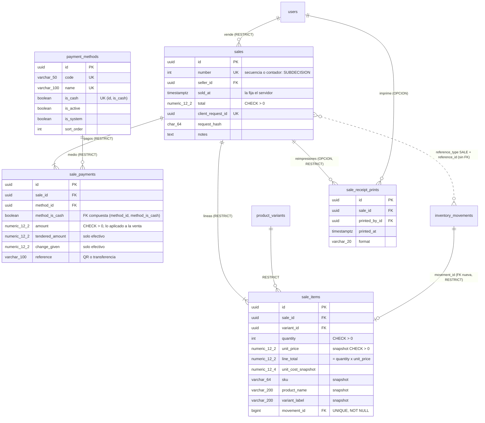
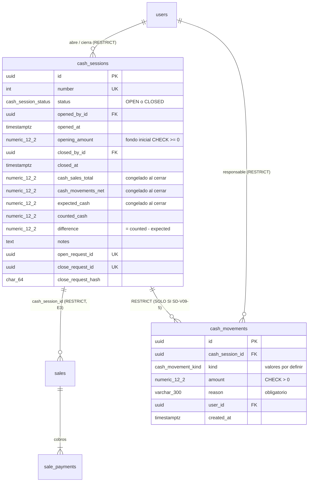

# 03 · Propuesta de modelo de datos de Ventas y Caja (Fase 2)

> Documento de **análisis para revisión**. Fecha: 2026-11-09 · Rama de trabajo: `.worktrees/int`.
> Fuente de verdad de las decisiones: resolución formal del responsable del proyecto sobre **Q-V07, Q-V09 y Q-V12** (07/11/2026) más las decisiones previas Q-V01 a Q-V05.
>
> **Alcance de la autorización: SOLO ANÁLISIS.** Este documento no modifica `schema.prisma`, no crea migraciones ni archivos `.sql`, no toca código, ADR, PENDIENTES, `CLAUDE.md` ni `DATABASE.md`, y no se ejecutó nada (ni Docker, ni tests, ni consultas). **Todo el SQL/DDL de este documento es ilustrativo**; no es una migración lista para aplicar. Cualquier afirmación de rendimiento o de comportamiento de PostgreSQL bajo concurrencia es _razonamiento, no medido_.

> **Actualización 2026-11-09.** Las subdecisiones de caja SD-V09-1 a SD-V09-8 se respondieron (B2 a B9
> de [RESOLUCIONES-2026-11-09](../../business/RESOLUCIONES-2026-11-09.md)); las etiquetas
> **[PENDIENTE]** de este documento se leen contra esas respuestas y no se reescriben una a una. Cambios
> en el modelo por las aclaraciones posteriores:
>
> - **`cash_sessions.opening_amount`:** fondo obligatorio, digitado en un campo libre en cada apertura
>   (B4). `CHECK >= 0` (acepta 0) y sin tope son **recomendación técnica**, pendiente de confirmar.
> - **`cash_movements`:** no se crea en el MVP (B6); `cash_movements_net` es 0.
> - **Sin reapertura (B7):** `cash_sessions_guard` no cambia; una sesión `CLOSED` sigue inmutable.
> - **Tabla nueva propuesta `cash_session_corrections`** (append-only, solo el Administrador): corrige
>   errores de captura del contado, del fondo y de la observación sin modificar la sesión ni tocar
>   ventas o pagos. Diseño en [10-correcciones-de-caja](10-correcciones-de-caja.md).
> - **`sales.cash_session_id`:** obligatoria, porque no se vende sin sesión abierta (B2).
>
> Solo se corrigieron las frases sobre fondo, gastos y retiros, reapertura y corrección (§1, §5.5, §5.6,
> §5.8 y §13.3). Lo relativo a B2 (`cash_session_id` en §5.2 y §11) se lee contra esta nota y no se
> reescribió.

## Cómo leer las etiquetas

| Etiqueta                    | Significado                                                                                                          |
| --------------------------- | -------------------------------------------------------------------------------------------------------------------- |
| **[CONFIRMADA]**            | Está en la resolución del responsable (Q-V01…Q-V05, Q-V07, Q-V09, Q-V12) o es un hecho verificado en el repositorio. |
| **[RECOMENDACIÓN TÉCNICA]** | Propuesta del especialista en base de datos. **No es una regla** hasta que el responsable la apruebe.                |
| **[PENDIENTE]**             | Subdecisión sin respuesta. El modelo la presenta como opciones; no se elige ni se anticipa en columnas.              |

Cuando una tabla o columna sale de una recomendación, así se rotula. Las subdecisiones pendientes de la resolución se citan como **SD-V09-1 … SD-V09-8** (las ocho listadas en DEC-V09) y **SD-V12-x** (las de DEC-V12).

## Índice

1. Resumen ejecutivo
2. Base verificada en el repositorio
3. Reglas confirmadas que el modelo debe reflejar
4. Diagrama entidad-relación
5. Catálogo de tablas (columnas, tipos, FK, únicos, CHECK, índices, triggers, escritor)
6. Cuadro de `ON DELETE`, únicos e índices
7. Triggers e inmutabilidad (y la decisión «Σ pagos = total»)
8. Concurrencia (a)
9. Integración con el libro de inventario (b)
10. Numeración (c)
11. El conflicto E1 antes que E3 (d)
12. Tamaños, reportes, arqueo, retención, respaldos, zona horaria y formato de dinero (e)
13. Qué NO se modela y qué queda pendiente (f)
14. Plan de migración y de pruebas de integridad (g)
15. Lista de decisiones que necesita del responsable
16. Supuestos y límites de este análisis

---

## 1. Resumen ejecutivo

1. **Cuatro tablas inmutables y dos de apoyo.** Ventas: `payment_methods` (catálogo), `sales`, `sale_items`, `sale_payments`. Caja: `cash_sessions`, `cash_movements`. Todas con UUID v7, `timestamptz(3)`, `numeric`, `snake_case` y FK `RESTRICT` **[RECOMENDACIÓN TÉCNICA]** salvo lo confirmado por la resolución (nombres de `cash_sessions`, `cash_movements`, `payment_methods`, `sale_payments`).
2. **Sin estado `VOIDED`, sin `SALE_VOID`, sin columnas de anulación y sin columna `status` en `sales` [CONFIRMADA en lo que excluye / RECOMENDACIÓN en omitir `status`].** Una venta existe solo si se confirmó (la transacción es atómica); lo que no se confirma se revierte y no deja fila. `sales`, `sale_items` y `sale_payments` llevan triggers `BEFORE UPDATE OR DELETE` que **siempre** lanzan excepción.
3. **Un solo trigger de integridad diferido (`DEFERRABLE INITIALLY DEFERRED`)** comprueba al `COMMIT` que `Σ line_total = total` y `Σ pagos = total`, y además impide agregar líneas o pagos a una venta ya confirmada. Se recomienda **trigger diferido como última línea de defensa + validación previa en el servicio** (sección 7.3).
4. **Idempotencia de la venta:** `client_request_id uuid UNIQUE` + `request_hash char(64)`. **Idempotencia del cierre:** `close_request_id uuid UNIQUE` y `close_request_hash` en `cash_sessions`. **Una sola sesión `OPEN`:** índice único parcial.
5. **El efectivo esperado nunca es un saldo editable.** Mientras la sesión está `OPEN` se calcula con una consulta; al cerrar se **congela** (dato histórico) y un trigger recalcula y rechaza un valor que no coincida.
6. **Concurrencia (sección 8):** nivel de aislamiento `READ COMMITTED` (el actual) + bloqueos explícitos. Orden propuesto: **sesión de caja (`FOR SHARE` en venta, `FOR UPDATE` en cierre) → variantes por id (`FOR NO KEY UPDATE`) → saldo**. Con ese orden venta y cierre no pueden interbloquearse y una venta nunca queda «medio dentro» de un arqueo.
7. **Hallazgo importante sobre migraciones:** como `sales` será inmutable por trigger, **ningún backfill de `cash_session_id`** sobre ventas ya registradas es posible sin deshabilitar el trigger (sección 11). Esto condiciona el conflicto E1/E3.
8. **Hallazgo sobre numeración:** `INSERT … ON CONFLICT DO NOTHING` con `DEFAULT nextval()` **consume números** aunque el insert se descarte por duplicado; una secuencia tiene huecos incluso sin errores de negocio (sección 10). Elegir entre secuencia y contador sin saltos **es una subdecisión pendiente (SD-V12)**.
9. **No se modelan** anulación, crédito, apartados, impuestos, multimoneda, clientes, descuentos, cambios (E4), factura externa ni multi-sucursal. **Quedan como opciones pendientes** reapertura de caja, gastos/retiros y conciliación de QR/transferencias (sección 13). _Actualización 2026-11-09:_ ya respondidas: sin reapertura (B7), sin gastos ni retiros (B6) y QR y transferencias informados aparte (B8); los errores de cierre se corrigen con `cash_session_corrections` ([10](10-correcciones-de-caja.md)).

---

## 2. Base verificada en el repositorio

Hechos leídos en `apps/api/prisma/schema.prisma`, las 17 migraciones y el código (no inventados):

| Elemento                                                     | Hecho verificado                                                                                                                                                                                                                                                                                                                                  |
| ------------------------------------------------------------ | ------------------------------------------------------------------------------------------------------------------------------------------------------------------------------------------------------------------------------------------------------------------------------------------------------------------------------------------------- |
| Tablas existentes                                            | 34 (informe `04`); relevantes aquí: `users`, `product_variants`, `inventory_balances`, `inventory_movements`, `audit_logs`, `price_changes`, `stock_entry_cost_types` (patrón de catálogo + seed). No existe ninguna tabla de configuración (`settings`): `grep "model Setting"` no devuelve nada, aunque el permiso `settings:manage` sí existe. |
| `movement_type`                                              | Ya incluye `SALE` (reservado, sin uso) y `CUSTOMER_RETURN`. **No** hay que ejecutar `ADD VALUE` para ventas. No se agrega `SALE_VOID`.                                                                                                                                                                                                            |
| `inventory_movements`                                        | `id bigint` (BIGSERIAL), `variant_id uuid`, `type`, `quantity int` (con signo, CHECK `<> 0`), `balance_before/after`, `unit_cost numeric(12,4)`, `reference_type varchar(40)`, `reference_id uuid` **sin FK**, `user_id`, `created_at`. Trigger `inventory_movements_append_only`.                                                                |
| `REFERENCE_TYPES` (`packages/shared/src/reference-types.ts`) | `STOCK_ENTRY`, `INVENTORY_ADJUSTMENT`, `INVENTORY_COUNT`, `EXCHANGE`. **Falta `SALE`** (cambio de código compartido, no de BD).                                                                                                                                                                                                                   |
| `product_variants`                                           | `sale_price numeric(12,2)`, `cost_price numeric(12,4)`, `sku varchar(64)`, `barcode varchar(64)`, `label varchar(200)`, `status`; `products.name varchar(200)`.                                                                                                                                                                                   |
| Convención de números                                        | `number SERIAL` en ingresos, conteos y ajustes (con huecos tras reversión).                                                                                                                                                                                                                                                                       |
| Claves                                                       | `@default(uuid(7))` lo genera el cliente Prisma; la columna **no** tiene `DEFAULT` en BD (la migración 10 usó `uuidv7()` de PG 18 para sembrar).                                                                                                                                                                                                  |
| Transacciones                                                | `lib/prisma.ts`: `timeout 30 s`, `maxWait 10 s`. **No** hay `isolationLevel` en ningún lugar de `apps/api/src` (verificado por búsqueda) → se usa el nivel por defecto de PostgreSQL, `READ COMMITTED`. No hay `lock_timeout`/`statement_timeout` (DT-DAT-09).                                                                                    |
| Bloqueos                                                     | `applyStockChanges` toma `SELECT … FROM product_variants WHERE id = … FOR UPDATE` en orden de id y luego `inventory_balances … FOR UPDATE`.                                                                                                                                                                                                       |
| Rol de BD                                                    | La app corre con el rol dueño de las tablas (DT-DAT-08): los triggers protegen contra bugs, no contra una credencial comprometida; `TRUNCATE` no dispara triggers de fila.                                                                                                                                                                        |
| Zona horaria                                                 | Almacenamiento UTC; presentación `America/La_Paz` (UTC−4, la zona no usa horario de verano).                                                                                                                                                                                                                                                      |
| Seeds                                                        | `resetDatabase` hace `TRUNCATE … CASCADE` de **todas** las tablas del esquema `public`, por lo que cualquier tabla nueva entra sola en la limpieza de pruebas.                                                                                                                                                                                    |

---

## 3. Reglas confirmadas que el modelo debe reflejar

| #   | Regla                                                                                                                                      | Fuente        | Dónde se refleja                                                                               |
| --- | ------------------------------------------------------------------------------------------------------------------------------------------ | ------------- | ---------------------------------------------------------------------------------------------- |
| 1   | Venta de mostrador con comprobante interno; precio registrado = total cobrado, la aplicación no añade impuestos                            | Q-V01, Q-V03  | `sales.total = Σ line_total`; sin columnas de impuesto                                         |
| 2   | Pagos en efectivo, QR, transferencia y combinaciones, exclusivamente en Bs                                                                 | Q-V04         | `payment_methods` (3 filas); sin columna de moneda                                             |
| 3   | Solo ventas pagadas íntegramente al momento; sin crédito ni apartados                                                                      | Q-V05         | `Σ pagos = total` forzado en BD; sin saldo pendiente ni estado intermedio                      |
| 4   | No anulación ordinaria; sin `VOIDED`, sin `SALE_VOID`, sin `sales:void`                                                                    | DEC-V07       | Sin `status`, sin columnas `void_*`; triggers de inmutabilidad                                 |
| 5   | No eliminar ni modificar importes o productos de una venta confirmada                                                                      | DEC-V07       | Triggers `BEFORE UPDATE OR DELETE` incondicionales                                             |
| 6   | Auditoría e historial de cada venta                                                                                                        | DEC-V07       | `recordAudit(tx, 'sale.created')` en la misma transacción (ADR-010)                            |
| 7   | Controles previos: precios/cantidades definitivos, disponibilidad, suma de pagos, idempotencia, transacción atómica                        | DEC-V07       | Secciones 7, 8 y 9                                                                             |
| 8   | Caja única; apertura, cobros, cierre, arqueo                                                                                               | DEC-V09       | `cash_sessions` + índice único parcial                                                         |
| 9   | Campos mínimos de `cash_sessions` y `cash_movements`                                                                                       | DEC-V09       | Sección 5.5 y 5.6                                                                              |
| 10  | Ventas asociadas a la sesión de caja correspondiente                                                                                       | DEC-V09       | `sales.cash_session_id` (ver el conflicto E1/E3, sección 11)                                   |
| 11  | Efectivo esperado calculado (fondo + cobros en efectivo + movimientos autorizados); QR/transferencia aparte                                | DEC-V09       | Sección 12.3                                                                                   |
| 12  | Una sola sesión abierta garantizada en BD; cierre idempotente; datos del cierre históricos; diferencias registradas; no editar el esperado | DEC-V09       | Índice único parcial, `close_request_id`, trigger de cierre                                    |
| 13  | Comprobante generado tras confirmar; imprimir no crea venta; reimpresión no cambia importes; vinculado permanentemente a la venta          | DEC-V12       | El comprobante **se renderiza siempre desde filas inmutables**; no se guarda copia renderizada |
| 14  | Numeración independiente de la factura fiscal; sin garantía de continuidad sin decisión específica                                         | DEC-V12       | `sales.number` propio; sin vínculo a factura; sección 10                                       |
| 15  | Roadmap: E2 (anulaciones) excluida; E3 caja después de cerrar subdecisiones                                                                | Resolución §5 | Sección 11                                                                                     |

---

## 4. Diagrama entidad-relación

### 4.1 Ventas (E1)



### 4.2 Caja (E3)



Las líneas punteadas son referencias lógicas sin FK (polimórficas, como el resto del libro).

---

## 5. Catálogo de tablas

Leyenda: **NN** = `NOT NULL`; **U** = único; **PK**/**FK**. Los `id` UUID no llevan `DEFAULT` en BD (los genera Prisma), igual que el resto del esquema. «Escribe» = módulo del backend autorizado a insertar/actualizar.

### 5.1 `payment_methods` (catálogo, patrón de `stock_entry_cost_types`)

**[CONFIRMADA]** existe la entidad y los medios son efectivo, QR, transferencia, solo Bs. **[RECOMENDACIÓN TÉCNICA]** en cómo se representa.

| Columna      | Tipo           | NULL | Default / nota                                                                               |
| ------------ | -------------- | ---- | -------------------------------------------------------------------------------------------- |
| `id`         | uuid           | NN   | PK                                                                                           |
| `code`       | varchar(50)    | NN   | **U**. `CASH`, `QR`, `BANK_TRANSFER` (nombres de código a validar)                           |
| `name`       | varchar(100)   | NN   | **U**. «Efectivo», «QR», «Transferencia»                                                     |
| `is_cash`    | boolean        | NN   | Alimenta el arqueo: solo `true` en efectivo. **Inmutable en la práctica** (ver FK compuesta) |
| `is_active`  | boolean        | NN   | `true`                                                                                       |
| `is_system`  | boolean        | NN   | `false`; los tres sembrados son `true`                                                       |
| `sort_order` | int            | NN   | `0`                                                                                          |
| `created_at` | timestamptz(3) | NN   | `CURRENT_TIMESTAMP`                                                                          |

- **Únicos:** `code`, `name`, y **`UNIQUE (id, is_cash)`** (necesario para la FK compuesta de `sale_payments`, ver 5.4).
- **Escribe:** migración (siembra con `uuidv7()`, `ON CONFLICT DO NOTHING`) y `seed.ts` (upsert por `code`, sin pisar `is_active`). No hay API de edición mientras el responsable no la pida. El patrón idéntico existe en la migración 10 (tipos de costo) y en el seed.
- **Por qué catálogo y no `enum`:** la resolución nombra la entidad `payment_methods`; un enum de BD no puede quitar valores y no admite atributos (`is_cash`). **[PENDIENTE]** si el negocio necesitará un cuarto medio (p. ej. tarjeta): hoy Q-V04 limita a los tres; agregar uno sería una fila, no una migración.
- **No se modela** `requires_reference` (si el número de transferencia/QR es obligatorio): **[PENDIENTE]** (no está resuelto; relacionado con SD-V09-7).

### 5.2 `sales`

**[CONFIRMADA]**: inmutable, sin `VOIDED`, sin eliminación, idempotente (`client_request_id` + `request_hash`), numeración independiente de la factura, asociada a una sesión de caja (E3).

| Columna             | Tipo           | NULL    | Default / nota                                                                                                                 |
| ------------------- | -------------- | ------- | ------------------------------------------------------------------------------------------------------------------------------ |
| `id`                | uuid           | NN      | PK. Se genera en el servidor **antes** de llamar al libro (se usa como `reference_id`)                                         |
| `number`            | integer        | NN      | **U**. Generación **[PENDIENTE]** (sección 10)                                                                                 |
| `seller_id`         | uuid           | NN      | FK → `users` **RESTRICT**. Quien registra la venta                                                                             |
| `sold_at`           | timestamptz(3) | NN      | La fija el servidor (nunca el cliente). Sin `DEFAULT` útil: `CURRENT_TIMESTAMP` es el inicio de la transacción, aceptable aquí |
| `total`             | numeric(12,2)  | NN      | CHECK `> 0` (precio 0 no es vendible, D9/Q-11). Total cobrado en Bs                                                            |
| `client_request_id` | uuid           | NN      | **U**. Clave de idempotencia generada por el POS                                                                               |
| `request_hash`      | char(64)       | NN      | SHA-256 (hex) de la solicitud canónica                                                                                         |
| `notes`             | varchar(500)   | sí      | Observación libre del vendedor **[RECOMENDACIÓN]**: opcional                                                                   |
| `cash_session_id`   | uuid           | sí / NN | **Depende de la decisión E1/E3 (sección 11)**; en E1 se omite                                                                  |
| `created_at`        | —              | —       | **No se agrega**: `sold_at` es la única marca de tiempo (una sola fuente de verdad)                                            |

Omitidos **a propósito** (no hay decisión que los respalde): `status`, `subtotal`, `discount_total`, `voided_*`, `void_reason`, `customer_id`, `invoice_reference`, moneda, impuestos, `seller_name`.

- **Sobre omitir `status` [RECOMENDACIÓN TÉCNICA]:** la venta nace confirmada y es la única forma de existir (el carrito vive en el navegador; opción A «descuento inmediato» del informe de arquitectura B.5). Una columna con un único valor posible es peso muerto y una invitación a agregar `VOIDED` «más adelante». Si E4 (cambios) necesitara un estado, será una migración aprobada.
- **Sobre `subtotal`/`discount_total`:** los descuentos están sin decidir (Q-V06). Sin ellos `subtotal = total`; mantener ambas columnas sería redundante. Si se aprueban descuentos, la migración agrega columnas y relaja el CHECK `total = Σ line_total`.
- **CHECK:** `sales_total_positive_check (total > 0)`; `sales_request_hash_format_check (request_hash ~ '^[0-9a-f]{64}$')`; `number > 0`.
- **Únicos/índices:** `UNIQUE (number)`, `UNIQUE (client_request_id)`, `sales_sold_at_id_idx (sold_at, id)` (listados y reportes; ver 12.2), `sales_seller_id_sold_at_idx (seller_id, sold_at)`. En E3: `sales_cash_session_id_idx (cash_session_id)`.
- **Triggers:** `sales_immutable` (BEFORE UPDATE OR DELETE → siempre excepción); `sales_integrity_check` (CONSTRAINT TRIGGER diferido, ver 7.3); en E3, `sales_require_open_session` (BEFORE INSERT, ver 8.3).
- **Escribe:** módulo `sales` (únicamente `INSERT`), más auditoría `sale.created`.
- **Idempotencia — por qué el `request_hash`:** la misma clave con un cuerpo distinto (otra cantidad, otro pago) es un error del cliente y debe responder `409`, no devolver silenciosamente otra venta.
- **`request_hash` qué incluye [RECOMENDACIÓN]:** JSON canónico ordenado de `{líneas: [variantId, quantity, expectedUnitPrice], pagos: [methodId, amount, tendered, reference], cashSessionId si aplica}`; **no** incluye marcas de tiempo ni el usuario.
- **Alcance de la clave:** `UNIQUE` global como en el informe de arquitectura. Para impedir que un usuario obtenga la venta de otro con solo conocer el UUID, el servicio comparará `seller_id` en el replay y responderá `409/404` si difiere **[RECOMENDACIÓN]**.

### 5.3 `sale_items`

| Columna              | Tipo          | NULL | Default / nota                                                                                                  |
| -------------------- | ------------- | ---- | --------------------------------------------------------------------------------------------------------------- |
| `id`                 | uuid          | NN   | PK                                                                                                              |
| `sale_id`            | uuid          | NN   | FK → `sales` **RESTRICT**                                                                                       |
| `variant_id`         | uuid          | NN   | FK → `product_variants` **RESTRICT**                                                                            |
| `quantity`           | integer       | NN   | CHECK `> 0` (piezas enteras, P-09)                                                                              |
| `unit_price`         | numeric(12,2) | NN   | **Snapshot** del `sale_price` vigente bajo bloqueo. CHECK `> 0`                                                 |
| `line_total`         | numeric(12,2) | NN   | CHECK `line_total = quantity * unit_price` (exacto: entero × 2 decimales)                                       |
| `unit_cost_snapshot` | numeric(12,4) | NN   | Costo vigente (`cost_price`, P-07) al vender. CHECK `>= 0`. **Solo visible con `costs:read`** (la API lo omite) |
| `sku`                | varchar(64)   | NN   | **Snapshot de descripción** para el comprobante                                                                 |
| `product_name`       | varchar(200)  | NN   | Snapshot (`products.name`)                                                                                      |
| `variant_label`      | varchar(200)  | sí   | Snapshot (`product_variants.label`)                                                                             |
| `movement_id`        | bigint        | NN   | FK → `inventory_movements(id)` **RESTRICT**, **UNIQUE**. El movimiento `SALE` de esta línea                     |

- **Único:** `UNIQUE (sale_id, variant_id)` — **una línea por variante** (escanear dos veces suma cantidad). **[RECOMENDACIÓN TÉCNICA]** tomada del informe de arquitectura (B.4); no es una regla confirmada. Es coherente con ADR-017 (una variante por ajuste) y con el índice I-02 del libro.
- **Por qué `movement_id NOT NULL` con FK desde el nacimiento:** evita repetir el hueco I-04 (`inventory_adjustment_items.movement_id` sin FK). El orden de inserción lo hace posible: **primero** el libro (que solo necesita el `sales.id` generado en memoria, `reference_id` no tiene FK), **después** las líneas.
- **Redundancia consciente:** con el índice I-02 la relación línea ↔ movimiento también sería recuperable por `(reference_type='SALE', reference_id, variant_id, type)`. Se conserva `movement_id` porque la FK es un contrato de BD verificable y lo usarán las conciliaciones.
- **CHECK adicional diferido (trigger, ver 7.4):** el movimiento referido es `type = 'SALE'`, de la misma variante, `quantity = -sale_items.quantity`, `reference_id = sale_id`, `unit_cost` igual al snapshot.
- **Índices:** el `UNIQUE (sale_id, variant_id)` ya cubre las búsquedas por `sale_id` (no se crea índice redundante, lección de INC-19); `sale_items_variant_id_sale_id_idx (variant_id, sale_id)` para historial por pieza y reportes; el `UNIQUE (movement_id)` sirve la FK.
- **Triggers:** `sale_items_immutable` (siempre excepción en UPDATE/DELETE); `sales_integrity_check` (diferido, AFTER INSERT) también aquí.
- **Escribe:** módulo `sales` (solo `INSERT`, en la transacción de la venta).
- **Por qué `ON DELETE RESTRICT` y no `CASCADE`** (distinto de `stock_entry_items`): una venta confirmada no se borra nunca; una cascada sería un camino muerto que solo existiría para ser neutralizado por el trigger (como hoy ocurre con ajustes y conteos). RESTRICT lo expresa directamente. **[RECOMENDACIÓN TÉCNICA]**
- **Margen:** `Σ quantity × (unit_price − unit_cost_snapshot)`; usa el **último costo** (P-07 sigue PENDIENTE, DT-ARQ-16): los reportes deben rotularlo como «costo vigente al vender».

### 5.4 `sale_payments` (inmutable)

**[CONFIRMADA]** la entidad y que separa efectivo, QR, transferencia y pagos mixtos.

| Columna           | Tipo          | NULL | Default / nota                                                                      |
| ----------------- | ------------- | ---- | ----------------------------------------------------------------------------------- |
| `id`              | uuid          | NN   | PK                                                                                  |
| `sale_id`         | uuid          | NN   | FK → `sales` **RESTRICT**                                                           |
| `method_id`       | uuid          | NN   | FK → `payment_methods` **RESTRICT**                                                 |
| `method_is_cash`  | boolean       | NN   | Copia **forzada por FK compuesta** del `is_cash` del medio                          |
| `amount`          | numeric(12,2) | NN   | CHECK `> 0`. **Lo aplicado a la venta** (en efectivo: lo recibido menos el vuelto)  |
| `tendered_amount` | numeric(12,2) | sí   | Efectivo recibido del cliente (solo medio en efectivo)                              |
| `change_given`    | numeric(12,2) | sí   | Vuelto entregado (solo efectivo)                                                    |
| `reference`       | varchar(100)  | sí   | Texto libre (n.º de operación de QR/transferencia). **No se exige** hasta decidirlo |

- **FK compuesta:** `FOREIGN KEY (method_id, method_is_cash) REFERENCES payment_methods (id, is_cash)` (soportada por Prisma con `@relation(fields: [methodId, methodIsCash], references: [id, isCash])`). Así la BD garantiza que `method_is_cash` no miente, **sin trigger** y permite un índice parcial de efectivo y el CHECK siguiente (un CHECK no puede consultar otra tabla). Si alguien intentara cambiar `payment_methods.is_cash`, el `ON UPDATE CASCADE` intentaría reescribir `sale_payments` y chocaría con el trigger de inmutabilidad: queda bloqueado. **[RECOMENDACIÓN TÉCNICA]**
- **CHECK de efectivo:** `(method_is_cash) = (tendered_amount IS NOT NULL AND change_given IS NOT NULL)` y, si es efectivo, `change_given >= 0 AND tendered_amount = amount + change_given`.
- **Por qué `amount` es lo neto:** para el arqueo el efectivo que **queda** en caja es `amount` (el vuelto salió del cajón). Esto evita sumar `tendered_amount` por error y contar el vuelto dos veces. El comprobante muestra `tendered_amount` y `change_given` (DEC-V12).
- **Sin `created_at`:** el pago nace con la venta; `sales.sold_at` es la única fuente. **[RECOMENDACIÓN TÉCNICA]** (evita dos instantes distintos para un mismo hecho).
- **Sin `created_by_id`:** la persona que registra es `sales.seller_id`. Si SD-V09-8 (responsabilidad de cada vendedor en la caja compartida) distingue «quién vende» de «quién cobra», se agregaría entonces.
- **Sin `exchange_id`:** E4 está sin definir.
- **Índices:** `sale_payments_sale_id_idx (sale_id)`; `sale_payments_method_id_idx (method_id)`.
- **Triggers:** `sale_payments_immutable`; `sales_integrity_check` (diferido).
- **Escribe:** módulo `sales`. **Lo lee** el módulo `cash` (arqueo) y `reports`.
- **Mixto:** una venta con ≥ 2 filas. No se guarda una bandera «es mixta»: se deriva (`COUNT(*) > 1` o `COUNT(DISTINCT method_id) > 1`).

### 5.5 `cash_sessions` (E3, tras cerrar SD-V09-1…8)

**[CONFIRMADA]** la entidad y sus campos mínimos (identificador, número, estado `OPEN`/`CLOSED`, usuario y fecha de apertura, fondo inicial, usuario y fecha de cierre, efectivo esperado, efectivo contado, diferencia, observaciones). Lo demás es **[RECOMENDACIÓN TÉCNICA]**.

| Columna              | Tipo                                     | NULL | Default / nota                                                                                                                                     |
| -------------------- | ---------------------------------------- | ---- | -------------------------------------------------------------------------------------------------------------------------------------------------- |
| `id`                 | uuid                                     | NN   | PK                                                                                                                                                 |
| `number`             | integer                                  | NN   | **U**, `SERIAL`. Los huecos aquí no tienen consecuencia contable (es un contador de turnos) **[PENDIENTE si el responsable quiere lo contrario]**  |
| `status`             | `cash_session_status` (`OPEN`, `CLOSED`) | NN   | `OPEN`. Enum nuevo                                                                                                                                 |
| `opened_by_id`       | uuid                                     | NN   | FK → `users` RESTRICT                                                                                                                              |
| `opened_at`          | timestamptz(3)                           | NN   | `CURRENT_TIMESTAMP`                                                                                                                                |
| `opening_amount`     | numeric(12,2)                            | NN   | Fondo inicial obligatorio, digitado en cada apertura **[CONFIRMADA B4]**; CHECK `>= 0` y sin tope **[RECOMENDACIÓN]**; cero y tope **[PENDIENTE]** |
| `closed_by_id`       | uuid                                     | sí   | FK → `users` RESTRICT. Puede diferir de quien abrió **[PENDIENTE SD-V09-1]**                                                                       |
| `closed_at`          | timestamptz(3)                           | sí   |                                                                                                                                                    |
| `cash_sales_total`   | numeric(12,2)                            | sí   | Σ pagos en efectivo de la sesión, **congelado al cerrar**                                                                                          |
| `cash_movements_net` | numeric(12,2)                            | sí   | Σ movimientos de caja con signo, **congelado al cerrar** (0 si no hay `cash_movements`)                                                            |
| `expected_cash`      | numeric(12,2)                            | sí   | `opening_amount + cash_sales_total + cash_movements_net`, **congelado**                                                                            |
| `counted_cash`       | numeric(12,2)                            | sí   | Efectivo físico contado; CHECK `>= 0`                                                                                                              |
| `difference`         | numeric(12,2)                            | sí   | `counted_cash − expected_cash`; con signo                                                                                                          |
| `notes`              | varchar(500)                             | sí   | Observaciones                                                                                                                                      |
| `open_request_id`    | uuid                                     | sí   | **U**. Idempotencia de la apertura                                                                                                                 |
| `close_request_id`   | uuid                                     | sí   | **U**. Idempotencia del cierre                                                                                                                     |
| `close_request_hash` | char(64)                                 | sí   | Hash de `{sessionId, countedCash, notes}`                                                                                                          |

- **Por qué dos columnas extra (`cash_sales_total`, `cash_movements_net`):** permiten un CHECK aritmético en BD y dejan el desglose histórico sin depender de que las filas de origen existan idénticas (siempre existirán por inmutabilidad, pero el arqueo debe ser reproducible a simple vista). **[RECOMENDACIÓN TÉCNICA]**; el mínimo de la resolución es `expected_cash`.
- **Desglose QR/transferencia:** no es parte del efectivo; se reporta por consulta (12.3). Opcionalmente se congela en un `closing_breakdown jsonb` (informativo). **[PENDIENTE]**: requiere aprobar su contenido y SD-V09-7.
- **CHECK:**
  - `cash_sessions_closing_state_check`: `(status = 'CLOSED') = (closed_by_id IS NOT NULL AND closed_at IS NOT NULL AND cash_sales_total IS NOT NULL AND cash_movements_net IS NOT NULL AND expected_cash IS NOT NULL AND counted_cash IS NOT NULL AND difference IS NOT NULL AND close_request_id IS NOT NULL AND close_request_hash IS NOT NULL)`
  - `closed_at >= opened_at` cuando existe.
  - `expected_cash = opening_amount + cash_sales_total + cash_movements_net`.
  - `difference = counted_cash - expected_cash`.
  - `opening_amount >= 0`, `counted_cash >= 0`.
  - `expected_cash` **no** se restringe a `>= 0`: retiros mayores al efectivo serían un dato anómalo que conviene ver, no ocultar **[PENDIENTE SD-V09-5]**.
- **Índice único parcial (garantía de BD de una sola sesión abierta):**
  ```sql
  -- ilustrativo
  CREATE UNIQUE INDEX cash_sessions_single_open_idx
    ON cash_sessions (status) WHERE status = 'OPEN';
  ```
  Solo puede existir una fila con `status = 'OPEN'`. No necesita índice de expresión. Prisma no declara índices parciales: queda **solo en SQL** (igual que los dos existentes; ver INC-17). Si algún día hubiera más cajas, la migración reemplazaría la clave por `(cash_register_id) WHERE status='OPEN'`: **no se anticipa** `cash_registers` ni `location_id`.
- **Índices:** `UNIQUE (number)`, `UNIQUE (open_request_id)`, `UNIQUE (close_request_id)`, `cash_sessions_opened_at_idx (opened_at)`.
- **Triggers:** `cash_sessions_guard` (BEFORE UPDATE OR DELETE, ver 7.5): DELETE prohibido; un UPDATE solo es válido si `OLD.status = 'OPEN'` y `NEW.status = 'CLOSED'`, nada más cambia salvo los campos de cierre, y `expected_cash`, `cash_sales_total` y `cash_movements_net` **coinciden con lo recalculado**; una sesión `CLOSED` es inmutable. _Actualización 2026-11-09:_ las correcciones del Administrador se guardan en otra tabla (`cash_session_corrections`) y no relajan este trigger ([10](10-correcciones-de-caja.md)).
- **Escribe:** módulo `cash` (apertura = `INSERT`; cierre = un único `UPDATE`).

### 5.6 `cash_movements` (E3, **solo si se aprueba SD-V09-5**)

**[CONFIRMADA]** la entidad, sus campos mínimos (sesión de caja, tipo, importe, motivo, usuario responsable, fecha y hora), que conserva historial y auditoría y que existe «cuando se autoricen». **[PENDIENTE SD-V09-5]** qué tipos existen (gastos, retiros, ingresos) y quién los autoriza. Por eso **esta tabla no debe crearse hasta resolverlo**; el cálculo de arqueo funciona sin ella (`cash_movements_net = 0`). _Actualización 2026-11-09:_ resuelto en contra (B6, sin gastos ni retiros en el MVP): **la tabla no se crea**; lo que sigue queda como referencia por si una decisión futura la habilita.

| Columna           | Tipo                 | NULL | Nota                                                                                                               |
| ----------------- | -------------------- | ---- | ------------------------------------------------------------------------------------------------------------------ |
| `id`              | uuid                 | NN   | PK                                                                                                                 |
| `cash_session_id` | uuid                 | NN   | FK → `cash_sessions` RESTRICT                                                                                      |
| `kind`            | `cash_movement_kind` | NN   | Enum **por definir** (el informe de arquitectura sugirió `EXPENSE`, `WITHDRAWAL`, `DEPOSIT`; **no está aprobado**) |
| `amount`          | numeric(12,2)        | NN   | CHECK `> 0`; el sentido (entra/sale) lo da `kind` **[RECOMENDACIÓN]**                                              |
| `reason`          | varchar(300)         | NN   | CHECK `length(btrim(reason)) >= 3`                                                                                 |
| `user_id`         | uuid                 | NN   | FK → `users` RESTRICT. Responsable                                                                                 |
| `created_at`      | timestamptz(3)       | NN   | `CURRENT_TIMESTAMP`                                                                                                |

- **Alternativa de signo:** `amount` con signo y `CHECK <> 0` (como el libro de inventario) — más simple de sumar, pero permite incoherencias entre `kind` y signo. Se recomienda monto positivo + `kind` y una función de signo en la fórmula.
- **Índices:** `(cash_session_id, created_at)`, `(user_id)`.
- **Triggers:** `cash_movements_immutable` (siempre excepción en UPDATE/DELETE) y `cash_movements_require_open_session` (BEFORE INSERT: la sesión debe estar `OPEN`, con `FOR SHARE`).
- **Riesgo de «anulación encubierta»:** un movimiento de caja compensatorio («egreso: devolución») podría usarse para devolver dinero de una venta sin tocar la venta. La resolución prohíbe mecanismos alternativos de reversión sin autorización expresa. **Control propuesto:** los `kind` aprobados no incluyen «devolución a cliente»; no existe vínculo `sale_id` en el movimiento; el motivo es obligatorio y se audita.
- **Escribe:** módulo `cash` (solo `INSERT`).

### 5.7 Comprobante: qué se modela y qué no

**[CONFIRMADA]** (DEC-V12): se genera tras confirmar, imprimible desde el navegador, formato configurable (58 mm, 80 mm, A5, A4), vinculado permanentemente a la venta, imprimir no crea venta, reimprimir no cambia importes. Contenido: identidad comercial, logo si se proporciona, leyenda «Comprobante interno», número de venta, fecha y hora, productos y variantes, cantidades, precios unitarios, subtotales, total en Bs, desglose de pagos, efectivo recibido y vuelto, leyenda «No válido como factura fiscal».

| Necesidad                        | Dónde está el dato                                                                            | Estado                                                                                                                                                                            |
| -------------------------------- | --------------------------------------------------------------------------------------------- | --------------------------------------------------------------------------------------------------------------------------------------------------------------------------------- |
| Número del comprobante           | `sales.number` (el comprobante es 1:1 con la venta; el contenido pide «número de venta»)      | **[RECOMENDACIÓN TÉCNICA]**: no crear tabla `receipts` ni segundo correlativo                                                                                                     |
| Independencia de la factura      | `sales.number` no se relaciona con ninguna numeración fiscal; no existe columna de factura    | **[CONFIRMADA]** (Q-V02, DEC-V12)                                                                                                                                                 |
| Snapshot de importes             | `unit_price`, `line_total`, `total`, `amount`, `tendered_amount`, `change_given` (inmutables) | **[RECOMENDACIÓN TÉCNICA]**                                                                                                                                                       |
| Snapshot de descripción          | `sku`, `product_name`, `variant_label` en `sale_items`                                        | **[RECOMENDACIÓN TÉCNICA]** (si luego se renombra un producto, el comprobante histórico no cambia)                                                                                |
| Fecha y hora                     | `sales.sold_at` (se presenta en `America/La_Paz`)                                             | —                                                                                                                                                                                 |
| Vendedor                         | `sales.seller_id` → `users.name` (**actual**, no histórico)                                   | **[PENDIENTE SD-V12 «identificación del vendedor»]**. Opción: `seller_name varchar(120)` como snapshot si el nombre debe ser histórico                                            |
| Identidad comercial / logo / NIT | **No existe lugar** (no hay tabla de configuración)                                           | **[PENDIENTE SD-V12 «datos obligatorios del negocio»]**. Opciones: tabla `app_settings`, constantes de despliegue, o snapshot por venta (`receipt_header jsonb`). No se crea nada |
| Formato de impresión             | Preferencia del usuario o del establecimiento                                                 | **[PENDIENTE SD-V12]**. No va en `sales`. Opciones: `localStorage` del navegador (cero BD), `user_preferences`, `app_settings`                                                    |
| Copia renderizada (HTML/PDF)     | **No se almacena**                                                                            | **[RECOMENDACIÓN TÉCNICA]**: el comprobante se renderiza siempre desde las filas inmutables; así es imposible que venta y comprobante difieran                                    |
| Reimpresiones                    | Ver abajo                                                                                     | **[PENDIENTE SD-V12 «reimpresión y su auditoría»]**                                                                                                                               |

**Reimpresiones — opciones (no se elige):**

| Opción | Cómo                                                                                                                                                                                                | Pro                                         | Contra                                                |
| ------ | --------------------------------------------------------------------------------------------------------------------------------------------------------------------------------------------------- | ------------------------------------------- | ----------------------------------------------------- |
| R-0    | Sin registro; solo logs técnicos                                                                                                                                                                    | Cero esquema                                | Sin trazabilidad de copias                            |
| R-1    | `audit_logs` con `sale.receipt_printed` (formato en `metadata`)                                                                                                                                     | Sin tabla nueva; ya inmutable; ADR-010      | Consultar «cuántas copias» exige filtrar `audit_logs` |
| R-2    | Tabla `sale_receipt_prints` (`id`, `sale_id` RESTRICT, `printed_by_id` RESTRICT, `printed_at timestamptz(3)`, `format varchar(20)`, `copy_number int`, UNIQUE `(sale_id, copy_number)`) append-only | Consulta directa; permite rotular «COPIA N» | Tabla nueva solo por una pregunta abierta             |

**Límite técnico de cualquier opción:** la impresión es del navegador (`window.print()`); el servidor **no puede saber si se imprimió** realmente ni si el papel salió. Lo que se registra es «se solicitó la vista/impresión», no «se imprimió». El fallo de impresión tras una venta exitosa **no** afecta a la venta (ya confirmada): se resuelve reimprimiendo. Si el negocio esperara controlar «solo una copia original», la BD no puede garantizarlo.

**Factura externa [PENDIENTE]:** el informe de arquitectura sugería `sales.invoice_reference` opcional. Con ventas inmutables **no puede llenarse después** de confirmar (la factura se emite fuera, posiblemente después). Si algún día se necesita, requeriría una tabla separada append-only `sale_external_documents (sale_id, document_type, document_number, recorded_by_id, recorded_at)`. No se modela (Q-V02: la facturación es externa y la integración está fuera de alcance).

### 5.8 Resumen: quién escribe cada tabla

| Tabla                                                                               | `INSERT`                                    | `UPDATE`                                                       | `DELETE`            | Lee                                                   |
| ----------------------------------------------------------------------------------- | ------------------------------------------- | -------------------------------------------------------------- | ------------------- | ----------------------------------------------------- |
| `payment_methods`                                                                   | migración + seed                            | seed (solo `is_active`, `name`, `sort_order`); nunca `is_cash` | nunca               | `sales`, `reports`                                    |
| `sales`                                                                             | módulo `sales`                              | **nunca** (trigger)                                            | **nunca** (trigger) | `sales`, `cash` (arqueo), `reports`                   |
| `sale_items`                                                                        | módulo `sales`                              | nunca                                                          | nunca               | `sales`, `reports`                                    |
| `sale_payments`                                                                     | módulo `sales`                              | nunca                                                          | nunca               | `sales`, `cash`, `reports`                            |
| `cash_sessions`                                                                     | módulo `cash` (apertura)                    | módulo `cash`, **una sola vez** (cierre OPEN→CLOSED)           | nunca               | `cash`, `sales` (solo bloqueo `FOR SHARE`), `reports` |
| `cash_movements`                                                                    | módulo `cash`                               | nunca                                                          | nunca               | `cash`, `reports`                                     |
| `cash_session_corrections` (propuesta 2026-11-09, [10](10-correcciones-de-caja.md)) | módulo `cash` (solo con `cash:correct`)     | nunca                                                          | nunca               | `cash`, `reports`, `audit`                            |
| `inventory_movements`, `inventory_balances`                                         | **solo** la fachada de `inventory`          | saldo: fachada                                                 | —                   | —                                                     |
| `audit_logs`                                                                        | `recordAudit(tx, …)` desde `sales` y `cash` | nunca                                                          | nunca               | `audit`                                               |

Frontera de módulos **[RECOMENDACIÓN TÉCNICA]**: `sales` necesita **bloquear** la fila de la sesión de caja (`FOR SHARE`) pero no escribe en tablas de `cash`; lo hace llamando a una función pública de `cash` (p. ej. `lockOpenSession(tx)`), igual que `sales` llama a la fachada de inventario. Así la regla «cada tabla tiene un único escritor» se conserva.

---

## 6. Cuadro de `ON DELETE`, únicos e índices

### 6.1 Claves foráneas (todas `ON UPDATE CASCADE` por defecto de Prisma; irrelevante con UUID)

| FK                                                           | Destino                        | `ON DELETE` | Motivo                                                                                                              |
| ------------------------------------------------------------ | ------------------------------ | ----------- | ------------------------------------------------------------------------------------------------------------------- |
| `sales.seller_id`                                            | `users`                        | RESTRICT    | Historial (un usuario con ventas no se borra, solo se desactiva)                                                    |
| `sales.cash_session_id` (E3)                                 | `cash_sessions`                | RESTRICT    | Historial                                                                                                           |
| `sale_items.sale_id`                                         | `sales`                        | RESTRICT    | Ver 5.3 (no hay borrado de ventas)                                                                                  |
| `sale_items.variant_id`                                      | `product_variants`             | RESTRICT    | Una variante vendida nunca se borra                                                                                 |
| `sale_items.movement_id`                                     | `inventory_movements`          | RESTRICT    | Trazabilidad línea ↔ libro (FK nueva; declarar la relación en `schema.prisma`, o `migrate dev` generaría un `DROP`) |
| `sale_payments.sale_id`                                      | `sales`                        | RESTRICT    | Historial                                                                                                           |
| `sale_payments.(method_id, method_is_cash)`                  | `payment_methods(id, is_cash)` | RESTRICT    | Historial; coherencia de `is_cash`                                                                                  |
| `cash_sessions.opened_by_id`, `closed_by_id`                 | `users`                        | RESTRICT    | Historial                                                                                                           |
| `cash_movements.cash_session_id`                             | `cash_sessions`                | RESTRICT    | Historial                                                                                                           |
| `cash_movements.user_id`                                     | `users`                        | RESTRICT    | Historial                                                                                                           |
| `sale_receipt_prints.sale_id`, `.printed_by_id` (opción R-2) | `sales`, `users`               | RESTRICT    | Historial                                                                                                           |

**No hay ninguna `CASCADE` ni `SET NULL`** en las tablas nuevas **[RECOMENDACIÓN TÉCNICA]**. Efecto colateral que debe atenderse: `products.remove` hoy cuenta tablas concretas (I-06) y devolvería un 422 genérico (`P2003`) ante `sale_items`; el servicio debe contar también `sale_items` para dar un mensaje claro (cambio de servicio, no de esquema).

### 6.2 Únicos

`payment_methods(code)`, `(name)`, `(id, is_cash)` · `sales(number)`, `(client_request_id)` · `sale_items(sale_id, variant_id)`, `(movement_id)` · `cash_sessions(number)`, `(open_request_id)`, `(close_request_id)`, índice parcial `(status) WHERE status='OPEN'` · (opción R-2) `sale_receipt_prints(sale_id, copy_number)`.

### 6.3 Índices secundarios

| Tabla            | Índice                                       | Para qué                                  |
| ---------------- | -------------------------------------------- | ----------------------------------------- |
| `sales`          | `(sold_at, id)`                              | Listado, ventas del día, rango (ver 12.2) |
| `sales`          | `(seller_id, sold_at)`                       | Ventas por vendedor                       |
| `sales`          | `(cash_session_id)` (E3)                     | Arqueo por sesión                         |
| `sale_items`     | `(variant_id, sale_id)`                      | Historial por pieza, piezas más vendidas  |
| `sale_payments`  | `(sale_id)`, `(method_id)`                   | Detalle de venta; reporte por medio       |
| `cash_sessions`  | `(opened_at)`                                | Listado por fecha                         |
| `cash_movements` | `(cash_session_id, created_at)`, `(user_id)` | Arqueo y consulta por responsable         |

No se crean índices redundantes con las unicidades (aprendizaje de INC-19 y F-22). No se crean índices GIN de texto en `sales`: la búsqueda de ventas es por número, fecha, vendedor o pieza.

---

## 7. Triggers e inmutabilidad

### 7.1 Inmutabilidad total de `sales`, `sale_items`, `sale_payments` (y `cash_movements`)

**[CONFIRMADA]** que no se eliminan ni se modifican importes/productos de una venta confirmada (DEC-V07). **[RECOMENDACIÓN TÉCNICA]** la forma: triggers incondicionales (más estrictos que los de ajustes, que admiten cambios mientras están `PENDING`; aquí no hay estado previo en el que editar).

```sql
-- ilustrativo, mismo estilo que prevent_resolved_adjustment_change (migración 13)
CREATE OR REPLACE FUNCTION prevent_sale_record_change() RETURNS trigger AS $$
BEGIN
  RAISE EXCEPTION 'Los registros de ventas son inmutables (% sobre %)', TG_OP, TG_TABLE_NAME;
END;
$$ LANGUAGE plpgsql;

CREATE TRIGGER sales_immutable         BEFORE UPDATE OR DELETE ON sales
  FOR EACH ROW EXECUTE FUNCTION prevent_sale_record_change();
CREATE TRIGGER sale_items_immutable    BEFORE UPDATE OR DELETE ON sale_items
  FOR EACH ROW EXECUTE FUNCTION prevent_sale_record_change();
CREATE TRIGGER sale_payments_immutable BEFORE UPDATE OR DELETE ON sale_payments
  FOR EACH ROW EXECUTE FUNCTION prevent_sale_record_change();
```

Límites heredados (informe `04` §4.3): no cubren `TRUNCATE` ni a un rol dueño que ejecute `DISABLE TRIGGER`. Con dinero real conviene (**[RECOMENDACIÓN TÉCNICA]**, **[PENDIENTE]** hosting OD-07 / DT-DAT-08): rol de ejecución sin `TRUNCATE`/`DELETE`/`UPDATE` sobre estas tablas y rol de migración aparte; un `BEFORE TRUNCATE` por tabla solo sería compatible con las pruebas si `resetDatabase` lo permite explícitamente (hoy usa `TRUNCATE … CASCADE` de todo el esquema).

### 7.2 Los triggers de inmutabilidad no cubren `INSERT`

Es el hueco documentado en informe `04` §4.3.1 (se pueden insertar líneas en un ajuste ya `APPROVED`). Para ventas se cierra con el trigger diferido de 7.3 (cualquier fila adicional rompería la igualdad de sumas).

### 7.3 Decisión: «Σ pagos = total» (y «Σ líneas = total») — trigger diferido frente a validación de servicio

**[CONFIRMADA]** la exigencia («pagos mixtos con Σ pagos = total»); **[RECOMENDACIÓN TÉCNICA]** el mecanismo.

| Criterio                                        | Solo servicio        | Solo trigger diferido                                                           | **Ambos (recomendado)**        |
| ----------------------------------------------- | -------------------- | ------------------------------------------------------------------------------- | ------------------------------ |
| Garantiza el invariante con SQL manual o un bug | No                   | Sí                                                                              | Sí                             |
| Mensaje de error útil al usuario                | Sí (422 con detalle) | No: falla en el `COMMIT` con `P0001` genérico (500)                             | Sí: el servicio valida primero |
| Cubre agregar líneas/pagos después de confirmar | No                   | Sí (ver abajo)                                                                  | Sí                             |
| Costo                                           | Cero                 | 3 consultas indexadas por fila al `COMMIT` (≤ ~10 líneas + ≤ 3 pagos por venta) | Igual                          |
| Complejidad de pruebas                          | Baja                 | Media (insertar filas sueltas ya no funciona)                                   | Media                          |

**Recomendación: ambos.** El servicio valida con aritmética entera de centavos y responde con el detalle (diferencia, qué pago sobra); el trigger es la última línea de defensa. La justificación pesa más aquí que en otros módulos: es dinero, el invariante es de una línea, y la inmutabilidad posterior hace que **un solo chequeo al `COMMIT` sea suficiente y definitivo**.

```sql
-- ilustrativo
CREATE OR REPLACE FUNCTION check_sale_totals() RETURNS trigger AS $$
DECLARE
  v_sale_id uuid := CASE TG_TABLE_NAME WHEN 'sales' THEN NEW.id ELSE NEW.sale_id END;
  v_total numeric; v_items numeric; v_paid numeric; v_n_items int; v_n_pay int;
BEGIN
  SELECT total INTO v_total FROM sales WHERE id = v_sale_id;
  SELECT COALESCE(sum(line_total),0), count(*) INTO v_items, v_n_items FROM sale_items    WHERE sale_id = v_sale_id;
  SELECT COALESCE(sum(amount),0),     count(*) INTO v_paid,  v_n_pay   FROM sale_payments WHERE sale_id = v_sale_id;
  IF v_n_items = 0 OR v_n_pay = 0 THEN
    RAISE EXCEPTION 'La venta % debe tener al menos una linea y un pago', v_sale_id;
  END IF;
  IF v_items <> v_total THEN
    RAISE EXCEPTION 'La suma de lineas (%) no coincide con el total de la venta (%)', v_items, v_total;
  END IF;
  IF v_paid <> v_total THEN
    RAISE EXCEPTION 'La suma de pagos (%) no coincide con el total de la venta (%)', v_paid, v_total;
  END IF;
  RETURN NULL;
END; $$ LANGUAGE plpgsql;

CREATE CONSTRAINT TRIGGER sales_integrity_check         AFTER INSERT ON sales
  DEFERRABLE INITIALLY DEFERRED FOR EACH ROW EXECUTE FUNCTION check_sale_totals();
CREATE CONSTRAINT TRIGGER sale_items_integrity_check    AFTER INSERT ON sale_items
  DEFERRABLE INITIALLY DEFERRED FOR EACH ROW EXECUTE FUNCTION check_sale_totals();
CREATE CONSTRAINT TRIGGER sale_payments_integrity_check AFTER INSERT ON sale_payments
  DEFERRABLE INITIALLY DEFERRED FOR EACH ROW EXECUTE FUNCTION check_sale_totals();
```

**Por qué el mismo chequeo en las tres tablas:** si alguien insertara más tarde (otra transacción) una línea o un pago sobre una venta ya confirmada, la suma dejaría de coincidir con `total` (los importes son siempre `> 0`, por CHECK, así que una fila adicional no puede dejar la suma igual) y la transacción fallaría al `COMMIT`. Eso cierra el hueco «INSERT no cubierto por la inmutabilidad» sin recurrir a `xmin` ni a una bandera mutable.

Notas honestas:

- La función se ejecuta por fila: una venta de 3 líneas y 2 pagos la corre 6 veces al `COMMIT`. A 15–40 ventas/día es irrelevante; no se optimiza.
- El error aparece en el `COMMIT`: con Prisma, el `$transaction` lanzará al cerrar. El servicio debe haber validado antes; el error de BD sería, por diseño, un bug.
- **Consecuencia en pruebas:** `database-integrity.test.ts` y similares no pueden insertar una `sales` suelta con Prisma; deben insertar `sales`+`sale_items`+`sale_payments` en una `$transaction`.
- **Alternativa descartada — `CHECK` agregado:** PostgreSQL no admite subconsultas en `CHECK`.
- **Alternativa descartada — columna `paid_total` mantenida por trigger:** introduce una columna derivada mutable en una tabla inmutable.

### 7.4 Coherencia línea ↔ movimiento (opcional, **[RECOMENDACIÓN TÉCNICA]**)

Trigger diferido `AFTER INSERT ON sale_items` que verifica por PK que `inventory_movements.id = NEW.movement_id` cumple `type = 'SALE'`, `variant_id = NEW.variant_id`, `quantity = -NEW.quantity`, `reference_type = 'SALE'`, `reference_id = NEW.sale_id` y `unit_cost = NEW.unit_cost_snapshot`. Una lectura por PK por línea. Cierra la clase de error «la línea dice una cosa y el libro otra». Encaja con I-04 e I-05 (sección 9.4). Es opcional: sin él, lo cubren el servicio y los tests de conciliación.

### 7.5 Triggers de caja (E3)

- `cash_sessions_guard` (BEFORE UPDATE OR DELETE):
  - `DELETE` → excepción.
  - `OLD.status = 'CLOSED'` → excepción siempre.
  - `OLD.status = 'OPEN'` y `NEW.status = 'OPEN'` → excepción (una sesión abierta no se edita; las observaciones se registran al cerrar).
  - `OLD.status = 'OPEN'` y `NEW.status = 'CLOSED'` → exige que `id`, `number`, `opened_*`, `opening_amount`, `open_request_id` no cambien, y **recalcula** `cash_sales_total` (Σ `sale_payments.amount` donde `method_is_cash` de ventas con `cash_session_id = OLD.id`) y `cash_movements_net`; si difieren de los valores que trae el `UPDATE`, lanza excepción. Con esto, «el importe esperado no se puede escribir a mano» queda garantizado por la BD y no solo por el servicio.
- `sales_require_open_session` (BEFORE INSERT ON sales, E3) y `cash_movements_require_open_session`: leen la sesión con `FOR SHARE`; si `status <> 'OPEN'` (o no existe) lanzan excepción; además exigen `NEW.sold_at >= opened_at`. Es el respaldo de BD del bloqueo explícito del servicio (8.3). Si el servicio ya tomó el mismo bloqueo, el trigger no espera.

**Comportamiento ante «venta sin sesión abierta» [PENDIENTE SD-V09-2]:** estos triggers asumen la regla estricta (toda venta exige sesión `OPEN`). Si el responsable decide permitir ventas sin caja, el trigger y la nulabilidad cambian (sección 11).

---

## 8. Concurrencia (a)

**Nivel de aislamiento [RECOMENDACIÓN TÉCNICA]: `READ COMMITTED` (el actual), con bloqueos explícitos de fila.**

- `SERIALIZABLE` exigiría reintentar `40001` en todas las rutas de stock y multiplicaría la complejidad sin ganar nada sobre los `FOR UPDATE` que ya garantizan el orden.
- `REPEATABLE READ` es **perjudicial** aquí: tras esperar un `FOR UPDATE`, una fila modificada por otra transacción produce `could not serialize access` en vez de re-leer; el POS tendría errores espurios con ventas simultáneas de la misma pieza.
- En `READ COMMITTED`, `SELECT … FOR UPDATE/SHARE` re-evalúa la fila bloqueada contra su última versión confirmada. **Detalle crítico:** el _snapshot_ de cada **sentencia** se toma al empezar la sentencia. Por eso los cálculos del cierre (sumas) deben ser **sentencias posteriores** al bloqueo, nunca un CTE o subconsulta en la misma sentencia que adquiere el bloqueo.

### 8.1 Orden de bloqueo propuesto (único para todo lo que toque estas tablas)

| Paso | Venta (`POST /sales`)                                                                                       | Cierre (`POST /cash/sessions/:id/close`)                                        | Movimiento de caja |
| ---- | ----------------------------------------------------------------------------------------------------------- | ------------------------------------------------------------------------------- | ------------------ |
| 0    | Replay: `SELECT` de `sales` por `client_request_id` **sin bloqueo**; si existe y el hash coincide, devolver | Replay: buscar por `close_request_id`; si existe y coincide, devolver           | —                  |
| 1    | `SELECT … FROM cash_sessions WHERE status='OPEN' FOR SHARE`                                                 | `SELECT … FROM cash_sessions WHERE id=$1 FOR UPDATE` (con `lock_timeout` corto) | `… FOR SHARE`      |
| 2    | `INSERT INTO sales … ON CONFLICT (client_request_id) DO NOTHING RETURNING`                                  | Sentencias **separadas** de suma (efectivo, movimientos, QR, transferencia)     | `INSERT`           |
| 3    | `SELECT … FROM product_variants WHERE id = ANY(…) ORDER BY id FOR NO KEY UPDATE`                            | `UPDATE cash_sessions SET status='CLOSED', …` (el trigger recalcula)            | —                  |
| 4    | `applyStockChanges`/fachada: saldo `FOR UPDATE`, `INSERT` movimiento, `UPDATE` saldo                        | `recordAudit`                                                                   | `recordAudit`      |
| 5    | `INSERT` `sale_items`, `sale_payments`; `recordAudit`                                                       |                                                                                 |                    |
| 6    | `COMMIT` → corre el trigger diferido                                                                        | `COMMIT`                                                                        | `COMMIT`           |

Regla general: **sesión de caja → documento → variantes por id ascendente → saldo**. El informe de arquitectura ya fija «documento → variantes por id → saldo»; esta propuesta antepone la sesión.

### 8.2 Por qué `FOR SHARE` en la venta y `FOR UPDATE` en el cierre

- Muchas ventas pueden tener `FOR SHARE` sobre la **misma** fila de sesión a la vez: no se serializan entre sí (los bloqueos `FOR SHARE` son compatibles entre sí).
- El cierre pide `FOR UPDATE`: espera a que las ventas en vuelo terminen y bloquea a las nuevas hasta que cierre.
- `FOR KEY SHARE` **no** serviría: no entra en conflicto con un `UPDATE` que no cambie claves, y el cierre cambia `status`. Por eso se pide `FOR SHARE`, que sí conflictúa con cualquier `UPDATE`/`FOR NO KEY UPDATE`. (Detalle de PostgreSQL no medido; debe verificarse con una prueba de concurrencia real antes de fijarlo.)
- Las FK de `sales.cash_session_id` toman `FOR KEY SHARE` automáticamente al insertar; es compatible con el `FOR SHARE` previo del mismo proceso.

### 8.3 Escenarios

| Escenario                                                         | Resultado esperado                                                                                                                                                                                                                                  | Mecanismo                                                                                    |
| ----------------------------------------------------------------- | --------------------------------------------------------------------------------------------------------------------------------------------------------------------------------------------------------------------------------------------------- | -------------------------------------------------------------------------------------------- |
| **Venta frente a cierre (la venta empieza antes)**                | La venta termina y entra en el esperado; el cierre espera                                                                                                                                                                                           | `FOR SHARE` vs `FOR UPDATE`; las sumas son sentencias posteriores al bloqueo                 |
| **Venta frente a cierre (el cierre empieza antes)**               | La venta espera; cuando el cierre confirma, la sesión es `CLOSED`, la re-evaluación de `WHERE status='OPEN'` no devuelve fila → `409/422 «no hay caja abierta»`; **nada se guarda**. El carrito sigue en el navegador                               | Re-lectura de la fila tras la espera (READ COMMITTED) + trigger `sales_require_open_session` |
| **Cierre doble simultáneo (dos pestañas o dos usuarios)**         | Uno cierra; el otro, tras esperar, ve `CLOSED`. Misma `close_request_id` y mismo hash → devuelve el cierre ya hecho (**idempotente**); otro id → `409` «ya cerrada»                                                                                 | `FOR UPDATE` + `close_request_id UNIQUE` + `WHERE status='OPEN'`                             |
| **Apertura doble simultánea**                                     | Una abre; la otra viola el índice único parcial (`23505`) → `409`; con el mismo `open_request_id` devuelve la sesión existente                                                                                                                      | Índice único parcial + `open_request_id`                                                     |
| **Doble envío de la misma venta (clic doble, reintento por red)** | Una sola venta. La segunda espera en el índice único de `client_request_id` hasta que la primera confirme (entonces `DO NOTHING` devuelve 0 filas, se lee la existente y se compara el hash) o se revierta (entonces la segunda procede a insertar) | `UNIQUE (client_request_id)` + `INSERT … ON CONFLICT DO NOTHING RETURNING`                   |
| **Mismo `client_request_id` con cuerpo distinto**                 | `409` (no devuelve otra venta)                                                                                                                                                                                                                      | `request_hash`                                                                               |
| **Reintento tras perder la conexión (resultado desconocido)**     | El POS reenvía con el mismo `client_request_id`: si la venta se confirmó, se devuelve igual; si no, se procesa. **El replay se evalúa antes de exigir sesión abierta**: un reintento después de un cierre no debe fallar si la venta ya existe      | Paso 0 del orden de bloqueo                                                                  |
| **Dos ventas de la última unidad**                                | Una confirma, otra `422`; saldo ≥ 0                                                                                                                                                                                                                 | `FOR NO KEY UPDATE` de variante + saldo + CHECK `quantity >= 0`                              |
| **Venta frente a ajuste/ingreso/conteo del mismo producto**       | Se serializan por variante; sin interbloqueo                                                                                                                                                                                                        | Mismo orden por id; el cierre jamás bloquea variantes                                        |
| **Venta frente a cambio de precio**                               | Precio coherente o `409 PRICE_CHANGED`                                                                                                                                                                                                              | Lectura del precio bajo bloqueo de variante                                                  |
| **Venta frente a desactivar la variante**                         | Coherente con P-22 si el libro valida `ACTIVE` bajo bloqueo                                                                                                                                                                                         | DT-ARQ-04 (aún abierto)                                                                      |
| **Movimiento de caja frente a cierre**                            | Igual que una venta: o entra en el esperado o es rechazado                                                                                                                                                                                          | `FOR SHARE`                                                                                  |

### 8.4 ¿Hay interbloqueo posible?

El cierre solo toma el bloqueo de la sesión y luego **lee** (sin bloquear) `sales`, `sale_payments` y `cash_movements`; nunca solicita bloqueos de variantes ni de saldo. Una venta solo espera a la sesión **al comienzo**. Para un ciclo haría falta que el cierre esperara algo que retiene una venta: no ocurre. Aun si algún servicio invirtiera el orden (variantes antes de la sesión), el resultado es una espera, no un ciclo. La regla de orden está para acotar latencias y para que, si en el futuro el cierre llegara a bloquear algo más, no aparezca un ciclo. **Cada transacción espera como máximo `maxWait`/`timeout` actuales (10 s/30 s)**; se propone `SET LOCAL lock_timeout = '5s'` en el cierre para responder `503 Retry-After` en lugar de colgar al usuario **[RECOMENDACIÓN TÉCNICA, cierra parte de DT-DAT-09]**.

### 8.5 `FOR NO KEY UPDATE` frente a `FOR UPDATE` sobre variantes

El informe de arquitectura (DT-ARQ-05) y `06` §5.6 proponen `FOR NO KEY UPDATE` para que las inserciones con FK (que toman `FOR KEY SHARE` sobre `product_variants`) no queden bloqueadas por la venta de otra pieza. El código actual usa `FOR UPDATE` (`stock-ledger.ts`). Mientras `applyStockChanges` use `FOR UPDATE`, el bloqueo efectivo sobre la variante será el más fuerte (`FOR UPDATE`); el cambio a `NO KEY UPDATE` pertenece a **E0** (unificar el libro). La propuesta de modelo no depende de él.

### 8.6 Resultado observable para el usuario

Solo hay dos finales posibles para una venta que coincide con un cierre: **incluida** o **rechazada sin efectos**. No existe «venta confirmada fuera del arqueo» porque la sesión está bloqueada desde el inicio de la venta hasta su `COMMIT`.

---

## 9. Integración con el libro de inventario (b)

### 9.1 Contrato

**[CONFIRMADA]** (ADR-007 y reglas del proyecto): el stock solo cambia por movimientos, y solo escribe el libro el servicio de inventario. **[RECOMENDACIÓN TÉCNICA]** el uso concreto:

| Campo del movimiento | Valor para una línea de venta                                                      |
| -------------------- | ---------------------------------------------------------------------------------- |
| `type`               | `SALE` (ya existe en el enum; **no** se agrega valor)                              |
| `quantity`           | `-sale_items.quantity` (negativo)                                                  |
| `unit_cost`          | igual a `sale_items.unit_cost_snapshot`                                            |
| `reference_type`     | `'SALE'` (agregar a `REFERENCE_TYPES` en `@joyeria/shared`)                        |
| `reference_id`       | `sales.id` (uuid sin FK; polimórfico)                                              |
| `user_id`            | `sales.seller_id`                                                                  |
| `reason` / `notes`   | `NULL` (o texto fijo)                                                              |
| `created_at`         | inicio de la transacción (**no** usar para «ventas del día»: usar `sales.sold_at`) |

Flujo: el servicio de ventas **no importa** `stock-ledger.ts`; llama a la fachada pública de `inventory` (E0 / DT-ARQ-03) con la lista de cambios; la fachada ejecuta `applyStockChanges` en la `tx` de la venta y devuelve los `movement_id`, que se guardan en `sale_items`.

### 9.2 Orden de escritura y por qué importa

1. `sales.id` se genera en memoria.
2. `INSERT sales` (reclama la idempotencia).
3. Fachada del libro (`reference_id = sales.id`; no hay FK, no hay problema de orden).
4. `INSERT sale_items` con `movement_id NOT NULL`.
5. `INSERT sale_payments`.

Si la fachada falla (saldo insuficiente, variante inactiva), toda la transacción se revierte: **no queda venta, ni línea, ni movimiento, ni número consumido bajo la opción B** (bajo la A sí se consume el número).

### 9.3 Índice único parcial I-02

Propuesta vigente (informe `04` §4.6): `UNIQUE (reference_type, reference_id, variant_id, type) WHERE reference_id IS NOT NULL`.

- Con DEC-V07 **desaparece** la razón principal para incluir `type` (que `SALE_VOID` no chocara con `SALE`). Se recomienda **conservar `type`** de todos modos: no cuesta nada, y protege el caso `EXCHANGE_IN`/`EXCHANGE_OUT` si algún día comparten referencia. **[RECOMENDACIÓN TÉCNICA]**
- Con I-02 y `UNIQUE (sale_id, variant_id)` en `sale_items`, la garantía es doble: la BD rechaza un segundo `SALE` de la misma variante bajo la misma venta, tanto en el libro como en las líneas.
- **Efecto de borde:** si la fachada reintentara por error el mismo cambio dentro de la misma transacción, el segundo `INSERT` violaría I-02 (aborta la transacción): comportamiento deseado.

### 9.4 Relación con las garantías pendientes I-01 … I-06

| Garantía (informe `04` §4.6)                               | Relación con Ventas                                                                                                                                                                                                                                                               | ¿Prerrequisito de E1?                                                                                      |
| ---------------------------------------------------------- | --------------------------------------------------------------------------------------------------------------------------------------------------------------------------------------------------------------------------------------------------------------------------------- | ---------------------------------------------------------------------------------------------------------- |
| **I-01** saldo = último `balance_after` (trigger diferido) | La venta aumenta de forma importante la frecuencia de escrituras del libro. La fachada ya mantiene la coherencia; I-01 detecta cualquier escritor que no pase por ella (hoy hay 4 puntos de escritura, DT-ARQ-01). Corre en el `COMMIT` de la venta (una vez por variante tocada) | **Recomendado antes de E1** (E0 / DT-DAT-02). No bloquea el diseño de las tablas                           |
| **I-02** unicidad `(ref, variante, tipo)`                  | Ver 9.3                                                                                                                                                                                                                                                                           | **Recomendado antes de E1**                                                                                |
| **I-03** ingreso confirmado inmutable                      | Ajeno a ventas                                                                                                                                                                                                                                                                    | No                                                                                                         |
| **I-04** FK de `movement_id`                               | `sale_items.movement_id` ya nace con FK; I-04 cubre las dos tablas antiguas (consistencia del patrón)                                                                                                                                                                             | No (pero la FK de ventas va en la migración de ventas)                                                     |
| **I-05** CHECK de signo por tipo                           | Fija `SALE < 0`. Sin `SALE_VOID`, el CHECK queda más simple y **no hay que esperar una migración posterior por `ADD VALUE`**                                                                                                                                                      | **Recomendado antes de E1**: es la única defensa de BD contra una venta con signo positivo (sumaría stock) |
| **I-06** `products.remove` cuenta dependencias             | Debe contar también `sale_items` (FK RESTRICT lo impide, pero el mensaje sería genérico)                                                                                                                                                                                          | No bloquea; ajustar el servicio                                                                            |

Todo esto sigue **[PENDIENTE]** de aprobación (OD-01 en el informe `06`): ninguna se aplica aquí.

### 9.5 Valorización y margen

`unit_cost_snapshot` y `inventory_movements.unit_cost` guardan el mismo valor en el instante de la venta. El costo es el **último costo** (P-07 pendiente); `INITIAL_STOCK` no guarda costo; las piezas sin ingreso tienen `cost_price = 0` y generarían margen del 100 %. Los reportes deben advertirlo; el modelo no lo corrige.

---

## 10. Numeración (c)

**[CONFIRMADA]** la numeración es independiente de la factura fiscal y no se promete continuidad sin decisión específica. **[PENDIENTE]** (subdecisiones de DEC-V12): formato definitivo del correlativo, política sobre saltos, datos obligatorios del negocio, requisitos del contador. **No se elige.** El modelo físico es el mismo en ambos casos: `sales.number integer NOT NULL UNIQUE`; lo único que cambia es **cómo se genera**. El formato visible (`VTA-000123`, prefijo, año, serie) se aplica en la capa de presentación y puede cambiar sin migración.

### 10.1 Opciones

|                               | **A. Secuencia (`SERIAL`/`nextval`)**                                                                                                               | **B. Contador bloqueado sin saltos** (`document_counters`)                                                                                                                                                                                                                                                                                                                                            |
| ----------------------------- | --------------------------------------------------------------------------------------------------------------------------------------------------- | ----------------------------------------------------------------------------------------------------------------------------------------------------------------------------------------------------------------------------------------------------------------------------------------------------------------------------------------------------------------------------------------------------- |
| Mecanismo                     | `number integer NOT NULL DEFAULT nextval('sales_number_seq')`, como ingresos/ajustes/conteos                                                        | Tabla `document_counters(code PK, last_number int)`; en la transacción: `UPDATE … SET last_number = last_number + 1 WHERE code='SALE' RETURNING last_number`                                                                                                                                                                                                                                          |
| Huecos                        | **Sí**: por cada transacción revertida (stock insuficiente, error, cierre concurrente) y **por cada intento duplicado** de idempotencia (ver abajo) | **Ninguno** mientras el incremento y la venta compartan transacción                                                                                                                                                                                                                                                                                                                                   |
| Efecto en concurrencia        | Ninguno (la secuencia no bloquea)                                                                                                                   | Serializa el commit de todas las ventas por la fila del contador (hasta el `COMMIT`). Con 15–40 ventas/día es irrelevante; no escala a miles por minuto                                                                                                                                                                                                                                               |
| Efecto en el orden de bloqueo | Ninguno                                                                                                                                             | El contador debe tomarse **lo más tarde posible** (tras variantes y libro) para acortar la espera; pero entonces el `INSERT sales` (que lleva `number`) ocurre tarde y la reclamación de idempotencia por `INSERT … ON CONFLICT` al inicio ya no sirve; se reemplaza por `SELECT` previo + captura de `23505` (la violación aborta la transacción completa, que se revierte con el contador incluido) |
| Orden vs. tiempo              | `number` y `sold_at` pueden quedar levemente desordenados entre transacciones concurrentes                                                          | Con el contador al final, el orden de número coincide con el orden de commit                                                                                                                                                                                                                                                                                                                          |
| Complejidad                   | Mínima; patrón existente                                                                                                                            | Tabla nueva, función, pruebas de concurrencia                                                                                                                                                                                                                                                                                                                                                         |
| Honestidad                    | No promete continuidad                                                                                                                              | Promete continuidad **solo si nadie toca la fila del contador**; hoy lo protegería solo el rol de BD                                                                                                                                                                                                                                                                                                  |

**Detalle importante de la opción A (verificado en la semántica de PostgreSQL, no medido aquí):** en `INSERT … ON CONFLICT DO NOTHING`, los `DEFAULT` de la fila propuesta (incluido `nextval`) se evalúan **antes** de detectar el conflicto. Por lo tanto cada reintento idempotente (clic doble, reenvío por red) **consume un número** aunque no cree venta. Mitigaciones, ninguna elimina el problema por completo: un `SELECT` previo por `client_request_id` (paso 0 del flujo) evita la mayoría de los casos; los empates verdaderamente simultáneos siguen consumiendo.

**Un tercer eje, neutral respecto al contador:** si el contador fuera por año o por serie (`VTA-2026-000001`), el reinicio anual requiere clave compuesta `(serie, number)`; pendiente del formato.

### 10.2 Lo que ninguna opción garantiza

- La BD no puede imponer «sin saltos» con un CHECK sin serializar (verificar `number = max+1` también requiere bloqueo).
- Un número continuo **no equivale a validez fiscal**: el comprobante es interno y lleva la leyenda «No válido como factura fiscal».
- Como no hay anulación, un salto **no puede corresponder a una venta anulada**: sería siempre un intento revertido o un duplicado. Esto facilita explicar los saltos al contador (opción A) si se decide aceptarlos.

**Pregunta para el responsable (SD-V12):** ¿se acepta que el correlativo tenga saltos (A) o se requiere continuidad (B)? ¿Qué dice el contador? Hasta entonces el esquema es el mismo; **cambiar de A a B después** implica reasignar el origen de `number` sin tocar filas existentes (posible: el contador arranca en `MAX(number)`), pero no corrige saltos ya ocurridos.

---

## 11. El conflicto de orden E1 antes que E3 (d)

**El conflicto:** la resolución ordena E1 (ventas) antes que E3 (caja) y exige que «las ventas deban asociarse con la sesión de caja correspondiente». Pero `cash_sessions` no existe hasta E3, y las subdecisiones SD-V09-1…8 deben cerrarse **antes** de E3. Además, el informe de arquitectura señala que operar con dinero real exige E1 a E3.

### 11.1 Hecho técnico que condiciona todo: la inmutabilidad impide el backfill

Con `sales_immutable` activo, **no se puede ejecutar** `UPDATE sales SET cash_session_id = …` sobre ventas existentes: el trigger lo rechaza. Para hacerlo habría que `ALTER TABLE sales DISABLE TRIGGER sales_immutable` dentro de la migración (requiere ser dueño, queda fuera de la auditoría de la app y es, de hecho, una modificación de una venta confirmada). Tampoco es posible «borrar las ventas de prueba». Por lo tanto la decisión sobre la columna en E1 es **estructural**.

### 11.2 Tres modelos posibles

|                                                        | **A1. E1 sin la columna** (se agrega en E3)                                                                                                                                    | **A2. E1 con `cash_session_id uuid NULL` sin FK**    | **B. Obligatoria desde E1** (`NOT NULL` + FK)                                  |
| ------------------------------------------------------ | ------------------------------------------------------------------------------------------------------------------------------------------------------------------------------ | ---------------------------------------------------- | ------------------------------------------------------------------------------ |
| Qué incluye la migración E1                            | Solo `payment_methods`, `sales`, `sale_items`, `sale_payments`                                                                                                                 | Lo mismo + columna sin FK (no existe el destino)     | Todo lo anterior **y** `cash_sessions` (tabla, enum, índice parcial, triggers) |
| ¿Respeta «no agregar columnas para reglas pendientes»? | **Sí**                                                                                                                                                                         | No del todo: ancla una regla sin aprobar             | **No**: crea estructura para SD-V09-1…8 antes de cerrarlas                     |
| Migración E3                                           | `ALTER TABLE sales ADD COLUMN cash_session_id uuid NULL` (instantáneo en PG ≥ 11) + `ADD CONSTRAINT … FOREIGN KEY … NOT VALID` + `VALIDATE` + índice + trigger `BEFORE INSERT` | `ADD CONSTRAINT FK NOT VALID` + `VALIDATE` + trigger | No hay migración de ventas; solo se agregan reglas                             |
| Ventas ya registradas en E1                            | Quedan con `NULL` **para siempre**                                                                                                                                             | Igual                                                | No existen (no se pudo vender sin sesión)                                      |
| Cómo se impone después                                 | CHECK de corte (11.3)                                                                                                                                                          | CHECK de corte                                       | `NOT NULL` desde el inicio                                                     |
| Efecto en E1                                           | El MVP vende sin caja (solo prueba/piloto)                                                                                                                                     | Igual                                                | **E1 ya incluye abrir/cerrar caja** → en la práctica E1 + E3 juntas            |
| Riesgo principal                                       | Efectivo de ventas anteriores a E3 fuera de cualquier arqueo                                                                                                                   | Igual; además una columna huérfana sin FK            | Se adelanta E3 sin tener cerradas las ocho subdecisiones                       |
| Riesgo de dato                                         | Ninguno (no hay filas que migrar)                                                                                                                                              | Ninguno                                              | Ninguno                                                                        |

### 11.3 Cómo conservar el invariante «toda venta tiene sesión» tras E3 (modelos A1/A2)

**Opción N — nulabilidad con fecha de corte [RECOMENDACIÓN TÉCNICA para A1]:**

```sql
-- ilustrativo, dentro de la migración E3
DO $$
BEGIN
  EXECUTE format(
    'ALTER TABLE sales ADD CONSTRAINT sales_cash_session_required_check
       CHECK (cash_session_id IS NOT NULL OR sold_at < %L::timestamptz) NOT VALID',
    clock_timestamp());      -- instante de corte = momento de aplicar la migración
END $$;
-- NOT VALID: solo valida filas nuevas; las existentes son anteriores al corte por construcción
```

- No requiere tocar ninguna venta; las anteriores al corte quedan con `NULL` (histórico honesto: «vendida antes de existir la caja») y las posteriores **deben** traer sesión.
- Condición: que no se inserten ventas con la versión vieja de la aplicación después de aplicar la migración (el despliegue ya ejecuta `prisma migrate deploy` al arrancar el contenedor; la ventana es mínima y falla de forma segura: rechaza).
- Los reportes de arqueo ignoran las ventas con `cash_session_id NULL`; un reporte «ventas sin sesión (pre-caja)» las muestra.

**Opción R — sesión sintética de migración (no recomendada):** crear una `cash_sessions` `CLOSED` que agrupe las ventas antiguas exige `UPDATE sales` (bloqueado por 11.1) y **fabrica** un arqueo (`counted_cash`, `difference`) que nunca existió. Contradice «registrar las diferencias de arqueo» y la honestidad del histórico. Alternativa sin `UPDATE`: tabla puente append-only `sale_cash_session_links(sale_id PK, cash_session_id)` para ventas pre-caja; añade complejidad para datos que, si E1 solo se usa en pruebas, no existen.

**Opción V — reiniciar el entorno de pruebas (decisión del responsable):** si E1 solo se despliega a desarrollo/preproducción con datos de prueba, el responsable puede decidir vaciar esa base antes de E3. Esto es un comando destructivo y **requiere confirmación explícita del usuario**; este documento no lo ejecuta ni lo propone como paso automático.

### 11.4 Qué pasa con la regla de «venta sin sesión abierta» (SD-V09-2)

| Decisión posible                                     | Efecto en el modelo                                                                                                                                                                                                                         |
| ---------------------------------------------------- | ------------------------------------------------------------------------------------------------------------------------------------------------------------------------------------------------------------------------------------------- |
| La venta **exige** sesión abierta                    | `cash_session_id NOT NULL` (tras el corte) + trigger `sales_require_open_session`; el POS bloquea la venta y pide abrir caja                                                                                                                |
| La venta **puede** hacerse sin sesión                | `cash_session_id` permanece **nulable**; los cobros en efectivo de esas ventas **no están en ningún arqueo**; habría que decidir cómo se concilian (probablemente una sesión posterior que las «recoja», lo que choca con la inmutabilidad) |
| La venta sin sesión se asigna a la siguiente abierta | Requiere `UPDATE` o una tabla puente (11.3-R): **desaconsejado**                                                                                                                                                                            |

**[RECOMENDACIÓN TÉCNICA]** la primera (venta exige sesión): es la única compatible con «ventas asociadas a la sesión», con inmutabilidad y con un arqueo completo. **[PENDIENTE]**: decisión del responsable.

### 11.5 Recomendación

**[RECOMENDACIÓN TÉCNICA]** Modelo **A1** (omitir la columna en E1; agregarla en E3 con CHECK de corte) **si** E1 se usa solo en pruebas y piloto sin pretender control del efectivo. Si el responsable quiere vender con dinero real antes de cerrar las subdecisiones, el modelo **B** es el único que mantiene el invariante, pero obliga a cerrar antes SD-V09-1, 2 y 3 como mínimo y a adelantar `cash_sessions` y la apertura/cierre a E1: en la práctica, **reordenar el roadmap**. **[PENDIENTE]**: decisión del responsable; no se asume.

---

## 12. Tamaños, reportes, arqueo, retención, respaldos, zona horaria y dinero (e)

### 12.1 Tamaño estimado (razonamiento, no medido)

Base: ~15–40 ventas/día, 1–2 líneas (informe `04` §6.5), ~300 días/año, hasta 3 pagos por venta.

| Tabla                                          | Filas por año (estimado) | Bytes por fila (aprox. con índices)                 | Volumen por año |
| ---------------------------------------------- | ------------------------ | --------------------------------------------------- | --------------- |
| `sales`                                        | 4.500–12.000             | ~250                                                | < 3 MB          |
| `sale_items`                                   | 7.000–25.000             | ~350 (incluye textos snapshot hasta 460 caracteres) | < 9 MB          |
| `sale_payments`                                | 5.000–20.000             | ~150                                                | < 3 MB          |
| `inventory_movements` (aporte de ventas)       | 7.000–25.000             | ~220                                                | < 6 MB          |
| `audit_logs` (aporte de ventas, 1–2 por venta) | 5.000–25.000             | ~600 (JSON)                                         | < 15 MB         |
| `cash_sessions`                                | ~300                     | ~250                                                | < 0,1 MB        |
| `cash_movements`                               | decenas–cientos          | ~200                                                | despreciable    |

Diez años: orden de cientos de MB, comparable a las fotos. **No hay riesgo de rendimiento**; las decisiones de índices no necesitan particionar.

### 12.2 Índices para reportes

- **Por día / rango:** `sold_at` en rango (`>= $ini AND < $fin`). La Paz es UTC−4 fijo (sin horario de verano), por lo que el servicio puede calcular los límites del día como `instante UTC` y consultar por rango sobre `sales_sold_at_id_idx`. Se recomienda **no** usar `(sold_at AT TIME ZONE …)::date` en el `WHERE` (no usaría el índice a menos que se cree uno de expresión). El `GROUP BY` por día en La Paz sí puede usar la expresión (cálculo, no filtro).
- **Por vendedor:** `(seller_id, sold_at)`.
- **Por medio de pago:** `sales` (rango) → `sale_payments` por `sale_id` → `method_id`. Con este volumen no requiere índice compuesto con fecha (por eso `sale_payments` no lleva `created_at`).
- **Por pieza/categoría:** `sale_items (variant_id, sale_id)` → `product_variants` → `products.category_id`.
- **No** se usa `inventory_movements.created_at` para «ventas del día».
- **Margen:** solo con `costs:read`.

### 12.3 Arqueo (consultas ilustrativas)

```sql
-- Efectivo esperado de una sesión ABIERTA (nunca se guarda como saldo editable)
SELECT s.opening_amount
     + COALESCE((SELECT sum(p.amount) FROM sales v
                   JOIN sale_payments p ON p.sale_id = v.id AND p.method_is_cash
                  WHERE v.cash_session_id = s.id), 0)
     + COALESCE((SELECT sum(CASE m.kind /* signo por tipo: PENDIENTE SD-V09-5 */ END)
                   FROM cash_movements m WHERE m.cash_session_id = s.id), 0)
       AS expected_cash
FROM cash_sessions s WHERE s.id = $1;

-- Cobros no efectivo, separados (QR, transferencia): informativos, no entran al conteo físico
SELECT pm.code, pm.name, count(*) AS pagos, sum(p.amount) AS total
FROM sales v
JOIN sale_payments p  ON p.sale_id = v.id
JOIN payment_methods pm ON pm.id = p.method_id
WHERE v.cash_session_id = $1 AND NOT p.method_is_cash
GROUP BY pm.code, pm.name;
```

- La suma de efectivo usa `amount` (neto del vuelto), no `tendered_amount`.
- El índice `sales (cash_session_id)` + `sale_payments (sale_id)` basta a este volumen (una sesión tiene decenas de ventas). Si se quisiera un índice solo-índice, se podría denormalizar `cash_session_id` en `sale_payments` con FK compuesta `(sale_id, cash_session_id)`; **no se recomienda** a este volumen.
- **Al cerrar:** `expected_cash`, `cash_sales_total` y `cash_movements_net` se congelan; el trigger recalcula y compara. El valor guardado es histórico: las consultas posteriores del arqueo de una sesión cerrada **leen el valor guardado**, y el recálculo solo sirve de verificación.
- **Sesiones que cruzan la medianoche:** el arqueo es por **sesión**, no por día calendario.
- **Consistencia de tiempo:** `sold_at >= opened_at` (trigger) y, para sesiones cerradas, `sold_at <= closed_at` (se cumple por el bloqueo; puede añadirse al chequeo del cierre).

### 12.4 Retención

- Ventas, líneas, pagos, sesiones y movimientos de caja: **sin purga**, inmutables. Es coherente con P-23 (auditoría indefinida) y con el principio «no se borra lo que tiene historial».
- **[PENDIENTE]** el plazo legal de conservación de registros comerciales/contables en Bolivia: **no se asume**; es consulta para el contador/asesor legal del cliente. La arquitectura no lo impide: nada se purga.
- **Datos personales:** no hay clientes en el modelo (no se almacenan nombre, NIT ni teléfono del comprador). Reduce la superficie de privacidad. Si se aprueba E6 (clientes), habrá que ampliar `audit-redaction` y definir retención.
- `sale_payments.reference` es texto libre: puede contener datos de terceros (un nombre en una transferencia). **[RECOMENDACIÓN]** límite de 100 caracteres y no mostrarlo a roles sin permiso de detalle.

### 12.5 Respaldos y recuperación

- El valor de los datos sube con las ventas y la caja: la propuesta P-26 (RPO ≤ 24 h) significa perder potencialmente **un día de ventas y de arqueo**. **[RECOMENDACIÓN TÉCNICA]** reconsiderar RPO de minutos (PITR) cuando se opere con dinero real; **[PENDIENTE]** P-26.
- Verificación posterior a una restauración (ampliar la del informe `04` §7.3): (1) saldo = Σ movimientos; (2) para cada venta, Σ líneas = Σ pagos = total; (3) para cada línea, existe el movimiento `SALE` con cantidad coincidente; (4) para cada sesión `CLOSED`, el esperado guardado = esperado recalculado; (5) a lo sumo una sesión `OPEN`.
- Pérdida de datos parcial sin respaldo reciente: una venta presente en el libro sin fila en `sales` (o viceversa) es detectable con el punto (3) y por `reference_id`.
- La inmutabilidad significa que **el único «deshacer» ante una venta errónea es la restauración** o un mecanismo aprobado de excepción (ver 13.1): conviene tenerlo presente al fijar el RPO.

### 12.6 Zona horaria

Todos los instantes son `timestamptz(3)` (UTC en almacenamiento); la presentación y el corte del «día de negocio» usan `America/La_Paz` (UTC−4, sin horario de verano, **verificar vigencia con `tzdata` del servidor**). `sold_at`, `opened_at`, `closed_at` las fija el servidor, nunca el navegador. El comprobante muestra la hora de La Paz.

### 12.7 Formato de dinero

- `numeric(12,2)` para todo importe de venta/caja (hasta 9.999.999.999,99 Bs), como `sale_price`. `unit_cost_snapshot` en `numeric(12,4)` como `cost_price`.
- Sin `float`. Cálculo de totales en el servidor con centavos enteros; serialización como **string** en la API.
- `line_total` es exacto: cantidad entera × precio de 2 decimales.
- **Redondeo del efectivo [PENDIENTE]:** en Bolivia las monedas más pequeñas son de 10 centavos; si el negocio redondea cobros en efectivo, hoy no hay regla. El modelo permite cualquier centavo; no se anticipa ningún redondeo.
- **No hay columna de moneda** (Q-V04: solo Bs; P-10 parcial).

---

## 13. Qué NO se modela y qué queda pendiente (f)

### 13.1 No se modela por decisión confirmada

| Concepto             | Decisión | Qué NO aparece en el modelo                                                                                                                                                             | Qué sí                                                                                             |
| -------------------- | -------- | --------------------------------------------------------------------------------------------------------------------------------------------------------------------------------------- | -------------------------------------------------------------------------------------------------- |
| Anulación            | DEC-V07  | `status = VOIDED`, `voided_at/by`, `void_reason`, `SALE_VOID` en `movement_type`, `reference_type = 'SALE_VOID'`, pagos de signo negativo, permiso `sales:void`, `POST /sales/:id/void` | Triggers de inmutabilidad; `amount > 0` en pagos (un pago negativo sería una reversión encubierta) |
| Crédito y apartados  | Q-V05    | saldo pendiente, anticipos, estado `PENDING`/`PARTIAL`, reservas de stock, `customer_id` obligatorio                                                                                    | CHECK `Σ pagos = total`                                                                            |
| Impuestos            | Q-V03    | columnas de IVA/IT, base imponible, `tax_total`                                                                                                                                         | `total = Σ line_total`                                                                             |
| Multimoneda          | Q-V04    | columna de moneda, tipo de cambio en ventas                                                                                                                                             | Todo en Bs                                                                                         |
| Factura fiscal       | Q-V02    | `invoice_reference`, `invoice_number`, integración SIN                                                                                                                                  | Numeración propia independiente                                                                    |
| Comprobante guardado | DEC-V12  | copia HTML/PDF, `receipt_blob`                                                                                                                                                          | Render desde datos inmutables                                                                      |

**Aviso de la resolución que el diseño respeta:** la prohibición de anular **no** significa que no pueda existir una obligación legal de devolución o rectificación. El modelo no introduce ningún mecanismo alternativo. Si se aprueba un proceso de excepción (devolución, corrección de venta errónea), deberá diseñarse **encima** de esta base: por ejemplo documentos nuevos y separados (`sale_corrections`, append-only, con aprobación y movimiento compensatorio de tipo propio), sin tocar `sales`. **[PENDIENTE]**, requiere autorización expresa; no se esboza más aquí.

### 13.2 No se modela porque no hay decisión (se mencionan para que no se anticipen)

| Concepto                                                | Estado                                       | Razón                                            |
| ------------------------------------------------------- | -------------------------------------------- | ------------------------------------------------ |
| Descuentos                                              | Q-V06 sin responder                          | Sin `discount_*`                                 |
| Clientes (`customer_id`)                                | E6 condicional, sin respuesta                | Sin datos personales de compradores              |
| Cambios de pieza (E4)                                   | Pendiente de definición; **no es anulación** | Sin `sale_exchanges`, sin `exchange_id` en pagos |
| Lotes/series                                            | P-17 = NO                                    | Sin tabla de lotes                               |
| Multi-sucursal / varias cajas                           | Fuera de alcance (`CLAUDE.md`)               | Sin `location_id` ni `cash_registers`            |
| Identidad del negocio, formato de impresión por usuario | SD-V12                                       | Sin tabla de configuración (no existe)           |

### 13.3 Pendientes presentados como opciones (no como decisión)

**a) Reapertura de caja cerrada (SD-V09-6)**

> **Actualización 2026-11-09.** Respondida: **sin reapertura** (B7) y sin `cash_movements` (B6). La
> opción 0 ya no puede anotar el error «en `cash_movements`»; la vía elegida es la corrección
> append-only del Administrador en `cash_session_corrections`, que no modifica la sesión
> ([10](10-correcciones-de-caja.md)). La tabla se conserva como análisis histórico.

| Opción                                    | Modelo                                                                                                                                                                                                               | Consecuencia                                                                                        |
| ----------------------------------------- | -------------------------------------------------------------------------------------------------------------------------------------------------------------------------------------------------------------------- | --------------------------------------------------------------------------------------------------- |
| 0 — Sin reapertura                        | Una sesión `CLOSED` es definitiva; un error de arqueo se anota en la sesión siguiente (`cash_movements` o `notes`)                                                                                                   | Cero cambios al modelo; la sesión siguiente arrastra la corrección; el error original queda visible |
| 1 — Reabrir la misma sesión               | `CLOSED → OPEN` requeriría relajar `cash_sessions_guard`, perder el «dato histórico» del cierre o conservarlo en una tabla `cash_session_events` append-only; choca con el índice de una sola abierta si ya hay otra | Debilita la inmutabilidad; exige permiso, motivo y auditoría                                        |
| 2 — Reapertura como sesión nueva enlazada | Nueva fila con `reopens_session_id`; la original sigue `CLOSED`                                                                                                                                                      | Conserva el histórico; complica el arqueo (dos sesiones por un mismo turno)                         |

**b) Gastos y retiros (SD-V09-5):** (i) no existen; el efectivo esperado = fondo + cobros; (ii) `cash_movements` con tipos aprobados; (iii) un registro de gastos fuera del alcance de Fase 2. Ver 5.6 y el control contra la anulación encubierta.

**c) Cierre con QR/transferencia pendiente de conciliación (SD-V09-7)**

| Opción                     | Modelo                                                                                                                                                     |
| -------------------------- | ---------------------------------------------------------------------------------------------------------------------------------------------------------- |
| 0 — Solo informar          | El cierre muestra QR y transferencias por separado; no hay estado de conciliación; `reference` permite verificar fuera del sistema                         |
| 1 — Conciliación posterior | Tabla append-only `payment_settlements(sale_payment_id FK, status, recorded_by_id, recorded_at)`. **No puede ser un campo de `sale_payments`** (inmutable) |
| 2 — Bloquear el cierre     | El cierre exige que no haya pagos no efectivos sin conciliar: requiere la opción 1 y un chequeo en el trigger de cierre                                    |

**d) Otras subdecisiones que afectan el modelo:** SD-V09-1 (roles; no es columna sino permiso: `cash:*`), SD-V09-2 (sección 11.4), SD-V09-3 (restricciones del fondo: ¿máximo?, ¿obligatorio > 0?, ¿heredado del cierre anterior?; hoy solo `>= 0`; _actualización 2026-11-09:_ obligatorio y digitado en cada apertura, sin herencia, por B4; cero y tope siguen sin confirmar), SD-V09-4 (tolerancia: la diferencia siempre se guarda; si se exigiera nota para diferencias > tolerancia, sería un CHECK sobre `notes`), SD-V09-8 (responsabilidad por vendedor: podría requerir `sale_payments.collected_by_id` o por `sales.seller_id`).

---

## 14. Plan de migración y de pruebas de integridad (g)

> Nada de esto se ejecuta ni se crea ahora. Es el plan para cuando exista autorización expresa y delimitada.

### 14.1 Secuencia de migraciones (E0 → E3)

| Orden | Migración (nombre sugerido)                                                   | Contenido                                                                                                                                                                                               | Riesgo                                                                 |
| ----- | ----------------------------------------------------------------------------- | ------------------------------------------------------------------------------------------------------------------------------------------------------------------------------------------------------- | ---------------------------------------------------------------------- |
| 0     | (E0, ya planificada) garantías I-01, I-02, I-05, I-04 y unificación del libro | Triggers y CHECK sobre el libro; ver informe `04` §4.6                                                                                                                                                  | Valida datos existentes; requiere verificación previa de 0 filas       |
| 1     | `…_sales_payment_methods`                                                     | `CREATE TABLE payment_methods` + `UNIQUE (id, is_cash)` + siembra de 3 filas (`uuidv7()`, `ON CONFLICT DO NOTHING`)                                                                                     | Bajo                                                                   |
| 2     | `…_sales_core`                                                                | `sales`, `sale_items`, `sale_payments` + FK + únicos + CHECK + índices + secuencia de `number` (opción A) o `document_counters` (opción B)                                                              | Bajo (tablas nuevas)                                                   |
| 3     | `…_sales_integrity_triggers`                                                  | `prevent_sale_record_change`, 3 triggers de inmutabilidad, `check_sale_totals` + 3 constraint triggers, trigger línea↔movimiento (opcional)                                                             | Bajo: separar de la anterior permite revisar el SQL de triggers aparte |
| 4     | (E3) `…_cash_sessions`                                                        | Enum `cash_session_status`, tabla `cash_sessions`, CHECK, índice único parcial, `cash_sessions_guard`                                                                                                   | Bajo                                                                   |
| 5     | (E3, solo si SD-V09-5 aprobada) `…_cash_movements`                            | Enum `cash_movement_kind` (valores aprobados), tabla, triggers. **El `ADD VALUE` de un enum no puede usarse en la misma transacción que lo crea**: si el enum se amplía después, va en migración aparte | Bajo                                                                   |
| 6     | (E3) `…_sales_cash_session`                                                   | `ADD COLUMN cash_session_id` (si el modelo es A1/A2: sección 11), FK `NOT VALID` + `VALIDATE`, índice, `sales_require_open_session`, CHECK de corte                                                     | Bajo–medio                                                             |

Notas de proceso:

- Todo con `npm run db:migrate -- --create-only --name …`, revisar el SQL, aplicar. Nunca editar una migración aplicada.
- Las secuencias, triggers, CHECK e índices parciales **no se declaran en `schema.prisma`** (no producen deriva); recrear la BD con `db push` los perdería (INC-17). `sale_items.movement_id` y la FK compuesta de `sale_payments` **sí** se declaran como relaciones en el schema.
- Declarar `SALE` en `REFERENCE_TYPES` y etiquetas en `MOVEMENT_TYPE_LABELS` (código compartido).
- Seed: `payment_methods` (idempotente) y permisos de ventas/caja (los permisos nuevos solo llegan a los roles al ejecutar el seed en cada entorno, DT-OPS-04).
- Antes de cada migración que valide datos existentes: dump previo (única forma de «revertir», no hay `down`).
- Actualizar `docs/database/DATABASE.md` y proponer ADR-028 (caja y arqueo) y la actualización de ADR-029 (comprobante); ADR-025 (anulaciones) debe clasificarse como no aprobado/sustituido por DEC-V07 **sin borrar** su historia (en el repositorio actual solo existen ADR-001…ADR-021: el ADR-025 está únicamente en las propuestas del informe `06`).

### 14.2 Pruebas de integridad: casos que deben fallar

Archivo previsto: ampliación de `apps/api/test/integration/database-integrity.test.ts` (y pruebas por módulo). Cada caso se ejecuta con SQL directo (Prisma `$executeRaw`) para probar la **BD**, independiente del servicio.

**Ventas**

| #    | Intento                                                                            | Debe fallar por                                    |
| ---- | ---------------------------------------------------------------------------------- | -------------------------------------------------- |
| V-01 | `UPDATE sales SET total = …`                                                       | `sales_immutable`                                  |
| V-02 | `DELETE FROM sales`                                                                | `sales_immutable`                                  |
| V-03 | `UPDATE sale_items SET quantity = …` / `DELETE FROM sale_items`                    | `sale_items_immutable`                             |
| V-04 | `UPDATE`/`DELETE` sobre `sale_payments`                                            | `sale_payments_immutable`                          |
| V-05 | `INSERT INTO sales … total = 0` / negativo                                         | CHECK `total > 0`                                  |
| V-06 | Línea con `quantity <= 0`, `unit_price <= 0` o `line_total <> quantity*unit_price` | CHECK                                              |
| V-07 | Pago con `amount <= 0`                                                             | CHECK                                              |
| V-08 | Σ pagos ≠ total (con una transacción que inserta sale+items+payments)              | trigger diferido, en el `COMMIT`                   |
| V-09 | Σ líneas ≠ total                                                                   | trigger diferido                                   |
| V-10 | Venta sin ningún pago o sin ninguna línea                                          | trigger diferido                                   |
| V-11 | Agregar una línea o un pago a una venta ya confirmada (otra transacción)           | trigger diferido (suma deja de coincidir)          |
| V-12 | Dos líneas de la misma variante en la misma venta                                  | `UNIQUE (sale_id, variant_id)`                     |
| V-13 | Dos ventas con el mismo `client_request_id`                                        | `UNIQUE`                                           |
| V-14 | `request_hash` con formato inválido                                                | CHECK                                              |
| V-15 | Dos ventas con el mismo `number`                                                   | `UNIQUE`                                           |
| V-16 | `sale_items.movement_id` inexistente                                               | FK                                                 |
| V-17 | Dos líneas apuntando al mismo `movement_id`                                        | `UNIQUE`                                           |
| V-18 | Línea cuyo movimiento no es `SALE`, otra variante, otra cantidad o otra referencia | trigger línea↔movimiento (si se adopta)            |
| V-19 | Pago en efectivo sin `tendered_amount`/`change_given`, o no efectivo con ellos     | CHECK                                              |
| V-20 | `tendered_amount <> amount + change_given` o vuelto negativo                       | CHECK                                              |
| V-21 | Pago con `method_is_cash` distinto del `is_cash` del medio                         | FK compuesta                                       |
| V-22 | `UPDATE payment_methods SET is_cash = …` con pagos existentes                      | FK `ON UPDATE CASCADE` bloqueada por inmutabilidad |
| V-23 | Borrar un usuario, variante o medio de pago con ventas                             | FK `RESTRICT`                                      |
| V-24 | Movimiento `SALE` con `quantity > 0`                                               | I-05 (si está aplicada)                            |
| V-25 | Segundo movimiento `SALE` de la misma variante y misma venta                       | I-02 (si está aplicada)                            |
| V-26 | Venta que dejaría saldo negativo                                                   | `inventory_balances_quantity_check`                |

**Caja**

| #    | Intento                                                               | Debe fallar por                                                            |
| ---- | --------------------------------------------------------------------- | -------------------------------------------------------------------------- |
| C-01 | Dos sesiones `OPEN` (concurrente y secuencial)                        | índice único parcial                                                       |
| C-02 | Cerrar sin `counted_cash`/`closed_by_id`/`closed_at`                  | CHECK de estado                                                            |
| C-03 | `expected_cash <> opening + cash_sales + movements`                   | CHECK                                                                      |
| C-04 | `difference <> counted − expected`                                    | CHECK                                                                      |
| C-05 | Cerrar con `expected_cash` distinto del recalculado (valor «editado») | `cash_sessions_guard`                                                      |
| C-06 | `UPDATE` de una sesión `CLOSED` (cualquier columna)                   | `cash_sessions_guard`                                                      |
| C-07 | `UPDATE` de una sesión `OPEN` que no sea el cierre                    | `cash_sessions_guard`                                                      |
| C-08 | `DELETE` de una sesión                                                | `cash_sessions_guard`                                                      |
| C-09 | Cierre doble con el mismo `close_request_id`                          | `UNIQUE` / idempotencia (la segunda devuelve lo mismo, no cierra de nuevo) |
| C-10 | Venta o movimiento sobre una sesión `CLOSED`                          | `sales_require_open_session` / `cash_movements_require_open_session`       |
| C-11 | Venta con `sold_at < opened_at` de la sesión                          | trigger                                                                    |
| C-12 | `opening_amount < 0`, `counted_cash < 0`                              | CHECK                                                                      |
| C-13 | `UPDATE`/`DELETE` de `cash_movements`; `amount <= 0`; `reason` vacío  | triggers / CHECK                                                           |
| C-14 | Venta sin sesión posterior al corte (modelo A1/A2)                    | CHECK de corte                                                             |

**Concurrencia (pruebas de integración con varias conexiones reales)**

| #    | Escenario                                                 | Resultado esperado                                                                                                                                                       |
| ---- | --------------------------------------------------------- | ------------------------------------------------------------------------------------------------------------------------------------------------------------------------ |
| K-01 | N ventas simultáneas con el mismo `client_request_id`     | 1 venta; N−1 respuestas iguales; 1 solo `SALE` por línea; 1 fila de auditoría                                                                                            |
| K-02 | Mismo id, cuerpo distinto                                 | `409`                                                                                                                                                                    |
| K-03 | Dos ventas de la última pieza                             | Una `201`, otra `422`; saldo = 0; sin movimientos huérfanos                                                                                                              |
| K-04 | Venta que empieza antes del cierre y se demora            | El cierre espera; el esperado incluye la venta                                                                                                                           |
| K-05 | Cierre que empieza antes de la venta                      | La venta es rechazada; no hay fila alguna                                                                                                                                |
| K-06 | Dos cierres simultáneos                                   | Uno cierra; el otro recibe `CLOSED`/replay; `expected_cash` no cambia                                                                                                    |
| K-07 | Dos aperturas simultáneas                                 | Una abre; la otra `409`/replay                                                                                                                                           |
| K-08 | Ráfaga: ventas continuas + un cierre                      | Σ de `sale_payments` en efectivo de las ventas confirmadas con esa sesión = `cash_sales_total` guardado; ninguna venta con la sesión cerrada tiene `sold_at > closed_at` |
| K-09 | Venta + ajuste negativo + ingreso sobre la misma variante | Sin interbloqueo; invariante `saldo = Σ movimientos`                                                                                                                     |
| K-10 | Reintento de una venta después del cierre de caja         | Devuelve la venta original (el replay precede a la comprobación de sesión)                                                                                               |

**Verificación global (script/consulta, también tras restauración)**

1. Σ `inventory_movements.quantity` por variante = `inventory_balances.quantity`.
2. Cada `sale_items.movement_id` coincide con su movimiento (tipo, variante, cantidad, referencia, costo).
3. Cada venta cumple Σ líneas = Σ pagos = total.
4. Cada sesión `CLOSED` cumple esperado guardado = esperado recalculado.
5. A lo sumo una sesión `OPEN`.
6. Cada movimiento `SALE` tiene una línea de venta (sin movimientos `SALE` huérfanos).

---

## 15. Lista de decisiones que necesita del responsable

| #    | Decisión                                                               | Opciones                                                 | Mi recomendación (no regla)                                 |
| ---- | ---------------------------------------------------------------------- | -------------------------------------------------------- | ----------------------------------------------------------- |
| D-1  | ¿Aprobar el modelo base (4 tablas de venta, inmutables, sin `status`)? | Sí / ajustar                                             | Sí                                                          |
| D-2  | Numeración de ventas (SD-V12)                                          | A (secuencia, con saltos) / B (contador sin saltos)      | Depende del contador; A si se aceptan saltos explicados     |
| D-3  | Formato del correlativo (SD-V12)                                       | `VTA-000001`, con año, con serie                         | Aplicar en presentación; no afecta el esquema               |
| D-4  | ¿Una línea por variante en la venta?                                   | Sí / permitir repetidas                                  | Sí (simplifica)                                             |
| D-5  | E1 y la caja (sección 11)                                              | A1 / A2 / B / reordenar roadmap                          | A1 si E1 es solo prueba; B si habrá dinero real antes de E3 |
| D-6  | Venta sin sesión abierta (SD-V09-2)                                    | Exigir / permitir                                        | Exigir                                                      |
| D-7  | Reimpresión (SD-V12)                                                   | R-0 / R-1 (`audit_logs`) / R-2 (tabla)                   | R-1                                                         |
| D-8  | Identificación del vendedor en el comprobante                          | Nombre actual / snapshot `seller_name`                   | Snapshot si se requiere histórico                           |
| D-9  | Datos del negocio y logo: dónde viven                                  | Constantes / tabla de configuración / snapshot por venta | Tabla de configuración (decisión aparte)                    |
| D-10 | Gastos y retiros (SD-V09-5)                                            | Ninguno / `cash_movements`                               | Decidir antes de crear la tabla                             |
| D-11 | Reapertura de caja (SD-V09-6)                                          | 0 / 1 / 2                                                | 0                                                           |
| D-12 | QR/transferencia pendiente de conciliación (SD-V09-7)                  | 0 / 1 / 2                                                | 0 en el MVP                                                 |
| D-13 | `request_hash`/`client_request_id` globales o por vendedor             | Global + chequeo de `seller_id` en replay                | Global                                                      |
| D-14 | Triggers diferidos de totales y de cierre (más lógica en BD)           | Sí / solo servicio                                       | Sí (ambos)                                                  |
| D-15 | Rol de BD sin `TRUNCATE`/`DELETE` sobre tablas de dinero               | Sí / no                                                  | Sí antes de dinero real (OD-07)                             |
| D-16 | Plazo de conservación de registros (legal)                             | A confirmar con contador                                 | Sin purga mientras tanto                                    |

---

## 16. Supuestos y límites de este análisis

- No se ejecutó nada: ni Docker, ni tests, ni `EXPLAIN`, ni consultas de bloqueo. Las afirmaciones sobre `FOR SHARE`, `READ COMMITTED`, `ON CONFLICT DO NOTHING` y consumo de secuencias provienen del comportamiento documentado de PostgreSQL y **deben comprobarse con pruebas de concurrencia reales** antes de fijar el diseño.
- Los volúmenes (15–40 ventas/día) son estimaciones del informe técnico, no mediciones.
- El código de los endpoints, la fachada de inventario (E0), los permisos `sales:*`/`cash:*` y la interfaz **no** forman parte de este documento (otros entregables y agentes).
- No se modificó ningún archivo existente. No se propuso ni se ejecutó ningún comando destructivo. Cualquier reinicio de una base de pruebas (11.3-V) requiere confirmación explícita del usuario.
- Nombres de código de medios de pago, de enums y de índices son propuestas; pueden cambiar sin afectar la lógica.
- Las referencias a ADR-022…ADR-033 y a las filas DT-xx/OD-xx provienen de `docs/informe-tecnico/06-estado-deuda-y-fase-2.md`: son propuestas, no ADR aprobados.
