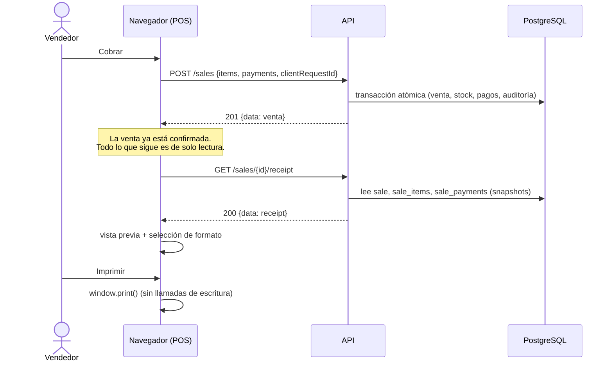
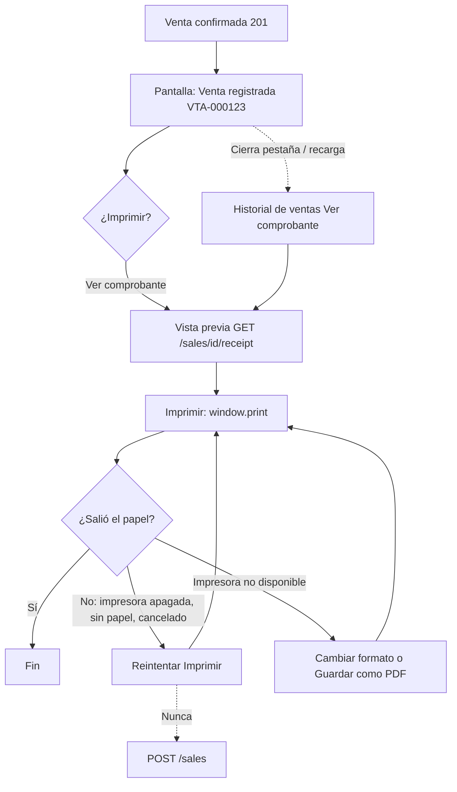

# 04 · Especificación del comprobante interno imprimible (E1, DEC-V12)

> **Estado:** documento de análisis para revisión del responsable del proyecto. **No autoriza** código, migraciones, endpoints, permisos ni pantallas. Todo lo descrito como ruta, esquema, permiso, componente o CSS es una **PROPUESTA** escrita en este markdown.
> **Fecha:** 2026-11-09 · **Fuente de verdad:** resolución formal Q-V07, Q-V09 y Q-V12 (07/11/2026), §4 (DEC-V12) y §5 (roadmap).
> **Verificado contra el repositorio** (lectura, sin ejecutar nada): `apps/web/src/features/catalog/{label-settings.ts, label.tsx, labels-page.tsx}`, `apps/web/e2e/s2-catalog-complete.spec.ts`, `apps/web/src/lib/format.ts`, `apps/web/src/app/app-shell.tsx`, `apps/api/src/plugins/auth.ts`, `apps/api/src/lib/permissions.ts`, `apps/api/src/modules/audit/audit.service.ts`, `packages/shared/src/{permissions,api,costing,dates}.ts`, `docs/decisions/` (solo ADR-001 a ADR-021), e informes `docs/informe-tecnico/03`, `05`, `06 §5`.

## Cómo leer las etiquetas

| Etiqueta                    | Significado                                                                                                       |
| --------------------------- | ----------------------------------------------------------------------------------------------------------------- |
| **[CONFIRMADA]**            | Decisión escrita por el responsable en la resolución (o hecho verificado en el código, indicado como «[CÓDIGO]»). |
| **[RECOMENDACIÓN TÉCNICA]** | Propuesta de quien analiza. **No es regla** hasta que el responsable la apruebe.                                  |
| **[PENDIENTE]**             | Subdecisión sin resolver; el documento muestra opciones y no elige por el responsable.                            |

## Índice

1. [Alcance](#1-alcance)
2. [Requisitos funcionales de la resolución](#2-requisitos-funcionales-de-la-resolución)
3. [Principio de datos: el comprobante es una proyección de snapshots inmutables](#3-principio-de-datos-el-comprobante-es-una-proyección-de-snapshots-inmutables)
4. [Contenido y leyendas](#4-contenido-y-leyendas)
5. [Formatos de impresión y maquetas](#5-formatos-de-impresión-y-maquetas)
6. [Mecanismo de impresión del navegador](#6-mecanismo-de-impresión-del-navegador)
7. [Contrato propuesto de API](#7-contrato-propuesto-de-api)
8. [Contrato propuesto de pantalla](#8-contrato-propuesto-de-pantalla)
9. [Configuración guardada del formato](#9-configuración-guardada-del-formato)
10. [Numeración](#10-numeración)
11. [Reimpresión y auditoría](#11-reimpresión-y-auditoría)
12. [Fallos y controles: impresión, red, importes inconsistentes](#12-fallos-y-controles-impresión-red-importes-inconsistentes)
13. [Accesibilidad e impresión (`@media print`)](#13-accesibilidad-e-impresión-media-print)
14. [Pruebas](#14-pruebas)
15. [Alternativas descartadas para ADR-029](#15-alternativas-descartadas-para-adr-029)
16. [Resumen propuesto para ADR-029](#16-resumen-propuesto-para-adr-029)
17. [Subdecisiones pendientes del comprobante](#17-subdecisiones-pendientes-del-comprobante)

---

## 1. Alcance

| Aspecto                     | Contenido                                                                                                                                                                                                                                                         |
| --------------------------- | ----------------------------------------------------------------------------------------------------------------------------------------------------------------------------------------------------------------------------------------------------------------- |
| Qué cubre                   | Comprobante **interno**, **no fiscal**, de una venta confirmada: datos, formatos 58 mm, 80 mm, A5 y A4, vista previa, impresión desde el navegador, vínculo con la venta, numeración, reimpresión.                                                                |
| Qué no cubre                | Factura fiscal y su integración con Impuestos Nacionales (la facturación se hará con un sistema externo, Q-V02 **[CONFIRMADA]**); cálculo de impuestos (el precio es el total cobrado, Q-V03 **[CONFIRMADA]**); envío por correo/mensajería; anulación (DEC-V07). |
| Etapa                       | E1 (Venta de mostrador: «comprobante interno»), §5 de la resolución **[CONFIRMADA]**.                                                                                                                                                                             |
| Prohibido en este documento | Cambiar código, crear migraciones, endpoints, permisos reales; editar ADR, PENDIENTES, CLAUDE.md o API.md.                                                                                                                                                        |

---

## 2. Requisitos funcionales de la resolución

Todos **[CONFIRMADA]** (DEC-V12). La columna derecha es la traducción técnica propuesta **[RECOMENDACIÓN TÉCNICA]**.

| #     | Requisito confirmado                                                                              | Traducción propuesta                                                                                                                                                                             |
| ----- | ------------------------------------------------------------------------------------------------- | ------------------------------------------------------------------------------------------------------------------------------------------------------------------------------------------------ |
| RF-1  | Tras confirmar una venta, el sistema genera un comprobante interno imprimible desde el navegador. | Una vez creada la venta, el comprobante **queda disponible** de inmediato (no se calcula al imprimir sino que se lee de la venta). La impresión no es automática por defecto (ver §12.1).        |
| RF-2  | Obtener el comprobante de una venta confirmada.                                                   | `GET /sales/:id/receipt` (§7). Solo existe para ventas confirmadas.                                                                                                                              |
| RF-3  | Vista previa.                                                                                     | Pantalla con el comprobante en pantalla al ancho real del formato (§8).                                                                                                                          |
| RF-4  | Seleccionar el formato de impresión.                                                              | Selector 58 mm / 80 mm / A5 / A4 (§9).                                                                                                                                                           |
| RF-5  | Usar la impresión del navegador.                                                                  | `window.print()` + CSS `@page` y `@media print`, igual que las etiquetas [CÓDIGO]. Sin servicios de impresión ni PDF en servidor (§15).                                                          |
| RF-6  | El comprobante queda vinculado permanentemente a la venta.                                        | El comprobante **no es una entidad aparte**: es una proyección de lectura de la venta (relación 1:1 por construcción). Enlace estable `/ventas/:id/comprobante`. No se guarda HTML ni PDF (§15). |
| RF-7  | Imprimir NO crea una nueva venta.                                                                 | `GET` de solo lectura; el botón «Imprimir» no llama a `POST /sales`. Se prueba (§14).                                                                                                            |
| RF-8  | La reimpresión NO modifica importes históricos.                                                   | Los importes salen de snapshots inmutables de la venta; ninguna ruta del comprobante escribe en `sales`, `sale_items` ni `sale_payments` (§3).                                                   |
| RF-9  | Sin exigir marca o modelo de impresora para el MVP.                                               | Impresión por el controlador del sistema operativo; ningún comando propietario (§6, §15).                                                                                                        |
| RF-10 | Márgenes, ancho imprimible, fuentes legibles y compatibilidad con controladores.                  | Especificados por formato en §5.                                                                                                                                                                 |

---

## 3. Principio de datos: el comprobante es una proyección de snapshots inmutables

**Regla de diseño [RECOMENDACIÓN TÉCNICA]:** el comprobante lee **siempre** de la venta y de sus líneas y pagos tal como quedaron al confirmar, nunca del precio ni del nombre «vivos» del catálogo. Sin esto, reimprimir mañana podría mostrar un importe distinto al cobrado, lo que viola RF-8.

### 3.1 De dónde sale cada dato

La tabla usa el modelo de datos **propuesto** en el informe 06 §5.4 (no existe aún en el código [CÓDIGO]; las tablas `sales`, `sale_items`, `sale_payments` no están en `schema.prisma`).

| Dato del comprobante                           | Fuente propuesta                                  |            ¿Snapshot inmutable?            | Observación                                                                                                                                                                                                                                              |
| ---------------------------------------------- | ------------------------------------------------- | :----------------------------------------: | -------------------------------------------------------------------------------------------------------------------------------------------------------------------------------------------------------------------------------------------------------- |
| Número de venta                                | `sales.number`                                    |                     Sí                     | Ver §10                                                                                                                                                                                                                                                  |
| Fecha y hora                                   | `sales.sold_at` (la fija el servidor)             |                     Sí                     | Se muestra en `America/La_Paz` con `formatDateTime` [CÓDIGO]                                                                                                                                                                                             |
| SKU, nombre del producto, etiqueta de variante | `sale_items.sku`, `product_name`, `variant_label` |                     Sí                     | **Crítico:** al renombrar una opción de atributo la API **recalcula la etiqueta de todas las variantes** que la usan (`PATCH /attributes/:id/options/:optionId`, informe 03 #27 [CÓDIGO]). Por eso el comprobante no puede leer `product_variants.label` |
| Cantidad                                       | `sale_items.quantity`                             |                     Sí                     |                                                                                                                                                                                                                                                          |
| Precio unitario                                | `sale_items.unit_price`                           |                     Sí                     | Nunca `product_variants.sale_price` (cambia con aprobaciones, ADR-018)                                                                                                                                                                                   |
| Subtotal de línea                              | `sale_items.line_total`                           |                     Sí                     | Con CHECK `line_total = quantity × unit_price − discount_amount` (propuesto)                                                                                                                                                                             |
| Total en Bs                                    | `sales.total`                                     |                     Sí                     |                                                                                                                                                                                                                                                          |
| Pagos: medio, importe                          | `sale_payments.amount` + **nombre del medio**     |    Importe sí; **nombre del medio: no**    | `payment_methods.name` es un catálogo editable. Opciones: guardar `method_name` en `sale_payments` al cobrar (snapshot) o impedir renombrar medios con uso. **[RECOMENDACIÓN TÉCNICA]**: snapshot                                                        |
| Recibido en efectivo y vuelto                  | `sale_payments.tendered`, `change_given`          |                     Sí                     | Solo en pagos en efectivo                                                                                                                                                                                                                                |
| Referencia de transferencia/QR                 | `sale_payments.reference`                         |                     Sí                     | Si se imprime es **[PENDIENTE]** (puede ser un dato sensible del cliente)                                                                                                                                                                                |
| Vendedor                                       | `sales.seller_id` → `users.name`                  | **No** (el nombre del usuario es editable) | Si se aprueba mostrarlo: guardar `seller_name` en la venta. **[PENDIENTE]** (§17)                                                                                                                                                                        |
| Identificación comercial del negocio           | configuración del negocio                         |                  Depende                   | **[PENDIENTE]**: no existe hoy un lugar para estos datos (§4.3)                                                                                                                                                                                          |
| Costos                                         | —                                                 |                     —                      | **Nunca** en el comprobante (§7.3)                                                                                                                                                                                                                       |

### 3.2 Garantías necesarias en la venta (a cargo del database-agent y del backend)

**[RECOMENDACIÓN TÉCNICA]**, coherente con las restricciones de DEC-V07 («no habilitar modificación de los importes o productos de una venta confirmada»):

- Triggers que impiden `UPDATE`/`DELETE` de `sales` (confirmada), `sale_items` y `sale_payments` (propuesto en informe 06 §5.4).
- CHECK de coherencia: `total = subtotal − discount_total`, `line_total` por línea.
- Invariante de servicio, y opcionalmente trigger diferido: Σ pagos = `total`.
- Ninguna de estas garantías existe todavía; son requisito previo para poder afirmar RF-8.

### 3.3 Qué NO es el comprobante

| Descartado                                                | Razón                                                                                          |
| --------------------------------------------------------- | ---------------------------------------------------------------------------------------------- |
| Entidad `receipts` con HTML o PDF guardado                | Duplica datos y puede divergir de la venta; la venta ya es inmutable                           |
| Cálculo de importes en el navegador a partir del catálogo | Reintroduce el precio vivo                                                                     |
| Mostrar impuestos desglosados                             | «La aplicación no añade impuestos» (Q-V03 **[CONFIRMADA]**); la leyenda dice que no es factura |

---

## 4. Contenido y leyendas

### 4.1 Elementos del comprobante

| #   | Elemento                                                  | Estado                                                                                                                                                                                |
| --- | --------------------------------------------------------- | ------------------------------------------------------------------------------------------------------------------------------------------------------------------------------------- |
| 1   | Identificación comercial de Joyería Sole                  | **[CONFIRMADA]** que se incluye; los datos exactos (razón social, NIT, dirección, teléfono) son **[PENDIENTE]** («datos obligatorios del negocio»)                                    |
| 2   | Logo                                                      | **[CONFIRMADA]** «si se proporciona»; identidad visual P-16 sigue pendiente [CÓDIGO: informe 06]                                                                                      |
| 3   | Leyenda **«Comprobante interno»**                         | **[CONFIRMADA]**                                                                                                                                                                      |
| 4   | Número de venta                                           | **[CONFIRMADA]** que se muestra; formato del correlativo **[PENDIENTE]**                                                                                                              |
| 5   | Fecha y hora                                              | **[CONFIRMADA]**                                                                                                                                                                      |
| 6   | Productos y variantes (nombre, SKU, etiqueta de variante) | **[CONFIRMADA]**                                                                                                                                                                      |
| 7   | Cantidades                                                | **[CONFIRMADA]**                                                                                                                                                                      |
| 8   | Precios unitarios                                         | **[CONFIRMADA]**                                                                                                                                                                      |
| 9   | Subtotales                                                | **[CONFIRMADA]** como elemento; se interpreta como subtotal por línea (`line_total`) **[RECOMENDACIÓN TÉCNICA]**; un subtotal general solo si existen descuentos (Q-V06, no resuelta) |
| 10  | Total en Bs                                               | **[CONFIRMADA]**                                                                                                                                                                      |
| 11  | Desglose de pagos                                         | **[CONFIRMADA]**                                                                                                                                                                      |
| 12  | Importe recibido en efectivo y vuelto, cuando corresponda | **[CONFIRMADA]**                                                                                                                                                                      |
| 13  | Leyenda **«No válido como factura fiscal»**               | **[CONFIRMADA]**                                                                                                                                                                      |
| 14  | Identificación del vendedor                               | **[PENDIENTE]** (decisión explícita de la resolución)                                                                                                                                 |
| 15  | Marca de «Reimpresión» o «Copia»                          | **[PENDIENTE]** (§11)                                                                                                                                                                 |
| 16  | Número de factura externa (`invoice_reference`)           | No incluido en el MVP **[RECOMENDACIÓN TÉCNICA]**: podría cargarse después de la venta y haría que un comprobante reimpreso difiera del original                                      |
| 17  | Código de barras/QR del comprobante                       | No pedido en la resolución; no se incluye                                                                                                                                             |
| 18  | Hora de impresión                                         | No se incluye **[RECOMENDACIÓN TÉCNICA]** (haría que dos impresiones difieran); la fecha y hora son las de la venta                                                                   |

### 4.2 Leyendas y textos fijos

**[RECOMENDACIÓN TÉCNICA]:** los textos fijos viven como constantes en `@joyeria/shared` (para que la prueba, la API y la pantalla usen exactamente la misma cadena), no escritos a mano en cada formato.

| Constante propuesta         | Texto exacto                                   |
| --------------------------- | ---------------------------------------------- |
| `RECEIPT_TITLE`             | `Comprobante interno`                          |
| `RECEIPT_NOT_FISCAL_LEGEND` | `No válido como factura fiscal`                |
| Moneda                      | `Bs` (solo bolivianos, Q-V04 **[CONFIRMADA]**) |

Las leyendas son **obligatorias** en los cuatro formatos y deben ser visibles al imprimir (sin depender de colores de fondo, que algunos controladores omiten).

### 4.3 Datos del negocio: dónde viven **[PENDIENTE]**

El repositorio actual no tiene una tabla ni una variable de configuración para la identidad comercial [CÓDIGO: no hay `business`/`settings` de negocio; `settings:manage` solo se usa para tipos de costo]. Opciones (sin elegir):

| Opción                                                                         | Pros                      | Contras                                                                              |
| ------------------------------------------------------------------------------ | ------------------------- | ------------------------------------------------------------------------------------ |
| A. Constantes en `@joyeria/shared`                                             | Sin migración ni pantalla | Cambiar un teléfono exige publicar una versión                                       |
| B. Tabla de configuración del negocio con pantalla (permiso `settings:manage`) | Editable                  | Migración nueva; decidir si el comprobante guarda copia del encabezado o lo lee vivo |
| C. Variables de entorno                                                        | Sin migración             | Mezcla configuración comercial con despliegue; no es lo previsto en `config/env.ts`  |

Sub-pregunta: si cambia la dirección o el nombre comercial, ¿una reimpresión antigua debe mostrar el encabezado actual o el de la fecha de la venta? Con A/B-viva muestra el actual; solo un snapshot en la venta mostraría el histórico. **[PENDIENTE]**; no afecta importes.

El logo, si se proporciona, debe ser **monocromo/alto contraste** para papel térmico; la CSP actual (`img-src 'self' data: blob:`) permite servirlo desde el mismo origen [CÓDIGO: helmet en `security.ts`, informe 03 §1.6].

---

## 5. Formatos de impresión y maquetas

### 5.1 Parámetros por formato **[RECOMENDACIÓN TÉCNICA]**

Los valores son punto de partida y **deben validarse con una impresora real** en el piloto (E7). La resolución exige compatibilidad con controladores, no una marca.

| Parámetro                      | 58 mm (térmico)                                                       | 80 mm (térmico)                          | A5                                                        | A4                       |
| ------------------------------ | --------------------------------------------------------------------- | ---------------------------------------- | --------------------------------------------------------- | ------------------------ |
| Papel                          | 58 mm de ancho, rollo                                                 | 80 mm de ancho, rollo                    | 148 × 210 mm                                              | 210 × 297 mm             |
| Orientación                    | Vertical, largo variable                                              | Vertical, largo variable                 | Vertical                                                  | Vertical                 |
| Ancho imprimible del contenido | **48 mm**                                                             | **72 mm**                                | 128 mm                                                    | 180 mm                   |
| `@page`                        | `size: 58mm auto; margin: 0`                                          | `size: 80mm auto; margin: 0`             | `size: A5; margin: 10mm`                                  | `size: A4; margin: 15mm` |
| Relleno interno del contenedor | 1,5 mm                                                                | 2 mm                                     | 0                                                         | 0                        |
| Fuente                         | Sans-serif del sistema, cifras tabulares                              | Sans-serif del sistema, cifras tabulares | Sans-serif del sistema                                    | Sans-serif del sistema   |
| Tamaño base                    | 9 pt                                                                  | 10 pt                                    | 10,5 pt                                                   | 11 pt                    |
| Tamaño mínimo (leyendas, SKU)  | 8 pt                                                                  | 8,5 pt                                   | 9 pt                                                      | 9 pt                     |
| Estructura de líneas           | Una línea de texto por producto y debajo `cant × precio ... subtotal` | Igual                                    | Tabla de 5 columnas                                       | Tabla de 5 columnas      |
| Salto de página                | Una sola «página» continua                                            | Una sola «página» continua               | Cabecera de tabla repetida en cada hoja; filas sin cortar | Igual                    |
| Color                          | Negro sobre blanco, sin tramas ni grises claros                       | Igual                                    | Igual                                                     | Igual                    |

Justificaciones **[RECOMENDACIÓN TÉCNICA]**:

- **Ancho imprimible menor que el papel (48/58, 72/80):** muchas impresoras térmicas imprimen solo la zona central (a menudo 48 mm en papel de 58 mm y 72 o 76 mm en papel de 80 mm). El contenido se centra con `margin: 0 auto` para no recortarse. El valor exacto depende del modelo y se confirma en el piloto.
- **Margen de página en 0 para térmicas:** igual que las etiquetas (`@page { …; margin: 0 }` [CÓDIGO: `labelPrintCss`]); en Chrome, con margen 0 no aparecen encabezados y pies de página del navegador.
- **Fuentes del sistema, sin fuentes web:** no hay descargas ni dependencia de red al imprimir, y la CSP `default-src 'self'` bloquearía fuentes externas [CÓDIGO]. Una pila tipo `system-ui, Arial, sans-serif` y `font-variant-numeric: tabular-nums` mantiene alineados los importes.
- **Texto mínimo de 8 pt:** por debajo, la impresión térmica de baja resolución pierde legibilidad.
- **Sin color de fondo ni sombreados:** muchos controladores no imprimen fondos por defecto y las térmicas son monocromas.

### 5.2 Incertidumbres técnicas conocidas **[PENDIENTE de verificación en navegador e impresora]**

| Tema                                  | Detalle                                                                                                                                                                                                                                                                                                                                                               |
| ------------------------------------- | --------------------------------------------------------------------------------------------------------------------------------------------------------------------------------------------------------------------------------------------------------------------------------------------------------------------------------------------------------------------- |
| Altura `auto` en `@page size`         | No todos los navegadores y controladores aceptan `auto` en una dimensión. Plan A: `size: 80mm auto`. Plan B: omitir `size` y fijar solo el ancho del contenido en mm, dejando que el papel definido en el controlador (rollo) mande. Plan C: altura fija configurable. Se prueba con las impresoras reales sin exigir marca.                                          |
| Encabezados y pies de página en A5/A4 | Con `@page { margin: 10mm }` (no cero) el navegador puede imprimir fecha/URL/paginación si el usuario deja activa esa opción del cuadro de impresión. Alternativa: margen de página 0 y relleno en el contenedor (pero entonces la segunda hoja no tiene margen superior). Se decide tras probar; la interfaz puede indicar «Desactive Encabezados y pies de página». |
| Escala                                | «Ajustar a página» del controlador puede reducir el ancho de 48/72 mm; la ayuda debe indicar «Escala: 100 %».                                                                                                                                                                                                                                                         |
| Papel sin definir en el controlador   | Algunos controladores térmicos no ofrecen «58 mm» como tamaño hasta configurarlo en el sistema operativo. Documentación operativa (manual por rol).                                                                                                                                                                                                                   |

### 5.3 Maquetas textuales

Son esquemas. Los anchos de columna reales dependen del CSS; los caracteres mostrados **no** implican columnas fijas (la impresión del navegador no usa modo texto). Datos de ejemplo ficticios: el efectivo aplicado es 300,00, recibido 350,00, vuelto 50,00; la suma de pagos (300,00 + 80,00) es igual al total (380,00).

#### 58 mm (contenido de 48 mm)

```
      JOYERÍA SOLE
   [logo, si se proporciona]
   [datos del negocio: PENDIENTE]
      COMPROBANTE INTERNO
--------------------------------
Venta N°: VTA-000123
Fecha: 09/11/2026 15:42
[Vendedor: PENDIENTE]
--------------------------------
Anillo corazón con circonia
SKU-000045 · Talla 7
 2 x 150,00            300,00
Cadena acero 45 cm
SKU-000112 · Única
 1 x  80,00             80,00
--------------------------------
TOTAL Bs               380,00
--------------------------------
PAGOS
Efectivo               300,00
  Recibido             350,00
  Vuelto                50,00
QR                      80,00
--------------------------------
  No válido como factura fiscal
```

#### 80 mm (contenido de 72 mm)

```
                 JOYERÍA SOLE
            [logo, si se proporciona]
            [datos del negocio: PENDIENTE]
              COMPROBANTE INTERNO
------------------------------------------
Venta N°: VTA-000123
Fecha:    09/11/2026 15:42
[Vendedor: PENDIENTE]
------------------------------------------
Anillo corazón con circonia
SKU-000045 · Talla 7
   2 x 150,00                       300,00
Cadena acero 45 cm
SKU-000112 · Única
   1 x  80,00                        80,00
------------------------------------------
TOTAL Bs                            380,00
------------------------------------------
PAGOS
Efectivo                            300,00
   Recibido                         350,00
   Vuelto                            50,00
QR                                   80,00
------------------------------------------
        No válido como factura fiscal
```

#### A5 (contenido de 128 mm) y A4 (contenido de 180 mm)

Misma estructura; A4 con más aire y la tabla a todo el ancho.

```
+--------------------------------------------------------------+
| [LOGO]   JOYERÍA SOLE                  COMPROBANTE INTERNO   |
|          [datos del negocio: PENDIENTE]  Venta N°: VTA-000123 |
|                                          Fecha: 09/11/2026    |
|                                                 15:42         |
|                                          [Vendedor: PENDIENTE]|
+--------------------------------------------------------------+
| Cant. | Código     | Descripción               | P. unit. | Subtotal |
|-------+------------+---------------------------+----------+----------|
|   2   | SKU-000045 | Anillo corazón con        |   150,00 |   300,00 |
|       |            | circonia · Talla 7        |          |          |
|   1   | SKU-000112 | Cadena acero 45 cm · Única|    80,00 |    80,00 |
+--------------------------------------------------------------+
|                                           TOTAL Bs:   380,00 |
+--------------------------------------------------------------+
| Pagos                                                         |
|   Efectivo ........................................  300,00   |
|      Recibido ..................................... 350,00    |
|      Vuelto .......................................  50,00    |
|   QR ..............................................   80,00   |
+--------------------------------------------------------------+
|              No válido como factura fiscal                    |
+--------------------------------------------------------------+
```

Reglas comunes **[RECOMENDACIÓN TÉCNICA]**:

- El nombre del producto puede ocupar varias líneas (se parte por palabras, nunca se corta el importe).
- Los importes se muestran siempre con **2 decimales** y alineados a la derecha, con el mismo formateador en los cuatro formatos; sin símbolo de moneda repetido por línea (la moneda aparece en el total y en el encabezado de columna).
- Con muchas líneas, A5/A4 paginan con la cabecera de tabla repetida (`thead { display: table-header-group }`) y `tr { break-inside: avoid }`. El bloque de total y pagos no se parte (`break-inside: avoid`). En térmico es una sola hoja continua.
- El límite de líneas por venta lo define E1 (valor técnico, aún sin fijar); el comprobante debe soportar el máximo sin errores.

---

## 6. Mecanismo de impresión del navegador

### 6.1 Patrón existente que se reutiliza [CÓDIGO]

| Elemento                | Etiquetas hoy                                                                                                                                                                                                       |
| ----------------------- | ------------------------------------------------------------------------------------------------------------------------------------------------------------------------------------------------------------------- |
| CSS dinámico            | `labelPrintCss(size)` produce `@page { size: W H; margin: 0; }`, oculta `#print-labels` en pantalla y en `@media print` oculta `body > #root` y muestra `#print-labels`                                             |
| Área de impresión       | `LabelPrintArea` monta un **portal hijo de `<body>`** (fuera de `#root`) con `<style>` interno y `aria-hidden="true"`                                                                                               |
| Disparo                 | `window.print()` en un botón; el sistema/navegador gestiona «Guardar como PDF»                                                                                                                                      |
| Persistencia del tamaño | `localStorage` clave `joyeria.labelSize`, validada con Zod y con valor por defecto si falla                                                                                                                         |
| Prueba E2E              | `addInitScript` sustituye `window.print` por un contador; `emulateMedia({media:'print'})` comprueba que `#root` se oculta y que el área de impresión es visible; se lee el CSS del `<style>` y se comprueba `@page` |

### 6.2 Propuesta para el comprobante **[RECOMENDACIÓN TÉCNICA]**

| Aspecto                   | Propuesta                                                                                                                                              |
| ------------------------- | ------------------------------------------------------------------------------------------------------------------------------------------------------ |
| Área                      | `#print-receipt`, portal hijo de `<body>`, mismo método que las etiquetas                                                                              |
| CSS                       | Función pura `receiptPrintCss(format)` con una tabla de formatos (ancho, `@page`, márgenes, fuentes), probada por unidad como `labelPrintCss`          |
| Ciclo de vida del `@page` | El `<style>` solo existe mientras la pantalla del comprobante está montada: así su `@page` no afecta a la impresión de etiquetas ni de otras pantallas |
| Un formato por impresión  | `@page` es global al trabajo de impresión; no se mezclan formatos en un mismo trabajo                                                                  |
| Sin librerías nuevas      | Ni PDF ni códigos de barras. No se añade ninguna dependencia (regla de CLAUDE.md)                                                                      |
| Cabecera de la ventana    | Se usa `useDocumentTitle` para que el nombre sugerido al «Guardar como PDF» incluya el número de venta                                                 |

### 6.3 Qué hace y qué no hace el sistema

| Sí                                                                  | No                                                                             |
| ------------------------------------------------------------------- | ------------------------------------------------------------------------------ |
| Genera el documento y lo envía al cuadro de impresión del navegador | No detecta si la impresora está encendida, si hay papel ni si el trabajo salió |
| Permite «Guardar como PDF» mediante el propio navegador             | No genera archivos PDF en el servidor                                          |
| Recuerda el formato elegido                                         | No selecciona impresora (la elige el usuario en el diálogo)                    |

---

## 7. Contrato propuesto de API

> **PROPUESTA.** No existe en el código. Prefijo `/api/v1`; formato `{ data }`; errores `{ error: { code, message, details?, requestId } }`; dinero como `string` decimal con 2 decimales; fechas ISO 8601 con `Z`. Esquema Zod de `params` y `response`; autorización como `preValidation` (401/403 antes que 400), como en `exchanges.routes.ts` [CÓDIGO]. Los handlers solo delegan al servicio.

### 7.1 Ruta

| Ruta                     | Permiso                                                                                             | Parámetros | Respuesta               | Errores                                                                                                                       |
| ------------------------ | --------------------------------------------------------------------------------------------------- | ---------- | ----------------------- | ----------------------------------------------------------------------------------------------------------------------------- |
| `GET /sales/:id/receipt` | `requireAnyPermission(sales:create, sales:read, sales:read-all)` **más** regla de propiedad (abajo) | `id` uuid  | `200 { data: receipt }` | `400` id no uuid · `401` · `403` sin permiso · `404` no existe **o** no es accesible para el usuario · `429` · `500` genérico |

Los nombres `sales:create`, `sales:read` y `sales:read-all` son los del catálogo **propuesto** en el informe 06 §5.7; no existen en `permissions.ts` [CÓDIGO] y sus asignaciones a roles son **[PENDIENTE]** (Q-V13: si el Vendedor ve ventas ajenas).

Regla de propiedad **[RECOMENDACIÓN TÉCNICA]** (evita IDOR, informe 06 §5.11): sin `sales:read-all`, solo se devuelve el comprobante de ventas propias; las ajenas responden `404` (no `403`, para no revelar existencia). Quien acaba de vender necesita su comprobante inmediatamente, de modo que `sales:create` debe bastar para ver el de **sus** ventas.

Cabeceras: toda respuesta bajo `/api/` ya recibe `Cache-Control: no-store` [CÓDIGO]; no se propone caché específico. La ruta cuenta con el límite global de 300/min [CÓDIGO].

### 7.2 Cuerpo de respuesta propuesto (`receipt`)

| Campo                          | Tipo               | Notas                                                                                                 |
| ------------------------------ | ------------------ | ----------------------------------------------------------------------------------------------------- |
| `saleId`                       | uuid               | Vínculo permanente                                                                                    |
| `number`                       | string             | Número legible de la venta, p. ej. `VTA-000123` (formato **[PENDIENTE]**)                             |
| `soldAt`                       | string ISO         | Instante de la venta; la pantalla lo muestra en La Paz                                                |
| `currency`                     | `"BOB"`            | Constante                                                                                             |
| `items`                        | array              | `{ sku, productName, variantLabel, quantity, unitPrice, lineTotal }`, todos snapshots                 |
| `subtotal`, `discountTotal`    | string             | Solo si la venta tiene descuentos (Q-V06 sin resolver); si no existen, se omiten                      |
| `total`                        | string             | Total cobrado                                                                                         |
| `payments`                     | array              | `{ methodName, amount, tendered?, changeGiven?, reference? }`; `tendered`/`changeGiven` solo efectivo |
| `seller`                       | `{ name } \| null` | Solo si se aprueba mostrarlo (**[PENDIENTE]**); snapshot                                              |
| `business`                     | objeto \| null     | Datos de identidad comercial (**[PENDIENTE]** de origen)                                              |
| `printCount` / `lastPrintedAt` | —                  | **No se incluyen** salvo que se apruebe la auditoría de reimpresión (§11)                             |

Las leyendas **no** viajan en la respuesta: son constantes compartidas (§4.2).

### 7.3 Seguridad y privacidad **[RECOMENDACIÓN TÉCNICA]**

| Regla                          | Detalle                                                                                                                                                                                                                                                                                                                                                                              |
| ------------------------------ | ------------------------------------------------------------------------------------------------------------------------------------------------------------------------------------------------------------------------------------------------------------------------------------------------------------------------------------------------------------------------------------ |
| **Sin costos, para nadie**     | El esquema de respuesta no tiene `unit_cost_snapshot` ni margen, **ni siquiera para quien tiene `costs:read`**. El comprobante es un documento que se entrega al cliente. Esto cumple y supera el requisito «sin costos para quien no tiene `costs:read`» (P-02: el Vendedor nunca recibe costos). Se prueba con un usuario con `costs:read` y otro sin él: la respuesta es idéntica |
| Esquema de respuesta declarado | `response: { 200: receiptResponseSchema }`; un campo extra provoca error de serialización (500) en lugar de filtrarse [CÓDIGO: serializador Zod]                                                                                                                                                                                                                                     |
| Solo lectura                   | La ruta no escribe en ninguna tabla de ventas ni de inventario                                                                                                                                                                                                                                                                                                                       |
| Solo ventas confirmadas        | Hoy sólo existiría el estado `COMPLETED`; no hay `VOIDED` (DEC-V07 **[CONFIRMADA]**)                                                                                                                                                                                                                                                                                                 |
| Sin datos personales           | El MVP no registra clientes (Q-V10, recomendado A); no hay nombre/documento del cliente en el comprobante a menos que se decida                                                                                                                                                                                                                                                      |
| Sin acceso público             | El vínculo permanente exige sesión y permiso; el identificador (UUID) no es un secreto ni una capacidad de acceso                                                                                                                                                                                                                                                                    |

### 7.4 Interacción con la creación de la venta



---

## 8. Contrato propuesto de pantalla

> **PROPUESTA.** Hoy el menú «Ventas» muestra «Punto de venta», «Historial de ventas» y «Devoluciones» como «Próximamente» sin enlace ni permiso [CÓDIGO: `app-shell.tsx:158-160`]. La entrada «Devoluciones» debe revisarse cuando se active el grupo: DEC-V07 prohíbe habilitar anulación y E4 (cambios) está sin definir.

| Pantalla / elemento        | Ruta                      | Permiso (UX; la seguridad está en la API)       | Contenido                                                                                                                         |
| -------------------------- | ------------------------- | ----------------------------------------------- | --------------------------------------------------------------------------------------------------------------------------------- |
| Venta confirmada (E1)      | dentro del POS            | `sales:create`                                  | Resumen «Venta VTA-000123 registrada», total, botones **«Ver comprobante»** y **«Nueva venta»**. Sin impresión automática (§12.1) |
| Comprobante (vista previa) | `/ventas/:id/comprobante` | `sales:create`, `sales:read` o `sales:read-all` | Selector de formato, vista previa al ancho real en mm, botón «Imprimir», enlace «Volver a ventas»                                 |
| Historial de ventas (E1)   | `/ventas`                 | `sales:read`                                    | Acción «Ver comprobante» por venta                                                                                                |

Elementos de la pantalla del comprobante:

| Elemento            | Detalle                                                                                                                                                                                                    |
| ------------------- | ---------------------------------------------------------------------------------------------------------------------------------------------------------------------------------------------------------- |
| Selector de formato | Grupo de radios (`fieldset` + `legend` «Formato de impresión») con 58 mm, 80 mm, A5, A4; se aplica de inmediato a la vista previa y al `@page`                                                             |
| Vista previa        | Es el **mismo componente** que se imprime, renderizado en pantalla con el ancho del formato (`mm`), sobre un fondo que simula el papel; con borde discontinuo, como la vista previa de etiquetas [CÓDIGO]  |
| Botón «Imprimir»    | Nombre accesible «Imprimir comprobante de la venta VTA-000123»; llama `window.print()`; no envía ninguna petición de escritura                                                                             |
| Ayuda breve         | «Se imprime con el cuadro de impresión de su navegador. Use escala 100 % y desactive encabezados y pies de página. Para guardar un PDF elija “Guardar como PDF”.» (patrón del texto de etiquetas [CÓDIGO]) |
| Estados             | Cargando (`role="status"`), error con «Reintentar» (`role="alert"`), 404 («La venta no existe o no tiene acceso»), importes inconsistentes (§12.3)                                                         |
| Carga               | Página perezosa (`lazyPage`); no requiere `jsbarcode` ni otra dependencia                                                                                                                                  |
| Título              | `useDocumentTitle('Comprobante VTA-000123')`                                                                                                                                                               |

Pruebas visuales de desbordes: la ruta debe agregarse a `responsive.spec.ts` (el informe 05 §4.5 indica que hoy varias pantallas nuevas no están cubiertas).

---

## 9. Configuración guardada del formato

La resolución dice «tamaño configurable» pero deja como **[PENDIENTE]** si la configuración es «por usuario o por establecimiento».

| Opción                 | Dónde se guarda                                       | Pros                                                                                                                 | Contras                                                                                                     |
| ---------------------- | ----------------------------------------------------- | -------------------------------------------------------------------------------------------------------------------- | ----------------------------------------------------------------------------------------------------------- |
| A. Por navegador       | `localStorage` (p. ej. `joyeria.receiptFormat`)       | Idéntico a las etiquetas [CÓDIGO]; sin backend, sin migración; refleja que la **impresora es del puesto de trabajo** | Se pierde al limpiar datos o cambiar de equipo; cada PC se configura una vez                                |
| B. Por usuario         | Tabla de preferencias en servidor                     | Sigue al usuario                                                                                                     | La impresora no sigue al usuario; requiere migración y rutas                                                |
| C. Por establecimiento | Configuración general (`settings:manage`)             | Un único valor para todos                                                                                            | Una sola tienda con varias PC/impresoras (térmica en caja, A4 en oficina) no puede tener formatos distintos |
| D. Mixta               | Valor general por defecto + preferencia por navegador | Flexible                                                                                                             | Más piezas; no necesaria en el MVP                                                                          |

**Recomendación técnica: A** para el MVP (misma razón física que las etiquetas), con D como evolución si el responsable la pide. **Valor por defecto: A4** [RECOMENDACIÓN TÉCNICA]: funciona en cualquier impresora de oficina y no presupone una térmica (la impresora y el rollo siguen sin definirse, B7).

Reglas del almacenamiento **[RECOMENDACIÓN TÉCNICA]** (copia del patrón de `loadLabelSize`):

- Validación con esquema Zod de enumeración `'58mm' | '80mm' | 'A5' | 'A4'`; cualquier valor inválido, JSON corrupto o almacenamiento bloqueado → valor por defecto, sin error.
- Solo se guarda el **identificador del formato**, no CSS ni dimensiones libres (evita inyección de CSS desde `localStorage`; en las etiquetas los valores numéricos se validan y se redondean antes de ir al CSS [CÓDIGO]).
- ¿Ancho libre en milímetros como en las etiquetas (20–150 mm)? Los cuatro formatos cubren la resolución; el ancho libre queda **[PENDIENTE]**.

---

## 10. Numeración

**[CONFIRMADA]:** la numeración del comprobante es independiente de la factura fiscal. **[PENDIENTE]:** formato definitivo del correlativo, política sobre saltos, requisitos del contador. **[CONFIRMADA]:** no introducir garantía de numeración continua sin decisión específica.

### 10.1 Un número o dos

| Opción | Descripción                                                                                               |
| ------ | --------------------------------------------------------------------------------------------------------- |
| A      | El comprobante muestra el **número de la venta** (`sales.number`); no hay un número de comprobante aparte |
| B      | Numeración propia del comprobante, distinta de la venta                                                   |

**Recomendación técnica: A.** Hay una relación 1:1 y la resolución pide mostrar el «número de venta». Dos números aumentarían el riesgo de confusión sin beneficio. La opción B solo se justificaría si el contador exigiera una serie distinta. **[PENDIENTE].**

### 10.2 Cómo se genera el número (opciones, sin elegir)

| Opción | Mecanismo                                                                                                                | Saltos                                              | Observaciones                                                                   |
| ------ | ------------------------------------------------------------------------------------------------------------------------ | --------------------------------------------------- | ------------------------------------------------------------------------------- |
| A      | Columna autonumérica (`autoincrement`), como ingresos/ajustes/conteos (`ING-`, `AJ-`, `CNT-`) [CÓDIGO: informe 03 §1.11] | **Sí**: la secuencia no revierte con la transacción | Más simple; consistente con el resto                                            |
| B      | Contador transaccional (`document_counters` con `FOR UPDATE`) dentro de la misma transacción de la venta                 | No por reversión de transacción                     | Serializa solo la emisión del número (irrelevante con 3–5 usuarios); más piezas |
| C      | No mostrar correlativo; identificar por fecha y un código corto                                                          | n/a                                                 | Dificulta citar una venta por teléfono                                          |

Nunca `MAX(number)+1` (condición de carrera) — regla del informe 06 §5.14.

### 10.3 Efecto de los saltos

| Causa de salto con la opción A                    | Ejemplo                                                                                                                                                                                                                                                             |
| ------------------------------------------------- | ------------------------------------------------------------------------------------------------------------------------------------------------------------------------------------------------------------------------------------------------------------------- |
| Transacción revertida (stock insuficiente, error) | Se consume el número 125 y la venta 125 no existe                                                                                                                                                                                                                   |
| Repetición idempotente                            | `INSERT … ON CONFLICT DO NOTHING` evalúa el valor por defecto de la secuencia antes de detectar el conflicto, por lo que cada repetición puede consumir un número. Comportamiento conocido de PostgreSQL; **verificar con una prueba** antes de afirmarlo en un ADR |
| Reinicios o restauraciones                        | Una restauración de copia puede dejar la secuencia por delante o por detrás                                                                                                                                                                                         |

Consecuencia: ver «VTA-000124» seguido de «VTA-000126» es posible y, con la opción A, **no indica una venta faltante**. Si el cliente o su contador exigen un correlativo continuo, se necesita la opción B y una decisión explícita. Mientras tanto la interfaz y los documentos **no deben prometer** numeración continua.

---

## 11. Reimpresión y auditoría

Todo lo de esta sección es **[PENDIENTE]** (la resolución lista «reimpresión y su auditoría»). Solo se confirma que reimprimir no cambia importes históricos (RF-8).

### 11.1 ¿Qué es una reimpresión?

El servidor no puede saber cuándo se imprimió: `window.print()` abre un cuadro de diálogo y no informa si se confirmó, se canceló ni si salió papel. Por eso hay que decidir qué se audita.

| Opción | Descripción                                                                                                                                             | Alcance                                     | Costo                                                                        |
| ------ | ------------------------------------------------------------------------------------------------------------------------------------------------------- | ------------------------------------------- | ---------------------------------------------------------------------------- |
| A      | Sin registro de impresiones                                                                                                                             | Ninguno                                     | Cero                                                                         |
| B      | El navegador avisa al servidor con un evento («se solicitó imprimir») que se guarda como auditoría `sale.receipt_printed` con formato y número de copia | Registra **intención**, no impresión física | Una ruta de escritura de solo auditoría; sin tabla nueva si usa `audit_logs` |
| C      | Auditar cada `GET` del comprobante                                                                                                                      | Incluye vistas previas                      | Ruido en la auditoría                                                        |

Si se elige B, la ruta propuesta sería `POST /sales/:id/receipt/print-events` (`{ format }`), con los mismos permisos que la lectura, escritura **solo** en `audit_logs` mediante `recordAudit(tx, …)` en la misma transacción y sin tocar `sales`. Es compatible con RF-7 (no crea ventas) y con RF-8. Contenido de auditoría: venta, usuario, formato, contador de copia; sin importes ni datos personales.

### 11.2 Marca de reimpresión

| Opción | Descripción                                                                                                   | Consecuencia                                                                                                 |
| ------ | ------------------------------------------------------------------------------------------------------------- | ------------------------------------------------------------------------------------------------------------ |
| A      | La reimpresión es **idéntica** a la original                                                                  | Imposible distinguirlas en papel                                                                             |
| B      | Se agrega «Reimpresión» (o «Copia») cuando el comprobante se abre desde el historial y no justo tras la venta | Simple; sin datos; la distinción es de interfaz, no verificada por el servidor                               |
| C      | «Copia N.º 2» basado en el contador de eventos de impresión (requiere B de §11.1)                             | Más trazable; nunca perfecto (se puede imprimir sin avisar al servidor desde las herramientas del navegador) |

La marca no modifica importes. El informe 06 §5.10 propuso la opción B («marcada “Copia”»); la resolución **no** la confirma. **[RECOMENDACIÓN TÉCNICA]:** decidir junto con la auditoría; si se aprueba, la leyenda se añade como constante compartida.

### 11.3 Quién puede reimprimir

Mismos permisos que ver el comprobante (§7.1). Limitar la reimpresión a roles específicos es **[PENDIENTE]** y depende de Q-V13.

---

## 12. Fallos y controles: impresión, red, importes inconsistentes

### 12.1 Fallo de impresión después de una venta exitosa



| Control **[RECOMENDACIÓN TÉCNICA]**           | Detalle                                                                                                                                                                                                                                                                                                  |
| --------------------------------------------- | -------------------------------------------------------------------------------------------------------------------------------------------------------------------------------------------------------------------------------------------------------------------------------------------------------- |
| La venta es independiente de la impresión     | La transacción ya terminó; ningún fallo de impresión puede revertirla ni duplicarla                                                                                                                                                                                                                      |
| «Reintentar impresión» nunca reenvía la venta | Se prueba que el botón no hace ninguna petición de escritura                                                                                                                                                                                                                                             |
| El comprobante se recupera siempre            | Desde el historial de ventas y con el enlace permanente, aunque se cierre la pestaña                                                                                                                                                                                                                     |
| Sin impresión automática por defecto          | Un diálogo de impresión que se abre solo, sin intervención, se puede cerrar sin darse cuenta; el vendedor decide. Impresión silenciosa (Chrome con la opción `--kiosk-printing`) es una configuración del equipo, no del sistema: puede mencionarse en el manual como consejo operativo, **[PENDIENTE]** |
| Texto de ayuda                                | «La venta ya quedó registrada. Si el comprobante no salió, vuelva a imprimirlo»                                                                                                                                                                                                                          |
| Alternativa si no hay impresora               | «Guardar como PDF» del navegador                                                                                                                                                                                                                                                                         |
| Procedimiento de contingencia                 | Si la impresora falla en un turno, el vendedor registra la venta igual y entrega el comprobante cuando se resuelva; la guía de contingencia en papel (informe 06) debe incluirlo                                                                                                                         |

Pérdida de conexión **durante** la confirmación (antes de ver la venta): el cliente reintenta con el mismo `clientRequestId`; el servidor devuelve la venta original (idempotencia de E1) y desde ahí se abre el comprobante. Ese flujo pertenece a la especificación de la venta, pero el comprobante debe poder abrirse con la respuesta repetida.

### 12.2 Reimpresión y fraude

Un comprobante reimpreso es evidencia de pago interna; como no hay devoluciones definidas (E4 pendiente) el riesgo es bajo hoy. Controles: marca de reimpresión y auditoría (§11) si se aprueban; el comprobante **no** es un título de crédito ni una factura (la leyenda lo declara).

### 12.3 Venta y comprobante con importes inconsistentes

Los controles se aplican en tres capas **[RECOMENDACIÓN TÉCNICA]**:

| Capa                                | Control                                                                                                                                                                                                                                                                                                                                                                                                           |
| ----------------------------------- | ----------------------------------------------------------------------------------------------------------------------------------------------------------------------------------------------------------------------------------------------------------------------------------------------------------------------------------------------------------------------------------------------------------------- |
| Base de datos y servicio (al crear) | Totales recalculados en el servidor con enteros de centavos (`parseMoney`/`formatMoney` [CÓDIGO]); CHECK de línea y total; Σ pagos = total; triggers de inmutabilidad (§3.2)                                                                                                                                                                                                                                      |
| API del comprobante                 | Devuelve los importes **guardados**; no recalcula ni redondea de nuevo. Un campo fuera del esquema falla la serialización                                                                                                                                                                                                                                                                                         |
| Pantalla                            | Antes de habilitar «Imprimir», verifica con BigInt en centavos que Σ `lineTotal` = `total` (descontando `discountTotal` si existe) y que Σ pagos = `total`. Si no coincide: se deshabilita el botón y aparece `role="alert"`: «Los importes de este comprobante no cuadran. No lo entregue y avise al administrador». Registra un error en el log del navegador/servidor con el `requestId` (sin datos sensibles) |
| Verificación periódica              | Un script/prueba (parte de las verificaciones globales de E0) que compara en toda la base: Σ líneas = total y Σ pagos = total para cada venta                                                                                                                                                                                                                                                                     |

Un mismo formateador monetario para pantalla y papel evita diferencias por redondeo; ningún cálculo con `number` de coma flotante.

---

## 13. Accesibilidad e impresión (`@media print`)

### 13.1 En pantalla

| Requisito                                      | Detalle                                                                                                                                                               |
| ---------------------------------------------- | --------------------------------------------------------------------------------------------------------------------------------------------------------------------- |
| Vista previa real, no imagen                   | Es HTML semántico: encabezado, `<table>` con `<caption>` y `<th scope>`, lista de pagos. Lo leen los lectores de pantalla                                             |
| Área de impresión oculta a tecnología asistiva | `#print-receipt` con `aria-hidden="true"` (como `#print-labels` [CÓDIGO]) para no duplicar lectura; la vista previa visible es la versión accesible                   |
| Selector de formato                            | `fieldset`/`legend`, radios con etiqueta, foco visible, operable con teclado                                                                                          |
| Botón «Imprimir»                               | Nombre accesible con el número de venta; `min-h-10`; sin deshabilitarse salvo importes inconsistentes (con mensaje)                                                   |
| Mensajes                                       | Estados de carga y error con `role="status"` / `role="alert"`; resultado del cambio de formato anunciado con `aria-live="polite"`                                     |
| Foco                                           | Al abrir la pantalla, el foco va a la región principal (comportamiento existente del `AppShell` [CÓDIGO]) y el botón «Imprimir» es el primer control tras el selector |
| Contraste y color                              | Negro sobre blanco; ninguna información solo por color; el aviso de importes inconsistentes lleva texto                                                               |
| Idioma                                         | `lang="es"` ya declarado en `index.html` [CÓDIGO]                                                                                                                     |

### 13.2 En papel

| Regla `@media print`                                                                                          | Propósito                                                   |
| ------------------------------------------------------------------------------------------------------------- | ----------------------------------------------------------- |
| `body > #root { display: none !important; }` y `#print-receipt { display: block !important; }`                | Imprimir solo el comprobante (patrón de etiquetas [CÓDIGO]) |
| Ocultar menú, botones, selector, ayudas y vista previa                                                        | Que no salgan elementos de la interfaz                      |
| `html, body { background: #fff; margin: 0; padding: 0; }`                                                     | Fondo blanco                                                |
| `color: #000` y `-webkit-print-color-adjust: exact; print-color-adjust: exact` solo para el logo y las líneas | Texto negro nítido y logo fiel                              |
| `break-inside: avoid` en el bloque de total/pagos y en cada fila de producto                                  | No partir información en hojas distintas                    |
| `thead { display: table-header-group }` en A5/A4                                                              | Repetir cabecera si hay varias hojas                        |
| Sin enlaces visibles ni URL impresas                                                                          | El comprobante no debe mostrar rutas internas               |
| Texto mínimo 8 pt                                                                                             | Legibilidad térmica                                         |

Nota: el diálogo de impresión del navegador no es accesible desde este código; su operabilidad depende del navegador.

---

## 14. Pruebas

**Solo se listan; no se ejecutó ni se escribió ninguna.** Siguen los patrones del proyecto.

| Nivel                                        | Casos                                                                                                                                                                                                                                                                                                                                                                                                                                                                                                                                                                                                               |
| -------------------------------------------- | ------------------------------------------------------------------------------------------------------------------------------------------------------------------------------------------------------------------------------------------------------------------------------------------------------------------------------------------------------------------------------------------------------------------------------------------------------------------------------------------------------------------------------------------------------------------------------------------------------------------- |
| **Unitarias (formato)**                      | `receiptPrintCss(format)` para cada formato: contiene el `@page` esperado (`size`, `margin`), el ancho de contenido, oculta `#root` e incluye reglas de salto de página. Esquema de formato: valores válidos, inválidos, JSON corrupto, almacenamiento bloqueado → defecto (como `label-settings.test.ts`). Formateador monetario: 2 decimales, millares, coma/punto, sin `number` flotante. Verificación de coherencia (Σ líneas = total, Σ pagos = total) con propiedad (`fast-check`) y casos límite (centavos, líneas repetidas). Las constantes de leyenda tienen el texto exacto. Partición de nombres largos |
| **Integración API**                          | 401 sin sesión; 403 sin permiso; 400 con id no uuid; 404 inexistente y 404 de venta ajena para quien no tiene `sales:read-all`; caso feliz con todos los campos. Respuesta **idéntica** con y sin `costs:read` y sin ningún campo de costo (esquema estricto). El `GET` no crea ventas, ni movimientos de inventario, ni cambia saldos (contar filas antes y después). Dos `GET` consecutivos devuelven el mismo cuerpo                                                                                                                                                                                             |
| **Inmutabilidad frente a datos vivos**       | Tras vender: cambiar el precio de la variante (aprobación), renombrar la opción de atributo (recalcula etiquetas), renombrar el medio de pago, renombrar al vendedor → el comprobante no cambia                                                                                                                                                                                                                                                                                                                                                                                                                     |
| **Auditoría de reimpresión** (si se aprueba) | El evento escribe `audit_logs` en la misma transacción y nada más; 401/403/400; repetir no altera importes                                                                                                                                                                                                                                                                                                                                                                                                                                                                                                          |
| **Componentes (web)**                        | Vista previa muestra todos los elementos; selector cambia la vista y se guarda; «Imprimir» llama `window.print` una vez y **no** hace `POST /sales` (mock de `fetch`); estado de error con «Reintentar»; importes inconsistentes deshabilitan el botón con `role="alert"`; leyendas presentes en los cuatro formatos                                                                                                                                                                                                                                                                                                |
| **E2E (Playwright)**                         | Igual que las etiquetas: `addInitScript` sustituye `window.print` por un contador; vender → «Ver comprobante» → elegir cada formato → leer `#print-receipt style` y comprobar el `@page` de cada uno → clic en «Imprimir» (contador = 1) → `emulateMedia({media:'print'})`: `#root` oculto, `#print-receipt` visible, leyendas «Comprobante interno» y «No válido como factura fiscal» visibles → `emulateMedia({media:'screen'})`: área oculta. Persistencia del formato en `localStorage` tras `reload()`. Datos propios por spec                                                                                 |
| **Responsive**                               | Añadir la ruta del comprobante a `responsive.spec.ts` (5 anchos)                                                                                                                                                                                                                                                                                                                                                                                                                                                                                                                                                    |
| **Manual / piloto (E7)**                     | Imprimir los 4 formatos en las impresoras disponibles (sin exigir marca), incluida una venta con muchas líneas; «Guardar como PDF» en A4/A5; verificar escala 100 %, ausencia de encabezados/pies, legibilidad a 8–9 pt, corte del rollo. Resultado registrado en el acta                                                                                                                                                                                                                                                                                                                                           |
| **Fuera de alcance de pruebas automáticas**  | Que el papel realmente salga: no es verificable desde el código                                                                                                                                                                                                                                                                                                                                                                                                                                                                                                                                                     |

---

## 15. Alternativas descartadas para ADR-029

Cada fila es una **propuesta** de registro en el ADR. El ADR-029 no existe en el repositorio (solo hay ADR-001 a ADR-021) y no se edita ningún ADR desde este análisis.

| #   | Alternativa                                                                                      | Qué sería                                                                                              | Razones del descarte (propuesto)                                                                                                                                                                                                                                                                                                    |
| --- | ------------------------------------------------------------------------------------------------ | ------------------------------------------------------------------------------------------------------ | ----------------------------------------------------------------------------------------------------------------------------------------------------------------------------------------------------------------------------------------------------------------------------------------------------------------------------------- |
| 1   | **PDF generado en el servidor**                                                                  | Renderizar el comprobante a PDF (navegador sin cabeza, librería PDF) y devolver el archivo             | Añade dependencias pesadas (en el caso de un navegador sin cabeza, un Chromium dentro del contenedor único de ADR-012), más superficie de ataque (renderizado de HTML, SSRF), memoria, fuentes y mantenimiento. No aporta nada que el navegador no ofrezca con «Guardar como PDF». CLAUDE.md pide justificar cada dependencia nueva |
| 2   | **Impresión directa ESC/POS**                                                                    | Enviar comandos de la impresora térmica desde el servidor o desde el navegador (WebUSB/WebSerial, red) | Depende de marca y modelo: la resolución dice **no exigir** marca. El servidor está en Internet (producción) y no alcanza una impresora USB local. WebUSB/WebSerial solo funcionan en algunos navegadores, requieren contexto seguro y permisos por dispositivo. Cada modelo exige juego de comandos propio                         |
| 3   | **Controladores o agente nativo local** (software de impresión instalado en cada PC)             | Instalar un servicio local que reciba trabajos del navegador                                           | Instalación y mantenimiento por puesto, licencias eventuales, actualizaciones, y nueva superficie de seguridad; contradice «sin marca» y la sencillez operativa de una pyme                                                                                                                                                         |
| 4   | **Soporte para impresoras específicas** (una marca concreta)                                     | Optimizar para un modelo                                                                               | Prohibido por la resolución para el MVP; deja a la tienda atada a un proveedor                                                                                                                                                                                                                                                      |
| 5   | **Guardar HTML/PDF del comprobante al vender**                                                   | Tabla `receipts` con el documento generado                                                             | Duplica datos, puede divergir de la venta y ocupa almacenamiento. Si las ventas ya son inmutables la proyección es suficiente y más segura (§3.3)                                                                                                                                                                                   |
| 6   | **PDF generado en el navegador con librería** (por ejemplo, una biblioteca de PDF en JavaScript) | Descargar PDF en lugar de imprimir                                                                     | Dependencia extra; reproduce lo que el navegador ya hace; el formato térmico variable es más complicado. Podría reconsiderarse si el cuadro de impresión resultara inviable en el piloto                                                                                                                                            |
| 7   | **Envío por correo o mensajería**                                                                | Enviar el comprobante al cliente                                                                       | Fuera del alcance de la resolución; exigiría datos personales del cliente (Q-V10) y su política                                                                                                                                                                                                                                     |
| 8   | **Impresión automática obligatoria**                                                             | Llamar `window.print()` al confirmar la venta                                                          | Interrumpe con un diálogo, es difícil de cancelar sin perder el contexto, y no resuelve la falta de papel. Se deja como decisión del puesto (§12.1)                                                                                                                                                                                 |
| 9   | **Numeración fiscal/continua garantizada**                                                       | Correlativo sin saltos con validez legal                                                               | La resolución prohíbe garantizar continuidad sin decisión específica y el documento no es fiscal                                                                                                                                                                                                                                    |

---

## 16. Resumen propuesto para ADR-029

> **Borrador de contenido** para la actualización propuesta (el responsable decide si se redacta). Las partes **[PENDIENTE]** no se escriben como aceptadas.

| Sección                                          | Contenido propuesto                                                                                                                                                                                                                                                                 |
| ------------------------------------------------ | ----------------------------------------------------------------------------------------------------------------------------------------------------------------------------------------------------------------------------------------------------------------------------------- |
| Título                                           | Comprobante interno imprimible y numeración                                                                                                                                                                                                                                         |
| Estado                                           | Propuesto (a la espera de las subdecisiones de §17)                                                                                                                                                                                                                                 |
| Contexto                                         | Venta de mostrador con comprobante interno (Q-V01); facturación fiscal en sistema externo (Q-V02); precio = total cobrado (Q-V03); impresora y rollo sin definir (B7)                                                                                                               |
| Decisión **[CONFIRMADA]**                        | El comprobante se genera tras confirmar la venta, se imprime desde el navegador, tiene tamaño configurable, está vinculado a la venta, imprimir no crea ventas y la reimpresión no modifica importes. Formatos 58 mm, 80 mm, A5 y A4. Numeración independiente de la factura fiscal |
| Decisión **[RECOMENDACIÓN TÉCNICA]** (a aprobar) | Proyección de lectura sobre snapshots inmutables; `GET /sales/:id/receipt` sin costos para nadie; área de impresión como portal con `@page` dinámico; configuración por navegador; leyendas como constantes compartidas                                                             |
| Pendientes                                       | Formato del correlativo, política de saltos, datos del negocio, vendedor, reimpresión y auditoría, configuración por usuario o establecimiento, requisitos del contador                                                                                                             |
| Alternativas descartadas                         | §15                                                                                                                                                                                                                                                                                 |
| Consecuencias                                    | Sin dependencias nuevas; no se garantiza que el papel salga; depende de configurar el controlador de cada impresora; requiere inmutabilidad y snapshots en `sales`/`sale_items`/`sale_payments`                                                                                     |
| Relación con otros ADR                           | Reemplaza/actualiza la propuesta ADR-029 del informe 06 §5.13; consistente con ADR-010 (auditoría) y con el patrón de etiquetas                                                                                                                                                     |

---

## 17. Subdecisiones pendientes del comprobante

| ID candidato | Pregunta                                                  | Opciones                                         | Recomendación técnica (no confirmada)            | Bloquea                         |
| ------------ | --------------------------------------------------------- | ------------------------------------------------ | ------------------------------------------------ | ------------------------------- |
| CP-1         | Formato definitivo del correlativo                        | `VTA-000123`, serie + número, con año            | `VTA-000123` (el patrón ya usado)                | Esquema del número y la leyenda |
| CP-2         | Política sobre saltos                                     | Aceptar (autoincrement) / continuo (contador)    | Aceptar, salvo que el contador exija continuidad | Migración y ADR-029             |
| CP-3         | Datos obligatorios del negocio                            | Razón social, NIT, dirección, teléfono, otros    | Lo que indique el contador; ninguno inventado    | Cabecera del comprobante        |
| CP-4         | Dónde viven los datos del negocio y si hay snapshot       | Constantes / tabla de configuración / entorno    | Constantes o tabla; snapshot solo si se exige    | Pantalla de configuración       |
| CP-5         | Identificación del vendedor                               | No mostrar / nombre / código                     | Nombre guardado como snapshot, si se aprueba     | `sales.seller_name`             |
| CP-6         | Reimpresión: auditoría                                    | Ninguna / evento de intención / auditar lecturas | Evento de intención                              | Ruta de escritura de auditoría  |
| CP-7         | Marca de reimpresión                                      | Ninguna / «Reimpresión» por origen / «Copia N.º» | Decidir junto con CP-6                           | Leyenda y datos                 |
| CP-8         | Configuración del formato                                 | Navegador / usuario / establecimiento / mixta    | Navegador, con A4 por defecto                    | Almacenamiento                  |
| CP-9         | Ancho libre en mm además de los 4 formatos                | Sí / No                                          | No en el MVP                                     | Esquema de configuración        |
| CP-10        | Requisitos del contador                                   | Lista del contador                               | Consultarlo antes de E1 (Q-V02)                  | CP-1 a CP-3                     |
| CP-11        | Mostrar `reference` de QR/transferencia en el comprobante | Sí / No                                          | No, salvo decisión                               | Esquema de respuesta            |
| CP-12        | Impresión automática tras vender                          | Nunca / opcional por puesto                      | Nunca por defecto                                | Flujo del POS                   |
| CP-13        | Número de factura externa en el comprobante               | No / sí (campo posterior)                        | No en el MVP                                     | Inmutabilidad del comprobante   |

**Candidatas a incorporarse a `PENDIENTES.md`** por quien mantiene ese archivo (este análisis no puede editarlo): CP-1 a CP-13.

---

### Qué NO se hace

- No se implementa ni se propone anulación, devolución ni reversión de comprobantes (DEC-V07).
- No se asume P-03 ni se calculan impuestos.
- No se escribe en el libro de inventario desde ventas o comprobantes: solo el servicio de inventario lo hace.
- No se exige ninguna marca ni modelo de impresora.
- No se garantiza numeración continua.
