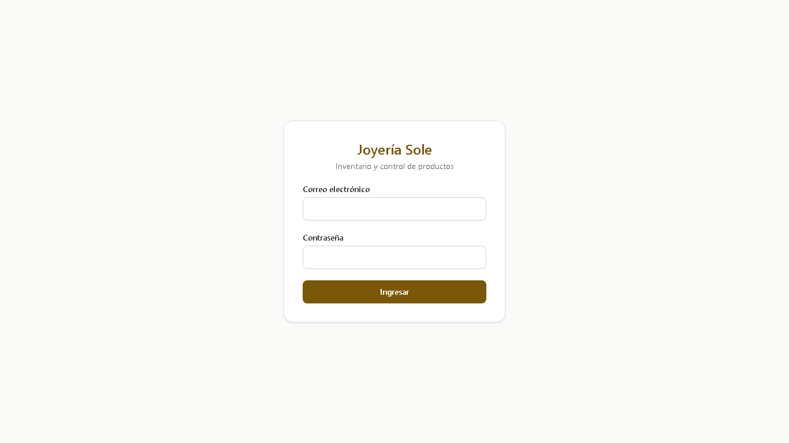
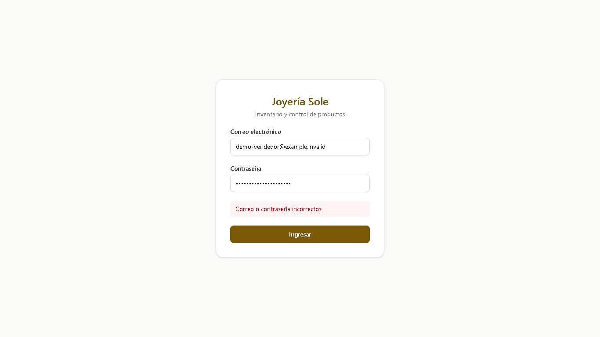
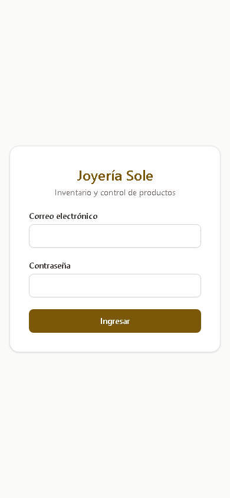
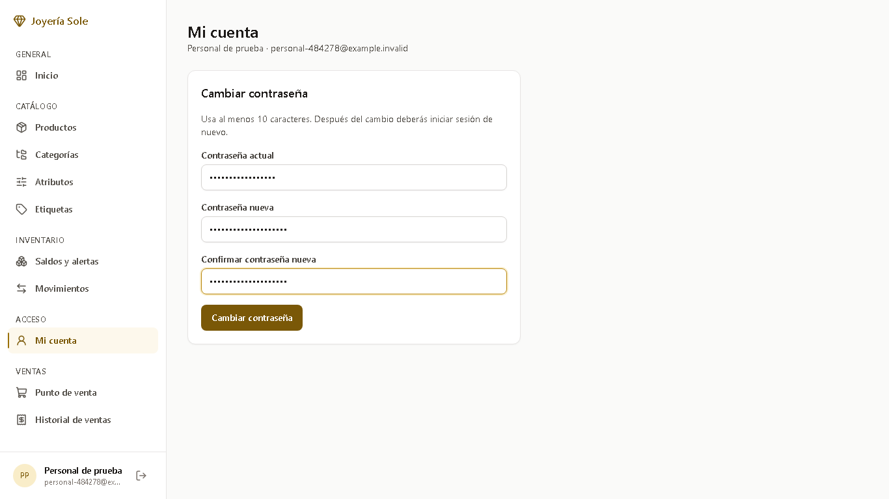

# Tutorial de uso — Joyería Sole

Guía para el personal de la tienda. Explica, paso a paso y con capturas reales del sistema, qué
puede hacer cada persona según su rol.

> Las capturas se tomaron con **datos de demostración** (productos «DEMO …», usuarios «DEMO …»).
> En la tienda verá sus propios productos, pero las pantallas son las mismas.

## Índice

1. [Qué es el sistema](#qué-es-el-sistema)
2. [Cómo entrar](#cómo-entrar)
3. [Glosario](#glosario)
4. [Quién puede hacer qué (matriz de acceso)](#quién-puede-hacer-qué)
5. Guías por rol:
   - [Administrador](administrador.md)
   - [Responsable de inventario](responsable-inventario.md)
   - [Vendedor](vendedor.md)
6. [Rutina del día, de la semana y periódica](flujos-del-dia.md)
7. [Guía breve de ventas y caja](../guias/ventas-y-caja.md)
8. [Tutorial completo en una sola página (para imprimir)](tutorial-completo.html)

## Qué es el sistema

Es el sistema de **inventario y ventas de mostrador** de la tienda. Sirve para:

- tener el **catálogo** de piezas (categorías, productos, variantes, fotos, etiquetas con código);
- registrar la **mercadería que llega** (ingresos) con sus costos;
- saber **cuántas piezas hay** de cada variante y por qué cambió esa cantidad (movimientos);
- **vender** en el mostrador, cobrar (efectivo, QR, transferencia) e imprimir el comprobante;
- **abrir y cerrar la caja** del día con su arqueo;
- **contar** el inventario físico y corregir diferencias con autorización;
- dejar **registro de quién hizo qué** (auditoría).

No es un sistema de facturación: el comprobante es **interno** y **no válido como factura fiscal**.

## Cómo entrar

1. Abra el navegador (Chrome, Edge o Firefox) en la dirección que le dio el Administrador.
2. Escriba su **correo** y su **contraseña** y pulse **Ingresar**.
3. Si se equivoca, aparece «Correo o contraseña incorrectos». Después de varios intentos fallidos el
   sistema espera un momento antes de dejarle probar otra vez.
4. Para salir, pulse **Salir** (arriba a la derecha). Hágalo siempre si la computadora es
   compartida.





También funciona en el celular: el menú se abre con el botón **Abrir menú**.



### Cambiar su contraseña

1. En el menú, **Acceso → Mi cuenta**.
2. Escriba la **contraseña actual**, la **nueva** (mínimo 10 caracteres) y repítala.
3. Pulse **Cambiar contraseña**.

Si el Administrador le asignó una **contraseña temporal**, el sistema le pedirá cambiarla antes de
dejarle usar cualquier otra pantalla; la nueva debe ser distinta de la temporal.




## Glosario

| Palabra                   | Qué significa                                                                                                                                        |
| ------------------------- | ---------------------------------------------------------------------------------------------------------------------------------------------------- |
| **Producto**              | La ficha general de una pieza, por ejemplo «Anillo Solitario Circona». Tiene categoría, nombre, fotos y atributos.                                   |
| **Variante**              | Cada versión concreta de un producto que se puede vender: por ejemplo la talla 16 en plata. El stock se cuenta **por variante**, nunca por producto. |
| **Pieza**                 | Forma corta de referirse a una variante concreta (lo que el cliente se lleva).                                                                       |
| **SKU**                   | Código interno único de cada variante (por ejemplo `SKU-000123`). Va en la etiqueta y lo lee el lector.                                              |
| **Código de barras**      | Código que también identifica una sola variante. El lector lo «escribe» y pulsa Enter solo.                                                          |
| **Saldo**                 | Cuántas piezas hay ahora de una variante.                                                                                                            |
| **Stock mínimo**          | Cantidad por debajo de la cual el sistema avisa «Bajo mínimo».                                                                                       |
| **Movimiento**            | Cada entrada o salida de piezas (ingreso, venta, ajuste, conteo, cambio). Nunca se borra; es el historial del saldo.                                 |
| **Ingreso de mercadería** | Registro de lo que llegó de un proveedor, con cantidades y costos. **Solo al confirmarlo** sube el stock.                                            |
| **Costo total unitario**  | Precio de compra de la pieza más su parte de los costos adicionales (transporte, aduana…).                                                           |
| **Ajuste**                | Corrección manual del saldo (rotura, pérdida…). Se **solicita** y otra persona autorizada lo **aprueba**; recién entonces cambia el stock.           |
| **Conteo físico**         | Contar las piezas de una categoría «a ciegas» (sin ver lo que dice el sistema). Las diferencias se recuentan y, al aprobar, se ajusta el stock.      |
| **Stock inicial**         | Primera carga de piezas de una variante que todavía no tiene ningún movimiento.                                                                      |
| **Caja**                  | La sesión de cobro del día: se **abre** con un fondo inicial y se **cierra** con el arqueo.                                                          |
| **Fondo inicial**         | Dinero en efectivo con el que se abre la caja.                                                                                                       |
| **Arqueo**                | Contar el efectivo al cerrar y compararlo con lo que el sistema espera (fondo + cobros en efectivo). La diferencia es «sobrante» o «faltante».       |
| **Comprobante**           | Hoja o ticket que se imprime tras una venta. Es interno: **no es factura**. Desde la segunda impresión dice «COPIA».                                 |
| **Incidencia**            | Aviso de que una venta tuvo un problema. Solo deja constancia: **no cambia la venta, el stock ni la caja**.                                          |
| **Auditoría**             | Registro de las acciones importantes: quién, cuándo, qué cambió (antes y después).                                                                   |

## Quién puede hacer qué

Permisos **iniciales** de cada rol (los que trae el sistema). El Administrador puede cambiarlos en
**Acceso → Roles**, salvo tres que son siempre exclusivos del Administrador (corregir cierres de
caja, gestionar incidencias y la configuración). Tomado de `DEFAULT_ROLE_PERMISSIONS` en
`packages/shared/src/permissions.ts`.

| Pantalla o acción                                         | Administrador | Responsable de inventario | Vendedor  |
| --------------------------------------------------------- | :-----------: | :-----------------------: | :-------: |
| Inicio (resumen y bandeja de aprobaciones)                |      sí       |            sí             |    sí¹    |
| Mi cuenta (cambiar contraseña)                            |      sí       |            sí             |    sí     |
| Ver catálogo: productos, ficha, fotos, categorías, atrib. |      sí       |            sí             |    sí     |
| Crear y editar catálogo, fotos, etiquetas                 |      sí       |            sí             |    no     |
| Eliminar una ficha sin movimientos                        |      sí       |            no             |    no     |
| Ver costos de compra                                      |      sí       |            sí             |    no     |
| Solicitar cambios de precio                               |      sí       |            sí             |    no     |
| Aprobar precios / cambiar precio directamente             |      sí       |            sí             |    no     |
| Proveedores (ver y editar)                                |      sí       |            sí             |    no     |
| Ingresos de mercadería (ver, registrar)                   |      sí       |            sí             |    no     |
| Confirmar ingresos (sube el stock)                        |      sí       |            sí             |    no     |
| Saldos y alertas, movimientos                             |      sí       |            sí             |    sí     |
| Cargar stock inicial                                      |      sí       |            sí             |    no     |
| Solicitar ajustes                                         |      sí       |            sí             |    no     |
| Aprobar o rechazar ajustes                                |      sí       |            sí             |    no     |
| Registrar cambios de pieza                                |      sí       |            sí             |    no     |
| Conteo físico (crear, capturar, aprobar)                  |      sí       |            sí             |    no     |
| Punto de venta (vender)                                   |      sí       |            sí             |    sí²    |
| Historial de ventas                                       |     todas     |           todas           | las suyas |
| Caja: ver, abrir y cerrar                                 |      sí       |            sí             |    no     |
| Corregir un cierre de caja                                |      sí       |            no             |    no     |
| Reportar una incidencia de venta                          |      sí       |            sí             |    sí     |
| Ver y cerrar incidencias                                  |      sí       |            no             |    no     |
| Tipos de costo y datos del negocio (configuración)        |      sí       |            no             |    no     |
| Usuarios y roles                                          |      sí       |            no             |    no     |
| Auditoría                                                 |      sí       |            no             |    no     |

¹ El Vendedor ve el resumen de inventario; la bandeja de aprobaciones solo aparece a quien puede
aprobar algo.
² Que vendan los tres roles es un **valor por defecto, pendiente de confirmación** (D-01), igual que
que el Vendedor vea solo sus ventas (D-02).

Si entra por la dirección a una pantalla que su rol no tiene, verá «No tiene permiso para ver esta
sección.». La seguridad la aplica el servidor: ocultar el menú es solo una ayuda visual.

## Valores pendientes de confirmación

Algunas reglas de ventas y caja funcionan hoy con un **valor por defecto, pendiente de confirmación**
por parte del responsable (lista D-01 a D-19 en `docs/business/PENDIENTES.md`). En las guías se
marcan así. Las más visibles para el personal:

- D-01 / D-02: quién vende y quién ve qué ventas.
- D-05: el fondo inicial acepta 0 escrito (vacío no vale).
- D-07 / D-08: datos del negocio en el comprobante (provisionales; se muestran los vigentes).
- D-09: tres medios de pago (Efectivo, QR, Transferencia); la referencia es opcional y no se imprime.
- D-10 / D-11: incidencias dentro del sistema y sus tipos.
- D-12: el arqueo **no es ciego** (quien cierra ve el esperado).
- D-15 / D-16: hasta 50 líneas por venta; sin descuentos ni clientes ni fecha retroactiva.
- D-18: una caja puede quedar abierta de un día a otro; no se cierra sola.
- D-19: «COPIA» desde la segunda impresión.

## Cómo se generaron las capturas

Con la prueba automática `apps/web/e2e/tutorial-capturas.spec.ts` sobre una base de datos de
demostración temporal. No corre con las pruebas normales; para regenerarlas (PowerShell):

```powershell
$env:TUTORIAL_CAPTURES='1'; npm run qa -- e2e tutorial-capturas.spec.ts
```
