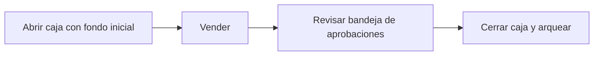

# Rutina del día, de la semana y periódica

[← Índice del tutorial](README.md)

## Cada día

| Momento             | Quién                       | Qué hacer                                                                                              | Guía                                                                |
| ------------------- | --------------------------- | ------------------------------------------------------------------------------------------------------ | ------------------------------------------------------------------- |
| Al abrir la tienda  | Responsable o Administrador | **Ventas → Caja → Abrir caja** con el fondo contado.                                                   | [Abrir caja](responsable-inventario.md#7-caja-abrir-y-cerrar)       |
| Durante el día      | Todos los que venden        | Vender con el lector; revisar antes de confirmar; imprimir el comprobante.                             | [Vender](vendedor.md#3-vender)                                      |
| Si algo sale mal    | Quien vendió                | Reportar una **incidencia** desde la venta (no cambia nada).                                           | [Incidencias](vendedor.md#5-reportar-una-incidencia)                |
| Durante el día      | Administrador / Responsable | Revisar en **Inicio** la bandeja de aprobaciones (ajustes y precios).                                  | [Aprobaciones](administrador.md#1-inicio-y-bandeja-de-aprobaciones) |
| Al cerrar la tienda | Responsable o Administrador | **Ventas → Caja → Cerrar caja**: contar todo el efectivo, explicar la diferencia si la hay, confirmar. | [Cerrar caja](responsable-inventario.md#7-caja-abrir-y-cerrar)      |
| Después del cierre  | Administrador               | Revisar incidencias abiertas y, si hubo un error de captura, corregir el cierre.                       | [Corregir cierre](administrador.md#8-caja)                          |

La caja no se cierra sola y puede quedar abierta de un día a otro: **valor por defecto, pendiente de
confirmación** (D-18). Lo recomendable es cerrarla cada día.

## Cada semana (o cuando llega mercadería)

| Qué                | Quién                       | Pasos                                                                                |
| ------------------ | --------------------------- | ------------------------------------------------------------------------------------ |
| Registrar ingresos | Responsable                 | Borrador → ítems → costos → **Confirmar** el mismo día que llega la mercadería.      |
| Fotos y etiquetas  | Responsable                 | Completar fichas nuevas (fotos, descripción) e imprimir etiquetas con código.        |
| Revisar precios    | Responsable / Administrador | **Precios**: piezas sin precio, ganancia contra el costo nuevo; aprobar solicitudes. |
| Revisar alertas    | Responsable                 | **Saldos y alertas**: piezas sin stock o bajo mínimo para reponer.                   |
| Revisar auditoría  | Administrador               | **Auditoría**: cambios importantes de la semana.                                     |

## Periódicamente (por ejemplo, cada mes por categoría)

| Qué               | Quién         | Pasos                                                                                           |
| ----------------- | ------------- | ----------------------------------------------------------------------------------------------- |
| Conteo físico     | Responsable   | Crear conteo de una categoría → contar a ciegas → segundo recuento → aprobar (ajusta el stock). |
| Usuarios          | Administrador | Desactivar a quien ya no trabaja en la tienda; revisar roles.                                   |
| Datos del negocio | Administrador | Verificar dirección, teléfono y NIT del comprobante.                                            |

La frecuencia y el alcance del conteo físico están **pendientes de confirmación** (P-13).
